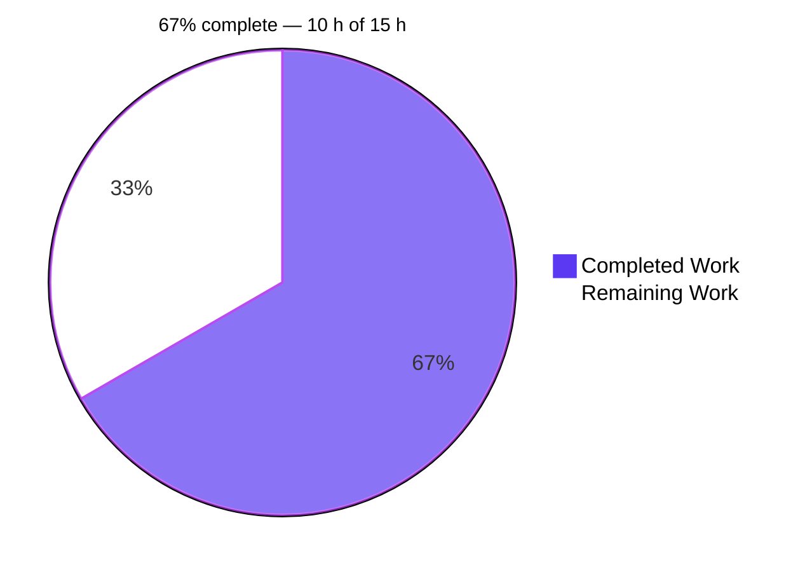

# 1. Executive Summary

## 1.1 Project Overview

The project is a small FastAPI task service: owners create, list, complete and delete their own tasks behind a static bearer token, with state held in process. This release is its documentation — `README.md` now states how to install and run the service, and the ASGI entry point carries a one-line summary of what it serves. Two files change; request handling, dependencies and tests do not.

## 1.2 Completion Status



| Metric | Hours |
|---|---|
| Total Hours | 15 |
| Completed Hours (Baseline: Human with agentic-assist) | 10 |
| Remaining Hours | 5 |

Completion = Completed ÷ (Completed + Remaining) = 10 ÷ (10 + 5) = 66.7%, expressed as 67%.

## 1.3 Key Accomplishments

- ✅ `README.md` is a 13-line guide: project name, `pip install -r requirements.txt`, `uvicorn app.main:app --reload`.
- ✅ The entry point carries a one-line summary of the four task operations and their bearer gate (`app/main.py:7`).
- ✅ Both documented commands run: the install resolves 21 packages cleanly, the run command boots on `127.0.0.1:8000`.
- ✅ The documented API was driven end to end: create `201`, list `200`, complete `200`, delete `204`, values verbatim.
- ✅ Every task route refuses unauthenticated and invalid-token calls with `401`, leaving state unchanged.
- ✅ The README's project name is the title the service serves (`/openapi.json`, 37 characters).
- ✅ The served surface is exactly four documented paths and five operations, with nothing added.
- ✅ The suite passes 12 of 12 and the tree compiles.

## 1.4 Critical Unresolved Issues

All five request requirements are delivered. Six items remain open, none of them unfinished request work: three are content the three-item ceiling excluded, one is an unexercised check, one a maintainability guard, one a product decision.

| Issue | Impact | Owner | ETA |
|---|---|---|---|
| README states no authentication prerequisite — task routes need `Authorization: Bearer <demo token>` | A reader following the README reaches only `401`s and concludes the API is broken | Documentation owner | 1.0 h |
| README states no environment prerequisite — no Python floor (resolved dependencies require ≥ 3.11) and no guidance to install into a virtualenv rather than the shared interpreter | Install succeeds only on a compatible interpreter and mutates shared site-packages when one is not isolated | Documentation owner | 1.0 h |
| The only documented run command is the development setting `--reload` (single worker, file watcher) | Operators have no documented production invocation | Documentation owner | 0.5 h |
| A `--reload` file-change restart was never induced — the reloader starts and supervises, but a restart is unverified | The documented flag's restart behaviour is accepted rather than proven | QA | 0.5 h |
| Nothing in the repository verifies the documented claims (no test, lint or link check reads `README.md`) | The README's name, install target or run target can drift from the code silently | QA / developer | 2.0 h |
| The predecessor file's production-safety warning ("synthetic fixture … do not deploy it or use real credentials") was removed and not replaced | Nothing warns against running the fixture as production software | Product owner (decision) | Decision only |

## 1.5 Access Issues

No access issues identified: the service reads no environment variable or secret and needs no database, queue or third-party API, so nothing outside the repository has to be provisioned.

## 1.6 Recommended Next Steps

1. **[High]** Add the authentication and environment prerequisites — bearer header with the demo tokens, Python ≥ 3.11, an activated virtualenv, the repository root.
2. **[High]** Add a test asserting the README heading equals the application title and both command targets exist.
3. **[Medium]** Document a non-reloader invocation, and induce one `--reload` restart so the flag is proven.
4. **[Medium]** Declare the bearer scheme and the 120-character title limit in the API schema.
5. **[Low]** Decide whether a production-safety warning returns, and replace the demo tokens and in-process store before any non-demo deployment.

# 2. Project Hours Breakdown

## 2.1 Completed Work Detail

| Component | Hours | Description |
|---|---|---|
| Entry-point comment (`app/main.py:7`) | 2.5 | Inventoried the five routes, chose the application object as the one element that handles every request, composed a single-summary line in the module's own `#` form, and proved the declaration and every other line unchanged. |
| README body (`README.md:1-13`) | 2.5 | Removed three conflict markers and a duplicate competing title, derived the install and run commands from the manifest and the ASGI callable, and held the three-item body to 13 of the available 15 lines. |
| Minimal-diff discipline and frozen-file preservation | 1.0 | One insertion and zero deletions in `app/main.py`; the exception handler, security middleware and five routes left byte-identical; no reindentation, reorder or rename anywhere. |
| Static verification and documentation-claim verification | 1.5 | Compile and import checks, manifest resolution, byte-identity of both delivered files, and verification that the documented name equals the application title and that both documented command targets exist. |
| Runtime verification of the documented commands and API | 2.0 | Executed the install and the run command as written, then drove `/health`, the four task operations with verbatim round trips, the bearer gate, the served schema and the `/docs` surface. |
| Delivery acceptance audit | 0.5 | Change-set attribution per commit, forbidden-artifact sweep, comment verdicts for both comment sites, and merge-readiness checks. |
| **Total** | **10.0** | Matches Completed Hours in Section 1.2. |

## 2.2 Remaining Work Detail

| Category | Hours | Priority |
|---|---|---|
| Reader prerequisites — authentication (bearer header and demo tokens) and environment (Python ≥ 3.11, activated virtualenv, repository root as working directory) written into the documentation | 2.0 | High |
| Production run guidance — a documented non-reloader invocation, plus one induced `--reload` restart so the documented flag is verified | 1.0 | Medium |
| Documentation drift guard — a test asserting the README heading equals the application title and that both documented command targets exist | 2.0 | Medium |
| **Total** | **5.0** | Matches Remaining Hours in Section 1.2 and the "Remaining Work" value in Section 7. |

These three categories are the path from a mergeable documentation change to documentation a new reader can actually operate the service from. None of them is unfinished request work: the request's three-item content ceiling is what excludes the first two, so closing them needs the product owner's agreement to widen the README beyond the name, install command and run command it asked for.

## 2.3 Hours Reconciliation

| Check | Value |
|---|---|
| Section 2.1 completed total | 10.0 h |
| Section 2.2 remaining total | 5.0 h |
| Section 2.1 + Section 2.2 | 15.0 h |
| Section 1.2 Total Hours | 15.0 h |
| Section 1.2 Remaining Hours = Section 2.2 total = Section 7 "Remaining Work" | 5.0 h |
| Completion percentage (10.0 ÷ 15.0) | 66.7% → 67% |

# 3. Test Results

Every number below was produced by running the suite and the service in this checkout (`pytest -q` from the repository root, then the documented run command against a live process). No coverage tool and no security scanner is configured in this repository, so no coverage figure and no scan result is claimed anywhere in this guide.

| Area / Category | Framework | Tests | Passed | Failed | Coverage | What This Proves |
|---|---|---|---|---|---|---|
| Service-layer unit tests (`tests/unit/test_services.py`) | pytest 9.2.0 | 4 | 4 | 0 | Not measured | Whitespace normalisation, blank-title and over-120-character rejection, and non-owner completion refusal are enforced in the service layer. |
| API integration tests (`tests/integration/test_task_api.py`) | pytest + FastAPI TestClient | 3 | 3 | 0 | Not measured | Create-then-list round trips, cross-user `403` on complete, and delete removing the task all hold over HTTP. |
| End-to-end lifecycle (`tests/e2e/test_user_journeys.py`) | pytest + FastAPI TestClient | 1 | 1 | 0 | Not measured | One session can create, list, complete and delete a task through the public routes. |
| Non-functional guards (`tests/non_functional/test_security_resilience.py`) | pytest + FastAPI TestClient | 4 | 4 | 0 | Not measured | `x-content-type-options: nosniff` and `x-frame-options: DENY` are present, missing and invalid tokens get `401`, and `/health` answers in under a second. |
| Compile and import gate | `compileall` / `py_compile` | 1 gate | 1 | 0 | n/a | The application package and the test tree compile, and `app.main` imports cleanly. |
| Documented commands, live | uvicorn + curl | 4 probes | 4 | 0 | n/a | The README's install command resolves the declared ranges and its run command boots the service and serves `/health` with `200`. |
| Task API, live | curl against the running service | 8 probes | 8 | 0 | n/a | Create `201`, list `200`, complete `200`, delete `204`, list-after-delete `[]`, `401` with no token, `401` with a wrong token, and `x-content-type-options`/`x-frame-options` present on a refused request. |
| Served documentation surface | curl + Chrome with console and network capture | 5 checks | 5 | 0 | n/a | `/openapi.json` advertises the README's title and exactly four paths / five operations; `/docs` renders those five operations with no JavaScript error; undocumented paths return the stock `404`. |

Suite totals observed: **12 automated tests, 12 passed, 0 failed, 1 warning** (a third-party `StarletteDeprecationWarning` from `fastapi/testclient.py`), completing in 0.04 s — unit 4, integration 3, end-to-end 1, non-functional 4. The compile gate exits 0. The 17 live probes and browser checks above were executed against a service booted with the documented command and shut down cleanly afterwards.

**Not Covered** — capabilities delivered or present that no test exercises, and what a human should check before release:

- **Coverage depth**: no coverage tool is configured, so there is no measured statement of which lines the 12 tests reach; the suite is documented in `docs/coverage_intent.md` as intentionally incomplete.
- **Concurrency, rate limiting, pagination, input fuzzing, audit logging and sustained load**: named as gaps in `docs/coverage_intent.md` and outside the suite. Simultaneous creates were observed to receive distinct ids, but nothing asserts it.
- **The exception handler's 500 envelope** (`app/main.py:29-32`, which returns `str(exc)`): no test drives an unhandled error, so the disclosure surface is unmeasured.
- **Security headers on error responses**: asserted by the suite only for `/health`; a `401` response was checked by hand, not by a test.
- **Documentation↔code agreement**: nothing in the repository reads `README.md`, so the heading-to-title and command-to-target relationships are unguarded.
- **The `/docs` page, the OpenAPI document and the `--reload` restart**: verified manually and by browser inspection, but asserted by no test.
- **Any UI beyond `/docs`**: the project ships no frontend, so no screen, flow or responsive behaviour exists to test.

# 4. Runtime Validation & UI Verification

The service was booted from a clean start with the command the README documents and driven over HTTP and in Chrome. Everything below was observed in this checkout; nothing is inferred from the code alone.

- ✅ **Boot and health** — `uvicorn app.main:app --reload` starts the reloader and server ("Application startup complete."), binds `127.0.0.1:8000`, and answers `GET /health` with `200 {"status":"ok"}`; shutdown stops both processes and releases the port.
- ✅ **Authentication** — a task request with no header returns `401 {"detail":"missing bearer token"}`, a wrong token returns `401 {"detail":"invalid token"}`, and a demo token returns `200`; refused calls change no state.
- ✅ **Task lifecycle** — create `201 {"id":1,"title":"Release sign-off","owner":"alice","completed":false}`, list `200` with the same object, complete `200` with `completed:true`, delete `204` with a zero-byte body, list afterwards `200 []`.
- ✅ **Ownership scoping** — each token sees only its own tasks, and a second principal acting on another owner's task is refused with `403 {"detail":"not task owner"}`.
- ✅ **Served schema** — `/openapi.json` declares `info.title` as `Proactive Insights Full-Coverage Demo` (37 characters, identical to the README heading) and exactly four paths / five operations.
- ✅ **Response headers** — `x-content-type-options: nosniff` and `x-frame-options: DENY` are present on successful and refused responses alike.
- ✅ **Undocumented routes** — unknown paths return the framework's stock `404 {"detail":"Not Found"}` and undocumented methods return `405`; no catch-all, extra endpoint or handler was added.
- ✅ **Docs UI** — `/docs` renders in Chrome as "Proactive Insights Full-Coverage Demo - Swagger UI" listing exactly the five operations and the three schema models, with no JavaScript error and no failed asset request.
- ⚠ **Docs UI authentication** — the document declares no security scheme, so there is no Authorize control, and Swagger UI drops the optional `authorization` header parameter: Try-it-out on `GET /tasks` transmits only `accept: */*` and returns `401` even with a token typed into the field. Authenticated calls have to be driven with `curl` or a page-level fetch.
- ⚠ **Persistence** — the store is a process-local dictionary, so a restart empties the task list; the documentation states no persistence boundary.

**Never exercised at runtime:** a `--reload` file-change restart (the watcher starts and supervises the repository root, but no restart was induced); login, token issuance and logout (no such endpoints exist — the tokens are static); any front-end (the project ships no HTML, JavaScript or assets, so `/docs` is its only browser surface); concurrency beyond simultaneous creates, rate limiting, pagination, input fuzzing, audit logging and sustained load; the `500` path of the exception handler; and any deployed environment — there is no container, reverse proxy, TLS termination or process supervisor in the repository. There is no external integration of any kind: the service reads no environment variable, secret, database, cache or third-party API.

# 5. Compliance & Quality Review

## 5.1 Compliance Matrix

| # | Deliverable | Benchmark | Status | Progress |
|---|---|---|---|---|
| 1 | `README.md` content | Holds the project name, install command and run command in that order; body under 15 lines; no contributing, license, testing, deployment, architecture or table-of-contents section | 🟢 PASS | 13 of 15 lines; 0 prohibited sections |
| 2 | `README.md` fidelity | Content matches the agreed body exactly | 🟢 PASS | 13 lines / 148 B, byte-identical |
| 3 | Entry-point comment | One line, one summary, no tags, no examples, directly above the declaration | 🟢 PASS | 1 line, 79 characters, above `app/main.py:8` |
| 4 | Both delivered files | Smallest diff: no unrelated refactor, reformat or rename | 🟢 PASS | `app/main.py` +1/−0; README replaced whole as required |
| 5 | Frozen application surface | Exception handler, security middleware and all five routes untouched | 🟢 PASS | Byte-identical to the pre-change file |
| 6 | Change-set hygiene | No CONTRIBUTING, CHANGELOG, LICENSE, lockfile, diagram, badge, or `docs/`/`tests/` change | 🟢 PASS | 0 of 6 categories present |
| 7 | Dependency integrity | No dependency, lockfile or documentation tool added; four declared ranges unchanged in value | 🟢 PASS | Same four ranges; no lockfile |
| 8 | Documentation accuracy | Every documented claim is true of the code | 🟢 PASS | 3 of 3 claims verified at a file and line |
| 9 | Test gate | The repository's suite passes | 🟢 PASS | 12 of 12, exit 0 |
| 10 | Compile gate | Application and tests compile and import | 🟢 PASS | `compileall` exit 0 |
| 11 | Manifest integrity | `requirements.txt` and `pytest.ini` left exactly as found | 🟡 PARTIAL (sanctioned) | Both re-laid from single-line literal-`\n` files; values unchanged, `pythonpath = .` added |
| 12 | Documentation operability | A new reader can install, run and exercise the service from the documentation alone | 🟡 PARTIAL | 6 open items recorded in Section 1.4 |

## 5.2 AAP & Rule Divergences and Gaps

Three departures from the agreed plan exist, and each is sanctioned by a source that ranks above the clause it departs from. No departure from the request's own directives exists beyond the first, and the request carries no separate rules to violate.

| What the AAP/Rule Required | What Was Delivered Instead | Why It Diverged | Impact | Remediation |
|---|---|---|---|---|
| A one-line JSDoc single-summary comment above "the request handler" in `server.js`, with no `@param`, `@returns`, multi-paragraph description or examples | A one-line Python `#` summary above the ASGI application object at `app/main.py:7`; no `server.js` exists | Sanctioned by the agreed placement decision: request handling lives in `app/main.py`, `/** */` with JSDoc tags is not valid Python and would break the module, and the module declares five routes so only the application object handles every request | None on behaviour; a reader expecting JavaScript syntax finds the module's own `#` convention instead | None — placement and form are the agreed decision |
| `requirements.txt` and `pytest.ini` stay exactly as they are, and nothing outside the two-file map is modified | `requirements.txt` re-laid from one physical line of literal `\n` into four lines (+4/−1); `pytest.ini` re-laid into five lines with `pythonpath = .` added (+5/−1) | Sanctioned by the project's environment definition, which governs over the frozen-file clause: both files shipped corrupted — the four pins and the pytest keys sat on one line containing literal backslash-n, which pip cannot parse and which breaks the very install command the README documents — and pytest cannot import the `app` package without `pythonpath = .` | The branch diff shows five paths instead of two; dependency values and every previous pytest key are unchanged | None — keep the repaired files |
| No other file created | `.gitignore` added (11 lines covering `.venv/`, `venv/`, `__pycache__/`, `*.py[cod]`, `*.egg-info/`, `.pytest_cache/`, `.coverage*`, `htmlcov/` and the capture directories) | Sanctioned by the project's environment definition, which requires it: without it the virtualenv, bytecode caches and browser captures dirty the working tree and can be committed | One added path in the diff; no runtime or documentation effect | None |

**Comment form and placement.** The request named `server.js` and a JSDoc comment, and the repository has neither: request handling is the ASGI application object declared in `app/main.py:8`, five route functions follow it, and `/** */` delimiters with JSDoc tags are not valid Python. The delivered line therefore takes the module's own single-line form — `# Serves the task API: create, list, complete, delete behind bearer-token auth.` at `app/main.py:7` — sitting directly above the declaration it annotates, with one sentence, no tags and no example. The wording is summary rather than exhaustive: its subject is the task API, and it does not enumerate the unauthenticated `GET /health` liveness probe or the framework's `/docs` and `/openapi.json` surfaces. A human should confirm this satisfies the intent of the original request before the documentation is called finished.

**Repaired manifests and the added ignore file.** The pre-change `requirements.txt` and `pytest.ini` were each one physical line containing literal `\n` sequences — four dependency pins and four pytest keys that no tool could parse, visible with `git show 279d651:requirements.txt | od -c`. Making them real files was a precondition for the documentation itself: the README's `pip install -r requirements.txt` is the repository's install command, and the suite only collects with `pythonpath = .` present. The repair preserved all four dependency ranges and every previous pytest key, so no behaviour or version moved, but it does widen the branch diff from the two files the request named to five. Whoever reviews the change set should read the three extra paths as environment repair rather than scope creep.

# 6. Risk Assessment

Risks below are forward-looking: what can still go wrong once this code is operated. The remaining-work items in Section 2.2 are not repeated here except where the same subject carries a distinct production risk.

| Risk | Category | Severity | Probability | Mitigation | Status |
|---|---|---|---|---|---|
| The service is not production software: hardcoded demo tokens (`app/main.py:9`), a process-local `InMemoryStore` that loses every task on restart and cannot be shared across workers (`app/store.py`), and an exception handler that returns `str(exc)` in the 500 body (`app/main.py:32`), disclosing internal detail on any unhandled error | Security | High if deployed | High if deployed outside a demo | Replace the token map with a real identity store and rotation, move state to a persistent store, return a generic 500 envelope, and keep this fixture away from production data | Open — accepted, deliberately retained as the fixture's evaluation weakness |
| Token guessing is unthrottled: the two short static tokens are compared in the request path with no rate limiting, lockout or authentication audit trail anywhere in the service | Security | High if exposed publicly | Medium | Put a real identity provider in front, add rate limiting and authentication logging, and retire the static map | Open — accepted with the fixture |
| Documentation drift: nothing in the repository reads `README.md`, so the heading, the install target or the run target can diverge from `app/main.py:8` and `requirements.txt` without a failing gate | Technical | Low | High | Add the drift guard test described in Section 2.2 | Open |
| Development server presented as the run command: `--reload` with a single worker, no interface, port or supervision guidance, and no health-based restart policy | Operational | Medium | Medium | Document and adopt a non-reloader invocation with workers behind a supervisor | Open |
| Schema looser than enforcement: `TaskRequest.title` declares `min_length=1` with no maximum while `app/services.py:8-9` rejects over 120 characters with `400`, and no operation documents its `401`, so a generated client can emit requests the server rejects and `/docs` labels the real refusal "Undocumented" | Integration | Low | Medium | Declare `max_length=120` on the model and `responses={401: ...}` on the task routes | Open — pre-existing, outside this request's scope |
| Swagger UI cannot exercise an authenticated call: no security scheme is declared, so there is no Authorize control and Try-it-out transmits only `accept: */*` regardless of what is typed into the optional `authorization` parameter | Integration | Low | High (reproducible) | Declare an `HTTPBearer` security scheme and depend on it in the task routes | Open — pre-existing, outside this request's scope |
| Third-party deprecation in the only gate: `fastapi.testclient` emits a `StarletteDeprecationWarning` advising `httpx2` under pytest 9; the suite passes 12 of 12 today, but the dependency pair will break on a future major | Technical | Low | Medium | Track the upstream change and refresh the `httpx` range when FastAPI supports it | Open — warning only |

# 7. Visual Project Status


| Status | Hours | Share |
|---|---|---|
| Completed Work (Dark Blue `#5B39F3`) | 10 | 67% |
| Remaining Work (White `#FFFFFF`) | 5 | 33% |
| **Total** | **15** | **100%** |

**Remaining hours by category** (from Section 2.2, totalling 5):

| Category | Hours | Priority |
|---|---|---|
| Reader prerequisites — authentication and environment | 2.0 | High |
| Production run guidance and reloader verification | 1.0 | Medium |
| Documentation drift guard | 2.0 | Medium |
| **Total** | **5.0** | |

**Requirement status:** 17 of 18 agreed requirements delivered as specified, 1 delivered with a sanctioned exception (the manifest repair in Section 5.2), 0 not started. Every request requirement is delivered; the remaining hours are the path from a mergeable documentation change to documentation a newcomer can operate the service from.

# 8. Summary & Recommendations

This release documents a small FastAPI task service that previously had none: `README.md` now carries the project name and the two commands needed to install and run it in 13 lines, and the ASGI entry point carries a one-line summary of the four task operations and the bearer-token gate that protects them (`app/main.py:7`). Both files hold exactly the agreed content, the rest of the application is byte-identical to what it was, and nothing outside the two files changed except the environment repair recorded in Section 5.2.

The documented behaviour was proven rather than asserted. The install command resolves the four declared ranges with a clean dependency check, the run command boots the service on `127.0.0.1:8000` and answers `/health` with `200`, and the four operations the comment names work through the routes it describes: create `201`, list `200`, complete `200`, delete `204`, with field values round-tripping verbatim and each token seeing only its own tasks. Every task route refuses an unauthenticated or invalid-token request with `401` and changes no state, the served title equals the README heading character for character, and the API advertises exactly four paths and five operations with no catch-all or added handler. The suite passes 12 of 12 and the tree compiles.

| Measure | Result |
|---|---|
| AAP-scoped completion | 67% (10 h completed of 15 h) |
| Requirements delivered as specified | 17 of 18 (1 sanctioned exception) |
| Request requirements open | 0 of 5 |
| Tests observed passing | 12 of 12 |
| Documented claims verified true | 3 of 3 |
| Open items tracked | 6 |

Five hours remain, and they are the difference between documentation that is correct and documentation a newcomer can operate from: the authentication prerequisite and the environment prerequisite are absent, the only run command given is the development `--reload` invocation, and nothing guards the README against drifting from the code. The critical path runs in that order — prerequisites first, because a reader who cannot authenticate never reaches the operations the README's audience came for; production guidance next; the drift guard last, since it protects work that is already correct. Widening the README past the three items the request named needs the product owner's agreement, and so does the question of whether a production-safety warning returns to the documentation.

**Production readiness:** the documentation change is ready to merge — both files match the agreed content, the documented commands and operations were exercised against a live service, and the application surface did not move. The service it documents is not production software: tokens are hardcoded demo values, state is lost on restart, and the exception handler exposes exception text. That is the fixture's deliberate design and outside this change; the recommendation is to merge the documentation, schedule the five hours before calling it finished, and treat productionising the service as a separate decision with its own scope.

# 9. Development Guide

Every command below was run against this checkout and the observed output is quoted with it.

## 9.1 System Prerequisites

- **Python 3.11 or newer.** The resolved dependency set requires it: fastapi 0.165.0 and starlette 1.10.0 declare `Requires-Python >= 3.11`, uvicorn 0.54.0, pydantic 2.14.4 and pytest 9.2.0 declare `>= 3.10`. The application also uses `str | None` annotations.
- **No other service.** There is no database, cache, queue, message broker or third-party API. State lives in a process-local `InMemoryStore` (`app/store.py`), so nothing has to be provisioned and no data survives a restart.
- **No configuration.** The application reads no environment variable and no secret, so there is nothing to export before starting it.

## 9.2 Environment Setup

Run everything from the repository root: both documented commands resolve paths relative to it.

```bash
cd <repository root>
python3 -m venv .venv
source .venv/bin/activate
```

A virtualenv keeps the project's dependencies out of the system interpreter, which may already carry some of them; installing without one writes into shared package directories instead of the project's own environment.

## 9.3 Dependency Installation

```bash
pip install -r requirements.txt
pip check
```

Observed: the install completes in roughly ten seconds over 21 distributions and exits 0; `pip check` prints `No broken requirements found.` The resolved versions were fastapi 0.165.0, starlette 1.10.0, pydantic 2.14.4, uvicorn 0.54.0, pytest 9.2.0 and httpx 0.28.1.

## 9.4 Application Startup

Development, with the file watcher (the command the README documents):

```bash
uvicorn app.main:app --reload
```

Observed output:

```
INFO:     Will watch for changes in these directories: ['<repository root>']
INFO:     Uvicorn running on http://127.0.0.1:8000 (Press CTRL+C to quit)
INFO:     Started reloader process [9921] using StatReload
INFO:     Started server process [9923]
INFO:     Application startup complete.
```

Production-style, without the reloader, on a chosen interface and port with more than one worker:

```bash
uvicorn app.main:app --host 0.0.0.0 --port 8000 --workers 2
```

Stop either with `CTRL+C`; the reloader and its server process shut down together and release the port.

## 9.5 Verification Steps

```bash
curl -s http://127.0.0.1:8000/health
# {"status":"ok"}

curl -s http://127.0.0.1:8000/openapi.json | python3 -c "import json,sys; d=json.load(sys.stdin); print(d['info']['title'], len(d['info']['title']), sorted(d['paths']))"
# Proactive Insights Full-Coverage Demo 37 ['/health', '/tasks', '/tasks/{task_id}', '/tasks/{task_id}/complete']

python -m compileall -q app tests
# exit 0, no output
```

The Swagger UI is served at `http://127.0.0.1:8000/docs`. It renders the five operations, but it cannot send the bearer token — see 9.8.

## 9.6 Example Usage

Every task route requires a bearer token. The two demo tokens are declared in `app/main.py:9`; the header must use the `Bearer` scheme followed by exactly one space.

```bash
# create — 201
curl -s -X POST http://127.0.0.1:8000/tasks \
  -H 'Authorization: Bearer demo-alice' \
  -H 'Content-Type: application/json' \
  -d '{"title":"Release sign-off"}'
# {"id":1,"title":"Release sign-off","owner":"alice","completed":false}

# list — 200
curl -s http://127.0.0.1:8000/tasks -H 'Authorization: Bearer demo-alice'
# [{"id":1,"title":"Release sign-off","owner":"alice","completed":false}]

# complete — 200
curl -s -X POST http://127.0.0.1:8000/tasks/1/complete -H 'Authorization: Bearer demo-alice'
# {"id":1,"title":"Release sign-off","owner":"alice","completed":true}

# delete — 204, empty body
curl -s -o /dev/null -w '%{http_code}\n' -X DELETE http://127.0.0.1:8000/tasks/1 -H 'Authorization: Bearer demo-alice'
# 204

# no token — 401
curl -s http://127.0.0.1:8000/tasks
# {"detail":"missing bearer token"}

# unknown token — 401
curl -s http://127.0.0.1:8000/tasks -H 'Authorization: Bearer nope'
# {"detail":"invalid token"}
```

The second demo token behaves the same way and sees only its own tasks. A request for another owner's task is refused with `403 {"detail":"not task owner"}`, and an unknown task id returns `404 {"detail":"task not found"}`.

## 9.7 Running the Test Suite

```bash
pytest -q
```

Observed: `12 passed, 1 warning in 0.04s` — 4 unit, 3 integration, 1 end-to-end and 4 non-functional tests. The warning is a third-party `StarletteDeprecationWarning` from `fastapi/testclient.py` advising `httpx2`; it does not affect the result. `pytest.ini` sets `testpaths = tests` and `pythonpath = .`, so the console script imports the `app` package without an editable install — keep that line.

## 9.8 Troubleshooting

| Symptom | Cause and resolution |
|---|---|
| `ModuleNotFoundError: No module named 'app'` | The command was run outside the repository root. Both documented commands are repository-root commands; `cd` into the checkout first. |
| `401 {"detail":"missing bearer token"}` | No `Authorization` header, or the header does not start with `Bearer ` exactly (scheme case and a single space matter). Add `-H 'Authorization: Bearer demo-alice'`. |
| `401 {"detail":"invalid token"}` | The token is not one of the two entries in `TOKENS` (`app/main.py:9`). |
| Swagger UI's Try-it-out always returns `401` | The API declares no security scheme, so `/docs` shows no Authorize control and silently drops the value typed into the `authorization` parameter. Use `curl` or a page-level `fetch` to send the header. |
| `ERROR: [Errno 98] address already in use` | Another process holds `127.0.0.1:8000`. Start on another port, e.g. `uvicorn app.main:app --port 8001`. |
| The task list is empty after a restart | Expected: the store is a process-local dictionary and holds no persistence boundary. Create a task inside the same process lifetime you intend to read it in. |
| `pytest` collects nothing or fails to import `app` | Run it from the repository root and keep `pythonpath = .` in `pytest.ini`. |
| `requirements.txt` or `pytest.ini` appears as a single line containing literal `\n` | The file is corrupted; restore real line breaks before use. The delivered files are proper multi-line files. |
| `400 {"detail":"title is too long"}` | Titles are normalised to 120 characters maximum, counted after whitespace collapsing. |

# 10. Appendices

## A. Command Reference

| Purpose | Command | Run from |
|---|---|---|
| Create an isolated environment | `python3 -m venv .venv && source .venv/bin/activate` | repository root |
| Install dependencies | `pip install -r requirements.txt` | repository root |
| Verify dependencies | `pip check` | repository root |
| Compile everything | `python -m compileall -q app tests` | repository root |
| Run in development | `uvicorn app.main:app --reload` | repository root |
| Run without the reloader | `uvicorn app.main:app --host 0.0.0.0 --port 8000 --workers 2` | repository root |
| Run the suite | `pytest -q` | repository root |
| Health probe | `curl -s http://127.0.0.1:8000/health` | anywhere |
| Served schema | `curl -s http://127.0.0.1:8000/openapi.json` | anywhere |
| Create a task | `curl -s -X POST http://127.0.0.1:8000/tasks -H 'Authorization: Bearer demo-alice' -H 'Content-Type: application/json' -d '{"title":"x"}'` | anywhere |

## B. Port Reference

| Port | Use | Notes |
|---|---|---|
| 8000 | The service's HTTP port | uvicorn's default; the documented run command binds `127.0.0.1:8000`. One process per port: a second instance needs `--port`. |

No other port is bound, and no outbound connection is made at runtime.

## C. Key File Locations

| Path | Contents |
|---|---|
| `app/main.py` | Application object, demo token map, request model, bearer gate, security-header middleware, exception handler, five routes |
| `app/store.py` | `InMemoryStore` and the module-level `store` singleton |
| `app/services.py` | `normalize_title`, `create_task`, `complete_task` |
| `tests/conftest.py` | `client` fixture that clears the store before each test |
| `tests/unit/`, `tests/integration/`, `tests/e2e/`, `tests/non_functional/` | 4, 3, 1 and 4 tests respectively |
| `docs/coverage_intent.md` | Maps the four test layers to their files and names the suite's intentional gaps |
| `README.md` | Project name, install command, run command |
| `requirements.txt`, `pytest.ini`, `.gitignore` | Four declared dependency ranges; pytest configuration with `pythonpath = .`; ignore rules for environments, caches and captures |

## D. Technology Versions

| Component | Version | Source |
|---|---|---|
| Python | 3.13.18 installed; 3.11 minimum | interpreter / resolved dependency metadata |
| fastapi | 0.165.0 | resolved from `fastapi>=0.110,<1.0` |
| starlette | 1.10.0 | transitive via fastapi |
| pydantic | 2.14.4 (pydantic-core 2.50.5) | transitive via fastapi |
| uvicorn | 0.54.0 | resolved from `uvicorn>=0.27` |
| pytest | 9.2.0 | resolved from `pytest>=8.0` |
| httpx | 0.28.1 | resolved from `httpx>=0.27` |
| anyio / h11 / httpcore | 4.16.0 / 0.16.0 / 1.0.9 | transitive |

## E. Environment Variable Reference

None. The application and the tests read no environment variable, and no secret is required; the demo tokens are declared in code at `app/main.py:9`.

## F. Developer Tools Guide

| Tool | Role here |
|---|---|
| `pytest` | The only automated gate in the repository; configured by `pytest.ini` (`testpaths = tests`, `python_files = test_*.py`, `addopts = -ra`, `pythonpath = .`). No linter, type checker, coverage tool or security scanner is configured, so none of their results may be claimed. |
| `uvicorn` | ASGI server; `--reload` supervises the repository root with `StatReload`, `--workers` scales processes without the reloader. |
| `compileall` | Byte-compiles `app` and `tests`; exits non-zero on a syntax error. |
| `curl` | The practical way to exercise the API, since `/docs` cannot send the bearer token. |
| Swagger UI (`/docs`) | Read-only exploration of the five operations and the served schema; not usable for authenticated calls here. |

## G. Glossary

| Term | Meaning in this project |
|---|---|
| ASGI | The asynchronous server interface uvicorn serves; `app` in `app/main.py` is the ASGI application object. |
| Bearer token | The credential sent as `Authorization: Bearer <token>`; two static demo tokens map to the owners `alice` and `bob`. |
| OpenAPI / Swagger UI | The machine-readable API description served at `/openapi.json` and the interactive page at `/docs` rendered from it. |
| `InMemoryStore` | The process-local task store; it holds tasks in a dictionary and loses them when the process exits. |
| Reloader | uvicorn's `--reload` supervisor, which watches the working directory and restarts the server process on file changes. |
| Normalisation | `normalize_title`'s trimming and internal whitespace collapsing, applied before the 120-character limit is checked. |
| Owner scope | Each token maps to one owner, and listings and mutations are restricted to that owner's tasks. |
