# Technical Specification

# 1. Introduction

## 1.1 Executive Summary

**Overview.** `proactive_insights_full_coverage_demo` is a synthetic FastAPI task-management API built to serve as a test fixture for Blitzy Proactive Insights (`README.md` lines 2–4: "Synthetic FastAPI test fixture for Blitzy Proactive Insights"). Thirteen tracked files comprise the entire project: a three-module application package under `app/` (`main.py`, `services.py`, `store.py`, plus an empty `__init__.py`), a four-tier pytest suite under `tests/`, one coverage-intent note in `docs/coverage_intent.md`, and three root-level files (`README.md`, `pytest.ini`, `requirements.txt`). The repository contains no build system, container definition, CI pipeline, dependency lock, database, or static asset.

**Core business problem.** A coverage report is only meaningful if the repository it describes contains code and tests that can be attributed unambiguously to each category being reported. This repository supplies that attribution by construction: `docs/coverage_intent.md` (lines 3–8) maps each of the four Proactive Insights categories — unit, integration, end-to-end, non-functional — to one named evidence file, and line 10 records the coverage the suite deliberately omits (concurrency, rate limiting, pagination, input fuzzing, audit logging, sustained-load behaviour) so that missing coverage reads as a decision rather than an oversight. The problem being solved is therefore verification: it gives the scanning workflow a small, deterministic target whose expected findings are known in advance, so a scan's output can be judged correct rather than merely plausible.

**Key stakeholders and users.**

| Stakeholder | Interest in this repository | Where it is satisfied |
|---|---|---|
| Proactive Insights scan operators | A repository connected at its root, on branch `main`, with the environment initially unset (`README.md` line 24) | The full checkout; `main` exists in `git branch` |
| QA engineers and test authors | One isolated, named evidence file per testing tier | `tests/unit/`, `tests/integration/`, `tests/e2e/`, `tests/non_functional/` |
| Reviewers of coverage claims | Provenance for each category and an explicit gap list | `docs/coverage_intent.md` lines 3–10 |
| API consumers (two demo personas, `alice` and `bob`) | Owner-scoped private task lists | `TOKENS` at `app/main.py:8`; `InMemoryStore.list_for` at `app/store.py:15-16` |

**Expected business impact and value proposition.**

- **Deterministic verification target.** All state is a single process-wide `InMemoryStore` (`app/store.py:21`), and `tests/conftest.py:6-10` clears it before every test, so id-based and count-based expectations are reproducible without fixtures, fixtures files or a database.
- **Known-answer expectations.** Each behaviour a scan can observe is pinned by an executable assertion: 201 on create, 401 on missing or unknown token, 403 on cross-owner completion or deletion, 404 on unknown task, 400 on invalid title, 204 on delete (`tests/integration/test_task_api.py`, `tests/non_functional/test_security_resilience.py`, `tests/e2e/test_user_journeys.py`).
- **Minimal operational footprint.** Four unpinned dependency ranges (`requirements.txt`), an ASGI entry point (`app.main:app`), in-process test transport, and no external service of any kind — the fixture can be scanned or run without infrastructure.
- **Explicit risk boundary.** The README's closing line states the fixture is "not production software", uses in-memory storage and demo credentials, and must not be deployed or given real credentials (`README.md` line 26). The value delivered is assurance about the scanner's coverage judgement, not end-user task-management functionality.


## 1.2 System Overview

### 1.2.1 Project Context

**Business context and market positioning.** The repository is a tooling artifact rather than a commercial product: it carries no packaging metadata, no version number, no license file and no release process among its thirteen tracked files, and the README positions it solely as a "Synthetic FastAPI test fixture for Blitzy Proactive Insights" (`README.md` line 4). Its functional stand-in subject is a task tracker — the smallest application shape that still exercises authentication, ownership, validation, mutation and deletion. The README defines exactly two operating modes for it: local execution (`python -m venv .venv`, `pip install -r requirements.txt`, `uvicorn app.main:app --reload`, interactive docs at `http://127.0.0.1:8000/docs` — lines 12–19) and evaluation by a scan ("Connect the repository root, select `main`, and initially leave the environment unset" — line 24). The `main` branch the latter instruction names exists in the checkout alongside `2211_01`.

**Current system limitations.** No predecessor system is replaced or upgraded; `git log` shows only three commits (`2eee6fe` Initial commit, `1788ffc` Add proactive insights full coverage demo, `279d651` Merge remote changes with full coverage demo), and nothing in the tree is a migration of earlier functionality. What the design does encode is a set of deliberate simplifications whose consequences bound what the fixture can demonstrate:

| Simplification | Implementation | Consequence |
|---|---|---|
| In-process storage | `store = InMemoryStore()` at `app/store.py:21`, one module-level instance imported by both the app and the tests | No durability: state vanishes on restart and is not shared across worker processes |
| Unsynchronized store | `InMemoryStore` holds a plain `dict` and counter with no lock (`app/store.py:1-19`) | Not thread-safe under concurrent requests; recorded as the "concurrency" coverage gap in `docs/coverage_intent.md` line 10 |
| Static credentials | `TOKENS = {"demo-alice": "alice", "demo-bob": "bob"}` (`app/main.py:8`), looked up verbatim in `current_user` (`app/main.py:13-19`) | No expiry, signature, rotation or revocation; identity is fixed at import time |
| No pagination or filtering | `list_for(owner)` returns every matching record in insertion order (`app/store.py:15-16`) | Listing cost grows with the number of tasks; recorded as the "pagination" gap |
| Error-detail disclosure | `error_handler` returns `{"detail": str(exc)}` with status 500 (`app/main.py:28-31`), annotated "Intentional weakness for scanner evaluation" at line 30 | Internal exception text reaches clients by design |
| Unpinned dependencies | Four ranges only — `fastapi>=0.110,<1.0`, `uvicorn>=0.27`, `pytest>=8.0`, `httpx>=0.27` (`requirements.txt`) | No lock file or constraints; resolved versions can drift between environments |

**Integration with existing enterprise landscape.** The project stands alone. `app/` imports only `fastapi`, `pydantic`, and its own `app.store` / `app.services` modules (`app/main.py:1-5`); no database driver, HTTP client, message broker, cache, logging, metrics or tracing library appears anywhere in the package. The sole integration surface is JSON over ASGI HTTP, and the only external system the repository names is the Proactive Insights scan that reads the checkout (`README.md` line 24). Authentication is likewise self-contained: `current_user` compares the bearer token against the literal table rather than calling an identity provider, so there is no federation or directory coupling to configure.

### 1.2.2 High-Level Description

**Primary system capabilities.** Five routes, one middleware and one exception handler constitute the entire externally observable behaviour.

| Capability | Interface | Observed contract |
|---|---|---|
| Liveness probe | `GET /health` (`app/main.py:33-35`) | Unauthenticated; returns `{"status": "ok"}` with 200 |
| Create task | `POST /tasks` (`app/main.py:37-43`) | 201 with the stored record `{id, title, owner, completed: false}`; id assigned by the store starting at 1 |
| List own tasks | `GET /tasks` (`app/main.py:45-47`) | 200 with the caller's records only, in insertion order; `[]` when none |
| Complete task | `POST /tasks/{task_id}/complete` (`app/main.py:49-56`) | 200 with the record and `completed: true`; 404 for unknown id, 403 for a non-owner |
| Delete task | `DELETE /tasks/{task_id}` (`app/main.py:58-66`) | 204 with an empty body; 404 for unknown id, 403 for a non-owner; removal is permanent |
| Authentication | `current_user` (`app/main.py:13-19`) | `Authorization: Bearer demo-alice` or `demo-bob`; 401 "missing bearer token" / 401 "invalid token" otherwise |
| Response hardening | `security_headers` middleware (`app/main.py:21-26`) | Stamps `X-Content-Type-Options: nosniff` and `X-Frame-Options: DENY` on every response |
| Uniform error envelope | `error_handler` (`app/main.py:28-31`) | Any unhandled exception becomes a 500 JSON body carrying `str(exc)` |

**Major system components.**

| Component | Location | Responsibility |
|---|---|---|
| ASGI application | `app/main.py:7` — `app = FastAPI(title="Proactive Insights Full-Coverage Demo")` | Owns every route, the middleware, the exception handler and the token table |
| Domain rules | `app/services.py` (19 lines, three functions) | Title normalization, 120-character limit, empty-title rejection, ownership check on completion |
| Persistence | `app/store.py` (21 lines, `InMemoryStore`) | `create`, `get`, `list_for`, `delete` over a dict keyed by monotonically increasing integer id |
| Package marker | `app/__init__.py` (0 bytes) | Makes `app.main`, `app.services`, `app.store` importable; contributes no behaviour |
| Test suite | `tests/` — `conftest.py` plus `unit/`, `integration/`, `e2e/`, `non_functional/` | Twelve test functions across four tiers; single `client` fixture that resets the store |
| Coverage policy | `docs/coverage_intent.md` | Maps each testing category to its evidence file and names six deliberate gaps |
| Tooling configuration | `pytest.ini`, `requirements.txt` | Test discovery paths and dependency ranges |

**Core technical approach.** The application is a three-layer, one-way dependency chain — routes in `main.py` call functions in `services.py`, which call methods on the `store` singleton in `store.py`. Nothing flows back upward: `services.py` accepts the store as an untyped duck-typed parameter, which is what lets `tests/unit/test_services.py` pass fresh `InMemoryStore()` instances without touching the module-level one. The app and the store are both created at import time, so tests exercise the very same objects that `uvicorn app.main:app` serves; per-test isolation comes from mutating that shared store (`store.tasks.clear()`, `store.next_id = 1`) rather than from constructing a new application. Validation is deliberately split: shape validation happens in pydantic (`TaskRequest.title: str = Field(min_length=1)`, `app/main.py:10-11`), business validation in `services.py`. Domain exceptions are translated to HTTP status codes at the route boundary:

| Condition | Raised or detected at | HTTP result |
|---|---|---|
| Header absent, or lacking the `Bearer ` prefix | `app/main.py:14-15` | 401 `missing bearer token` |
| Token not present in `TOKENS` | `app/main.py:16-18` | 401 `invalid token` |
| Body title empty or missing | `TaskRequest` (`app/main.py:10-11`) | 422 from pydantic validation |
| Title empty after whitespace collapse | `app/services.py:6-7` via `app/main.py:42-43` | 400 `title cannot be empty` |
| Title exceeds 120 characters | `app/services.py:8-9` via `app/main.py:42-43` | 400 `title is too long` |
| Complete or delete an unknown id | `app/services.py:14-15`; `app/main.py:62-63` | 404 `task not found` |
| Complete or delete another owner's task | `app/services.py:16-17`; `app/main.py:64-65` | 403 `not task owner` |
| Any unhandled exception | `app/main.py:28-31` | 500 with the exception text |

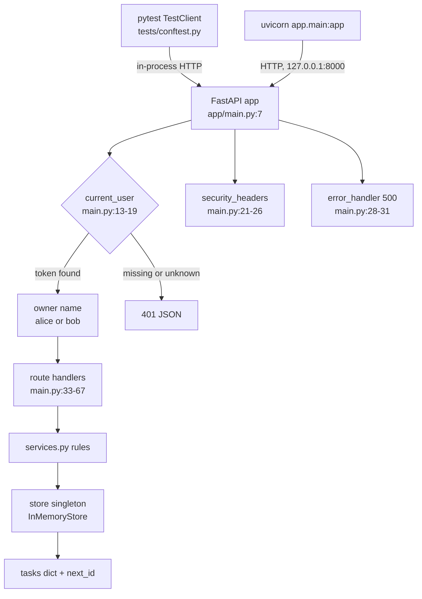

**Repository state at the time of writing.** Three defects in the checked-in project files are visible in the tree and affect how the fixture can be executed:

| Anomaly | Evidence | Effect |
|---|---|---|
| README committed with merge-conflict markers | `README.md:1` (`<<<<<<< HEAD`), line 27 (`=======`), line 29 (`>>>>>>> 2eee6fe...`) | The file renders with conflict markers; the descriptive README and the bare branch title are both present |
| `pytest.ini` encodes its directives as literal `\n` escapes on one physical line | 70-byte single-line file (`testpaths`, `python_files`, `addopts`) | `pytest -q` aborts before collection with `pytest.ini:1: unexpected value continuation` |
| `requirements.txt` uses the same single-line `\n` encoding | 62-byte file holding all four ranges | The four requirements are presented to pip as one line rather than four |

### 1.2.3 Success Criteria

**Measurable objectives.** Every objective below is enforced by an executable assertion in `tests/`; the source column identifies the governing code.

| Objective | Measurable target | Evidence |
|---|---|---|
| Suite is green | All 12 test functions pass under `pytest -q` (`README.md` line 21) | 4 unit, 3 integration, 1 end-to-end, 4 non-functional |
| Valid creation | 201, title echoed verbatim, and the new record appears in the listing | `tests/integration/test_task_api.py:4-8` |
| Full lifecycle | Create → list → complete → delete completes against one server-assigned id, ending at 204 | `tests/e2e/test_user_journeys.py:1-10` |
| Authentication is closed | Unauthenticated and unknown-token requests both return 401 | `tests/non_functional/test_security_resilience.py:6-11` |
| Ownership isolation | A second identity receives 403 when completing or deleting another owner's task | `tests/integration/test_task_api.py:10-13`; `tests/unit/test_services.py:16-20` |
| Title hygiene | Whitespace collapsed; blank and 121-character titles rejected | `tests/unit/test_services.py:5-14`; `app/services.py:1-9` |
| Deletion is permanent | 204 followed by an empty listing | `tests/integration/test_task_api.py:15-19` |
| Response hardening | Both `nosniff` and `DENY` headers present on a plain `/health` response | `tests/non_functional/test_security_resilience.py:1-4`; `app/main.py:21-26` |
| Health responsiveness | `/health` returns 200 within one second | `tests/non_functional/test_security_resilience.py:13-16` |

**Critical success factors.**

- **One object graph for app and tests.** Because `app` and `store` are module-level singletons (`app/main.py:7`, `app/store.py:21`), tests can only stay deterministic if every test starts from a clean store; the single `client` fixture that clears `tasks` and resets `next_id` (`tests/conftest.py:6-10`) is the mechanism the rest of the suite depends on.
- **Server-assigned identity.** Ids come from the store counter, never from the client, so the end-to-end and integration tests can chain calls through `response.json()["id"]`.
- **Layering held intact.** Business rules stay in `services.py` and storage stays in `store.py`, which is what allows the unit tier to test rules with a throwaway store and the other tiers to test the same rules through HTTP.
- **Gaps recorded as policy.** Documented omissions in `docs/coverage_intent.md` line 10 are what make a missing-coverage finding interpretable rather than an apparent defect.
- **Recognised non-production status.** The README's prohibition on deployment and real credentials (`README.md` line 26`) is the control that keeps the static token table and in-memory store acceptable.

**Key performance indicators.** The repository states no availability SLO, throughput target or user-facing latency budget; the only numeric performance threshold it contains is the sub-second `/health` assertion.

| KPI | Definition | Verified by |
|---|---|---|
| Category coverage mapping | 4 of 4 Proactive Insights categories resolve to a named evidence file | `docs/coverage_intent.md:3-8` |
| Test inventory by tier | Unit 4, integration 3, end-to-end 1, non-functional 4 — 12 total | `tests/unit/`, `tests/integration/`, `tests/e2e/`, `tests/non_functional/` |
| Health latency | `GET /health` completes in under 1.0 s | `tests/non_functional/test_security_resilience.py:16` |
| Header coverage | 2 hardening headers on 100% of responses, enforced by middleware rather than per route | `app/main.py:21-26` |
| Declared uncovered areas | Exactly 6 named gaps — concurrency, rate limiting, pagination, input fuzzing, audit logging, sustained-load behaviour | `docs/coverage_intent.md:10` |
| Owner isolation incidents | Zero cross-owner reads or mutations reachable through the five routes | `app/store.py:15-16`, `app/services.py:16-17`, `app/main.py:64-65` |


## 1.3 Scope

### 1.3.1 In-Scope

**Core features and functionalities.**

| Feature | Input | Guaranteed behaviour |
|---|---|---|
| Bearer-token authentication | `Authorization: Bearer demo-alice` or `Bearer demo-bob` (`app/main.py:8,13-19`) | Unknown or missing credential yields 401; the matched value becomes the request's owner |
| Task creation with title hygiene | JSON body `{"title": "..."}` validated by `TaskRequest` (`app/main.py:10-11`) | Whitespace collapsed to single spaces, empty rejected, over 120 characters rejected, stored with `completed: false` and a server-assigned id |
| Owner-scoped listing | `GET /tasks` with a valid token | Only the caller's records, in insertion order; `[]` when the caller owns none |
| Task completion | `POST /tasks/{task_id}/complete` with a valid token | Owner only; sets `completed: true` in place and echoes the record; 404 for unknown id, 403 for another owner |
| Task deletion | `DELETE /tasks/{task_id}` with a valid token | Owner only; 204 and permanent removal; 404 for unknown id, 403 for another owner |
| Uniform response hardening | Every response | `X-Content-Type-Options: nosniff` and `X-Frame-Options: DENY`, applied by middleware (`app/main.py:21-26`) |
| Liveness probe | `GET /health`, unauthenticated | 200 with `{"status": "ok"}` |
| Interactive API documentation | `GET /docs` on a running server | FastAPI's generated OpenAPI UI, as instructed by `README.md` line 19 |

**Primary user workflows.** The single end-to-end journey the suite pins (`tests/e2e/test_user_journeys.py:1-10`) is a task's full lifecycle by one identity:

1. `POST /tasks` with `{"title": "Ship feature"}` and `Authorization: Bearer demo-alice` → 201, body carries `id`.
2. `GET /tasks` as the same identity → the record with that `id` is present.
3. `POST /tasks/{id}/complete` → 200 with `completed: true`.
4. `DELETE /tasks/{id}` → 204, after which the record no longer appears.

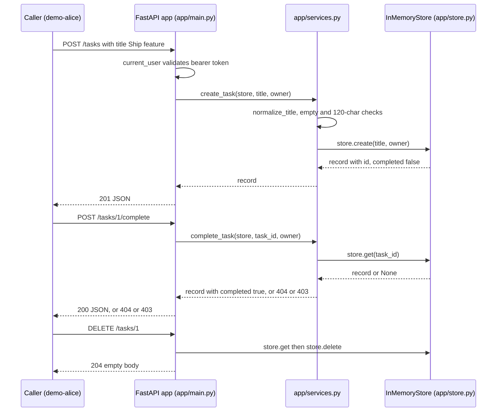

A second journey is exercised only as a negative case: a different identity (`demo-bob`) attempting to complete or delete `demo-alice`'s task receives 403, and because `list_for` filters on `owner`, bob's listing never contains alice's records (`tests/integration/test_task_api.py:10-13`, `app/store.py:15-16`).

**Essential integrations.** None external. The only two integration surfaces inside the project are the ASGI HTTP/JSON contract itself and the in-process test transport — `fastapi.testclient.TestClient` in `tests/conftest.py:2,10`, which drives real routing, validation, dependency and serialization code without sockets, a database, a filesystem or any outbound service. Tooling integration is limited to pytest discovery from `pytest.ini` (`testpaths = tests`, `python_files = test_*.py`, `addopts = -ra`) and dependency declaration in `requirements.txt`.

**Key technical requirements.**

| Requirement | Value | Evidence |
|---|---|---|
| Python version floor | 3.10 or later — inferred from PEP 604 unions in signatures and `str.removeprefix`; no version is declared in the repository | `app/main.py:16,38` |
| Runtime dependencies | `fastapi>=0.110,<1.0`, `uvicorn>=0.27` | `requirements.txt` |
| Test dependencies | `pytest>=8.0`, `httpx>=0.27` (the client behind `TestClient`) | `requirements.txt`; `tests/conftest.py:2` |
| ASGI entry point | `app.main:app` | `README.md` line 17; `app/main.py:7` |
| Wire protocol | JSON over HTTP with a single `Authorization` header; status vocabulary 200, 201, 204, 400, 401, 403, 404, 422, 500 | `app/main.py`; all four test tiers |
| Storage | Process memory only — one `dict` plus one integer counter | `app/store.py:1-21` |

**Implementation boundaries.**

| Dimension | Boundary in this system |
|---|---|
| System boundary | One Python process, one ASGI application object, one in-memory store; no other process, daemon or datastore participates |
| User groups covered | Exactly two hard-coded demo identities, `alice` and `bob`; no registration, directory, role model, or administrative identity exists |
| Geographic and market coverage | Local execution only — the README's documented address is `127.0.0.1:8000`; no environment configuration, deployment target or external exposure is defined |
| Data domains included | One entity, the task record with four fields — `id`, `title`, `owner`, `completed` (`app/store.py:7`); no users, projects, comments, attachments, audit events or settings |

### 1.3.2 Out-of-Scope

**Explicitly excluded capabilities.** `docs/coverage_intent.md` line 10 states that "The suite is intentionally incomplete" and names six gaps; the remaining rows below are absences visible in the code and tracked files.

| Excluded capability | Status in the repository | Recorded at |
|---|---|---|
| Concurrency safety | Store has no lock; `dict` and counter are mutated without synchronisation | `docs/coverage_intent.md:10`; `app/store.py:1-19` |
| Rate limiting | No throttling middleware or counter exists | `docs/coverage_intent.md:10` |
| Pagination | `list_for` returns every matching record; no `limit`/`offset`/cursor parameters | `docs/coverage_intent.md:10`; `app/store.py:15-16` |
| Input fuzzing | Tests call fixed literals; no property-based or fuzz tooling | `docs/coverage_intent.md:10` |
| Audit logging | No logging import anywhere in `app/`; no event records of creates, completions or deletions | `docs/coverage_intent.md:10` |
| Sustained-load behaviour | Only single-request latency is asserted; no load generator or soak test | `docs/coverage_intent.md:10`; `tests/non_functional/test_security_resilience.py:13-16` |
| Durability and multi-worker state | In-memory singleton only; state lost on restart and not shared between workers | `app/store.py:21` |
| Identity management and token lifecycle | Literal two-entry token table; no expiry, signature, rotation or revocation; no registration or password flow | `app/main.py:8,13-19` |
| Task update and single-record read | No `PUT`, `PATCH` or `GET /tasks/{task_id}`; a task cannot be reopened once completed | Route list in `app/main.py:33-67` |
| Packaging, deployment and CI | No `pyproject.toml`, `setup.py`, Dockerfile, pipeline file or lock file among the thirteen tracked files | `git ls-files` |
| Notifications, search, sorting, filtering | No such routes, parameters or services | `app/main.py`, `app/services.py` |

**Future phase considerations.** The repository records no roadmap, backlog or issue list; the only forward-looking statement it contains is the gap list above, framed as "potential gaps". That list, together with the simplifications catalogued in 1.2.1, is the entire documented basis for extension — a successor phase would be defined by promoting one or more of those gaps into a tested category, and by replacing the single-line-encoded `pytest.ini` and `requirements.txt` with parseable, pinned equivalents.

**Integration points not covered.** No database or ORM, no external identity provider, no message broker or queue, no cache, no outbound HTTP client, and no observability backend (logs, metrics, traces) is integrated or stubbed. The Proactive Insights scan itself is described only as instructions ("Connect the repository root, select `main`, and initially leave the environment unset", `README.md` line 24); no API contract, credential, webhook or configuration file for it exists in the repository.

**Unsupported use cases.**

- **Production deployment.** The README explicitly forbids it: the fixture uses in-memory storage and demo credentials and "must not be deployed or used with real credentials" (`README.md` line 26).
- **Real users or real data.** Only the two static demo tokens authenticate; there is no way to add an identity without editing `TOKENS` in `app/main.py:8`, and no data-handling, retention or privacy control exists.
- **Horizontal scaling.** Because state lives in a per-process dictionary, two workers would present two disjoint task sets.
- **Concurrent write safety.** Parallel requests can interleave on `next_id` and the `tasks` dict, so id uniqueness is only guaranteed within a single sequential request stream.
- **Compliance or audit obligations.** With no audit trail and a 500 handler that returns exception text, the system cannot support evidentiary or regulatory reporting.


## 1.4 References

- `README.md` — declared purpose ("Synthetic FastAPI test fixture for Blitzy Proactive Insights"), the four test tiers, run and scan instructions (`main` branch, environment unset), and the non-production disclaimer; also the source of the merge-conflict markers at lines 1, 27 and 29.
- `requirements.txt` — the four unpinned dependency ranges (`fastapi>=0.110,<1.0`, `uvicorn>=0.27`, `pytest>=8.0`, `httpx>=0.27`) and the single-line `\n` encoding defect.
- `pytest.ini` — test discovery configuration (`testpaths = tests`, `python_files = test_*.py`, `addopts = -ra`) and the encoding defect that makes `pytest -q` abort with `pytest.ini:1: unexpected value continuation`.
- `app/` — the complete application package: four flat files, no sub-packages, no external I/O.
- `app/main.py` — `app = FastAPI(...)` at line 7, `TOKENS` at line 8, `TaskRequest` at lines 10-11, `current_user` authentication at 13-19, `security_headers` middleware at 21-26, `error_handler` at 28-31, and the five routes at lines 33-67 with their status-code mappings.
- `app/services.py` — title normalization, the empty-title and 120-character rules, and the `LookupError`/`PermissionError` ownership contract for completion.
- `app/store.py` — `InMemoryStore` (`create`, `get`, `list_for`, `delete`), the four-field task record at line 7, insertion-ordered owner filtering at 15-16, and the process-wide `store` singleton at line 21.
- `app/__init__.py` — empty package marker establishing the `app.main` / `app.services` / `app.store` import paths.
- `tests/` — the single pytest suite: one shared `conftest.py` plus four single-file tier packages, twelve test functions in total.
- `tests/conftest.py` — the only fixture (`client`), which clears `store.tasks`, resets `store.next_id = 1` and returns a `TestClient(app)`.
- `tests/unit/test_services.py` — the four domain-rule tests (whitespace collapse, blank title, 121-character title, non-owner completion).
- `tests/integration/test_task_api.py` — create-and-list, cross-owner 403, and hard-deletion assertions against the HTTP API.
- `tests/e2e/test_user_journeys.py` — the single end-to-end lifecycle test (create → list → complete → delete).
- `tests/non_functional/test_security_resilience.py` — hardening-header presence, 401 rejection of missing and invalid tokens, and the sub-second `/health` latency assertion.
- `docs/` — documentation folder containing only the coverage-intent note.
- `docs/coverage_intent.md` — the four-category-to-evidence-file mapping (lines 3-8) and the six declared coverage gaps (line 10).
- Repository git metadata (`git ls-files`, `git log`, `git branch`) — the 13-file tracked inventory, the three-commit history (`2eee6fe`, `1788ffc`, `279d651`), and the presence of branches `main` and `2211_01`.


# 2. Product Requirements

## 2.1 Feature Catalog

The catalog below enumerates every feature the repository actually implements. The inventory is exhaustive rather than illustrative: a text search of all thirteen tracked files finds exactly five route decorators (`app/main.py:33`, `:37`, `:45`, `:49`, `:58`), one HTTP middleware (`app/main.py:21`), one exception handler (`app/main.py:28`), one persistence class (`app/store.py:1`) and one test suite (`tests/`). No feature is listed that the code does not implement, and no implemented capability is left out.

Priorities reflect what the fixture cannot demonstrate without the feature: authentication, creation, listing and persistence are **Critical** because every other task route depends on them; completion, deletion, hardening and the test suite are **High**; the error envelope is **Medium** because it exists to model a weakness rather than to satisfy a functional need. Every feature carries status **Completed** — each is implemented in `app/` and exercised by `tests/`, with the two execution caveats recorded in 2.6.2.

### 2.1.1 Feature Index

| ID | Feature name | Category | Priority / Status |
|---|---|---|---|
| F-001 | Health Probe Endpoint | Platform Health | High / Completed |
| F-002 | Bearer-Token Authentication and Identity Binding | Security | Critical / Completed |
| F-003 | Task Creation with Title Hygiene | Task Management | Critical / Completed |
| F-004 | Owner-Scoped Task Listing | Task Management | Critical / Completed |
| F-005 | Task Completion with Ownership Enforcement | Task Management | High / Completed |
| F-006 | Task Deletion with Ownership Enforcement | Task Management | High / Completed |
| F-007 | Response Security Header Hardening | Security | High / Completed |
| F-008 | Uniform Error Handling Envelope | Error Handling | Medium / Completed |
| F-009 | In-Memory Task Persistence with Server-Assigned Identifiers | Data Management | Critical / Completed |
| F-010 | Four-Tier Automated Test Suite with Declared Coverage Intent | Quality Assurance | High / Completed |

### 2.1.2 F-001 — Health Probe Endpoint

| Attribute | Value |
|---|---|
| Unique ID | F-001 |
| Feature name | Health Probe Endpoint |
| Category | Platform Health |
| Priority | High |
| Status | Completed (implemented at `app/main.py:33-35`, covered by `tests/non_functional/test_security_resilience.py:1-4` and `:13-16`) |

**Overview.** A single unauthenticated `GET /health` route returns the literal body `{"status": "ok"}`. It is the only route in the application with no bearer-token requirement: `health()` (`app/main.py:34`) declares no parameters, whereas the four `/tasks` routes each declare `authorization: str | None = Header(default=None)`.

**Business Value.** The endpoint gives the fixture a dependency-free liveness signal that a scan or a local operator can hit without credentials, and it supplies the Proactive Insights non-functional tier with a stable target for header and latency assertions (`tests/non_functional/test_security_resilience.py:2`, `:14`).

**User Benefits.** Callers can confirm the process is serving before attempting authenticated work; the README's documented interactive surface (`http://127.0.0.1:8000/docs`, `README.md` line 19) uses the same application object, so a successful `/health` proves routing is live.

**Technical Context.** The route is registered directly on the module-level `app = FastAPI(title="Proactive Insights Full-Coverage Demo")` (`app/main.py:7`) and returns a plain `dict`, which FastAPI serialises to JSON with status 200. Because it bypasses `current_user`, it exercises the routing, serialization and middleware layers without touching `app/store.py`, which is why the two header assertions and the latency assertion in the test suite are made against it.

**Dependencies.** *Prerequisite features:* none. *System dependencies:* the FastAPI application object and its middleware stack (`app/main.py:7`, `:21-26`). *External dependencies:* `fastapi>=0.110,<1.0` only. *Integration requirements:* none beyond HTTP; consumed in-process by `TestClient` (`tests/conftest.py:10`) and over TCP by `uvicorn app.main:app` (`README.md` line 17).

### 2.1.3 F-002 — Bearer-Token Authentication and Identity Binding

| Attribute | Value |
|---|---|
| Unique ID | F-002 |
| Feature name | Bearer-Token Authentication and Identity Binding |
| Category | Security |
| Priority | Critical |
| Status | Completed (implemented at `app/main.py:8`, `:13-19`; covered by `tests/non_functional/test_security_resilience.py:6-11`) |

**Overview.** Every task operation resolves the caller's identity from an `Authorization` header of the form `Bearer demo-alice` or `Bearer demo-bob`, looked up in the static table `TOKENS = {"demo-alice": "alice", "demo-bob": "bob"}` (`app/main.py:8`). A missing header, a header without the exact `Bearer ` prefix, or an unknown token is rejected with 401 before any route body runs (`app/main.py:14-18`). The resulting username becomes the `owner` used for every ownership decision.

**Business Value.** Identity is the mechanism that makes the fixture's ownership requirements — the completion 403, the delete 403 and the owner-filtered listing — demonstrable. Without a resolved owner there is no subject to attribute or protect, so the rest of the API's authorization semantics collapse.

**User Benefits.** A caller sees exactly its own tasks and cannot read, complete or delete another identity's work; a caller with no valid credential learns immediately, with a distinct message for "no token" versus "bad token" (`app/main.py:15`, `:18`).

**Technical Context.** Authentication is implemented as a plain helper, `current_user(authorization)` (`app/main.py:13`), not as a FastAPI dependency: each route declares the header itself and passes it positionally (`app/main.py:39`, `:47`, `:52`, `:60`). The lookup uses `authorization.startswith("Bearer ")` then `str.removeprefix("Bearer ")` (`app/main.py:14`, `:16`), so the scheme name and its single trailing space are matched literally and case-sensitively, and `str.removeprefix` requires Python 3.9 or later. There is no signing, hashing, expiry, rotation or revocation — the token table is fixed at import time, and no HTTP security scheme is declared on the routes, so the generated OpenAPI document describes `authorization` as an ordinary header parameter.

**Dependencies.** *Prerequisite features:* none. *System dependencies:* the `TOKENS` module constant and FastAPI's `Header` and `HTTPException` (`app/main.py:1`, `:8`). *External dependencies:* `fastapi>=0.110,<1.0`. *Integration requirements:* every task route must call `current_user` before touching the store — a convention enforced only by code review, since nothing in the framework compels it.

### 2.1.4 F-003 — Task Creation with Title Hygiene

| Attribute | Value |
|---|---|
| Unique ID | F-003 |
| Feature name | Task Creation with Title Hygiene |
| Category | Task Management |
| Priority | Critical |
| Status | Completed (implemented across `app/main.py:10-11`, `:37-43`, `app/services.py:1-10`, `app/store.py:6-10`; covered by `tests/unit/test_services.py:5-14` and `tests/integration/test_task_api.py:4-8`) |

**Overview.** `POST /tasks` accepts `{"title": "..."}`, normalises the title, applies two length rules, and stores a new record with a server-assigned identifier, the caller's username as `owner`, and `completed: false` (`app/store.py:6-10`). Success is 201 with the stored record echoed verbatim (`app/main.py:37`, `:41`).

**Business Value.** Creation is the entry point of the only workflow the fixture models — a task lifecycle from creation to deletion (`tests/e2e/test_user_journeys.py:1-10`). The layered validation is itself the feature: it demonstrates in one route the split between schema validation (pydantic), domain validation (`app/services.py`) and persistence (`app/store.py`).

**User Benefits.** Callers cannot create meaningless tasks: accidental leading, trailing or repeated whitespace is repaired rather than rejected (`app/services.py:1-2`), while genuinely empty and over-long titles fail with a specific reason (`app/services.py:6-7`, `:8-9`). The created record comes back complete, so the caller never has to re-read it.

**Technical Context.** The request body is `TaskRequest` with `title: str = Field(min_length=1)` (`app/main.py:10-11`), so a missing title or an empty string fails with 422 before any handler code runs; a whitespace-only title passes that check and is caught one layer deeper. The route calls `create_task(store, payload.title, owner)` inside a `try` and maps `ValueError` to `HTTPException(400, str(exc))` (`app/main.py:40-43`), which is why the 400 body carries the raw rule text. `create_task` takes the store as an untyped duck-typed parameter (`app/services.py:4`), so `tests/unit/test_services.py:8-14` can exercise the rules against throwaway `InMemoryStore()` instances instead of the shared singleton.

**Dependencies.** *Prerequisite features:* F-002 (the owner comes from the resolved identity) and F-009 (the record and its id are produced by the store). *System dependencies:* pydantic, FastAPI, and the `create_task` domain function. *External dependencies:* `fastapi>=0.110,<1.0`. *Integration requirements:* the store's `create(title, owner)` contract (`app/store.py:6`).

### 2.1.5 F-004 — Owner-Scoped Task Listing

| Attribute | Value |
|---|---|
| Unique ID | F-004 |
| Feature name | Owner-Scoped Task Listing |
| Category | Task Management |
| Priority | Critical |
| Status | Completed (implemented at `app/main.py:45-47`, `app/store.py:15-16`; covered by `tests/integration/test_task_api.py:4-8`, `:15-19` and `tests/e2e/test_user_journeys.py:6`) |

**Overview.** `GET /tasks` returns the caller's own records as a bare JSON array, in insertion order, and `[]` when the caller owns none (`app/store.py:15-16`). The filter is applied in the store rather than in the route: `main.py:47` passes the resolved username straight into `store.list_for(...)`.

**Business Value.** Tenant-style isolation is visible in one line of code and asserted in two tiers: a second identity's listing never contains the first identity's records, which is what makes the 403 tests meaningful rather than cosmetic.

**User Benefits.** A caller gets one predictable, unpaginated array of its tasks with no envelope to unwrap, so a client can treat the response as the complete set (`tests/integration/test_task_api.py:19` asserts equality with `[]`).

**Technical Context.** `list_for(owner)` is a list comprehension over `self.tasks.values()` filtered on `t["owner"] == owner` (`app/store.py:15-16`), so ordering follows CPython dict insertion order, i.e. ascending id within a single process. There is no `limit`, `offset`, cursor, sort or filter parameter — a deliberate absence recorded as the "pagination" gap in `docs/coverage_intent.md` line 10, and the reason the integration test can assert absolute counts only because the `client` fixture empties the store first (`tests/conftest.py:8`).

**Dependencies.** *Prerequisite features:* F-002 and F-009. *System dependencies:* `store.list_for`, FastAPI's default JSON encoder. *External dependencies:* `fastapi>=0.110,<1.0`. *Integration requirements:* the store must key records by owner; any future change to the record shape must preserve the `owner` field (`app/store.py:7`).

### 2.1.6 F-005 — Task Completion with Ownership Enforcement

| Attribute | Value |
|---|---|
| Unique ID | F-005 |
| Feature name | Task Completion with Ownership Enforcement |
| Category | Task Management |
| Priority | High |
| Status | Completed (implemented at `app/main.py:49-56`, `app/services.py:12-19`; covered by `tests/e2e/test_user_journeys.py:7-9`, `tests/integration/test_task_api.py:10-13`, `tests/unit/test_services.py:16-20`) |

**Overview.** `POST /tasks/{task_id}/complete` flips a task's `completed` flag to `true` and echoes the record with status 200. The rule set lives entirely in the domain layer: an unknown id raises `LookupError("task not found")`, a caller that is not the `owner` raises `PermissionError("not task owner")`, and the route translates those to 404 and 403 (`app/main.py:53-56`).

**Business Value.** This is the state transition that gives a task a lifecycle, and the only place where an authenticated-but-unauthorised caller is refused with 403 on a state change. It is also the clearest demonstration in the repository of domain exceptions being mapped to HTTP status at the route boundary.

**User Benefits.** A caller can close its own task and receives the updated record instead of a confirmation code; a caller cannot close someone else's task, and learns nothing about it beyond the refusal — a non-owner's request is indistinguishable from a nonexistent task only in the 404 case, while a real and foreign task yields 403.

**Technical Context.** `complete_task(store, task_id, owner)` (`app/services.py:12-19`) fetches through `store.get`, raises `LookupError` when the store returns `None`, raises `PermissionError` when `task["owner"] != owner`, then mutates the record in place with `task["completed"] = True` (`app/services.py:18`). No store update method is called: the write is visible because `get` hands back the live dict held in `self.tasks` (`app/store.py:13`). `task_id` is declared `int` in the path (`app/main.py:50`), so a non-numeric path segment is rejected with 422. There is no guard against completing an already-completed task and no way to reopen one — no `PUT`, `PATCH` or un-complete route exists.

**Dependencies.** *Prerequisite features:* F-002 (owner resolution), F-003 (a task must exist to complete) and F-009 (lookup and in-place mutation). *System dependencies:* `store.get`, `store.create`. *External dependencies:* `fastapi>=0.110,<1.0`. *Integration requirements:* the record must remain a mutable dict with an `owner` key, since both the ownership test and the in-place write depend on it.

### 2.1.7 F-006 — Task Deletion with Ownership Enforcement

| Attribute | Value |
|---|---|
| Unique ID | F-006 |
| Feature name | Task Deletion with Ownership Enforcement |
| Category | Task Management |
| Priority | High |
| Status | Completed (implemented at `app/main.py:58-66`, `app/store.py:18-19`; covered by `tests/integration/test_task_api.py:15-19` and `tests/e2e/test_user_journeys.py:10`) |

**Overview.** `DELETE /tasks/{task_id}` removes a task permanently and answers 204 with an empty body. An unknown id yields 404 `task not found`, a non-owner yields 403 `not task owner` (`app/main.py:62-65`).

**Business Value.** Deletion closes the lifecycle and gives the fixture a hard-removal path, which is what lets the end-to-end test prove that a completed task can still be removed and that removal is total rather than a status flag.

**User Benefits.** A caller can erase its own task with no body to parse, and can rely on the record being gone from subsequent listings (`tests/integration/test_task_api.py:19`).

**Technical Context.** Unlike completion, the ownership rule is implemented inside the route: `delete` calls `current_user`, then `store.get`, then compares `task["owner"]` with the caller before calling `store.delete(task_id)` (`app/main.py:60-66`). It therefore bypasses `app/services.py` entirely — the same rule exists in two places in two styles (`app/services.py:16-17` versus `app/main.py:64-65`) and the two error messages coincide by duplication, not by sharing. `store.delete` pops with a `None` default and returns `True` only when something was removed (`app/store.py:18-19`); the route discards that boolean, having already proven existence with `get`. Because the declared status is 204 (`app/main.py:58`), FastAPI sends no body.

**Dependencies.** *Prerequisite features:* F-002 and F-009. *System dependencies:* `store.get`, `store.delete`. *External dependencies:* `fastapi>=0.110,<1.0`. *Integration requirements:* none beyond the store contract; no cascade, tombstone or audit record is produced, so nothing downstream must be notified.

### 2.1.8 F-007 — Response Security Header Hardening

| Attribute | Value |
|---|---|
| Unique ID | F-007 |
| Feature name | Response Security Header Hardening |
| Category | Security |
| Priority | High |
| Status | Completed (implemented at `app/main.py:21-26`; covered by `tests/non_functional/test_security_resilience.py:1-4`) |

**Overview.** An HTTP middleware awaits the route and then stamps `X-Content-Type-Options: nosniff` and `X-Frame-Options: DENY` onto the response object (`app/main.py:24-25`). Because it is registered with `@app.middleware("http")` (`app/main.py:21`), the behaviour is global: no route sets these headers itself.

**Business Value.** The fixture needs at least one non-functional control that is genuinely enforced rather than merely described, and a middleware is the smallest honest example: one registration covers every route, present and future.

**User Benefits.** Every browser-facing consumer of the `default` branch receives protection against content-type sniffing and framing without the API author remembering to add it per endpoint.

**Technical Context.** The headers are added after `await call_next(request)` returns (`app/main.py:23-25`), which means the effect is applied to responses that travel back through the middleware stack; the suite asserts both values on a single unauthenticated `GET /health` (`tests/non_functional/test_security_resilience.py:2-4`) and does not assert them on authenticated, error or 500 responses. The 500 response is produced by the separately registered exception handler (`app/main.py:28-31`), so headers on that path are unverified. Header values are literals — no configuration, no `Strict-Transport-Security`, no `Content-Security-Policy`.

**Dependencies.** *Prerequisite features:* none (it wraps all others). *System dependencies:* Starlette's `BaseHTTPMiddleware` behaviour exposed through `@app.middleware("http")`, and the `Request` import (`app/main.py:1`). *External dependencies:* `fastapi>=0.110,<1.0` (which supplies Starlette). *Integration requirements:* the middleware must be registered on the same `app` object that owns the routes, since it is not a reusable component.

### 2.1.9 F-008 — Uniform Error Handling Envelope

| Attribute | Value |
|---|---|
| Unique ID | F-008 |
| Feature name | Uniform Error Handling Envelope |
| Category | Error Handling |
| Priority | Medium |
| Status | Completed (implemented at `app/main.py:28-31`; documented as an intentional weakness at `app/main.py:30`; not covered by any test) |

**Overview.** Any exception that escapes a route is caught by `error_handler`, registered with `@app.exception_handler(Exception)`, and converted to `JSONResponse(status_code=500, content={"detail": str(exc)})` (`app/main.py:28-31`). Expected failures never reach it, because each route translates its own domain exceptions first: `ValueError` to 400 (`app/main.py:42-43`), `LookupError` to 404 and `PermissionError` to 403 (`app/main.py:53-56`), with the delete route raising its own 404 and 403 directly (`app/main.py:62-65`).

**Business Value.** The handler models a realistic and deliberately unsafe pattern so that a scanner has something concrete to report: the in-source comment at `app/main.py:30` — "Intentional weakness for scanner evaluation: exception details are exposed" — states that the disclosure is a fixture objective, not an oversight. It also guarantees that an unexpected failure still returns JSON rather than a bare server error page.

**User Benefits.** Callers always receive a JSON body with a `detail` key on failure, so a client needs only one error-parsing path; the benefit is bought at the cost of internal exception text reaching the caller.

**Technical Context.** `str(exc)` is interpolated into the response body verbatim, so a `KeyError`, `TypeError` or driver message would be returned to the client. Pydantic validation failures (422) and `HTTPException` responses are handled by FastAPI's own handlers and do not reach this one. The handler is synchronous in effect but declared `async` (`app/main.py:29`). Nothing in `tests/` asserts the 500 path, its body shape or its headers.

**Dependencies.** *Prerequisite features:* none, but it stands behind F-003, F-005 and F-006 as their last-resort path. *System dependencies:* FastAPI's `JSONResponse` (`app/main.py:2`). *External dependencies:* `fastapi>=0.110,<1.0`. *Integration requirements:* none; it is registered on the application object and applies process-wide.

### 2.1.10 F-009 — In-Memory Task Persistence with Server-Assigned Identifiers

| Attribute | Value |
|---|---|
| Unique ID | F-009 |
| Feature name | In-Memory Task Persistence with Server-Assigned Identifiers |
| Category | Data Management |
| Priority | Critical |
| Status | Completed (implemented at `app/store.py:1-21`; exercised by all four test tiers) |

**Overview.** `InMemoryStore` holds one `dict` keyed by integer id plus a `next_id` counter starting at 1 (`app/store.py:2-4`), and exposes exactly four operations: `create`, `get`, `list_for`, `delete` (`app/store.py:6-19`). A single instance is created at import time — `store = InMemoryStore()` (`app/store.py:21`) — and imported by both the application (`app/main.py:4`) and the test fixture (`tests/conftest.py:4`).

**Business Value.** This is the only persistence layer the fixture has, and its singleton shape is what makes twelve in-process tests deterministic: clearing `store.tasks` and resetting `store.next_id` (`tests/conftest.py:8-9`) gives every test the same starting world without any database, fixture framework or teardown.

**User Benefits.** Ids are assigned by the server, start at 1 and increase monotonically within the process, so a client never chooses an identifier and can chain calls through the value it receives (`tests/e2e/test_user_journeys.py:5-7`). Reads are immediate — no I/O, no latency budget to manage.

**Technical Context.** The stored record is `{"id", "title", "owner", "completed": False}` (`app/store.py:7`) and is returned by reference, which is why `complete_task` can mutate it without a store update method (`app/services.py:18`). `get` is `self.tasks.get(task_id)` returning `None` for unknown ids (`app/store.py:13`); `list_for` preserves insertion order (`app/store.py:16`); `delete` returns `True` only when a record was actually removed (`app/store.py:19`). The class takes no lock and holds no connection, so it is neither thread-safe nor durable, and state does not span processes — the "concurrency" gap named in `docs/coverage_intent.md` line 10.

**Dependencies.** *Prerequisite features:* none — it is the base of the task features. *System dependencies:* CPython dict semantics and nothing else; `app/store.py` has no imports at all. *External dependencies:* none. *Integration requirements:* the record shape and the `owner` field are consumed by `app/services.py`, `app/main.py` and `tests/`; the module-level `store` name is imported by `app/main.py:4` and `tests/conftest.py:4`, so renaming or relocating it breaks both.

### 2.1.11 F-010 — Four-Tier Automated Test Suite with Declared Coverage Intent

| Attribute | Value |
|---|---|
| Unique ID | F-010 |
| Feature name | Four-Tier Automated Test Suite with Declared Coverage Intent |
| Category | Quality Assurance |
| Priority | High |
| Status | Completed (implemented across `tests/`, `pytest.ini`, `docs/coverage_intent.md`; see 2.6.2 for the runner defect that blocks execution as checked in) |

**Overview.** Twelve test functions in four single-file tiers verify the API: four unit tests calling `app.services` and `app.store` directly (`tests/unit/test_services.py:5-20`), three integration tests plus an `auth` header helper driving HTTP in-process (`tests/integration/test_task_api.py:1-19`), one end-to-end lifecycle test (`tests/e2e/test_user_journeys.py:1-10`), and four non-functional tests for headers, auth rejection and health latency (`tests/non_functional/test_security_resilience.py:1-16`). `docs/coverage_intent.md:3-8` maps each tier to the Proactive Insights category it evidences.

**Business Value.** The suite is the deliverable's purpose: it is the artifact a Proactive Insights scan evaluates, and the coverage-intent document converts unexercised areas into a declared decision (`docs/coverage_intent.md:10` names concurrency, rate limiting, pagination, input fuzzing, audit logging and sustained-load behaviour).

**User Benefits.** A contributor gets one command (`pytest -q`, `README.md` line 21), one shared fixture, and a green/red signal per rule: whitespace collapsing, blank and 121-character rejection, non-owner completion, create-and-list, cross-owner 403, permanent deletion, lifecycle, headers, missing and invalid tokens, and health latency.

**Technical Context.** Every HTTP test depends on the single `client` fixture, which clears the shared store, resets `next_id` to 1 and returns `TestClient(app)` (`tests/conftest.py:6-10`); there are no mocks, markers, parametrisation or `__init__.py` files, and discovery is configured in `pytest.ini` (`testpaths = tests`, `python_files = test_*.py`, `addopts = -ra`). Transport is in-process — real routing, validation, dependency and serialization code, but no sockets, database or filesystem. The asserted exception types are never checked for message text, and several implemented behaviours (the 500 handler, repeat completion, 422 paths, delete-by-non-owner over HTTP) have no test at all.

**Dependencies.** *Prerequisite features:* every feature under test (F-001 through F-009) — the suite has no meaning without them. *System dependencies:* the `store` singleton and the `app` object imported at `tests/conftest.py:3-4`; pytest discovery from `pytest.ini`. *External dependencies:* `pytest>=8.0` and `httpx>=0.27` (the client behind `TestClient`). *Integration requirements:* the fixture's reset relies on `store.tasks` and `store.next_id` remaining public attributes.


## 2.2 Functional Requirements Tables

Conventions applied throughout 2.2. Requirement IDs follow `F-XXX-RQ-YYY`, where `XXX` is the owning feature from 2.1 and `YYY` is sequential within that feature. Priority is `Must-Have`, `Should-Have` or `Could-Have`; complexity is `High`, `Medium` or `Low` and reflects the code that satisfies the requirement as written, not an estimate of future work. Acceptance criteria are stated so that each one is decidable by a named test node or by code inspection of a named line.

Two cross-cutting statements apply to every row and are therefore not repeated in each table:

- **Compliance.** No compliance control exists anywhere in the repository — no audit trail, retention rule, encryption, consent record or PII handling (`docs/coverage_intent.md:10` names audit logging as a gap; `app/store.py` has no imports at all). Every "rules" column below therefore records only the business, data-validation and security rules the code actually implements.
- **Performance.** The repository declares no availability, throughput or latency objective other than the sub-second `/health` assertion at `tests/non_functional/test_security_resilience.py:16`; where a row states "no numeric budget", that absence is the observed fact.

### 2.2.1 F-001 — Health Probe Endpoint

| Requirement ID | Description | Acceptance criteria | Priority / Complexity |
|---|---|---|---|
| F-001-RQ-001 | `GET /health` reports liveness with a fixed JSON body and requires no credentials. | Unauthenticated `GET /health` returns status 200 (`tests/non_functional/test_security_resilience.py:15`) and body `{"status": "ok"}` (`app/main.py:35`). | Must-Have / Low |
| F-001-RQ-002 | The health response completes within one second when driven in process. | `response.elapsed.total_seconds() < 1.0` on a `TestClient` call to `/health` (`tests/non_functional/test_security_resilience.py:16`). | Must-Have / Low |

| Requirement ID | Input parameters → Output / Response | Performance criteria & data requirements | Rules (business / validation / security) |
|---|---|---|---|
| F-001-RQ-001 | No path parameter, no body, no `Authorization` header → 200 with JSON object containing the single key `status` and value `ok`. | No store access and no I/O; the handler is `def health()` with zero parameters (`app/main.py:34`). No data requirements. | Public endpoint: it is the only route that does not call `current_user`, so no identity, ownership or validation rule applies. |
| F-001-RQ-002 | Same request as F-001-RQ-001 → same response, measured client-side by `TestClient`. | Threshold 1.0 s; measured in-process, so the assertion excludes network and server-startup cost. | No business rule; the threshold is the only latency figure the repository states. |

### 2.2.2 F-002 — Bearer-Token Authentication and Identity Binding

| Requirement ID | Description | Acceptance criteria | Priority / Complexity |
|---|---|---|---|
| F-002-RQ-001 | A request with no `Authorization` header, or one not starting with the literal `Bearer `, is rejected before the route body runs. | 401 with `detail` `missing bearer token` (`app/main.py:14-15`); a headerless `GET /tasks` returns 401 (`tests/non_functional/test_security_resilience.py:7`). | Must-Have / Low |
| F-002-RQ-002 | A token that is not a key of `TOKENS` is rejected with a distinct message. | 401 with `detail` `invalid token` (`app/main.py:16-18`); `Bearer invalid` on `GET /tasks` returns 401 (`tests/non_functional/test_security_resilience.py:9-11`). | Must-Have / Low |
| F-002-RQ-003 | A valid token resolves to the username bound to it, and that username becomes the `owner` of every operation in the request. | `demo-alice` resolves to `alice` and `demo-bob` to `bob` (`app/main.py:8`, `:16-19`); ownership consequences observed at `tests/integration/test_task_api.py:10-13`, `tests/unit/test_services.py:16-20`. | Must-Have / Low |
| F-002-RQ-004 | All four `/tasks` routes require a resolved identity; `/health` does not. | Each of `app/main.py:39`, `:47`, `:52`, `:60` calls `current_user` before touching the store; `health()` at `app/main.py:34` does not. | Must-Have / Low |
| F-002-RQ-005 | Authentication is stateless and exact-match: the scheme prefix is case- and space-sensitive and the token comparison has no normalisation. | `authorization.startswith("Bearer ")` then `authorization.removeprefix("Bearer ")` (`app/main.py:14`, `:16`); no stripping, lower-casing or expiry logic exists. | Must-Have / Low |

| Requirement ID | Input parameters → Output / Response | Performance criteria & data requirements | Rules (business / validation / security) |
|---|---|---|---|
| F-002-RQ-001 | Header `authorization: str \| None = Header(default=None)` → raises `HTTPException(401, "missing bearer token")`. | O(1) string prefix test; no data access. | Validation: header presence and the `Bearer ` prefix are both mandatory. Security: the two 401 messages deliberately distinguish "no credential" from "bad credential". |
| F-002-RQ-002 | Same header parameter → raises `HTTPException(401, "invalid token")`. | O(1) dict lookup in a two-entry table (`app/main.py:8`). | Data: the token table is a literal constant fixed at import; there is no expiry, signature, rotation or revocation, and no registration or password flow. |
| F-002-RQ-003 | Header carrying a known token → returns the mapped username to the calling route. | Constant time; no second store or service is consulted. | Security: identity is derived only from the token table — no header other than `Authorization` can assert identity, and there is no role, tenant or scope model above `owner`. |
| F-002-RQ-004 | Any `/tasks` request → the identity check runs before existence, ownership or validation checks. | Not applicable (a guard, not a resource operation). | Business: order of checks means an unauthenticated caller learns nothing about task existence — 401 precedes 404. |
| F-002-RQ-005 | Any `Authorization` value → pass or 401. | Not applicable. | Validation: `bearer demo-alice`, `Bearer  demo-alice` (double space) and `Bearer Demo-Alice` all fail, because the prefix test is literal and the lookup is case-sensitive. |

### 2.2.3 F-003 — Task Creation with Title Hygiene

| Requirement ID | Description | Acceptance criteria | Priority / Complexity |
|---|---|---|---|
| F-003-RQ-001 | `POST /tasks` with a valid token and an acceptable title stores a new task and returns it with status 201. | 201, echoed `title`, record present in the caller's listing (`tests/integration/test_task_api.py:4-8`); response carries `id`, `owner` and `completed: false` (`app/store.py:7`). | Must-Have / Low |
| F-003-RQ-002 | A title is normalised by trimming the ends and collapsing every internal whitespace run to one space before any length rule applies. | `normalize_title("  prepare   release ") == "prepare release"` (`tests/unit/test_services.py:5-6`; `app/services.py:1-2`). | Must-Have / Low |
| F-003-RQ-003 | A title that is empty after normalisation is rejected with a descriptive 400. | `create_task(InMemoryStore(), "  ", "alice")` raises `ValueError` (`tests/unit/test_services.py:8-10`); over HTTP the body is `{"detail": "title cannot be empty"}` with status 400 (`app/services.py:6-7`, `app/main.py:42-43`). | Must-Have / Low |
| F-003-RQ-004 | A title longer than 120 characters after normalisation is rejected with a descriptive 400. | `create_task(…, "x" * 121, …)` raises `ValueError` (`tests/unit/test_services.py:12-14`); over HTTP `{"detail": "title is too long"}` with status 400 (`app/services.py:8-9`). | Must-Have / Low |
| F-003-RQ-005 | A body that omits `title` or supplies an empty string fails schema validation before the handler runs. | `title: str = Field(min_length=1)` (`app/main.py:10-11`) → 422. No test asserts this path. | Must-Have / Low |

| Requirement ID | Input parameters → Output / Response | Performance criteria & data requirements | Rules (business / validation / security) |
|---|---|---|---|
| F-003-RQ-001 | JSON body `{"title": "<string>"}` plus a valid `Authorization` header → 201 with `{id, title, owner, completed}`; `id` from `store.next_id`, `owner` from the token. | O(1) insertion into a dict; no numeric latency budget. Data: one record per task, four fields, no timestamps, description, tags or ordering metadata. | Business: the server, never the client, assigns `id`; `completed` is initialised to `False`; `owner` is the resolved identity. |
| F-003-RQ-002 | `title` string of any length → normalised string returned to the caller. | Two linear passes (`strip`, `split`, `join`); no length cap before normalisation. | Validation: leading, trailing and repeated internal whitespace are repaired, never rejected. |
| F-003-RQ-003 | `title` of `"  "` or any all-whitespace string → 400 `title cannot be empty`. | Not applicable. | Business: a task without a visible title is meaningless, so the rule fires after normalisation rather than before. Security: the rule text is returned verbatim to the caller (`app/main.py:43`). |
| F-003-RQ-004 | Normalised title of 121 or more characters → 400 `title is too long`; 120 characters is accepted. | Limit is the literal `120` at `app/services.py:8`; measured on the normalised value, so whitespace padding does not count towards it. | Validation: a hard cap with no truncation — the caller must shorten the title. |
| F-003-RQ-005 | Body `{}`, `{"title": ""}` or a non-object → 422 from pydantic. | Not applicable. | Validation: schema-level type and minimum-length check, separate from the domain rules that run afterwards — a whitespace-only title passes here and fails at F-003-RQ-003. |

### 2.2.4 F-004 — Owner-Scoped Task Listing

| Requirement ID | Description | Acceptance criteria | Priority / Complexity |
|---|---|---|---|
| F-004-RQ-001 | `GET /tasks` returns only records whose `owner` equals the caller's resolved identity. | Bob's listing never contains alice's records (`app/store.py:15-16`); the same-owner path is asserted at `tests/integration/test_task_api.py:8`. | Must-Have / Low |
| F-004-RQ-002 | Records are returned in insertion order. | Dict iteration order over `self.tasks.values()` (`app/store.py:16`); the end-to-end lifecycle relies on the created id being present, not on position (`tests/e2e/test_user_journeys.py:6`). | Should-Have / Low |
| F-004-RQ-003 | A caller that owns no tasks receives an empty JSON array. | `GET /tasks` returns `[]` after the only task is deleted (`tests/integration/test_task_api.py:19`). | Must-Have / Low |
| F-004-RQ-004 | The response body is a bare JSON array of task records — no envelope, no count, no paging metadata. | `client.get("/tasks", …).json() == []` and `len(...) == 1` are asserted directly (`tests/integration/test_task_api.py:8`, `:19`). | Must-Have / Low |

| Requirement ID | Input parameters → Output / Response | Performance criteria & data requirements | Rules (business / validation / security) |
|---|---|---|---|
| F-004-RQ-001 | Valid `Authorization` header, no query parameters → 200 with JSON array filtered on `owner`. | O(n) scan of every stored task per request; cost grows with the total population, not the caller's own count. | Security: filtering happens in the store (`app/store.py:15-16`), so a route bug cannot leak another owner's records through a different filter argument. |
| F-004-RQ-002 | Same as F-004-RQ-001 → array ordered by ascending id within one process. | Relies on CPython dict insertion order; nothing in the code documents or guarantees ordering across processes. | Business: no sort parameter, and no ordering contract beyond the observed behaviour. |
| F-004-RQ-003 | Same as F-004-RQ-001 for an owner with no records → 200 with `[]`. | List comprehension returns an empty list rather than raising or returning null. | Data: absence is represented as an empty collection, never a 404. |
| F-004-RQ-004 | Same as F-004-RQ-001 → `[{id, title, owner, completed}, …]`. | No pagination, `limit`, `offset`, cursor, sort or filter parameter exists (`app/store.py:15-16`); pagination is a declared gap at `docs/coverage_intent.md:10`. | Security: the `owner` field is echoed inside each record, so a caller can see that the filter is its own identity. |

### 2.2.5 F-005 — Task Completion with Ownership Enforcement

| Requirement ID | Description | Acceptance criteria | Priority / Complexity |
|---|---|---|---|
| F-005-RQ-001 | The owner completes its own task and receives the updated record. | 200 with `completed: true` in the body (`tests/e2e/test_user_journeys.py:8-9`). | Must-Have / Low |
| F-005-RQ-002 | Completing an id that does not exist returns 404. | `LookupError` → `HTTPException(404, "task not found")` (`app/services.py:14-15`, `app/main.py:53-54`); asserted at the domain level by type only (`app/services.py:13-15`), not by any HTTP test. | Must-Have / Low |
| F-005-RQ-003 | A caller that is not the record's owner is refused with 403 and the record is left unmodified. | 403 for bob completing alice's task over HTTP (`tests/integration/test_task_api.py:10-13`) and `PermissionError` at the domain level (`tests/unit/test_services.py:16-20`, `app/services.py:16-17`). | Must-Have / Low |
| F-005-RQ-004 | A non-integer `task_id` in the path is rejected as a validation error. | `task_id: int` path declaration (`app/main.py:50`) → 422. No test asserts this path. | Should-Have / Low |
| F-005-RQ-005 | A second completion of an already-completed task succeeds again and leaves `completed: true`. | No completed-guard exists: `app/services.py:12-19` re-fetches, re-checks ownership and re-assigns `True`. Implemented but untested. | Could-Have / Low |

| Requirement ID | Input parameters → Output / Response | Performance criteria & data requirements | Rules (business / validation / security) |
|---|---|---|---|
| F-005-RQ-001 | Path `task_id: int` plus valid `Authorization` → 200 with `{id, title, owner, completed: true}`. | O(1) dict lookup plus an in-place field assignment; no store update call and no write I/O. | Business: the transition is one-way; no route reopens a completed task. Data: only the `completed` field changes — `title`, `owner` and `id` are untouched. |
| F-005-RQ-002 | Valid header plus an id absent from `store.tasks` → 404 `task not found`. | O(1) `dict.get` returning `None` (`app/store.py:13`). | Business: existence is checked before ownership, so an unknown id never yields 403. |
| F-005-RQ-003 | Valid header plus an id owned by another identity → 403 `not task owner`. | O(1) comparison; the record is read but not written. | Security: ownership is the only authorization dimension; there is no administrative override, delegation or sharing model. |
| F-005-RQ-004 | Path segment that is not an integer, e.g. `/tasks/abc/complete` → 422 with FastAPI's validation detail. | Not applicable. | Validation: integer coercion happens before the handler body, so `current_user` is not reached for a malformed path. |
| F-005-RQ-005 | Valid header plus an id already marked complete → 200 with `completed: true` again. | Idempotent in effect, not because of a guard but because assignment of `True` is idempotent. | Business: no "already completed" error, and no timestamp recording when completion happened. |

### 2.2.6 F-006 — Task Deletion with Ownership Enforcement

| Requirement ID | Description | Acceptance criteria | Priority / Complexity |
|---|---|---|---|
| F-006-RQ-001 | The owner deletes its own task and the record is removed permanently. | 204 with no body (`tests/integration/test_task_api.py:15-18`); the subsequent listing is exactly `[]` (`:19`). | Must-Have / Low |
| F-006-RQ-002 | Deleting an id that does not exist returns 404. | `HTTPException(404, "task not found")` when `store.get` yields `None` (`app/main.py:61-63`). Implemented, not asserted by any test. | Must-Have / Low |
| F-006-RQ-003 | A caller that is not the record's owner is refused with 403. | `HTTPException(403, "not task owner")` when `task["owner"] != owner` (`app/main.py:64-65`). Implemented, not asserted by any test. | Must-Have / Low |
| F-006-RQ-004 | Deletion is hard: no soft-delete flag, tombstone or restore path exists. | The record is popped from the dict (`app/store.py:18-19`) and is absent from the next listing (`tests/integration/test_task_api.py:19`). | Must-Have / Low |

| Requirement ID | Input parameters → Output / Response | Performance criteria & data requirements | Rules (business / validation / security) |
|---|---|---|---|
| F-006-RQ-001 | Path `task_id: int` plus valid `Authorization` → 204, empty body, record removed. | Two O(1) dict operations (lookup then pop); no cascade work. | Business: an already-completed task can be deleted; completion state does not block removal. |
| F-006-RQ-002 | Valid header plus an absent id → 404 `task not found`. | O(1) lookup that returns `None`. | Business: check order is authenticate, then existence, then ownership. |
| F-006-RQ-003 | Valid header plus another identity's id → 403 `not task owner`, record untouched. | O(1) comparison on `task["owner"]`. | Security: the ownership test is implemented in the route (`app/main.py:64-65`), duplicating the rule in `app/services.py:16-17`; the two copies must be kept in step. |
| F-006-RQ-004 | Same as F-006-RQ-001 → record gone from `store.tasks`. | `store.delete` returns `True` only when a pop occurred (`app/store.py:19`), but the route ignores the return value, having already proven existence. | Data: no audit record, no undo, and no reference to the deleted id survives anywhere in the process. |

### 2.2.7 F-007 — Response Security Header Hardening

| Requirement ID | Description | Acceptance criteria | Priority / Complexity |
|---|---|---|---|
| F-007-RQ-001 | Every response carries `X-Content-Type-Options: nosniff`. | Header value equals `nosniff` on `GET /health` (`tests/non_functional/test_security_resilience.py:3`; set at `app/main.py:24`). | Must-Have / Low |
| F-007-RQ-002 | Every response carries `X-Frame-Options: DENY`. | Header value equals `DENY` on `GET /health` (`tests/non_functional/test_security_resilience.py:4`; set at `app/main.py:25`). | Must-Have / Low |
| F-007-RQ-003 | The headers are applied globally by middleware, not declared per route. | Single registration `@app.middleware("http")` (`app/main.py:21`); no route sets either header. | Must-Have / Low |

| Requirement ID | Input parameters → Output / Response | Performance criteria & data requirements | Rules (business / validation / security) |
|---|---|---|---|
| F-007-RQ-001 | Any request to any route → response headers augmented with `x-content-type-options`. | Two dict assignments per response after `await call_next(request)` (`app/main.py:23-25`); no per-route cost. | Security: mitigates MIME-sniffing. Verification covers only the unauthenticated `GET /health`; 5xx responses produced by the exception handler are not asserted. |
| F-007-RQ-002 | Any request to any route → response headers augmented with `x-frame-options`. | Same two assignments as F-007-RQ-001. | Security: blocks framing. Values are literals — no `Content-Security-Policy`, no `Strict-Transport-Security`, and no per-environment configuration. |
| F-007-RQ-003 | Not applicable (registration-time behaviour). | Middleware wraps the whole application, so future routes inherit it without change. | Data: no configuration or allow-list exists; the policy cannot be relaxed per endpoint. |

### 2.2.8 F-008 — Uniform Error Handling Envelope

| Requirement ID | Description | Acceptance criteria | Priority / Complexity |
|---|---|---|---|
| F-008-RQ-001 | Any exception that escapes a route becomes a 500 JSON response with the exception text under `detail`. | `JSONResponse(status_code=500, content={"detail": str(exc)})` (`app/main.py:29-31`). Implemented; no test exercises the path. | Must-Have / Low |
| F-008-RQ-002 | Expected domain failures are translated at the route boundary and never reach the 500 handler. | `ValueError` → 400 (`app/main.py:42-43`), `LookupError` → 404 and `PermissionError` → 403 (`app/main.py:53-56`), delete's own 404 and 403 (`app/main.py:62-65`); success paths asserted throughout `tests/`. | Must-Have / Low |
| F-008-RQ-003 | Exception detail disclosure is intentional and documented in source. | Comment "Intentional weakness for scanner evaluation: exception details are exposed." at `app/main.py:30`, immediately above the `str(exc)` interpolation. | Must-Have / Low |

| Requirement ID | Input parameters → Output / Response | Performance criteria & data requirements | Rules (business / validation / security) |
|---|---|---|---|
| F-008-RQ-001 | Any request that triggers an unhandled exception (e.g. a `KeyError` on a malformed record) → 500 with `{"detail": "<exception text>"}`. | Single `JSONResponse` construction; no logging, metrics or tracing is emitted on the path. | Security: internal exception text reaches the client by design; this is the fixture's labelled weakness (`app/main.py:30`). Compliance: no incident record is produced. |
| F-008-RQ-002 | Requests that violate a domain rule → 400, 403 or 404 with the rule's message as `detail`. | No additional work beyond the exception-to-response mapping. | Business: the message strings `title cannot be empty`, `title is too long`, `task not found` and `not task owner` are part of the observable contract because tests and clients read them. |
| F-008-RQ-003 | Not applicable (documentation requirement). | Not applicable. | Business: the disclosure must remain visible so a scan reports it; removing the comment without changing the behaviour would hide a known finding. |

### 2.2.9 F-009 — In-Memory Task Persistence with Server-Assigned Identifiers

| Requirement ID | Description | Acceptance criteria | Priority / Complexity |
|---|---|---|---|
| F-009-RQ-001 | One store instance is shared process-wide by the application and the test suite. | `store = InMemoryStore()` at `app/store.py:21`, imported at `app/main.py:4` and `tests/conftest.py:4`. | Must-Have / Low |
| F-009-RQ-002 | Creation assigns a monotonically increasing integer id starting at 1 and stores a four-field record. | `next_id` initialised to 1 (`app/store.py:4`), incremented after each create (`:9`); record shape `{id, title, owner, completed}` (`:7`). | Must-Have / Low |
| F-009-RQ-003 | Lookup by id returns the live record or `None`. | `self.tasks.get(task_id)` (`app/store.py:12-13`). | Must-Have / Low |
| F-009-RQ-004 | Listing filters by owner and preserves insertion order. | `[t for t in self.tasks.values() if t["owner"] == owner]` (`app/store.py:15-16`). | Must-Have / Low |
| F-009-RQ-005 | Deletion reports whether a record was removed. | `self.tasks.pop(task_id, None) is not None` (`app/store.py:18-19`). | Should-Have / Low |
| F-009-RQ-006 | State is per-process and non-durable, with no concurrency control. | No imports, no lock, no file or socket I/O in `app/store.py`; declared consequences at `docs/coverage_intent.md:10` and in the README disclaimer (`README.md` line 26). | Must-Have / Low |

| Requirement ID | Input parameters → Output / Response | Performance criteria & data requirements | Rules (business / validation / security) |
|---|---|---|---|
| F-009-RQ-001 | Import of `app.store.store` → the single shared instance. | Construction cost is two attribute assignments; no connection pool or warm-up. | Data: because the object is shared, any test that omits the `client` fixture observes state left by earlier tests (`tests/conftest.py:8-9` is the only reset). |
| F-009-RQ-002 | `create(title, owner)` → record dict, also stored under `tasks[id]`. | O(1); id uniqueness holds only within one process and only for sequential requests, since `next_id` is incremented without a lock. | Business: ids are server-assigned and never reused within a process; `completed` initialises to `False` at creation (`app/store.py:7`). |
| F-009-RQ-003 | `get(task_id)` → record or `None`. | O(1) hash lookup; returns the stored object by reference, not a copy. | Data: the by-reference return is what allows completion to persist without an update method (`app/services.py:18`) — a caller that mutates the result mutates storage. |
| F-009-RQ-004 | `list_for(owner)` → list of matching records. | O(n) over all records; no index on `owner`, no cap on the returned size. | Security: owner filtering is the only isolation mechanism, so a record written with the wrong `owner` would be visible to that owner only. |
| F-009-RQ-005 | `delete(task_id)` → `True` when a record was removed, `False` otherwise. | O(1); the `None` default makes deleting an absent id a no-op rather than an error. | Business: the boolean contract is unused by the only caller (`app/main.py:66`), which pre-checks existence instead. |
| F-009-RQ-006 | Any concurrent or restart scenario → no guarantee. | No lock, no journal, no persistence; a second worker process would hold a disjoint `tasks` dict. | Data: state is lost on process exit; the README forbids deploying the fixture or giving it real credentials (`README.md` line 26). |

### 2.2.10 F-010 — Four-Tier Automated Test Suite with Declared Coverage Intent

| Requirement ID | Description | Acceptance criteria | Priority / Complexity |
|---|---|---|---|
| F-010-RQ-001 | Twelve test functions exist across four tiers, and each tier maps to a named Proactive Insights category. | 4 unit (`tests/unit/test_services.py:5-20`), 3 integration (`tests/integration/test_task_api.py:4-19`), 1 end-to-end (`tests/e2e/test_user_journeys.py:1-10`), 4 non-functional (`tests/non_functional/test_security_resilience.py:1-16`); mapping rows at `docs/coverage_intent.md:5-8`. | Must-Have / Low |
| F-010-RQ-002 | Every HTTP test starts from an empty store with the id counter reset to 1. | The `client` fixture clears `store.tasks` and sets `store.next_id = 1` before returning `TestClient(app)` (`tests/conftest.py:6-10`); all absolute-count assertions depend on it (`tests/integration/test_task_api.py:8`, `:19`). | Must-Have / Low |
| F-010-RQ-003 | Tests are driven in process through `TestClient`, with no sockets, database or filesystem. | `TestClient(app)` at `tests/conftest.py:10`; no network client or fixture beyond `client` exists in `tests/`. | Must-Have / Low |
| F-010-RQ-004 | Discovery is centralised rather than per-file. | `pytest.ini`: `testpaths = tests`, `python_files = test_*.py`, `addopts = -ra`. | Should-Have / Low |
| F-010-RQ-005 | Tiers left uncovered are documented as decisions, not omissions. | `docs/coverage_intent.md:10` names six gaps: concurrency, rate limiting, pagination, input fuzzing, audit logging, sustained-load behaviour. | Must-Have / Low |

| Requirement ID | Input parameters → Output / Response | Performance criteria & data requirements | Rules (business / validation / security) |
|---|---|---|---|
| F-010-RQ-001 | `pytest -q` from the repository root (`README.md` line 21) → twelve collected test functions with pass/fail per function. | Whole-suite runtime is a few seconds because all transport is in process; no benchmark or duration assertion exists beyond the `/health` threshold. | Business: failure output is expanded rather than truncated because `addopts = -ra` lists every non-passing outcome. Constraint: `pytest.ini` as checked in blocks collection (2.6.2). |
| F-010-RQ-002 | Fixture injection by name `client` → a `TestClient` over the shared app with empty state. | Store reset is two statements, so isolation costs nothing; no teardown or cleanup hook exists. | Data: the fixture mutates the same singleton the application serves (`app/store.py:21`), so tests and the service share identity. |
| F-010-RQ-003 | HTTP method, path, JSON body, headers through `TestClient` → real routing, validation, serialization and status codes. | No socket binding, no server startup, no external calls — the design reason the suite is deterministic and fast. | Security: authentication is exercised as the real code path; the suite never mocks `current_user`. |
| F-010-RQ-004 | `pytest` invocation → discovery limited to `tests/`, files matching `test_*.py`. | Not applicable. | Business: files are organised into four one-file packages with no `__init__.py`, so discovery relies entirely on the configuration. |
| F-010-RQ-005 | Reading the document → an explicit list of unexercised areas. | Not applicable. | Compliance: the gap list is the fixture's only traceability artifact converting missing coverage into a recorded decision. |


## 2.3 Feature Relationships

Only relationships visible in the source are recorded here. Every edge below is backed by an import, a call site or an assertion; no feature relationship is inferred from naming or intent.

### 2.3.1 Feature Dependency Map

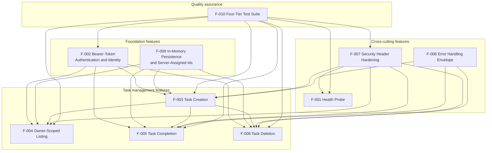

| Feature | Depends on | Enables | Evidence |
|---|---|---|---|
| F-001 Health Probe | F-007 (headers are asserted on its response) | F-010 (two non-functional tests target it) | `tests/non_functional/test_security_resilience.py:1-4`, `:13-16` |
| F-002 Authentication | none | F-003, F-004, F-005, F-006 (each route resolves identity first) | `app/main.py:39`, `:47`, `:52`, `:60` |
| F-003 Creation | F-002, F-009 | F-004, F-005, F-006 (a record must exist to be listed, completed or deleted); F-008 (400 mapping) | `app/main.py:40-43`, `app/services.py:4-10` |
| F-004 Listing | F-002, F-003, F-009 | nothing else | `app/main.py:45-47`, `app/store.py:15-16` |
| F-005 Completion | F-002, F-003, F-009 | nothing else | `app/main.py:49-56`, `app/services.py:12-19` |
| F-006 Deletion | F-002, F-003, F-009 | nothing else | `app/main.py:58-66`, `app/store.py:18-19` |
| F-007 Security Headers | none (registered on the app object) | every response path, including F-001 | `app/main.py:21-26` |
| F-008 Error Envelope | none (registered on the app object) | last-resort path behind F-003, F-005, F-006 | `app/main.py:28-31` |
| F-009 Persistence | none | F-003, F-004, F-005, F-006 | `app/store.py:1-21`, `app/main.py:4` |
| F-010 Test Suite | every feature under test | none (terminal feature) | `tests/conftest.py:3-4`, `docs/coverage_intent.md:5-8` |

The graph has two roots — F-002 and F-009 — and neither depends on the other: authentication never touches the store, and the store knows nothing about identity beyond the `owner` string it is handed. That is why the unit tier can construct a bare `InMemoryStore()` and still exercise the domain rules (`tests/unit/test_services.py:10`, `:14`, `:17`).

### 2.3.2 Integration Points

| Integration point | Mechanism and direction | Features on the point | Evidence |
|---|---|---|---|
| Client-to-API HTTP | JSON over ASGI HTTP; identity via a single `Authorization: Bearer <token>` header; status vocabulary 200, 201, 204, 400, 401, 403, 404, 422, 500 | F-001 through F-008 | `app/main.py:33-66`; assertions across all four test tiers |
| Test-to-application transport | `fastapi.testclient.TestClient` drives the real ASGI app in process — no socket, no server start, no external service | F-010 against F-001 through F-007 | `tests/conftest.py:2`, `:10` |
| Generated OpenAPI documentation | FastAPI derives the schema from the route signatures; served as the interactive UI at `/docs` on a running server | F-001 through F-006 route declarations | `README.md` line 19; `app/main.py:33-66` |
| ASGI server entry point | `uvicorn app.main:app --reload` binds the module-level application object, giving the only out-of-process access path | all features | `README.md` line 17; `app/main.py:7` |
| Proactive Insights scan | Read-only evaluation of the checkout: "Connect the repository root, select `main`, and initially leave the environment unset" | F-010 and the documented coverage gaps | `README.md` line 24; `docs/coverage_intent.md:1-10` |

No database, queue, cache, identity provider, observability backend or outbound HTTP client is integrated or stubbed anywhere in `app/`: `app/store.py` declares no imports at all, and `app/main.py` imports only FastAPI, pydantic and the project's own modules (`app/main.py:1-5`).

Because `current_user` is a plain function taking the header value rather than a FastAPI dependency (`app/main.py:13`, `:38`), the generated OpenAPI document describes `authorization` as an ordinary optional string header on each task route instead of a `securitySchemes` entry. Any consumer that generates a client from that document must therefore know to send the header itself.

### 2.3.3 Shared Components and Common Services

| Component | Location | Features served | Notes |
|---|---|---|---|
| `store` singleton | `app/store.py:21` | F-003, F-004, F-005, F-006, F-009, F-010 | Imported at `app/main.py:4` and `tests/conftest.py:4`; the reason a test reset (`tests/conftest.py:8-9`) is the suite's only isolation mechanism |
| `current_user` + `TOKENS` | `app/main.py:8`, `:13-19` | F-002, and through it F-003 to F-006 | Four call sites (`:39`, `:47`, `:52`, `:60`); the only place identity is derived |
| `TaskRequest` model | `app/main.py:10-11` | F-003 | Sole request model in the application; no model exists for any other route |
| `create_task` | `app/services.py:4-10` | F-003 | Owns normalisation and both title rules; the only caller is `app/main.py:41` |
| `complete_task` | `app/services.py:12-19` | F-005 | Owns the existence and ownership checks plus the in-place write; the only caller is `app/main.py:52` |
| `app` application object | `app/main.py:7` | all features | Owns every route, the middleware and the exception handler; also the object the test fixture wraps |
| `client` fixture | `tests/conftest.py:6-10` | F-010 | Requested by name in all three HTTP tiers; the sole shared fixture |
| `security_headers` middleware | `app/main.py:21-26` | F-007, applied to every response | No route sets either header itself |
| `error_handler` | `app/main.py:28-31` | F-008, applied to every unhandled exception | Registered for bare `Exception` |

**Common services.** There are none in the conventional sense: no logging, metrics, tracing, caching, rate limiting, notification, search or job-execution service exists in the repository, and `docs/coverage_intent.md:10` lists rate limiting, audit logging and sustained-load behaviour as deliberate gaps. The only genuinely shared runtime services are the two Starlette registration points — the HTTP middleware (`app/main.py:21`) and the global exception handler (`app/main.py:28`) — plus the store singleton.

**Duplicated rather than shared logic.** The ownership rule for deletion is implemented inside the route (`app/main.py:64-65`) instead of in `app/services.py`, so the same rule exists twice with the same message text but no shared function. F-005 and F-006 consequently reach their 403 through different code paths, which matters for maintenance: a change to the ownership definition must be applied in `app/services.py:16-17` and `app/main.py:64-65` together.


## 2.4 Implementation Considerations

### 2.4.1 Cross-Cutting Runtime and Platform Constraints

| Constraint | Observed state | Consequence for requirements | Evidence |
|---|---|---|---|
| Single process, single worker | One module-level `app` and one module-level `store`, both created at import | Every requirement is specified for one process; a second worker would hold a disjoint task set, so F-003 to F-006 cannot be met across workers | `app/main.py:7`, `app/store.py:21` |
| Python version floor | `str.removeprefix` (`app/main.py:16`) and PEP 604 unions in signatures (`app/main.py:38`, `:50`, `:59`) | Python 3.10 or later is required; no version is declared in the repository (no `pyproject.toml`, `setup.py` or `setup.cfg` exists) | `app/main.py`; `git ls-files` |
| Unpinned dependencies | Ranges only: `fastapi>=0.110,<1.0`, `uvicorn>=0.27`, `pytest>=8.0`, `httpx>=0.27`, all on one physical line with literal `\n` separators | Resolved versions can drift between environments; `pytest` is unbounded above, so a major release is admissible by the declared range | `requirements.txt` |
| No configuration layer | No settings module, environment variable, `.env`, TOML or YAML anywhere; the token table and header values are literals | The deployment environment cannot influence behaviour; every change to identity or header policy is a source change | `app/main.py:8`, `:24-25` |
| No packaging or build system | No `pyproject.toml`, `setup.py`, `setup.cfg`, Dockerfile, lock file or CI pipeline among the thirteen tracked files | Verification depends on running `pytest` from the repository root with `requirements.txt` installed by hand | `git ls-files` |
| In-process transport only | All automated verification uses `TestClient`; nothing binds a socket | Latency and header assertions measure the application, not the server or network stack | `tests/conftest.py:2`, `:10` |

### 2.4.2 Per-Feature Technical Constraints and Performance

| Feature | Technical constraints | Performance requirement | Scalability consideration |
|---|---|---|---|
| F-001 Health Probe | Zero-parameter synchronous handler returning a fixed dict; no dependency on the store, so it cannot report storage health | Sub-second response asserted in process (`tests/non_functional/test_security_resilience.py:16`); no other budget | Constant work per call; independent of task volume |
| F-002 Authentication | Two-entry literal table; literal `Bearer ` prefix; Python 3.9+ for `removeprefix`; implemented as a helper rather than a framework dependency, so enforcement rests on four explicit call sites | O(1) dict lookup per request | Constant-time and stateless, so it adds no shared bottleneck; adding identities means editing the literal, and revocation has no mechanism at all |
| F-003 Creation | Two validation layers must agree — pydantic `min_length=1` and the domain's post-normalisation empty check; the 120-character cap is a bare literal at `app/services.py:8` | Normalisation is linear in title length; insertion O(1); no numeric budget | Unbounded records per process; no per-owner cap, quota or eviction |
| F-004 Listing | Unpaginated by design; response shape is a bare array, so adding an envelope later breaks the assertions that compare against `[]` and use `len(...)` | O(n) over *all* stored tasks, not just the caller's, because `list_for` scans the whole dict | Degrades linearly with total task population across all owners; pagination is a declared gap (`docs/coverage_intent.md:10`) |
| F-005 Completion | Write-through mutation of the dict returned by `get`; no store update method exists, so a store that returned copies would silently lose the change; `task_id` typed `int` so malformed paths 422 before auth | O(1) lookup and assignment; no I/O | Constant per call; no locking, so concurrent completion of one record is unguarded |
| F-006 Deletion | Route-level ownership check duplicates the service-level rule; declared `status_code=204` means no body can be returned; the boolean from `store.delete` is discarded | O(1) lookup plus pop; no cascade or cleanup work | Constant; hard removal keeps the store small but leaves no history |
| F-007 Security Headers | Values are literals set after `call_next`; no configuration, no per-route override, no CSP or HSTS | Two dict assignments per response — negligible against any budget | Applies uniformly to all routes, including ones added later, without per-route cost |
| F-008 Error Envelope | Registered for bare `Exception`; interpolates `str(exc)`; FastAPI's own handlers still serve HTTPException and validation errors, which is why 401/403/404/422 appear in tests rather than 500 | No measurable cost; no logging, metrics or tracing is emitted on the path | Uniform for all routes; a 500 carries no correlation identifier for support |
| F-009 Persistence | Plain `dict` plus integer counter; no imports, no lock, no persistence, no index on `owner`; records handed out by reference | O(1) create/get/delete, O(n) list; no I/O latency at all | Memory-bound and per-process only; unsuitable for multiple workers or restart-safe requirements |
| F-010 Test Suite | Depends on module-level singletons, so there is no application factory and no per-test construction; isolation is achieved by mutating shared state; discovery relies on a `pytest.ini` that is not parseable as checked in (2.6.2) | Whole suite runs in seconds because no socket, server or database is involved | Each new HTTP test must request the `client` fixture or it inherits leftover state; the six documented gaps mark where the suite does not scale in scope |

### 2.4.3 Per-Feature Security and Maintenance Requirements

| Feature | Security implications | Maintenance requirement | Evidence |
|---|---|---|---|
| F-001 Health Probe | Public and unauthenticated; discloses only liveness, but also reveals the header policy through its response | Keep the body a literal so the latency assertion stays stable; no test asserts the body, so a change there would pass unnoticed | `app/main.py:33-35`; `tests/non_functional/test_security_resilience.py:13-16` |
| F-002 Authentication | Static, unsigned bearer tokens committed in source with no expiry, rotation or revocation; any request capturing a token can replay it indefinitely; the two distinct 401 messages aid credential probing | Identity changes require editing `TOKENS` and redeploying; the `Bearer ` prefix and case-sensitive comparison must be preserved or every documented client breaks | `app/main.py:8`, `:14-18` |
| F-003 Creation | Owner comes only from the token, so a caller cannot forge ownership; the 400 body returns internal rule text verbatim; titles are stored unvalidated for content (no character, script or injection filtering) | The pydantic minimum length and the domain empty check must be changed together; the 120 limit is duplicated nowhere, but is a literal rather than a constant | `app/main.py:10-11`, `:42-43`; `app/services.py:6-9` |
| F-004 Listing | Isolation depends entirely on the `owner` argument passed by the route; there are no roles, sharing or administrative views | Adding pagination or an envelope changes the response shape and requires updating the tests that compare the body to `[]` | `app/store.py:15-16`; `tests/integration/test_task_api.py:8`, `:19` |
| F-005 Completion | 403 versus 404 lets a caller infer that an id exists and belongs to someone else — an enumeration channel; no audit of who completed what | The in-place mutation contract (`app/services.py:18` mutating the dict from `app/store.py:13`) is undocumented and must not be broken by making `get` return copies; completion has no timestamp or reversal path | `app/services.py:12-19` |
| F-006 Deletion | Same existence-disclosure channel as F-005; deletion is irreversible with no tombstone or audit record | The duplicated ownership check (`app/main.py:64-65` versus `app/services.py:16-17`) must be changed in both places; the ignored boolean return from `store.delete` is dead contract surface | `app/main.py:58-66`; `app/store.py:18-19` |
| F-007 Security Headers | Two headers only; no `Content-Security-Policy`, `Strict-Transport-Security` or cache policy; the 500 path is unasserted | One registration point governs the whole app, so policy changes are a single edit — but they affect every route simultaneously | `app/main.py:21-26`; `tests/non_functional/test_security_resilience.py:1-4` |
| F-008 Error Envelope | Returns internal exception text to the caller by design (`app/main.py:30`); no logging means failures leave no server-side trace | Must be retained as-is for the fixture's purpose; a production fork would replace the body with a generic message and add logging | `app/main.py:28-31` |
| F-009 Persistence | All state, including every task and its owner, resides unencrypted in process memory; nothing survives restart, and nothing is authenticated beyond the tokens | The four-field record shape is consumed by `app/services.py`, `app/main.py` and `tests/`; the module-level `store` name is imported by `app/main.py:4` and `tests/conftest.py:4`, so both must change together | `app/store.py:1-21` |
| F-010 Test Suite | No fuzzing, boundary or negative-path coverage for 422 and 500; assertions check exception types only, never messages, so message regressions pass silently | Any change to route behaviour must be mirrored in the mapped tier (`docs/coverage_intent.md:5-8`); the runner configuration and the fixture's reset of shared state must be preserved or absolute-count assertions become order-dependent | `tests/`; `docs/coverage_intent.md` |


## 2.5 Traceability Matrix

### 2.5.1 Feature-to-Implementation-and-Verification Matrix

| Feature | Requirement IDs | Implementation evidence | Verification evidence |
|---|---|---|---|
| F-001 Health Probe | F-001-RQ-001, F-001-RQ-002 | `app/main.py:33-35` | `tests/non_functional/test_security_resilience.py:13-16` (status and latency; body unasserted) |
| F-002 Authentication | F-002-RQ-001 … F-002-RQ-005 | `app/main.py:8`, `:13-19` | `tests/non_functional/test_security_resilience.py:6-11`; ownership consequences at `tests/integration/test_task_api.py:10-13` |
| F-003 Creation | F-003-RQ-001 … F-003-RQ-005 | `app/main.py:10-11`, `:37-43`; `app/services.py:1-10`; `app/store.py:6-10` | `tests/unit/test_services.py:5-14`; `tests/integration/test_task_api.py:4-8`; `tests/e2e/test_user_journeys.py:3-5` |
| F-004 Listing | F-004-RQ-001 … F-004-RQ-004 | `app/main.py:45-47`; `app/store.py:15-16` | `tests/integration/test_task_api.py:8`, `:19`; `tests/e2e/test_user_journeys.py:6` |
| F-005 Completion | F-005-RQ-001 … F-005-RQ-005 | `app/main.py:49-56`; `app/services.py:12-19` | `tests/e2e/test_user_journeys.py:7-9`; `tests/integration/test_task_api.py:10-13`; `tests/unit/test_services.py:16-20` |
| F-006 Deletion | F-006-RQ-001 … F-006-RQ-004 | `app/main.py:58-66`; `app/store.py:18-19` | `tests/integration/test_task_api.py:15-19`; `tests/e2e/test_user_journeys.py:10` |
| F-007 Security Headers | F-007-RQ-001 … F-007-RQ-003 | `app/main.py:21-26` | `tests/non_functional/test_security_resilience.py:1-4` (success response only) |
| F-008 Error Envelope | F-008-RQ-001 … F-008-RQ-003 | `app/main.py:28-31`, plus route-level mappings at `:42-43`, `:53-56`, `:62-65` | No direct test; the 400/403/404 branches mapped here are asserted by the tests listed above |
| F-009 Persistence | F-009-RQ-001 … F-009-RQ-006 | `app/store.py:1-21` | Exercised indirectly by every HTTP tier; the reset contract is `tests/conftest.py:6-10` |
| F-010 Test Suite | F-010-RQ-001 … F-010-RQ-005 | `tests/`, `pytest.ini`, `docs/coverage_intent.md` | Self-verifying by inspection; execution blocked by the `pytest.ini` defect recorded in 2.6.2 |

### 2.5.2 Test-to-Requirement Coverage

| Test node | Tier | Requirement(s) verified | What the assertion actually checks |
|---|---|---|---|
| `tests/unit/test_services.py::test_normalize_title_collapses_whitespace` | Unit | F-003-RQ-002 | Exact string equality after normalisation of a padded, multi-space title |
| `tests/unit/test_services.py::test_create_task_rejects_blank_title` | Unit | F-003-RQ-003 | `ValueError` type only; message and store state unchecked |
| `tests/unit/test_services.py::test_create_task_rejects_long_title` | Unit | F-003-RQ-004 | `ValueError` for a 121-character title; the accepted 120-character boundary is not asserted |
| `tests/unit/test_services.py::test_non_owner_cannot_complete_task` | Unit | F-005-RQ-003 (domain) | `PermissionError` type only; the record is not re-read to prove it stayed incomplete |
| `tests/integration/test_task_api.py::test_create_and_list_tasks` | Integration | F-003-RQ-001, F-004-RQ-001, F-004-RQ-004 | 201, echoed title, and `len(listing) == 1` for the same identity |
| `tests/integration/test_task_api.py::test_user_cannot_complete_another_users_task` | Integration | F-005-RQ-003, F-002-RQ-003 | 403 when bob completes alice's task |
| `tests/integration/test_task_api.py::test_delete_removes_task` | Integration | F-006-RQ-001, F-004-RQ-003, F-004-RQ-004 | 204 followed by a listing equal to `[]` |
| `tests/e2e/test_user_journeys.py::test_complete_task_lifecycle` | End-to-end | F-003-RQ-001, F-004-RQ-001, F-005-RQ-001, F-006-RQ-001 | One server-assigned id carried through create → list → complete (`completed: true`) → delete (204) |
| `tests/non_functional/test_security_resilience.py::test_security_headers_are_present` | Non-functional | F-007-RQ-001, F-007-RQ-002 | Both header values on an unauthenticated `GET /health` |
| `tests/non_functional/test_security_resilience.py::test_unauthenticated_requests_are_rejected` | Non-functional | F-002-RQ-001 | 401 for a `GET /tasks` with no header; the message is not asserted |
| `tests/non_functional/test_security_resilience.py::test_invalid_token_is_rejected` | Non-functional | F-002-RQ-002 | 401 for `Bearer invalid` |
| `tests/non_functional/test_security_resilience.py::test_health_response_time_sanity` | Non-functional | F-001-RQ-001, F-001-RQ-002 | 200 and `elapsed < 1.0` s on `/health` |

### 2.5.3 Requirements Without Direct Test Coverage

| Requirement IDs | Behaviour left unverified | Status |
|---|---|---|
| F-001-RQ-001 (partial) | The exact body `{"status": "ok"}` — only the status code is asserted | Partial: implementation at `app/main.py:35`, no assertion |
| F-002-RQ-004, F-002-RQ-005 | That all four task routes authenticate (only `GET /tasks` is exercised) and that the `Bearer ` prefix is case- and space-sensitive | Uncovered |
| F-003-RQ-005 | The 422 response for a missing or empty `title` field | Uncovered |
| F-004-RQ-002 | Insertion ordering of the listing | Uncovered (no test asserts order) |
| F-005-RQ-002, F-005-RQ-004, F-005-RQ-005 | 404 for an unknown id over HTTP, 422 for a non-integer id, and repeated completion | Uncovered |
| F-006-RQ-002, F-006-RQ-003 | 404 for an unknown id on delete and 403 for deleting another owner's task; the nearest integration test exercises completion instead (`tests/integration/test_task_api.py:10-13`) | Uncovered |
| F-007-RQ-001, F-007-RQ-002 (partial) | Header presence on authenticated, error and 500 responses | Partial: asserted on `/health` only |
| F-008-RQ-001, F-008-RQ-003 | The 500 envelope, its body and its documented disclosure | Uncovered |
| F-009-RQ-002, F-009-RQ-005 | Monotonic id assignment across creates, and the boolean returned by `store.delete` | Uncovered directly; implied by absolute-count assertions |
| F-010-RQ-004 | That `pytest` discovery works as configured | Blocked: `pytest.ini` is not parseable as checked in (see 2.6.2) |

The six gaps in `docs/coverage_intent.md:10` — concurrency, rate limiting, pagination, input fuzzing, audit logging and sustained-load behaviour — are deliberate and are therefore excluded here; the rows above are gaps in coverage of behaviour the code does implement.

### 2.5.4 Requirement Version Tracking

| Version | Scope | Derivation basis | Revision history |
|---|---|---|---|
| 1.0 | All F-001-RQ-001 … F-010-RQ-005 as written in 2.2 | Repository state at commit `279d651` ("Merge remote changes with full coverage demo"), branch `2211_01`, thirteen tracked files | None recorded: the repository contains no changelog, issue tracker, backlog, ADR or version metadata, and `git log` holds three commits (`2eee6fe`, `1788ffc`, `279d651`) |

Every requirement above is the first version assigned to it. Because the repository declares neither a product version nor a release process, there is no basis in the code for earlier requirement revisions; a future change to behaviour should increment the affected `F-XXX-RQ-YYY` row and be recorded here, since no other requirement record exists.


## 2.6 Assumptions and Constraints

### 2.6.1 Assumptions

| ID | Assumption | Basis | Consequence if it does not hold |
|---|---|---|---|
| A-001 | The repository is a synthetic QA fixture, not a product; requirements describe acceptance targets for the fixture | `README.md` line 4 ("Synthetic FastAPI test fixture for Blitzy Proactive Insights") and line 26 ("not production software … Do not deploy it or use real credentials") | Every security requirement in 2.2 would read as a defect rather than a deliberate weakness — in particular F-002's static tokens and F-008's exception disclosure |
| A-002 | Exactly two identities exist, `alice` and `bob`, bound to `demo-alice` and `demo-bob` | `TOKENS = {"demo-alice": "alice", "demo-bob": "bob"}` (`app/main.py:8`) — the only identity source in the code | Ownership requirements (F-002-RQ-003 through F-006) would need restatement against a dynamic identity store |
| A-003 | A task is the only domain entity, with exactly four fields | Record literal `{"id", "title", "owner", "completed"}` (`app/store.py:7`); no other model exists in `app/` | Requirements covering related entities (comments, projects, users) would be missing from this section |
| A-004 | Requirements are evaluated in a single process with a single worker | One module-level `app` (`app/main.py:7`) and one module-level `store` (`app/store.py:21`) | Durability and cross-worker consistency (F-009-RQ-006) would become Must-Have rather than a recorded limitation |
| A-005 | The test suite is the acceptance authority, and the gap list in `docs/coverage_intent.md:10` converts missing coverage into an accepted decision | `docs/coverage_intent.md:1-10`; the four tier-to-file mappings at lines 5-8 | Rows in 2.5.3 would have to be treated as defects rather than noted gaps |
| A-006 | Verified behaviour is what the checked-in code does, not what the README claims | The README is in an unresolved merge-conflict state (`README.md:1`, `:27-29`) and `pytest.ini` cannot be parsed, so the documentation and tooling are less reliable than `app/` | Requirements derived from README statements alone would overstate what runs |
| A-007 | Deleting a task requires no cascade because no dependent entity exists | `app/store.py:18-19` removes only the record; no reference to a task id exists anywhere else | A dependent entity would require new deletion requirements |

### 2.6.2 Constraints

| ID | Constraint | Evidence | Effect on requirements |
|---|---|---|---|
| C-001 | `pytest.ini` encodes its directives as literal `\n` escapes on one 70-byte physical line, so the file is not valid INI | Running `python -m pytest -q` in this checkout aborts before collection with `pytest.ini:1: unexpected value continuation` (pytest 9.2.0, Python 3.12.3) | F-010-RQ-001 cannot be met as checked in; the twelve tests exist and are mappable (2.5.2) but the suite cannot be executed until the file is rewritten with real newlines |
| C-002 | `requirements.txt` uses the same single-line encoding for its four ranges (62 bytes) | `requirements.txt` content: `fastapi>=0.110,<1.0\nuvicorn>=0.27\npytest>=8.0\nhttpx>=0.27\n` with literal backslash-n sequences | Dependency installation from the file as-is does not yield four separate specifiers; F-003 through F-010 assume those packages are installed |
| C-003 | `README.md` is committed with unresolved merge-conflict markers | `<<<<<<< HEAD` at line 1, `=======` at line 27, bare branch title at line 28, `>>>>>>> 2eee6fee…` at line 29 | Documentation-based assumptions (A-001, A-006) rest on text inside a conflicted file rather than on a clean README |
| C-004 | Dependencies are ranges with no lock file, no hash and no constraints file | `requirements.txt`; no `*.lock`, `constraints.txt` or `.toml` among the thirteen tracked files | Behaviour requirements are pinned to source, not to resolved versions; `pytest>=8.0` admits any later major release |
| C-005 | No configuration, environment or secret management exists | Literal token table (`app/main.py:8`) and literal header values (`:24-25`); no settings module or environment read anywhere | F-002 cannot be satisfied by configuration; every identity or policy change is a source change |
| C-006 | State is in memory only, single-process, unsynchronised | `app/store.py:1-21`; "concurrency" gap at `docs/coverage_intent.md:10` | F-009-RQ-006 is a Must-Have limitation; concurrency, durability and multi-worker behaviour are out of scope for every requirement |
| C-007 | Several capabilities are deliberately absent | No `PUT`/`PATCH`/single-record `GET`, no pagination, no rate limiting, no audit log (`docs/coverage_intent.md:10`; route list at `app/main.py:33-66`) | No requirement in 2.2 asserts them; they appear only as documented gaps and as scalability notes in 2.4 |
| C-008 | Python 3.10 or later is required, though undeclared | `str.removeprefix` (`app/main.py:16`); PEP 604 unions (`app/main.py:38`, `:50`, `:59`); no version metadata in the repository | Every input-validation requirement depends on that floor; on an earlier interpreter the module would fail to import |
| C-009 | Shared module-level state means tests must reset the store | `tests/conftest.py:8-9` mutates `store.tasks` and `store.next_id` | F-010-RQ-002 is the precondition for the absolute-count assertions in F-004-RQ-001 and F-004-RQ-003 |
| C-010 | The fixture must not be deployed or given real credentials | `README.md` line 26 | F-002's identity model and F-006's irreversible deletion are acceptable only inside this constraint |


## 2.7 References

**Repository files cited as evidence.**

- `README.md` — fixture status and purpose (lines 4, 26), run command `uvicorn app.main:app --reload` (line 17), `/docs` address (line 19), `pytest -q` command (line 21), scan instruction (line 24), and the unresolved merge-conflict markers (lines 1, 27-29)
- `requirements.txt` — the four dependency ranges and their single-line literal `\n` encoding
- `pytest.ini` — `testpaths = tests`, `python_files = test_*.py`, `addopts = -ra`, and the encoding defect that blocks collection
- `app/main.py` — `app` object (line 7), `TOKENS` (line 8), `TaskRequest` (lines 10-11), `current_user` (lines 13-19), `security_headers` middleware (lines 21-26), `error_handler` (lines 28-31), and the five routes with their status-code translations (lines 33-66)
- `app/services.py` — `normalize_title`, `create_task`, `complete_task`, the 120-character limit (line 8) and the in-place completion write (line 18)
- `app/store.py` — `InMemoryStore` operations and record shape (lines 1-19), module-level `store` singleton (line 21)
- `app/__init__.py` — empty package marker; contributed no behaviour to this section
- `tests/conftest.py` — the single `client` fixture and the store reset (lines 6-10)
- `tests/unit/test_services.py` — the four domain-rule tests (lines 5-20)
- `tests/integration/test_task_api.py` — `auth` helper and the three HTTP tests (lines 1-19)
- `tests/e2e/test_user_journeys.py` — the complete-lifecycle test (lines 1-10)
- `tests/non_functional/test_security_resilience.py` — header, auth rejection and health-latency tests (lines 1-16)
- `docs/coverage_intent.md` — tier-to-category mapping (lines 5-8) and the six declared gaps (line 10)

**Repository folders cited as evidence.**

- `app/` — four flat modules confirmed as the whole runtime surface (HTTP, domain rules, persistence)
- `tests/` — confirmed four one-file tiers plus `conftest.py`, with no mocks, markers or test data
- `docs/` — confirmed to hold only the coverage-intent document

**Related specifications and flowcharts in this Technical Specification.**

- §1.2 System Overview — component inventory, the status-code translation table and the request-pipeline flowchart in 1.2.2, which 2.2 and 2.4 elaborate requirement by requirement
- §1.3 Scope — in-scope feature list, the task-lifecycle sequence diagram in 1.3.1 (the related process flowchart for F-003 through F-006), and the out-of-scope table that 2.6.2 and 2.5.3 build on
- §1.1 Executive Summary and §1.4 References — repository background and the project-level source list
- 2.3.1 Feature Dependency Map — the flowchart relating F-001 through F-010 within this section

**Verification performed against the checkout.** `git ls-files` confirmed the thirteen tracked files; `git log --oneline -3` confirmed the three commits and `git rev-parse --abbrev-ref HEAD` the current branch `2211_01`; a full-text search of every tracked file for route decorators, `HTTPException` statuses, validation keywords and authentication references confirmed that the five routes, one middleware and one exception handler documented above are the complete feature surface; and `python -m pytest -q` established the `pytest.ini` parse failure recorded in C-001 (pytest 9.2.0, Python 3.12.3).


# 3. Technology Stack

## 3.1 Programming Languages

Python is the only programming language in this repository. All 13 tracked files resolve to four kinds of artefact: 9 Python modules (181 lines), 2 Markdown documents (39 lines), 1 PEP 508 requirement text, and 1 INI configuration file — 220 content lines in total (`git ls-files`; `wc -l`). There is no second language, compiled artefact, template, or generated source anywhere in the checkout.

**Language by component.**

| Platform / component | Language | Minimum version established by the source | Footprint | Evidence |
|---|---|---|---|---|
| HTTP service (`app/`) | Python | 3.10 — PEP 604 unions in route signatures and `str.removeprefix` | 4 files, 106 lines | `app/main.py:16`, `:38`, `:50`, `:59` |
| Test suite (`tests/`) | Python | Same interpreter as the service | 5 files, 75 lines | `tests/conftest.py:2`, `:10` |
| Dependency manifest | PEP 508 requirement text | Not applicable | 1 line | `requirements.txt` |
| Test-runner configuration | INI | Not applicable | 1 line | `pytest.ini` |
| Documentation | Markdown | Not applicable | 39 lines | `README.md`, `docs/coverage_intent.md` |

**Selection criteria.** Python was not a free choice in this codebase — it follows from the single web framework the fixture adopts (`app/main.py:1`) and from the fixture's stated purpose as a synthetic QA artefact rather than a product (`README.md:4`, `:26`). Three consequences justify the pick on their own terms:

- **One interpreter spans application and tests.** `tests/conftest.py:3-4` imports `app.main` and `app.store` directly, so the tests execute the same objects that `uvicorn app.main:app` serves. There is no interop boundary, no compiled extension, and no build artefact to keep in step.
- **Economy of surface.** 181 Python lines deliver five routes, an authentication helper, one HTTP middleware, one exception handler, a four-method store and twelve tests. Python's plain-function handlers and dictionary literals carry nearly all of that behaviour without ceremony.
- **Typed request modelling is delegated, not written.** Pydantic supplies the only declarative type contract (`TaskRequest` with `title: str = Field(min_length=1)`, `app/main.py:10-11`), so the language itself needs no validation framework of its own.

**Constraints and dependencies.**

- **Undeclared version floor.** No `pyproject.toml`, `setup.py`, `setup.cfg`, `runtime.txt` or `.python-version` exists, so the interpreter version is nowhere stated (consistent with constraint C-008 in 2.6.2). The effective floor is the higher of two independent requirements: **3.10** from the source syntax, and **3.11** imposed by the FastAPI release the unpinned range currently resolves to (FastAPI 0.165.0 declares `requires-python >=3.11`). On an older interpreter the module fails at import.
- **Observed interpreter, not declared interpreter.** The only evidence of the toolchain actually used is an untracked bytecode file, `tests/__pycache__/conftest.cpython-312-pytest-9.2.0.pyc`, which records CPython 3.12 with pytest 9.2.0.
- **No static typing enforcement.** There is no mypy, pyright, `py.typed` marker or type-check step. Annotations are descriptive only, and the domain layer is deliberately duck-typed: the store parameter of `create_task` and `complete_task` is untyped (`app/services.py:4`, `:12`).
- **The standard library is barely used.** `app/` imports only `fastapi`, `pydantic` and its own sibling modules (`app/main.py:1-5`) — no `os`, `json`, `logging`, `typing`, `datetime` or `asyncio` import appears in the package. Python's role is confined to syntax, dictionaries and string methods (`strip`, `split`, `join`, `removeprefix`), with `async`/`await` appearing only on the middleware and the exception handler (`app/main.py:22-23`, `:29`).
- **Import-root coupling.** Imports are absolute over the `app` package (`from app.store import store`, `app/main.py:4`), so the process working directory must be the repository root or `PYTHONPATH` must include it.

No other language appears: TypeScript/JavaScript, Swift, Kotlin, Objective-C, Go, Java or Electron have **zero occurrences** across all tracked files (`git grep -i` returns no match for any of them), and the extension inventory contains only `py`, `md`, `txt` and `ini`. This system therefore has no client, mobile or desktop language tier to document.


## 3.2 Frameworks and Libraries

The framework tier is deliberately thin: **one** application framework, **two** inherited libraries it depends on, **one** development server and **two** test libraries. `requirements.txt` declares four of these six; Starlette and pydantic arrive transitively through FastAPI and are never named in the repository.

**Core frameworks and supporting libraries.**

| Package | Declared in `requirements.txt` | Latest upstream release (2026-11-22) | Tier | Use in this codebase |
|---|---|---|---|---|
| FastAPI | `fastapi>=0.110,<1.0` | 0.165.0 | Core | The ASGI application, all routing, status codes, exception handler registration (`app/main.py:1-2`, `:7`, `:21`, `:28`, `:33-66`) |
| Starlette | Not declared — inherited | 1.10.0 | Core (transitive) | HTTP middleware contract and exception-handler hooks re-exported by FastAPI (`app/main.py:21-26`, `:28-31`); `JSONResponse` (`app/main.py:2`) |
| pydantic | Not declared — inherited | 2.14.3 (v2 line) | Core (transitive) | The only schema in the system: `TaskRequest` with `Field(min_length=1)` (`app/main.py:3`, `:10-11`) |
| uvicorn | `uvicorn>=0.27` | 0.54.0 | Development server | Serves `app.main:app` with `--reload` (`README.md:17`); never imported by code |
| pytest | `pytest>=8.0` | 9.2.0 | Test framework | All twelve tests, the `client` fixture, `pytest.raises` contracts, discovery from `pytest.ini` |
| httpx | `httpx>=0.27` | 0.28.1 | Test support | Transport beneath `fastapi.testclient.TestClient` (`tests/conftest.py:2`) |

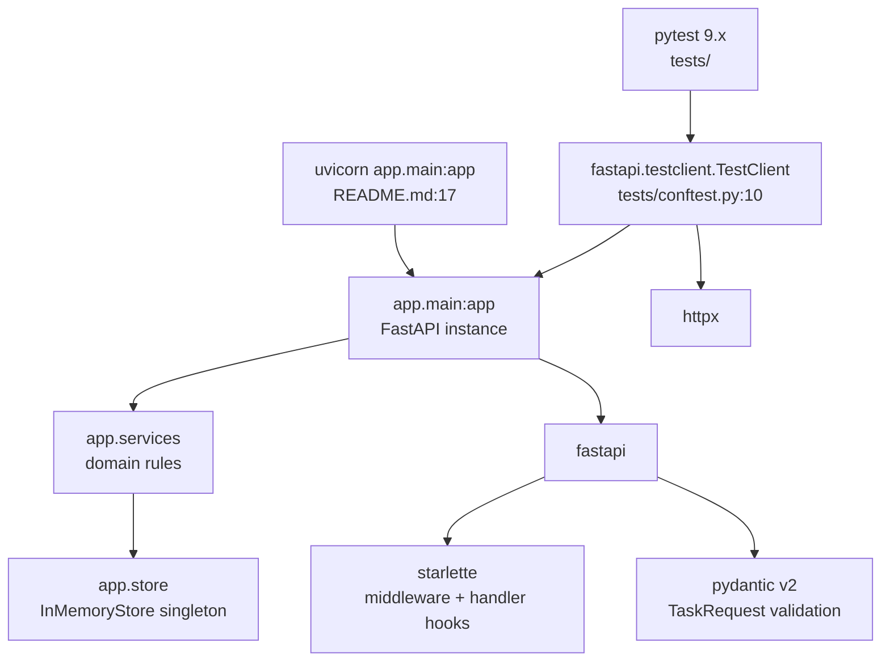

**Compatibility requirements.**

| Requirement | Detail | Evidence |
|---|---|---|
| Interpreter | Python 3.11 or newer once the range resolves to FastAPI 0.165.0 (`requires-python >=3.11`); source syntax needs only 3.10 | `app/main.py:16`, `:38`; upstream FastAPI metadata |
| Starlette coupling | FastAPI's Starlette floor moved from `>=0.46.0` to `>=1.6.0` in FastAPI 0.164.0. Because no Starlette version is declared here, the `<1.0` cap on FastAPI is the only thing preventing an unreviewed Starlette major from being installed | `requirements.txt`; upstream FastAPI release metadata |
| pydantic line | Only pydantic v2 satisfies the resolved FastAPI (`pydantic>=2.9.0`); the model relies on the v2-era `Field(min_length=...)` API | `app/main.py:3`, `:11` |
| Starlette API surface in use | A `@app.middleware("http")` coroutine taking `(request, call_next)` and awaiting `call_next`, `@app.exception_handler(Exception)`, mutable `response.headers`, and `JSONResponse(status_code=500, ...)` — all Starlette surfaces reached through the FastAPI object | `app/main.py:21-31` |
| uvicorn packaging | Declared as the base distribution (`uvicorn>=0.27`), not `uvicorn[standard]`; the reload behaviour documented in `README.md:17` is therefore whatever the base install provides | `requirements.txt` |
| httpx currency | Resolves to 0.28.1, which has been the newest httpx release since December 2024 — the declared `>=0.27` will not pull a newer one | `requirements.txt`; upstream release history |
| pytest ceiling | `pytest>=8.0` has no upper bound and the environment already carries pytest 9.2.0, which rejects the checked-in `pytest.ini`: `ERROR: pytest.ini:1: unexpected value continuation` | `requirements.txt`; `pytest.ini`; constraint C-001 in 2.6.2 |

**Justification for each major choice.**

- **FastAPI** is the only framework selected outright, and it carries the whole HTTP tier: routing, JSON serialisation, status-code declarations, exception-handler registration and the generated OpenAPI UI at `/docs` that `README.md:19` points users to. Adopting it removes the need for a separate validation, documentation or serialisation library.
- **Starlette** was inherited, not chosen. It is named here because the two cross-cutting behaviours this fixture is judged on — two hardening headers on every response and one uniform 500 envelope — are implemented exclusively through its middleware and exception-handler contracts.
- **pydantic** is the sole type contract. Its `min_length=1` on `TaskRequest.title` produces the 422 path before any domain rule runs, which is what lets `app/services.py` assume a non-null string.
- **uvicorn** is a development server only. Because no code imports it and all tests use `TestClient`, the application is exercisable without ever binding a socket.
- **pytest** fits the four-tier test layout (`tests/unit`, `integration`, `e2e`, `non_functional`): plain `def test_...()` functions, fixture injection by name, `pytest.raises` for exception contracts, and discovery configured in one file.
- **httpx** is present solely because `fastapi.testclient.TestClient` is built on it; no application module imports an HTTP client.

**Security-relevant framework behaviour.**

- The middleware stamps `X-Content-Type-Options: nosniff` and `X-Frame-Options: DENY` on every response, including error responses, because the headers are set after `call_next` (`app/main.py:22-26`).
- The handler registered for bare `Exception` returns `{"detail": str(exc)}` with status 500 — annotated in-source as an intentional weakness (`app/main.py:28-31`, comment at line 30).
- Authentication is implemented as a plain helper (`current_user`, `app/main.py:13-19`) invoked inside each handler rather than as a FastAPI `Depends`/`Security` dependency. No security scheme is therefore declared in the generated OpenAPI document, so `/docs` exposes the five routes without any authorization metadata.

**Frameworks deliberately absent.** No ORM or database driver, no authentication or JWT library (no `jwt`, `hashlib` or `hmac` reference exists), no HTTP client in application code, no logging/metrics/tracing library, no CORS middleware, no front-end framework and no AI or orchestration library: `git grep -i` returns **0 occurrences** for `flask`, `sqlalchemy`, `alembic`, `langchain`, `react`, `tailwind`, `celery`, `redis` and `opentelemetry` across every tracked file.


## 3.3 Open Source Dependencies

**Registry, manifest and format.** PyPI is the only package registry used. The single manifest is `requirements.txt`, and nothing else in the checkout configures package resolution: there is no `pyproject.toml`, `setup.py`, `setup.cfg`, `pip.conf`, index URL, `-e`/`git+` reference, wheel, vendored directory or system-package list (`git ls-files`). The file holds four PEP 508 specifiers with no `==` pins, no `--hash` values, no environment markers, no extras and no dev/production split.

| Distribution | Declared specifier | Relationship | Imported at | Purpose |
|---|---|---|---|---|
| `fastapi` | `fastapi>=0.110,<1.0` | Direct | `app/main.py:1-2` | ASGI framework: routing, validation, OpenAPI, exception handling |
| `uvicorn` | `uvicorn>=0.27` | Direct | Not imported (`README.md:17` invokes it as a command) | ASGI development server |
| `pytest` | `pytest>=8.0` | Direct | `tests/conftest.py:1`, `tests/unit/test_services.py:1` | Test runner, fixtures, exception assertions |
| `httpx` | `httpx>=0.27` | Direct | Not imported directly; required by `fastapi.testclient.TestClient` (`tests/conftest.py:2`) | In-process HTTP transport for tests |
| `starlette` | Not declared | Transitive via FastAPI | Re-exported through `fastapi` (`app/main.py:21`, `:28`) | ASGI toolkit behind the framework |
| `pydantic` | Not declared | Transitive via FastAPI | `app/main.py:3` | Request model and validation |

**Transitive closure inherited from FastAPI.** Per the metadata of the release the range currently resolves to (FastAPI 0.165.0), the runtime closure adds floors of `starlette>=1.6.0`, `pydantic>=2.9.0`, `anyio>=4.1.0`, `typing-extensions>=4.8.0`, `typing-inspection>=0.4.2`, `annotated-doc>=0.0.2` and `opentelemetry-api>=1.44.0`. Those floors are release-specific and shift between FastAPI releases; the repository records none of them, so the installed transitive set is whatever the resolver computes on the day of installation.

**Observed resolution.** Because three of the four direct specifiers are open-ended, a fresh install pulls the newest admissible releases. As of 2026-11-22 those are FastAPI 0.165.0, Starlette 1.10.0, pydantic 2.14.3, uvicorn 0.54.0, pytest 9.2.0 and httpx 0.28.1, and the inspection environment already holds the same Starlette, uvicorn, pytest and httpx versions alongside pydantic 2.14.2.

**Manifest integrity defect.** `requirements.txt` is a single 62-byte physical line in which newlines are stored as the two literal characters `\` and `n`:

```text
fastapi>=0.110,<1.0\nuvicorn>=0.27\npytest>=8.0\nhttpx>=0.27\n
```

Parsing that line with the standard `packaging.requirements.Requirement` parser fails with `InvalidRequirement: Expected comma (within version specifier), semicolon (after version specifier) or end`. Dependency installation from the file as checked in therefore cannot succeed, and the packages must be named individually — the same defect recorded as constraint C-002 in 2.6.2.

**Reproducibility and supply-chain posture.**

| Control | State | Consequence |
|---|---|---|
| Exact version pins | None (`==` appears nowhere) | Two installs on different dates can differ |
| Hash verification | None (`--hash` absent) | No integrity check on downloaded artefacts |
| Lock or constraints file | None (`*.lock`, `constraints.txt` absent) | No record of what was actually installed |
| Upper bounds | Only on FastAPI (`<1.0`) | `pytest`, `uvicorn` and `httpx` admit any future major release |
| Transitive bounds | None declared | Starlette's move to 1.x is absorbed silently through FastAPI's floor |
| Automated dependency scanning | None — no CI pipeline, no Dependabot/`pip-audit` configuration | Advisory exposure is discovered only by manual inspection |
| Project license | None — no `LICENSE` file among the 13 tracked files | The project's own terms and its dependency license inventory are unrecorded |

**Security implications.** The dependency surface itself is minimal — four direct distributions, none of which performs cryptography, network I/O in application code, or data persistence — which limits the attack surface. The exposure lies in the absence of pinning rather than in the choice of libraries: nothing prevents a newly published major release of uvicorn, pytest or httpx, or a Starlette major pulled transitively, from being installed into a build that was never tested against it. Establishing reproducibility would require rewriting `requirements.txt` with real newlines, adding `==` pins or a constraints file, and re-verifying the twelve tests against the pinned set.


## 3.4 Third-Party Services

**No third-party service participates in the runtime path.** The application opens no outbound connection: `app/main.py` and `app/services.py` import no HTTP client, socket, database driver or SDK (`git grep` finds no `requests`, `urllib`, `socket`, `aiohttp` or `http_client` reference), and `app/store.py` touches only process memory. The system starts and serves with no external precondition, which is why the test suite contains no mocks, stubs or network fixtures.

| Service category | Present | Evidence |
|---|---|---|
| Identity provider (Auth0, OAuth2/OIDC, SAML) | No | Authentication is a literal dictionary lookup in `current_user` (`app/main.py:8`, `:13-19`); 0 matches for `auth0`, `oauth`, `jwt`, `saml`, `cognito`, `keycloak` |
| Cloud platform or SDK (AWS, GCP, Azure) | No | 0 matches for `aws`, `boto3`, `google-cloud`, `azure` across all tracked files |
| Monitoring, APM or error tracking (Sentry, Datadog, Prometheus, OpenTelemetry) | No | No `logging`, `metrics`, `trace`, `sentry`, `datadog` or `prometheus` reference exists; although the resolved FastAPI declares an OpenTelemetry *API* floor, the application registers no tracer, meter or exporter, so it emits no telemetry |
| Message broker, queue or job service | No | 0 matches for `celery`, `kafka`, `rabbitmq`, `sqs`, `redis` |
| Cache service | No | No client import and no cache configuration anywhere |
| Email, SMS or notification service | No | No mail or messaging library, endpoint or template in the tree |
| Object or block storage | No | No `boto3`, GCS, Azure Blob or filesystem persistence (`open(`, `Path(` appear nowhere) |
| External business API or webhook | No | No endpoint URL, API key, webhook receiver or outbound request exists in code or configuration |
| Package registry (PyPI) | Yes — build time only | Sole manifest `requirements.txt`; see 3.3 |
| Source-control hosting (GitHub) | Yes — development time only | `origin` = `https://github.com/lakshya-blitzy/proactive_insights_full_coverage_demo.git` |
| Proactive Insights scan | Described, not integrated | `README.md:24` states the procedure ("connect the repository root, select `main`, and initially leave the environment unset"); no API contract, credential, webhook or configuration file for it exists in the checkout |

**Authentication services.** The system substitutes a hand-written bearer scheme for an identity provider. `TOKENS = {"demo-alice": "alice", "demo-bob": "bob"}` (`app/main.py:8`) is compared against the `Authorization` header after stripping the literal `Bearer ` prefix, and the matched value becomes the request's owner (`app/main.py:13-19`). No authentication library is linked: 0 matches for `jwt`, `hashlib`, `hmac`, `passlib` or `authlib`. The technology implications, carried forward from 1.3.2 and 2.4.3, are that tokens are committed in source, never expire, are neither signed nor revocable, and are replayable by anyone who reads them; the two distinct messages (`missing bearer token`, `invalid token`) also help credential probing. Replacing this with an external provider is not a configuration change: the repository has no settings module, environment read or secret store (constraint C-005 in 2.6.2), so it would require introducing a configuration layer and updating the four call sites that invoke `current_user` (`app/main.py:39`, `:47`, `:52`, `:60`).

**Integration requirements.** Because no external service is integrated, the operational requirement set is empty in the conventional sense — no credentials, endpoints, allow-lists, retry or timeout policy, certificate trust store, or secret rotation process is defined or needed. The single integration surface is JSON over ASGI HTTP, with the bearer token as the only header of semantic consequence besides the two hardening response headers. Any future addition — an identity provider, a datastore, an observability backend — must first introduce configuration and credential handling, which does not exist today, and must also extend the test tiers that currently assert in-process behaviour only.


## 3.5 Databases and Storage

**No database of any kind is used.** There is no relational store, document store, key-value cache, ORM, driver, migration tool, schema definition, backup or retention policy in the repository. The checkout contains no `.sql`, `.db`, `.sqlite`, `alembic.ini` or migration directory (`git ls-files`), and `git grep` finds no `sqlite`, `psycopg`, `sqlalchemy`, `pymongo`, `redis`, `cache`, `open(` or `Path(` reference in any tracked file. The persistence layer is a single Python dictionary held in process memory.

**The store as implemented.**

| Member | Behaviour | Location |
|---|---|---|
| `tasks` | `dict` mapping integer id to task record; insertion-ordered, so iteration follows creation order | `app/store.py:3` |
| `next_id` | Integer counter starting at 1, incremented on every create; the only id source | `app/store.py:4`, `:9` |
| `create(title, owner)` | Builds `{"id", "title", "owner", "completed": False}`, stores it, advances the counter, returns the record itself | `app/store.py:6-10` |
| `get(task_id)` | Returns the live record object, or `None` for an unknown id | `app/store.py:12-13` |
| `list_for(owner)` | Full scan of `tasks.values()` filtered on `owner`, in insertion order; `[]` when nothing matches | `app/store.py:15-16` |
| `delete(task_id)` | `pop` with a `None` default; returns `True` only when a record was actually removed | `app/store.py:18-19` |
| `store` | Module-level singleton — the whole persistence tier for the application and the tests | `app/store.py:21` |

**Data model.** One entity, four fields, defined by a dictionary literal rather than by a schema: `id` (server-assigned integer, monotonic within a process), `title` (string already normalised and length-capped by `app/services.py:1-9`), `owner` (string taken from the bearer token rather than the request body, `app/main.py:39`), and `completed` (boolean, `False` at creation, set to `True` in place on completion). No related entity, foreign key, timestamp or audit field exists.

**Data persistence strategy and its characteristics.**

| Concern | Behaviour | Consequence |
|---|---|---|
| Durability | None — state disappears when the process exits | A restart loses every task; no recovery path exists |
| Multi-process behaviour | Each worker imports its own `store` instance | Two uvicorn workers would present two disjoint task sets (assumption A-004, 2.6.1) |
| Concurrency | No lock guards `tasks` or `next_id` | Interleaved requests can collide ids or observe partial state; recorded as the "concurrency" gap in `docs/coverage_intent.md:10` |
| Secondary indexes | None; `list_for` scans every owner's records | Listing cost is O(n) in the total task population, not the caller's; "pagination" is a declared gap |
| Update mechanism | No update method exists; `complete_task` sets `task["completed"] = True` on the object returned by `get` (`app/services.py:18`) | The store's contract is **by reference**: a future store that returned copies would silently drop completions |
| Ordering guarantee | Python dictionary insertion order plus a monotonic counter | Listings are naturally id-ascending; no sort parameter exists |
| Deletion semantics | Hard `pop`, no tombstone, no history | Deletion is irreversible and unauditable |
| Capacity control | None | Memory grows without bound, with no per-owner quota or eviction |
| Schema and versioning | None — the record literal is the schema | A field change is a source change in `app/store.py:7` consumed by `app/services.py`, `app/main.py` and the tests |
| Encryption, retention, backup, audit | None | All task data, including owner identities, sits unencrypted in process memory |
| Test coupling | `tests/conftest.py:8-9` clears `store.tasks` and resets `store.next_id = 1`; the module-level `store` name is imported by `app/main.py:4` and `tests/conftest.py:4` | Per-test isolation exists only through mutation of this shared singleton |

**Caching.** There is no cache tier, no TTL, no invalidation logic and no session store. The in-memory dictionary is the system of record rather than a cache in front of one, which removes invalidation concerns entirely but also removes any recovery mechanism.

**Storage services.** None are referenced: no object storage, block volume, shared filesystem or network store appears in code or configuration. Nothing is written to disk — the only filesystem artefact in the checkout is an untracked `tests/__pycache__/` bytecode directory produced by the interpreter.

**Substitution contract.** Any replacement datastore would have to reproduce four method signatures with the observed semantics (`create` returning the stored record, `get` returning a live mutable object, `list_for` filtering on owner, `delete` returning a boolean) *and* be bound to the module-level name `store` in `app/store.py`, because both the application and the test fixture import that symbol directly. Ownership enforcement would also have to be preserved in application code: the store itself is owner-agnostic for `get` and `delete`, and isolation is enforced only by `list_for` and by the route-level checks at `app/main.py:64-65`.


## 3.6 Development and Deployment

**Build system: none.** The project is never packaged, compiled or installed as a distribution — there is no `pyproject.toml`, `setup.py`, `setup.cfg`, `Makefile`, `tox.ini`, `noxfile.py` or build script among the 13 tracked files. Because imports are absolute over the `app` package (`from app.store import store`, `app/main.py:4`), the process must run with the repository root as its working directory (or on `PYTHONPATH`); there is no installable console entry point.

**Development tooling as configured.**

| Concern | State | Evidence |
|---|---|---|
| Interpreter provisioning | Manual virtual environment: `python -m venv .venv` then `source .venv/bin/activate` | `README.md:14-15` |
| Dependency installation | `pip install -r requirements.txt`, currently unparsable (see 3.3) | `README.md:16`; `requirements.txt` |
| Development server | `uvicorn app.main:app --reload`, documented address `http://127.0.0.1:8000/docs` | `README.md:17`, `:19` |
| Test invocation | `pytest -q` from the repository root | `README.md:21` |
| Test discovery configuration | `pytest.ini` — `testpaths = tests`, `python_files = test_*.py`, `addopts = -ra`, stored as one line of literal `\n` escapes | `pytest.ini` |
| Linters, formatters, type checkers | None — no ruff, flake8, black, isort, mypy or pyright configuration exists | `git ls-files` |
| Pre-commit hooks / task runner | None | `git ls-files` |
| Ignore rules | None — no `.gitignore`, so build artefacts such as `tests/__pycache__/` appear as untracked files | `find . -path ./.git -prune -o -print` |
| Observed toolchain | CPython 3.12 with pytest 9.2.0, recorded by the untracked bytecode file `tests/__pycache__/conftest.cpython-312-pytest-9.2.0.pyc` | `tests/__pycache__/` |

**Containerization: none.** No `Dockerfile`, `docker-compose.yml`, `.dockerignore`, devcontainer or pod specification exists, and no base-image or runtime-image choice is recorded anywhere. Delivery is a source checkout plus a hand-built virtual environment.

**CI/CD: none.** The repository is hosted on GitHub (`origin` = `https://github.com/lakshya-blitzy/proactive_insights_full_coverage_demo.git`) but carries no `.github/` directory, no workflow file, no pipeline definition of any other provider, no release tags (`git tag` returns nothing) and no publish or artefact step. The three commits (`2eee6fe` Initial commit, `1788ffc` Add proactive insights full coverage demo, `279d651` Merge remote changes with full coverage demo) were all made on the same date, and the merge left `README.md` with unresolved conflict markers at lines 1, 27 and 29 — evidence that verification is manual and that branch integration is not gated by any automated check.

**Blocking defects a pipeline would inherit.** Each of these was reproduced in the checkout and is a precondition for any automated build:

| Blocker | Verified behaviour | Effect on automation |
|---|---|---|
| `pytest.ini` encoding (constraint C-001) | `python -m pytest -q` aborts before collection: `ERROR: pytest.ini:1: unexpected value continuation` | A CI test step fails immediately, before any of the twelve tests run |
| `requirements.txt` encoding (constraint C-002) | The standard requirement parser raises `InvalidRequirement: Expected comma (within version specifier)...` on the file's single line | An install step cannot consume the manifest; packages must be named explicitly |
| `README.md` merge-conflict markers | `<<<<<<< HEAD` at line 1 and `>>>>>>> 2eee6fee…` at line 29 | Documentation-driven steps (and the scan instructions at line 24) rest on a conflicted file |
| No ignore file | `tests/__pycache__/` is untracked but committable | Bytecode can enter the repository |
| No license file | No `LICENSE` among the tracked files | Redistribution terms are undefined |

**Deployment.** The only supported target is the developer's own machine: the documented address is the loopback interface on port 8000 and the README explicitly forbids deployment — "This is a synthetic QA fixture, not production software… Do not deploy it or use real credentials" (`README.md:26`). No reverse proxy, process manager, TLS termination, environment configuration or secret store is defined; the application registers no startup, shutdown or lifespan hook, so there is no warm-up or drain behaviour to orchestrate; and the `/health` route is the sole operational signal, reporting liveness only and consulting nothing, since it does not touch the store (`app/main.py:33-35`).

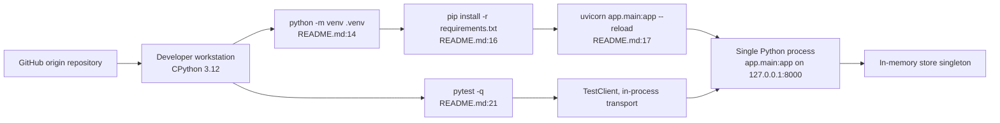


## 3.7 References

- `requirements.txt` — the sole dependency manifest: four PEP 508 ranges (`fastapi>=0.110,<1.0`, `uvicorn>=0.27`, `pytest>=8.0`, `httpx>=0.27`) with no pins, hashes or lock file, encoded on one physical line with literal `\n` escapes.
- `pytest.ini` — test-discovery configuration (`testpaths = tests`, `python_files = test_*.py`, `addopts = -ra`), also one physical line of literal `\n` escapes; rejected by pytest as invalid INI.
- `README.md` — the only run, test and scan instructions: virtual environment, `pip install -r requirements.txt`, `uvicorn app.main:app --reload`, `/docs` URL, `pytest -q`, and the statement that the fixture must not be deployed; committed with unresolved merge-conflict markers.
- `app/main.py` — FastAPI instance, `TOKENS` table, `TaskRequest` pydantic model, `current_user` bearer helper, HTTP middleware, bare-`Exception` handler, and the five route decorators that define the framework surface in use.
- `app/services.py` — domain layer with no external imports; establishes the pure-Python business-rule tier and the duck-typed store parameter.
- `app/store.py` — `InMemoryStore` (dict plus integer counter, four methods) and the module-level `store` singleton that constitutes the entire persistence and caching tier.
- `app/__init__.py` — 0-byte package marker; confirms `app` is a flat package with no sub-packages.
- `tests/conftest.py` — the only shared fixture: imports `fastapi.testclient.TestClient`, resets `store.tasks` and `store.next_id`, and returns the in-process client — the evidence that no socket, server or datastore is involved in verification.
- `tests/unit/test_services.py` — pytest usage against the domain layer with a real throwaway `InMemoryStore`.
- `tests/integration/test_task_api.py` — `TestClient` usage for create, list, cross-owner 403 and delete.
- `tests/e2e/test_user_journeys.py` — single lifecycle test through the in-process transport.
- `tests/non_functional/test_security_resilience.py` — header and authentication assertions plus the sub-second `/health` latency check.
- `docs/coverage_intent.md` — the four tier-to-file mappings and the six declared coverage gaps that bound the verified technology surface.
- `app/` — folder retrieved to establish the four-file package layout and the absence of sub-packages, ORM or driver modules.
- `tests/` — folder retrieved to establish the four-tier test layout and the absence of mocks, test data or conftest beyond `client`.
- `docs/` — folder retrieved to confirm a single documentation file and no configuration or deployment documents.
- [web] PyPI and GitHub metadata for `fastapi` 0.165.0 (release version, `requires-python >=3.11`, declared dependency floors of `starlette>=1.6.0`, `pydantic>=2.9.0`, `anyio>=4.1.0`, `typing-extensions>=4.8.0`, `typing-inspection>=0.4.2`, `annotated-doc>=0.0.2`, `opentelemetry-api>=1.44.0`, and the absence of `uvicorn`/`httpx` from runtime dependencies) — https://pypi.org/pypi/fastapi/json, https://raw.githubusercontent.com/fastapi/fastapi/0.165.0/pyproject.toml
- [web] FastAPI release notes for the Starlette floor change from `>=0.46.0` to `>=1.6.0` in 0.164.0 — https://fastapi.tiangolo.com/release-notes
- [web] Current stable versions used as upstream reference dates: `starlette` 1.10.0, `pydantic` 2.14.3, `uvicorn` 0.54.0, `pytest` 9.2.0, `httpx` 0.28.1 (unanchored since December 2024) — https://pypi.org/project/starlette, https://pypi.org/pypi/pydantic/2.14.3/json, https://uvicorn.dev/release-notes, https://pypi.org/project/pytest, https://github.com/encode/httpx/releases


# 4. Process Flowchart

## 4.1 System Workflows

Every workflow in this system is a single synchronous HTTP request/response cycle handled inside one ASGI process. There is no scheduler, no worker, no message broker and no external service call anywhere in the checkout, so the complete set of workflows is the five routes registered in `app/main.py:33-66` plus the process-level lifecycle of the in-memory store that those routes read and write. Each request traverses the same four stages in the same order: the `security_headers` middleware (`app/main.py:21-26`), routing and pydantic request validation, the `current_user` identity guard (`app/main.py:13-19`) followed by the route body, and the reverse pass back through the middleware, which stamps `X-Content-Type-Options: nosniff` and `X-Frame-Options: DENY` (`app/main.py:24-25`).

### 4.1.1 Core Business Processes

The task resource has a complete lifecycle — creation, listing, completion and hard deletion — and the repository's end-to-end test walks exactly that sequence in one process: `POST /tasks` → `GET /tasks` → `POST /tasks/{task_id}/complete` → `DELETE /tasks/{task_id}` (`tests/e2e/test_user_journeys.py:1-10`). The journeys below name the requests, the identity required, and the outcome the code produces.

| Journey | Actor | Requests in order | Terminal outcome | Evidence |
|---|---|---|---|---|
| J-1 Liveness probe | Anonymous caller | `GET /health` | `200 {"status": "ok"}` | `app/main.py:33-35`; `tests/non_functional/test_security_resilience.py:13-16` |
| J-2 Create task | Token holder (`alice` or `bob`) | `POST /tasks` with `{"title": …}` | `201` with `{id, title, owner, completed: false}` | `app/main.py:37-43`; `app/services.py:4-10`; `tests/integration/test_task_api.py:4-8` |
| J-3 List own tasks | Token holder | `GET /tasks` | `200` JSON array of the caller's records only | `app/main.py:45-47`; `app/store.py:15-16` |
| J-4 Complete own task | Owner | `POST /tasks/{task_id}/complete` | `200` with `completed: true` | `app/main.py:49-56`; `app/services.py:12-19`; `tests/e2e/test_user_journeys.py:7-9` |
| J-5 Delete own task | Owner | `DELETE /tasks/{task_id}` | `204` empty body, record gone | `app/main.py:58-66`; `app/store.py:18-19`; `tests/integration/test_task_api.py:15-19` |
| J-6 Cross-user completion | Token holder who is not the owner | `POST /tasks/{id}/complete` on another identity's task | `403 {"detail": "not task owner"}`, record unmodified | `app/services.py:16-17`; `tests/integration/test_task_api.py:10-13` |
| J-7 Unauthenticated access | Anonymous caller | Any `/tasks` request | `401`, either `missing bearer token` or `invalid token` | `app/main.py:14-18`; `tests/non_functional/test_security_resilience.py:6-11` |

**System interactions per request.** The interactions are ordinary in-process function calls, listed here in the order the code executes them because that order defines the observable contract:

1. The ASGI server (uvicorn, started as `app.main:app` per `README.md:17`) or the in-process `TestClient` (`tests/conftest.py:10`) invokes the application object created at `app/main.py:7`.
2. `security_headers` awaits `call_next(request)` (`app/main.py:23`) and holds the response on the way back to stamp the two hardening headers.
3. The router matches the method and path; an unmatched request leaves the router as a plain 404 (or 405 for a wrong method) without entering any handler.
4. Pydantic coerces the path parameter and body: `task_id: int` and `TaskRequest` with `title: str = Field(min_length=1)` (`app/main.py:10-11`).
5. The handler calls `current_user(authorization)` (`app/main.py:39`, `:47`, `:52`, `:60`) and, on success, either delegates to `app/services.py` (create, complete) or calls the store directly (list, delete).
6. The store mutates or reads `tasks` / `next_id`, and the handler returns a record, a list, or `None` for the 204.

**Decision points and their precedence.** The order of the checks is part of the contract and differs per route; it is catalogued diamond by diamond in 4.2.2. The observed precedence is:

| Route | Check order enforced by the code | Consequence |
|---|---|---|
| `POST /tasks` | body validation (422) → token present and prefixed (401) → token known (401) → title normalisation and length rules (400) | A malformed body is reported as 422 even when the token is also bad, because validation precedes the handler body (`app/main.py:38-43`). |
| `GET /tasks` | token present (401) → token known (401) → owner filter (always succeeds) | No 404 or 403 branch exists; the worst case is an empty array. |
| `POST /tasks/{task_id}/complete` | integer path (422) → token (401) → record exists (404) → ownership (403) | An unknown id can never return 403, and another identity's id can never return 404 (`app/services.py:14-17`). |
| `DELETE /tasks/{task_id}` | integer path (422) → token (401) → record exists (404) → ownership (403) | Ownership is re-implemented inside the route (`app/main.py:64-65`) rather than delegated, duplicating `app/services.py:16-17`. |

**Error handling paths.** Each journey has exactly one success terminal and a small set of error terminals, all of which are HTTP responses; nothing is written to a log, queue or dead-letter store on the way out. The paths are: 422 from framework validation, 401 from the identity guard, 400 from the title rules, 404 and 403 from the existence and ownership checks, the router's own 404/405, and the single catch-all 500 produced by `error_handler` (`app/main.py:28-31`) for any exception that escapes a handler. Those terminals are enumerated with their recovery options in 4.2.4 and drawn as a flowchart in 4.4.3.

### 4.1.2 Integration Workflows

**Data flow between systems.** There are exactly two boundaries in this architecture, and only one of them crosses a process edge:

| Boundary | Inside | Outside | Crossing mechanism |
|---|---|---|---|
| Client boundary | `app.main:app`, all routes | Any HTTP client, including the `Swagger UI` at `/docs` (`README.md:19`) | JSON over HTTP; `Authorization: Bearer <token>` is the only credential carrier (`app/main.py:13-19`) |
| Persistence boundary | Route handlers and `app/services.py` | `app/store.py` `InMemoryStore` | Direct Python method calls on the module singleton `store` (`app/store.py:21`); not a network or storage boundary |

The data that crosses the client boundary in each direction is fixed by the code: the request carries a `title` string and a bearer token; the response carries `{id, title, owner, completed}` for single-record operations, a bare JSON array of those records for `GET /tasks` (`app/store.py:15-16`), or an empty body for 204. There is no request schema beyond `title`, no query parameter on any route, and no response envelope, count or paging metadata.

**API interactions.** The five interactions below are the entire interface; the feature identifiers cross-reference 2.1 and 2.2.

| Interaction | Method and path | Authentication | Success | Failure modes |
|---|---|---|---|---|
| F-001 health probe | `GET /health` | None | 200 `{"status": "ok"}` | None in code |
| F-002 authentication | Applies to all `/tasks` routes | — | Identity string returned to the route | 401 `missing bearer token`, 401 `invalid token` |
| F-003 task creation | `POST /tasks` | Bearer token | 201 record | 422, 401, 400 `title cannot be empty`, 400 `title is too long` |
| F-004 task listing | `GET /tasks` | Bearer token | 200 array | 422, 401 |
| F-005 task completion | `POST /tasks/{task_id}/complete` | Bearer token | 200 record with `completed: true`; repeats are accepted | 422, 401, 404 `task not found`, 403 `not task owner` |
| F-006 task deletion | `DELETE /tasks/{task_id}` | Bearer token | 204 no body | 422, 401, 404 `task not found`, 403 `not task owner` |

**Event processing flows.** None exist. The repository contains no publisher, subscriber, webhook receiver, background task, timer or message broker — a text search of every tracked file for `background`, `celery`, `queue`, `schedule`, `cron`, `webhook` and `event` returns no matches. The only asynchrony in the codebase is the middleware's `await call_next(request)` (`app/main.py:23`); the route handlers themselves are plain `def` functions, which FastAPI dispatches to a worker thread pool rather than running on the event loop.

**Batch processing sequences.** None exist. There is no bulk endpoint, no import/export job, no cron entry and no scheduler. The only sequential batch in the project is the test suite: pytest collects twelve test functions from `testpaths = tests` (`pytest.ini`) and runs them one after another in a single process, where the `client` fixture clears `store.tasks` and resets `store.next_id = 1` before each one (`tests/conftest.py:6-10`). That reset is the suite's only isolation mechanism and is therefore the de facto batch step boundary.

**Declared integration gaps.** `docs/coverage_intent.md:10` records that concurrency, rate limiting, pagination, input fuzzing, audit logging and sustained-load behaviour are intentionally unexercised. No integration workflow in this repository tests any of them, and no external system is integrated at all: authentication is a two-entry dictionary literal (`app/main.py:8`), so there is no identity provider integration either. The sequence diagrams in 4.4.4 show both the happy-path lifecycle and the cross-caller isolation flow across these boundaries.


## 4.2 Flowchart Requirements

The flowcharts in 4.4 are drawn from the elements catalogued here: the entry and exit conditions of every route, the decision diamonds the code actually contains, the boundaries a request crosses, the error terminals available to a caller, the timing facts the repository supports, and the validation rules each step enforces. Where the specification's usual flowchart element has no counterpart in the code, that absence is recorded rather than illustrated with invented logic.

### 4.2.1 Start and End Points

Every workflow starts at the middleware and ends in an HTTP response. No workflow ends in a durable artifact, because the store is process memory (`app/store.py:3-4`, `:21`).

| Workflow | Start point | Success end point | Error end points |
|---|---|---|---|
| J-1 Health probe | `security_headers` receives `GET /health` (`app/main.py:22`) | `200 {"status": "ok"}` (`app/main.py:35`) | None in code; only the global 500 exists in principle |
| J-2 Create task | `security_headers` receives `POST /tasks` (`app/main.py:22`) | `201` with the four-field record (`app/main.py:37-41`) | 422 (schema), 401 (two variants), 400 (two variants), 500 |
| J-3 List tasks | `security_headers` receives `GET /tasks` (`app/main.py:22`) | `200` array, possibly `[]` (`app/main.py:47`) | 422, 401, 500 |
| J-4 Complete task | `security_headers` receives `POST /tasks/{task_id}/complete` (`app/main.py:22`) | `200` with `completed: true` (`app/services.py:18-19`) | 422, 401, 404, 403, 500 |
| J-5 Delete task | `security_headers` receives `DELETE /tasks/{task_id}` (`app/main.py:22`) | `204` with an empty body (`app/main.py:58`, `:66`) | 422, 401, 404, 403, 500 |
| P-1 Store lifecycle | Import of `app.store` constructs the singleton with `tasks = {}` and `next_id = 1` (`app/store.py:2-4`, `:21`) | Process exit; state is discarded | No failure branch; construction cannot fail |

The 500 terminal is reachable only through the global handler, and it is the one end point that does not pass back through `security_headers` — Starlette places user middleware inside `ServerErrorMiddleware`, so an exception that escapes the middleware stack is converted to a response outside it and the two hardening headers are absent from that response.

### 4.2.2 Process Steps and Decision Points

Each request traverses a fixed sequence of process steps. The steps, in execution order, are: middleware entry → route match → request validation → identity resolution → route-level business logic → domain rule evaluation → store read or mutation → response serialization → middleware exit.

| ID | Decision predicate | Enforced at | True branch | False branch |
|---|---|---|---|---|
| D-01 | Does the method and path match a registered route? | Starlette router | Continue to step 3 | Router 404 `Not Found`, or 405 for a known path with the wrong method |
| D-02 | Does the body satisfy `TaskRequest` — `title` present, a string, length ≥ 1? | `app/main.py:10-11` | Continue | `422` with the framework's validation detail |
| D-03 | Does the `task_id` path segment coerce to `int`? | `app/main.py:50`, `:59` | Continue | `422` with the framework's validation detail |
| D-04 | Is `Authorization` present and does it start with the literal `Bearer `? | `app/main.py:14` | D-05 | `401 {"detail": "missing bearer token"}` |
| D-05 | Is the stripped token a key of `TOKENS`? | `app/main.py:16-18` | Identity returned to the route | `401 {"detail": "invalid token"}` |
| D-06 | Is the normalised title non-empty? | `app/services.py:6-7` | D-07 | `ValueError` → `400 {"detail": "title cannot be empty"}` |
| D-07 | Is the normalised title at most 120 characters? | `app/services.py:8-9` | Create the record | `ValueError` → `400 {"detail": "title is too long"}` |
| D-08 | Does a record exist for `task_id`? | `app/services.py:14-15` (complete); `app/main.py:61-63` (delete) | D-09 | `404 {"detail": "task not found"}` |
| D-09 | Does `record["owner"]` equal the resolved identity? | `app/services.py:16-17` (complete); `app/main.py:64-65` (delete) | Mutate `completed`, or pop the record | `403 {"detail": "not task owner"}` |
| D-10 | Does this record's owner equal the caller? | `app/store.py:15-16`, evaluated per record | Record included in the array | Record omitted; zero matches yields `[]`, not an error |
| D-11 | Did an exception escape the handler? | `app/main.py:28-31` via `ServerErrorMiddleware` | `500 {"detail": "<exception text>"}` | Normal response |

Decisions the flowcharts deliberately do not contain, because no code implements them:

| Absent decision | Consequence in the flow | Evidence |
|---|---|---|
| Already-completed guard | Re-completing a completed task returns 200 again; the transition is one-way but repeatable | `app/services.py:12-19` re-assigns `True` with no state check |
| Rate limit or quota | No throttling branch exists on any route | Declared a gap at `docs/coverage_intent.md:10` |
| Pagination or result cap | Listing always returns the caller's full set | `app/store.py:15-16`; pagination named as a gap |
| Soft-delete or restore branch | Deletion is terminal; there is no tombstone | `app/store.py:18-19`; `tests/integration/test_task_api.py:19` |
| Retry, backoff or circuit breaker | A failure is reported immediately and never retried | No matching identifier in any tracked file |
| Role, scope or tenant check | Ownership is the only authorization axis | `app/main.py:8`, `app/services.py:16-17` |

### 4.2.3 System Boundaries and User Touchpoints

| Boundary | Inside the boundary | Outside the boundary | Trust assumption at the crossing |
|---|---|---|---|
| HTTP client boundary | The single `app` process and its store | Any bearer-token holder, plus the framework's public `/docs` and `/openapi.json` routes enabled by default at `app/main.py:7` | The `Authorization` header is the only identity assertion; no other header, cookie or query parameter can assert identity (`app/main.py:13-19`) |
| Process-memory boundary | Handler and service code | `app/store.py` data structures | Everything in the process is trusted; there is no service-to-service authentication because no service exists |
| Test-harness boundary | `tests/` | Application code | `TestClient(app)` drives real routing and validation in process, with no socket, database or filesystem (`tests/conftest.py:10`; 2.2 F-010-RQ-003) |
| Deployment boundary | `uvicorn app.main:app` started locally per `README.md:17` | Any operator or network peer | `README.md:26` states the fixture must not be deployed or given real credentials; no TLS, host allow-list or proxy configuration exists |

| User touchpoint | Who uses it | What it exposes | Authorization on the touchpoint |
|---|---|---|---|
| `GET /health` | Operators, uptime probes | Fixed JSON body `{"status": "ok"}` | None — the only route that skips `current_user` |
| `POST /tasks`, `GET /tasks`, `POST /tasks/{id}/complete`, `DELETE /tasks/{id}` | Token holders `alice` and `bob` only | Task records scoped to the caller's identity | Bearer token validated on every call (`app/main.py:39`, `:47`, `:52`, `:60`) |
| `Swagger UI` at `/docs` and the OpenAPI document | Any browser | Every route and schema, interactively | None; the documentation routes are framework defaults and are not covered by any test |
| `pytest` suite | Developers and CI-less local runs | The twelve test functions and their assertions | Process-local; the fixture mutates the shared store directly (`tests/conftest.py:6-10`) |
| Process console | The operator running uvicorn | Server start, access and error output produced by the ASGI server | Not configured by the repository; the application itself emits no log line |

### 4.2.4 Error States and Recovery Paths

| State | Response | Raised by | Caller-side recovery | Automatic recovery |
|---|---|---|---|---|
| Schema invalid | `422` with validation detail | Framework, before the handler (`app/main.py:10-11`, `:50`, `:59`) | Correct the body or path and resend | None needed; no state changed |
| Credential absent or malformed | `401 missing bearer token` | `app/main.py:14-15` | Supply `Authorization: Bearer <token>` exactly | None; fail fast |
| Credential unknown | `401 invalid token` | `app/main.py:16-18` | Use one of the two seeded tokens | None; there is no token issuance or refresh flow |
| Title empty after normalisation | `400 title cannot be empty` | `app/services.py:6-7` via `app/main.py:42-43` | Send a title with at least one non-whitespace character | None needed; no record created |
| Title too long | `400 title is too long` | `app/services.py:8-9` via `app/main.py:42-43` | Shorten the normalised title to 120 characters or fewer | None; no truncation exists |
| Target task unknown | `404 task not found` | `app/services.py:14-15`, `app/main.py:61-63` | Re-read the listing to obtain a live id | None; ids are never reused within a process |
| Caller is not the owner | `403 not task owner` | `app/services.py:16-17`, `app/main.py:64-65` | Act as the owning identity | None; the record is left untouched |
| Any unhandled exception | `500` with `str(exc)` in `detail` | `app/main.py:28-31` | Nothing actionable; the detail may describe internals | None — no retry, no state rollback, no log, no alert |
| Process restart | All prior state lost | Process exit | None; tasks must be recreated | None; the store is non-durable (`app/store.py:3-4`) |

Recovery in this system is always caller-driven and always a fresh request. The application contains no retry loop, no compensating action, no dead-letter path and no notification channel, so an automatic recovery path simply does not exist to draw.

### 4.2.5 Timing and SLA Considerations

| Timing concern | Observed fact |
|---|---|
| Declared SLA or SLO | None. No availability, throughput or latency objective exists in code or documentation. The single numeric threshold is the sub-one-second `/health` assertion measured in process (`tests/non_functional/test_security_resilience.py:14-16`) |
| Per-request budget | Unspecified. Each request performs a handful of dictionary operations plus one pydantic validation; no handler performs I/O |
| Timeouts | None configured anywhere: no client timeout, request timeout, socket timeout or task timeout exists in any tracked file |
| Serialisation of work | Handlers are plain `def` functions dispatched by FastAPI to a worker thread pool, so concurrent requests can run in parallel against the un-locked store — the risk `docs/coverage_intent.md:10` records as the concurrency gap |
| Middleware cost | One extra async hop per request (`await call_next` at `app/main.py:23`) plus two header assignments on the way back |
| Listing cost | `O(n)` over every stored record, not over the caller's records, because `list_for` scans `tasks.values()`; with no pagination the response grows without bound (`app/store.py:15-16`) |
| Failure latency | Immediate. With no retry or backoff, a failing request returns as soon as the exception is mapped, so a caller sees the error in a single round trip |
| Ordering | Listings follow dict insertion order, which equals ascending id order within a process; there is no time-based ordering because no timestamp field exists |
| Startup and shutdown | Startup only imports modules and constructs the app and the store; shutdown persists nothing and runs no hook |

### 4.2.6 Validation Rules

**Data validation.** Enforced by pydantic before any handler logic runs.

| Rule | Location | Violation |
|---|---|---|
| `title` is required and must be a string of at least one character | `app/main.py:10-11` | `422` |
| `title` may be whitespace-only at the schema layer, because the minimum-length check counts characters | `app/main.py:11` | Passes schema, then fails business rule D-06 with `400` |
| `task_id` must be an integer path segment | `app/main.py:50`, `:59` | `422` |
| No other input is validated: there is no query parameter, no body field besides `title`, and no content-type or charset rule in the code | `app/main.py:37-66` | — |

**Business rules at each step.**

| Step | Rule | Enforcement | Failure outcome |
|---|---|---|---|
| Create | Trim ends and collapse every internal whitespace run to one space | `app/services.py:1-2`, called at `:5` | Repaired silently, never rejected (`tests/unit/test_services.py:5-6`) |
| Create | The normalised title must be non-empty | `app/services.py:6-7` | `400 title cannot be empty` |
| Create | The normalised title must be ≤ 120 characters, measured after normalisation | `app/services.py:8-9` | `400 title is too long` |
| Create | `owner` comes from the token, never from the body, and `id` is assigned by the server starting at 1 | `app/store.py:6-10` | Not client-controllable |
| Create | `completed` starts as `False` | `app/store.py:7` | No client override exists |
| List | Only records whose `owner` equals the caller are returned, in insertion order | `app/store.py:15-16` | Empty array, never an error |
| Complete | The record must exist, then belong to the caller, then `completed` is set to `True` | `app/services.py:14-18` | `404`, then `403` |
| Complete | Completion is one-way and repeatable; no timestamp or actor is recorded | `app/services.py:18` | Second call succeeds |
| Delete | The record must exist, then belong to the caller, then it is popped | `app/main.py:61-66` | `404`, then `403` |
| Delete | Deletion is hard; no tombstone, audit entry or undo exists | `app/store.py:18-19` | Irreversible |

**Authorization checkpoints.** There are four, one per `/tasks` route, and each sits immediately after request validation: `app/main.py:39` (create), `:47` (list), `:52` (complete), `:60` (delete). Each calls the same `current_user` guard, so the checkpoint logic is single-sourced, but the ownership rule behind it is implemented twice — in `app/services.py:16-17` for completion and again inline in `app/main.py:64-65` for deletion. No checkpoint distinguishes roles, tenants or scopes; `owner` equality is the entire authorization model, and `/health` has no checkpoint at all.

**Regulatory compliance checks.** None. The repository implements no audit trail, retention schedule, encryption, consent record, data-subject-export path or PII classification, and `app/store.py` has no imports at all. `docs/coverage_intent.md:10` names audit logging as a declared gap, and `README.md:26` warns that the fixture uses demo credentials and must not be deployed. Any workflow described in this section therefore carries no compliance control to draw as a flowchart step.


## 4.3 Technical Implementation

The technical substrate behind the workflows is deliberately thin: one process, one module-level store, one middleware, one exception handler. The subsections below record exactly where state lives and mutates, where the transaction unit begins and ends, and which error-handling mechanisms exist — as well as the ones the specification template would normally describe but the code does not contain.

### 4.3.1 State Management

**State inventory.** All mutable state is module-level and process-local; nothing is persisted, cached or shared across processes.

| State holder | Type and initial value | Written by | Read by |
|---|---|---|---|
| `store.tasks` | `dict[int, dict]`, `{}` (`app/store.py:3`) | `create` (`:7-8`), `delete` (`:19`), and the in-place completion at `app/services.py:18` | `get` (`:13`), `list_for` (`:16`), `delete` (`:19`) |
| `store.next_id` | `int`, `1` (`app/store.py:4`) | `create` (`:9`) | `create` (`:7`) |
| `TOKENS` | Immutable `dict` of two literal entries (`app/main.py:8`) | Never | `current_user` (`:16`) |
| `app` | FastAPI instance with five routes, one middleware and one exception handler (`app/main.py:7`, `:21-66`) | At import only | ASGI server, `TestClient` |

**Task record state.** A record is a four-key dictionary literal (`app/store.py:7`). It has one mutable field and three immutable-in-practice ones, because no route writes them after creation: `id` (server-assigned, monotonic within the process), `title` (already normalised and length-checked), `owner` (derived from the token at `app/main.py:39`, never from the body), `completed` (the only field any request changes).

**State transitions.**

| Transition | Trigger | Guard | Mutation | Location |
|---|---|---|---|---|
| Absent → created | `POST /tasks` | Authenticated, body valid, title non-empty and ≤ 120 | `tasks[next_id] = {"id": next_id, "title": title, "owner": owner, "completed": False}`; `next_id += 1` | `app/store.py:6-10` |
| Created → completed | `POST /tasks/{task_id}/complete` | Record exists and owner matches | `task["completed"] = True` on the object returned by `get` | `app/services.py:18` |
| Completed → completed | Repeat of the same request | Same guard, no state check | Re-assigns `True` | `app/services.py:12-19` |
| Created or completed → absent | `DELETE /tasks/{task_id}` | Record exists and owner matches | `tasks.pop(task_id, None)` | `app/store.py:18-19` via `app/main.py:66` |
| Any → absent | Process exit | None | Whole process memory released | `app/store.py:21` |
| Any → absent (tests) | `client` fixture requested | None | `store.tasks.clear()`; `store.next_id = 1` | `tests/conftest.py:8-9` |

**Persistence points.** There are exactly three write sites in the application: the two assignments inside `InMemoryStore.create` (`app/store.py:8-9`), the in-place field assignment in `complete_task` (`app/services.py:18`), and the `pop` inside `InMemoryStore.delete` (`app/store.py:19`). Because `get` returns the live record object rather than a copy (`app/store.py:12-13`), completion persists without any store update method — the "persistence point" for that transition is the mutation of an object already held by the store (3.5 records this as the by-reference store contract). Nothing else is persisted: no file, no socket, no journal, no snapshot.

**Caching.** There is no cache tier. No TTL, invalidation rule, write-through or warm-up exists, and no session store is used between requests: every request re-derives identity from the token and re-reads the store, so the HTTP layer is fully stateless. The in-memory dictionary is the system of record rather than a cache in front of one, which removes invalidation concerns but also removes every recovery path (3.5).

**Transaction boundaries.** The transaction unit is one request handler invocation, and it has no explicit demarcation.

| Property | Observed behaviour |
|---|---|
| Unit of atomicity | The single handler call; there is no `begin`, `commit`, `rollback`, savepoint or context manager anywhere |
| Multi-write atomicity | `create` performs two writes — insert and counter increment (`app/store.py:8-9`). No lock guards either, so two worker threads can read the same `next_id` before either increments it; the second insert then overwrites the first record and one task is silently lost |
| Check-then-act windows | Complete and delete both read (`get`) and later write (`complete_task`'s in-place assignment, `delete`'s `pop`) with no lock; the ownership check and the mutation are not one atomic step |
| Isolation | None. A concurrent `GET /tasks` can observe a record created by another request at any interleaving, and record objects are shared by reference |
| Failure atomicity | A failure after a mutation leaves the mutation in place: if response serialisation raises after `complete_task` set the flag, the record stays completed while the caller received a 500 |
| Durability | None; a restart or a second worker process sees an empty, disjoint store (`docs/coverage_intent.md:10`; assumption A-004 in 2.6.1) |
| Cross-request consistency | Fine within one process because the dict is shared; undefined across processes |

### 4.3.2 Error Handling

**Exception taxonomy and mapping.** Errors surface at four distinct layers, each with its own mapping rule.

| Exception | Origin | Mapped by | Response |
|---|---|---|---|
| `RequestValidationError` (pydantic) | Body or path coercion before the handler | Framework's default handler | `422` with validation detail |
| `HTTPException` | `current_user` (`app/main.py:14-18`) and the delete route (`:63`, `:65`) | Starlette `ExceptionMiddleware` with FastAPI's HTTP handler | `401`, `403`, `404` with the message as `detail` |
| `ValueError` | `app/services.py:6-7`, `:8-9` | Route-level `except ValueError` at `app/main.py:42-43` | `400` with the rule message |
| `LookupError` | `app/services.py:14-15` | Route-level `except LookupError` at `app/main.py:53-54` | `404 task not found` |
| `PermissionError` | `app/services.py:16-17` | Route-level `except PermissionError` at `app/main.py:55-56` | `403 not task owner` |
| Any other `Exception` | Anywhere in a handler | Registered handler `error_handler` (`app/main.py:28-31`) | `500 {"detail": str(exc)}` |

Two mapping facts follow from the types involved. First, the `except` clauses name `ValueError`, `LookupError` and `PermissionError` only, so an `HTTPException` raised by `current_user` inside the completion route's `try` (`app/main.py:51-52`) is not swallowed and still leaves as a 401. Second, `HTTPException` inherits from `Exception`, but the registered 500 handler is only reached through `ServerErrorMiddleware`, which sits outside both the route-level handling and the user middleware — so expected failures never degrade to 500, and a 500 response carries neither `X-Content-Type-Options` nor `X-Frame-Options`.

**Retry mechanisms.** None exist in any layer. There is no retry loop, no exponential backoff, no idempotency key, no request de-duplication and no client-side retry policy in the tests. The consequence is caller-visible: a `POST /tasks` that times out after the store insert cannot be retried safely, because each call creates a new record with a new id; `GET /tasks` and repeat completion are naturally repeatable; a repeated `DELETE` returns `404` on the second attempt even though the desired end state was reached.

**Fallback processes.** None exist. There is no degraded mode, no cached or default response, no circuit breaker and no alternate provider — which is structurally consistent with the system having no external dependency that could fail. When a step fails, the request fails.

**Error notification flows.** The HTTP response is the only notification channel. The application writes no log entry, emits no metric or trace, produces no audit record and raises no alert; `error_handler` builds its response from `str(exc)` and discards the traceback (`app/main.py:28-31`), and the source comment at `app/main.py:30` labels that disclosure an intentional weakness for scanner evaluation. The operator's only visibility is whatever the ASGI server prints, and the repository configures none of it. Nothing marks a failure in the store, so a failed request leaves no trace after the response is sent.

**Recovery procedures.** No automatic recovery exists. Manual recovery is limited to three options the code actually supports: the caller re-issues the request (the only path for 400/401/403/404/422), the process is restarted (which discards all state and returns the store to `tasks = {}`, `next_id = 1`), or the test fixture resets the store between tests (`tests/conftest.py:6-10`). There is no compensating action for a partially applied mutation, no way to restore a deleted record, and no way to reopen a completed one — the deletion is a hard `pop` (`app/store.py:18-19`) and completion is one-way (`app/services.py:18`).


## 4.4 Required Diagrams

The five diagram categories the specification requires are mapped to the subsections below. Each diagram uses subgraphs as swim lanes for the actors and systems involved, and each is followed by the facts a reader should take from it. All nine diagrams were parsed with `mermaid-cli` 12.2.0 before publication.

| Required diagram | Delivered in | Scope |
|---|---|---|
| High-level system workflow | 4.4.1 | Actors, middleware, routing, identity guard, service and store layers in one process |
| Detailed process flows per core feature | 4.4.2 | One flow each for create, list, complete and delete, with every decision diamond |
| Error handling flowchart | 4.4.3 | Exception taxonomy to HTTP terminal, including the header-less 500 path |
| Integration sequence diagrams | 4.4.4 | End-to-end lifecycle and cross-caller isolation across the process boundary |
| State transition diagram | 4.4.5 | Task record lifecycle from absent to deleted |

### 4.4.1 High-Level System Workflow

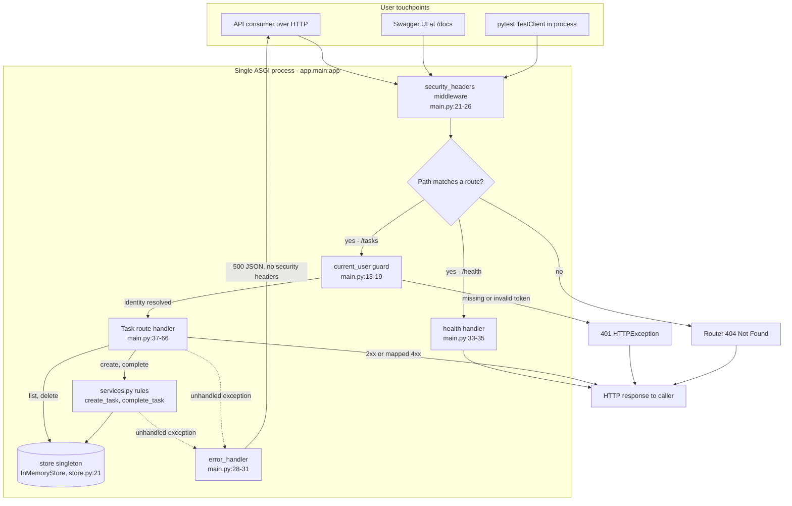

Every request enters through the same middleware node, and there are only two ways to reach business logic: through the identity guard for `/tasks`, or directly to `health` for `/health`. The store is touched from two places — the handler for listing and deletion, and the service layer for creation and completion — and the only edge that leaves the process without passing back through the middleware is the 500 produced by `error_handler`.

### 4.4.2 Detailed Process Flows for Each Core Feature

**Create task — `POST /tasks`.** The successful path is the longest in the system: schema validation, credential validation, identity resolution, title normalisation, two business rules, and two store writes.

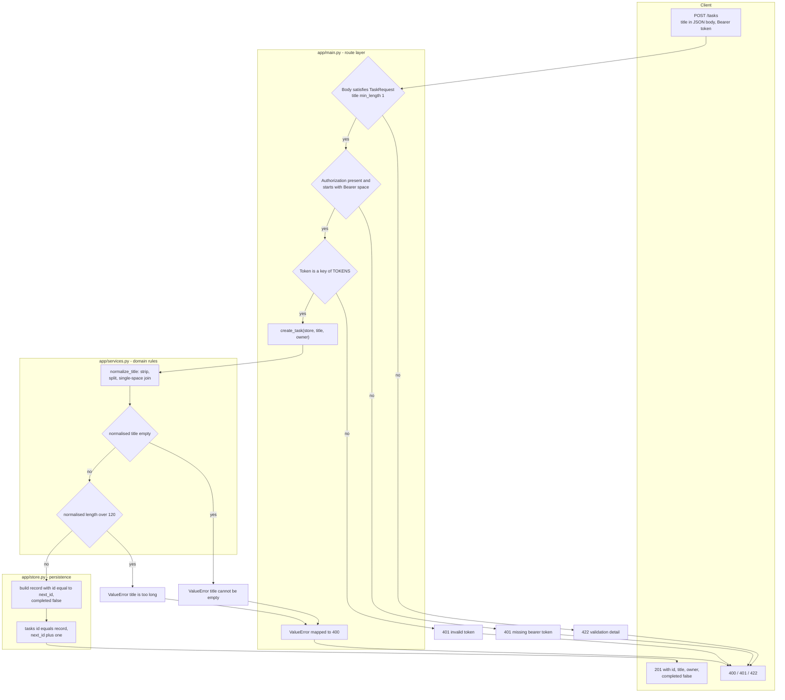

The lane order shows the precedence that 4.2.2 records: schema failure is answered before the credential is examined, and the credential is examined before the title is touched. Both title rules raise `ValueError` inside the service layer and are converted to 400 only when they cross back into the route at `app/main.py:42-43`.

**List own tasks — `GET /tasks`.** The shortest path: one guard, one filter, no failure branch after authentication.

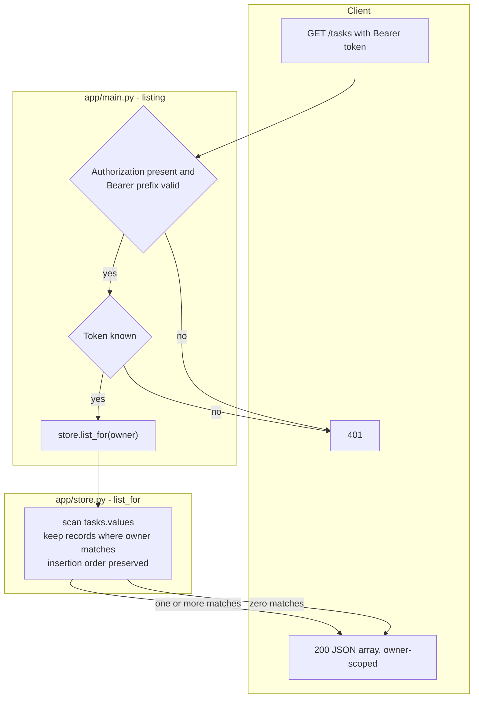

The filter decision is evaluated per record rather than once per request, and zero matches still produce a 200 with `[]` — absence of data is never an error state in this workflow.

**Complete task — `POST /tasks/{task_id}/complete`.** Existence is checked before ownership, so the two failure modes are distinguishable to the caller.

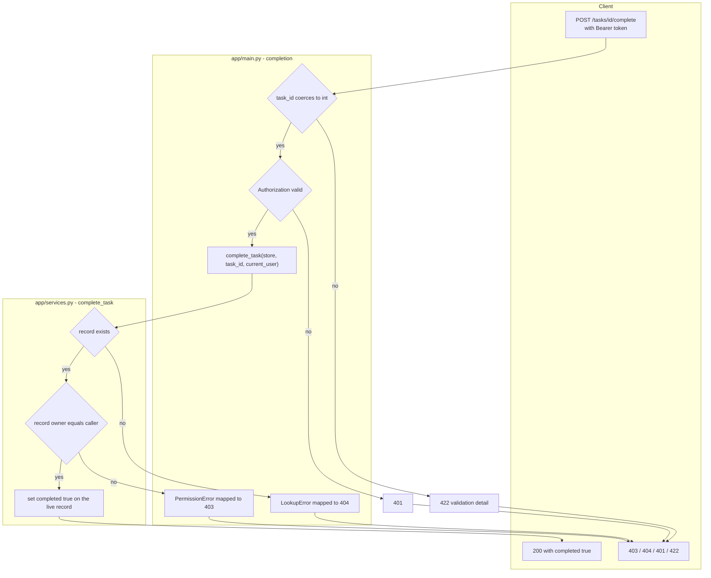

No diamond tests whether the task is already complete, which is why the transition can be traversed repeatedly: `K11` assigns `True` to a field that may already hold `True` (`app/services.py:18`).

**Delete task — `DELETE /tasks/{task_id}`.** The same two checks as completion, but implemented in the route rather than in `app/services.py`.

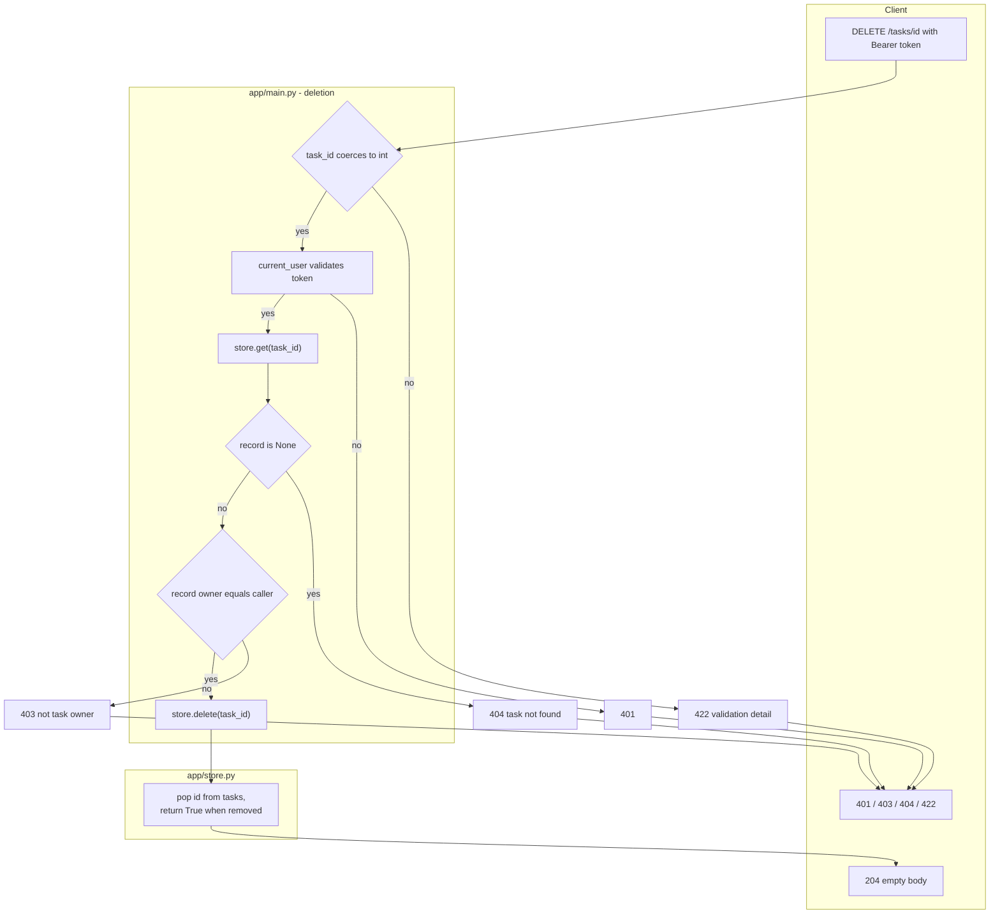

The success terminal is the only 204 in the API, and the boolean returned by `store.delete` is discarded because existence was already proven by `X4`-`X5` (`app/main.py:66`).

### 4.4.3 Error Handling Flowchart

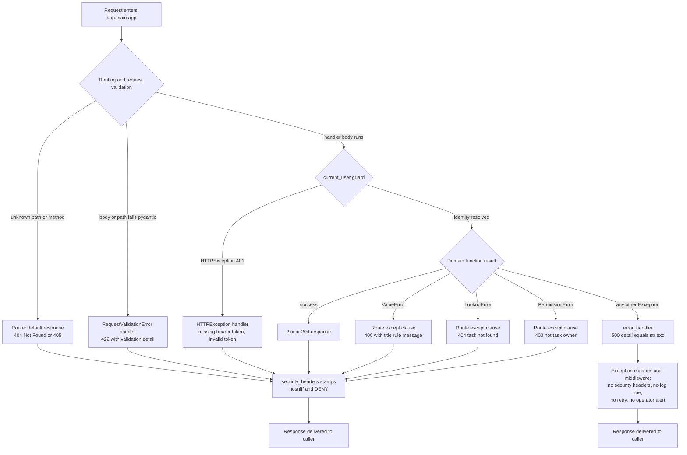

Eight of the nine terminals rejoin the middleware and carry both hardening headers; the 500 terminal does not, because user middleware sits inside `ServerErrorMiddleware` in Starlette's stack (verified against the installed Starlette 1.10.0 `build_middleware_stack`). No terminal has an outgoing retry or notification edge, because neither mechanism exists.

### 4.4.4 Integration Sequence Diagrams

The first sequence is the complete lifecycle asserted by `tests/e2e/test_user_journeys.py:1-10`, showing every participant that participates in a task's life.

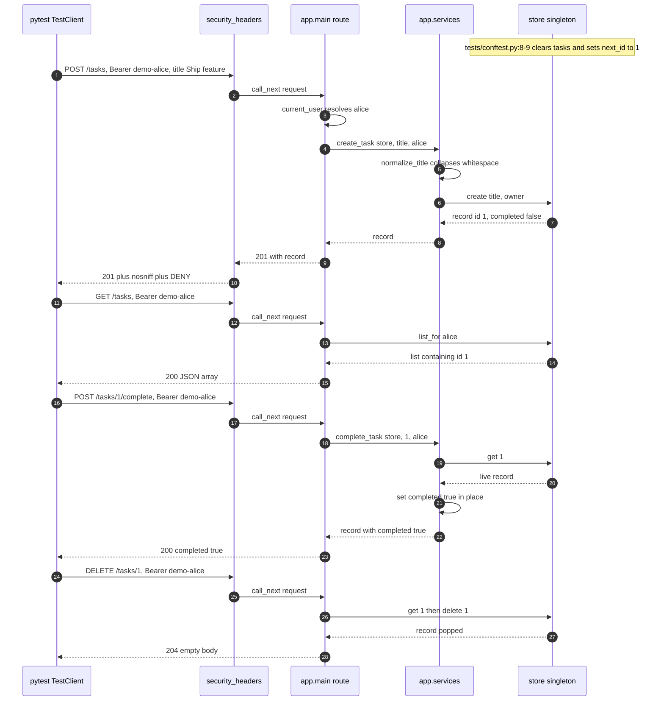

The second sequence is the cross-caller isolation flow, and it also carries the negative finding for integration: there is no participant beyond the store, because no outbound call exists.

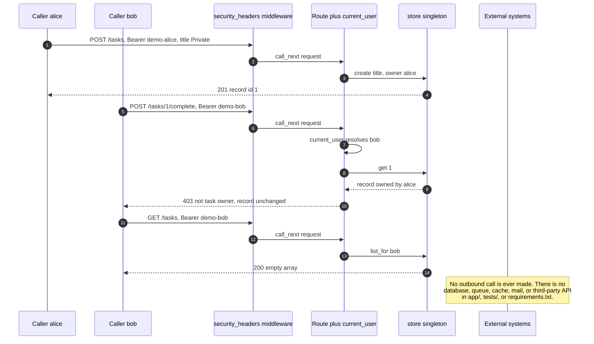

Both flows are provable from the tests: the first mirrors `tests/e2e/test_user_journeys.py:1-10`, the second mirrors `tests/integration/test_task_api.py:10-13` (403) and the owner filter in `app/store.py:15-16` (empty array for the non-owner).

### 4.4.5 State Transition Diagram

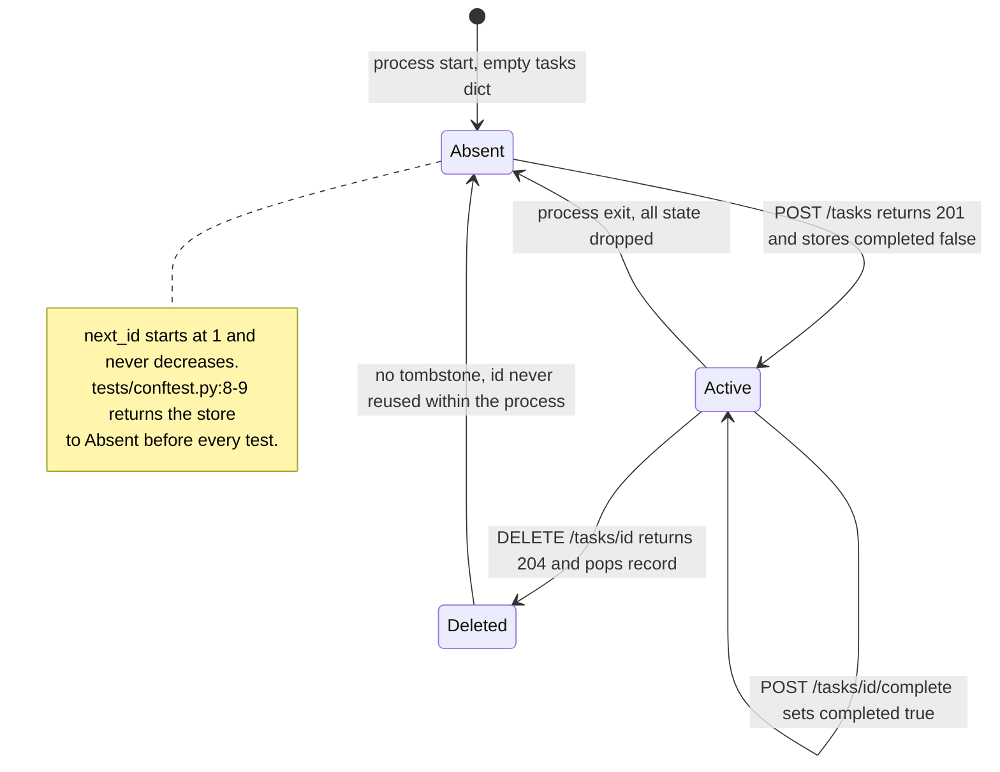

The diagram captures the two transitions the code actually performs — the in-place completion and the hard `pop` — and the two it performs implicitly, by process exit and by the test fixture's reset. There is no transition from `Deleted` back to `Active`: no restore path exists, and the id counter is never decremented, so a deleted id stays absent for the life of the process.


## 4.5 References

- `app/main.py` - the entire HTTP surface behind every workflow: `TOKENS` at line 8, `TaskRequest` at 10-11, `current_user` at 13-19, `security_headers` middleware at 21-26, `error_handler` at 28-31, and the five routes at 33-66 with their status codes and exception mappings.
- `app/services.py` - domain rules and transitions: `normalize_title` at 1-2, title validation and creation at 4-10, existence and ownership checks plus the in-place `completed` assignment at 12-19.
- `app/store.py` - state holder: `tasks` and `next_id` at 3-4, `create` at 6-10, `get` at 12-13, `list_for` at 15-16, `delete` at 18-19, and the module singleton at 21.
- `app/__init__.py` - empty package marker; establishes `app.main`, `app.services` and `app.store` as the import paths used by the routes and the tests.
- `app/` - the whole application package; confirms there is no worker, scheduler, client or cache module beyond these four files.
- `tests/conftest.py` - the `client` fixture at 6-10, the only state-reset mechanism (`tasks.clear()`, `next_id = 1`) and the in-process `TestClient` transport.
- `tests/e2e/test_user_journeys.py` - the create → list → complete → delete journey at 1-10 and its 201/200/204 expectations.
- `tests/integration/test_task_api.py` - creation and listing at 4-8, the cross-user 403 at 10-13, and hard deletion proven by an empty listing at 15-19.
- `tests/non_functional/test_security_resilience.py` - hardening headers at 1-4, unauthenticated and invalid-token rejections at 6-11, and the sub-one-second `/health` threshold at 13-16.
- `tests/unit/test_services.py` - normalisation and both title rules at 5-14, and the `PermissionError` ownership rule at 16-20.
- `tests/` - the four tiers whose twelve tests are the only executed evidence of these workflows.
- `docs/coverage_intent.md` - the test-tier mapping at 5-8 and the declared gaps at 10 (concurrency, rate limiting, pagination, input fuzzing, audit logging, sustained load).
- `README.md` - the run command and `/docs` URL at 17-19, `pytest -q` at 21, and the non-deployability disclaimer at 26.
- `pytest.ini` - `testpaths = tests` and `python_files = test_*.py`, the batch driver for the test suite.
- `requirements.txt` - the declared runtime and test dependencies, which contain no external service client.
- Starlette 1.10.0 `build_middleware_stack` and `BaseHTTPMiddleware.__call__` (installed package `starlette/applications.py`, `starlette/middleware/base.py`) - established the middleware ordering used to show that 500 responses bypass `security_headers`.


# 5. System Architecture

## 5.1 High-Level Architecture

### 5.1.1 System Overview

**Architecture style.** The system is a **three-layer, single-process monolith delivered as one ASGI application object**. The router and HTTP concerns live in `app/main.py`, business rules in `app/services.py`, and persistence in `app/store.py`; the package is flat, with exactly four modules and no sub-packages (`app/`). Every HTTP request is handled entirely inside one Python process by ordinary function calls, with no serialization hop between layers, no dependency-injection container, and no persistence library. The whole runtime surface is 106 lines of application code (`app/main.py` 66 lines, `app/services.py` 19, `app/store.py` 21) implementing five routes, one HTTP middleware, one exception handler, three domain functions and four store methods.

**Rationale for this style.** The repository is a QA fixture, not a product: `README.md:4` describes it as a "Synthetic FastAPI test fixture for Blitzy Proactive Insights", and `README.md:26` forbids deploying it or using real credentials. The architecture is therefore optimized for *observability of behaviour per layer* rather than for scale:

- **Layer purity makes the four test tiers possible.** `tests/unit/test_services.py:1-20` calls `app/services.py` directly with throwaway `InMemoryStore()` instances, while `tests/integration/`, `tests/e2e/` and `tests/non_functional/` drive the same rules through HTTP (`tests/conftest.py:10`). A single deployable with clean seams is the smallest shape that supports both.
- **Module-level singletons give the server and the tests the same object graph.** `app = FastAPI(...)` (`app/main.py:7`) and `store = InMemoryStore()` (`app/store.py:21`) are created at import time, so `uvicorn app.main:app` (`README.md:17`) and `TestClient(app)` share one instance each. Determinism comes from resetting that shared store (`tests/conftest.py:6-10`) instead of rebuilding an application.
- **Zero infrastructure dependency means zero configuration surface.** There is no database URL, no secret store, no broker address and no environment variable read anywhere in the package — a repository-wide search for `os.environ`, `getenv`, `config` and `settings` across `app/`, `tests/` and `docs/` returns no match.
- **Deliberate weaknesses are localized** so a scanner can find them: static credentials at `app/main.py:8` and the exception-text disclosure annotated "Intentional weakness for scanner evaluation" at `app/main.py:30`.

**Key architectural principles and patterns observed.**

| Principle or pattern | How it appears in the code | Consequence |
|---|---|---|
| Strict one-way layering | `app/main.py:4-5` imports the store and the domain functions; `app/services.py` and `app/store.py` import nothing from `main.py` | No upward dependency; the domain layer is importable and testable without the web layer |
| Composition root at import time | `app = FastAPI(...)` (`app/main.py:7`), `store = InMemoryStore()` (`app/store.py:21`), `TOKENS = {...}` (`app/main.py:8`) | One process-wide configuration moment; no factory, no lifespan hook |
| Repository-style persistence (informal) | `InMemoryStore` exposes `create` / `get` / `list_for` / `delete` over a private-by-convention dict (`app/store.py:6-19`) | Storage can be swapped by passing a different object; no abstract base class or protocol is declared |
| Dependency injection by parameter | Domain functions take `store` as an untyped first argument (`app/services.py:4`, `:12`) and the routes pass the singleton | The test seam; `tests/unit/test_services.py:10` exploits it |
| Middleware for cross-cutting behaviour | `@app.middleware("http")` (`app/main.py:21`) stamps two hardening headers on every routed response | Header policy is declared once instead of per route |
| Catch-all error handler | `@app.exception_handler(Exception)` (`app/main.py:28-31`) | One uniform 500 envelope; no per-exception taxonomy above the route level |
| Exception-type translation at the boundary | `ValueError`→400, `LookupError`→404, `PermissionError`→403 at `app/main.py:42-43` and `:53-56` | The domain layer stays HTTP-agnostic |
| Split validation | Shape in pydantic (`TaskRequest`, `app/main.py:10-11`), business rules in `services.py` | Empty body returns 422, whitespace-only title returns 400 |
| Ownership derived from credentials | The owner is read from the token, never from the request body (`app/main.py:39`, `:47`, `:52`, `:60`) | A caller cannot create or address another identity's record by payload |

**System boundaries and major interfaces.** The architecture has exactly three boundaries, and only one of them crosses a process edge:

| Boundary | Inside | Outside | Crossing mechanism |
|---|---|---|---|
| Client boundary (process edge) | All five routes of `app.main:app` | HTTP clients, `curl`, the auto-generated Swagger UI at `/docs` (`README.md:19`) | JSON over HTTP; `Authorization: Bearer <token>` is the only credential carrier (`app/main.py:13-19`) |
| Persistence boundary (in-process) | Route handlers and `app/services.py` | `InMemoryStore` in `app/store.py` | Direct Python method calls on the singleton; no network, no disk |
| Test transport boundary (in-process) | `tests/` suite | `app.main:app` | `TestClient(app)` built on httpx's in-process ASGI transport (`tests/conftest.py:2`, `:10`) — real routing, validation and serialization, no sockets |

There is no operations boundary: no CI configuration, container file, process manager definition or health-check probe outside the application is tracked in the repository (13 tracked files, enumerated by `git ls-files`). The `/health` route (`app/main.py:33-35`) exists as an application-level liveness endpoint only, and no deployment descriptor consumes it.

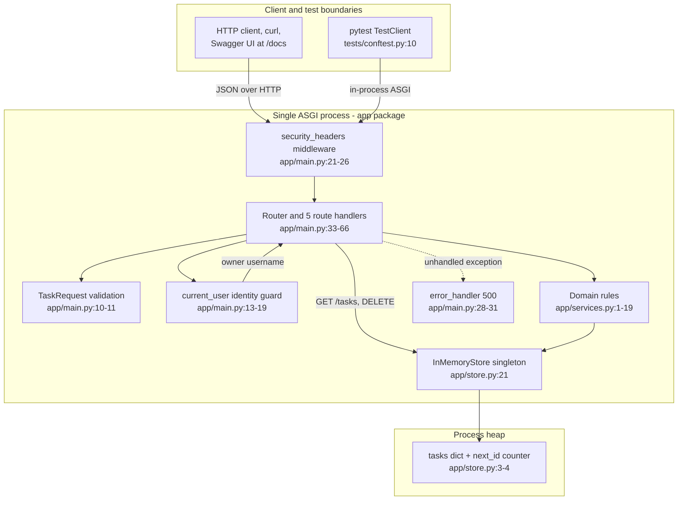

**Scale and shape of the system.** One application object, five routes, three domain functions, one store instance holding at most as many records as have been created since process start, two static credentials, and twelve test functions across four tiers. The store keeps every task ever created until it is deleted or the process ends; `list_for` has no limit, offset or filter beyond owner (`app/store.py:15-16`), which `docs/coverage_intent.md:10` records as an intentional pagination gap.

### 5.1.2 Core Components Table

Twelve components constitute the system. The first table covers responsibility, dependencies and integration; the second records the critical consideration for each, keeping every table within four columns.

| Component Name | Primary Responsibility | Key Dependencies | Integration Points |
|---|---|---|---|
| ASGI application object — `app/main.py:7` | Composition root: instantiate the framework app and own every route, the middleware, the exception handler and the token table | FastAPI; Starlette (routing, middleware and exception-handler hooks); pydantic | Exported as `app.main:app` for uvicorn (`README.md:17`) and for `TestClient(app)` (`tests/conftest.py:10`) |
| Route handlers — `app/main.py:33-66` | Serve the five endpoints F-001 through F-006: parse, authenticate, delegate, and translate domain exceptions into status codes | `TaskRequest`; `current_user`; `app/services.py`; `store` singleton | Invoked by the router; call the identity guard, the domain layer and the store |
| Identity guard and token table — `current_user` at `app/main.py:13-19`, `TOKENS` at `app/main.py:8` | Resolve `Authorization: Bearer <token>` into a username, otherwise raise 401 | FastAPI `Header` / `HTTPException`; the literal `TOKENS` dict | Called as a plain function inside all four `/tasks` handlers — no `Depends`, no route-level dependency list |
| Request model — `TaskRequest` at `app/main.py:10-11` | Validate the shape of `{"title": ...}`; absent, empty or wrong-typed titles are rejected with 422 before the handler runs | pydantic `BaseModel`, `Field(min_length=1)` | Injected into `POST /tasks`; published in the generated `/openapi.json` schema |
| Security-headers middleware — `app/main.py:21-26` | Stamp `X-Content-Type-Options: nosniff` and `X-Frame-Options: DENY` on responses returning through the router | Starlette `@app.middleware("http")`; `Request`, `call_next` | Wraps every route; the only middleware in the stack |
| Global exception handler — `app/main.py:28-31` | Convert any exception escaping the router into `500 {"detail": str(exc)}` | Starlette generic-exception hook; `JSONResponse` | Registered for `Exception`; sees only faults not already converted by a handler or by the framework's `HTTPException` path |
| Domain rule layer — `app/services.py:1-19` | Normalize titles, enforce the blank and 120-character rules, enforce ownership on completion | No imports at all; the store arrives as an untyped parameter | Called by the create and complete routes; called directly by the unit tier (`tests/unit/test_services.py:2`) |
| Persistence layer — `InMemoryStore` and singleton at `app/store.py:1-21` | Assign monotonic ids, hold records in a dict, filter by owner, hard-delete | Python built-in `dict` only | Used by `services.py`, by `GET /tasks` and `DELETE /tasks/{task_id}`, and by the `client` fixture's reset |
| Package marker — `app/__init__.py` (0 bytes) | Make `app` a regular package so siblings import as `app.main`, `app.services`, `app.store` | None | Import-path anchor only; contributes no behaviour |
| Test harness — `tests/conftest.py` plus `unit/`, `integration/`, `e2e/`, `non_functional/` | Exercise 12 assertions across four tiers and reset shared state between tests | pytest ≥8.0; httpx-backed `TestClient` | Imports `app.main:app` and `app.store:store`; drives the routes in-process |
| Tooling configuration — `pytest.ini`, `requirements.txt` | Centralize test discovery (`testpaths = tests`, `python_files = test_*.py`, `addopts = -ra`) and the four dependency ranges | pytest; pip / PyPI | Read by `pytest -q` (`README.md:21`) and `pip install -r requirements.txt` (`README.md:16`) |
| Coverage policy — `docs/coverage_intent.md:1-10` | Map each of the four Proactive Insights categories to its evidence file and declare the six intentional gaps | None | Documentation only; read by evaluators, referenced by no code |

| Component Name | Critical Consideration | Evidence |
|---|---|---|
| ASGI application object | A single process-wide instance means there is no per-test application construction; isolation must come from mutating shared state | `app/main.py:7`; `tests/conftest.py:6-10` |
| Route handlers | Two routes call the domain layer while `GET /tasks` and `DELETE` reach into the store directly, and `DELETE` re-implements the ownership check instead of delegating to `services.complete_task` | `app/main.py:47`, `:61-66` vs `app/services.py:16-17` |
| Identity guard | Implemented as a plain function rather than a FastAPI dependency, so it is invisible to the OpenAPI security scheme and cannot be reused declaratively on a new route | `app/main.py:13-19`; no `Depends` anywhere in `app/` |
| Request model | Only `title` is validated by the framework; the model has no `max_length`, so the 120-character cap is enforced in the domain layer and surfaces as 400, not 422 | `app/main.py:10-11`; `app/services.py:8-9` |
| Security-headers middleware | Registered on the application's HTTP middleware stack, so it stamps responses produced by the router; the generic-exception handler that produces 500s is installed by Starlette at the outermost server-error layer, above this middleware | `app/main.py:21-31` |
| Global exception handler | Returns the raw exception string to the caller by design; the in-source comment names it an intentional weakness for scanner evaluation | `app/main.py:30-31` |
| Domain rule layer | `complete_task` mutates the record dict handed back by the store and never calls a store update method, so correctness depends on the store returning a live reference rather than a copy | `app/services.py:18`; `app/store.py:12-13` |
| Persistence layer | Holds a plain `dict` and counter with no lock; because the handlers are synchronous `def` functions, the framework dispatches them on a worker thread pool, so concurrent requests mutate the same dict from multiple threads | `app/store.py:3-4`; `app/main.py:37-66`; `docs/coverage_intent.md:10` (concurrency gap) |
| Package marker | Empty file; renaming or flattening the package would break the `app.main:app` entry point named in the README and in `tests/conftest.py:3` | `app/__init__.py`; `README.md:17` |
| Test harness | The fixture mutates the production singleton instead of constructing a fresh app, so tests are order-independent only because of that reset | `tests/conftest.py:7-10` |
| Tooling configuration | Both files encode their directives as literal `\n` escapes on one physical line, which affects whether `pytest -q` can collect at all | `pytest.ini` (70 bytes, one line); `requirements.txt` (62 bytes, one line) |
| Coverage policy | Six gaps are declared rather than hidden, making an unexercised behaviour interpretable as policy rather than defect | `docs/coverage_intent.md:10` |

### 5.1.3 Data Flow Description

**Primary data flows.** Every flow is one synchronous request/response cycle sharing the same six-stage pipeline:

1. **Ingress.** uvicorn (`README.md:17`) or the in-process `TestClient` (`tests/conftest.py:10`) invokes `app.main:app`. No request ID is generated, no clock is read and nothing is written anywhere.
2. **Middleware entry.** `security_headers` receives the `Request` and `await`s `call_next(request)` (`app/main.py:22-23`) — the only `await` in the request path other than the handler's own signature.
3. **Routing and framework validation.** The router matches method and path, coerces `task_id: int` where present, and validates the body into `TaskRequest` (`app/main.py:10-11`). A failure here produces a 422 without entering the handler body.
4. **Identity resolution.** The handler calls `current_user(authorization)` (`app/main.py:39`, `:47`, `:52`, `:60`), which strips the `Bearer ` prefix with `str.removeprefix` and looks the remainder up in `TOKENS` (`app/main.py:16`). Success yields the username string that becomes the record owner; failure raises `HTTPException(401, ...)`.
5. **Domain and store work.** Create and complete delegate to `app/services.py`; list and delete call the store directly. All state transition happens here, in the process heap.
6. **Egress.** The handler returns a record dict, a list of dicts, or `None` (for the 204 on delete). The framework JSON-encodes it, the middleware stamps the two hardening headers on the way out (`app/main.py:24-25`), and the response leaves the process.

**Integration patterns and protocols.** The only protocol on the wire is JSON over HTTP; internally every hop is an in-process function call, and there is no message broker, webhook, polling loop or background task anywhere in the twelve-file tree. Request handling is **synchronous from the handler's perspective**: all four `/tasks` handlers and `/health` are plain `def` functions (`app/main.py:34`, `:38`, `:46`, `:50`, `:59`), so the framework runs them on a worker thread pool rather than on the event loop; only the middleware and the exception handler are `async def` (`app/main.py:22`, `:29`). The consequence is that concurrency inside one process is thread-based against an unsynchronized dict — the gap declared at `docs/coverage_intent.md:10`.

**Data transformation points.** Every point where data changes shape or meaning is listed below; there are no others.

| Stage | Input shape | Output shape | Location |
|---|---|---|---|
| Body decode and shape validation | JSON object with `title` | `TaskRequest` instance; 422 on violation | `app/main.py:10-11` |
| Title canonicalization | Raw title string | Whitespace-collapsed string (`" ".join(title.strip().split())`) | `app/services.py:1-2`, applied at `:5` |
| Record materialization | `title`, `owner` | `{"id", "title", "owner", "completed": False}` | `app/store.py:6-10` |
| Identity derivation | `Authorization` header | Username string from `TOKENS` | `app/main.py:13-19` |
| Ownership comparison | Record `owner` vs resolved username | `PermissionError` → 403, or in-place mutation | `app/services.py:16-18`; `app/main.py:64-65` |
| Exception translation | `ValueError` / `LookupError` / `PermissionError` / any other | 400 / 404 / 403 / 500 HTTP responses | `app/main.py:42-43`, `:53-56`, `:28-31` |
| Serialization | Record dict or list of dicts | JSON body | FastAPI's response encoding, implicit in the return type |
| Response hardening | Outgoing response | Two added headers | `app/main.py:24-25` |

A subtle but load-bearing transformation: `complete_task` sets `task["completed"] = True` on the dict returned by `store.get` (`app/services.py:18`) and never calls a store method. The change persists only because `InMemoryStore.get` returns the live dict stored in `tasks` (`app/store.py:12-13`). A store implementation that returned copies would silently break completion without any test failing on the record's identity — only `tests/e2e/test_user_journeys.py:9` asserts the `completed: true` body.

**Key data stores and caches.** There is exactly one store and no cache of any kind.

| Store | Backing | Lifetime | Contents |
|---|---|---|---|
| `store.tasks` (`app/store.py:3`) | Plain `dict` in the process heap, keyed by integer id | Process lifetime; lost on restart, not shared across workers | Task records, insertion-ordered, one per created task until deleted |
| `store.next_id` (`app/store.py:4`) | Integer counter, starts at 1 and increments per create | Process lifetime; reset to 1 by the test fixture | Monotonic in-process id sequence |
| `TOKENS` (`app/main.py:8`) | Module-level dict literal | Import lifetime; never mutated | Two token→username mappings (`demo-alice`→`alice`, `demo-bob`→`bob`) |

No caching layer exists: no memoization, no HTTP cache directives (`Cache-Control`, `ETag` or `Last-Modified` are never set — the only headers written are the two at `app/main.py:24-25`), no in-memory result cache and no external cache. The in-memory dict is a store, not a cache: there is no authoritative copy behind it. Test isolation is likewise achieved by mutating the live store (`store.tasks.clear()`, `store.next_id = 1` at `tests/conftest.py:8-9`) rather than by swapping in a fresh one.

### 5.1.4 External Integration Points

**Finding: the system has no outbound integrations.** A search across all twelve source and documentation files finds no HTTP client, database driver, message broker, cache client, identity provider, email, SMS or metrics SDK. The four declared dependencies (`requirements.txt`) are `fastapi>=0.110,<1.0`, `uvicorn>=0.27`, `pytest>=8.0` and `httpx>=0.27`; `httpx` is imported only indirectly, as the transport behind `fastapi.testclient.TestClient` (`tests/conftest.py:2`). Every integration point below is therefore inbound or build-time.

| System Name | Integration Type | Data Exchange Pattern | Protocol/Format |
|---|---|---|---|
| HTTP client / Swagger UI at `/docs` | Inbound synchronous API consumer | Client-initiated request/response only; no callbacks, webhooks or subscriptions | JSON over HTTP; `Authorization: Bearer <token>` |
| ASGI server (uvicorn) | Inbound host runtime | Loads the application object once per process and forwards each request | ASGI 3 over HTTP; no WebSocket routes are declared, so only the HTTP scope is used |
| pytest with `TestClient` | Inbound test transport | In-process call per test; no socket, no network | Python API over httpx's ASGI transport |
| FastAPI / Starlette / pydantic | Inbound library platform | In-process calls into the framework for routing, validation, middleware and error dispatch | Python API; OpenAPI 3 document published at `/openapi.json` |
| PyPI via pip | Build-time dependency supply | Pull resolution of four version ranges at install time | PEP 508 requirement lines in `requirements.txt` |
| Blitzy Proactive Insights scanner | Repository-level static consumer | Reads the checkout; no runtime channel | Source tree on branch `main` (`README.md:24`) |
| Identity provider | **Absent by design** | Credentials are compared against a literal dict; no federation, token verification or revocation call | n/a — `TOKENS` at `app/main.py:8` |
| Database / broker / cache | **Absent by design** | State is mutated in process memory only | n/a — `InMemoryStore` at `app/store.py:1-21` |

| System Name | SLA Requirements | Enforcement in Repository |
|---|---|---|
| HTTP client / Swagger UI | None declared for the API. The only numeric threshold in the project is a sub-one-second `/health` assertion | `tests/non_functional/test_security_resilience.py:13-16` |
| ASGI server (uvicorn) | None. No worker count, timeout, proxy header or bind configuration is tracked; the README's command is a development invocation with `--reload` | `README.md:17` |
| pytest with `TestClient` | The suite is expected to pass under `pytest -q` | `README.md:21`; twelve test functions across `tests/` |
| FastAPI / Starlette / pydantic | None. Dependency ranges are unpinned, so resolved versions may drift between environments | `requirements.txt` (four ranges, no lock file or hashes) |
| PyPI via pip | None. Reproducibility is explicitly not guaranteed by the manifest | `requirements.txt`; no `constraints.txt`, no lock file |
| Blitzy Proactive Insights scanner | Connect the repository root, select `main`, initially leave the environment unset | `README.md:23-24` |

Two consequences follow and are recorded as architectural constraints rather than defects: authentication has no dependency on any external system, so the system runs fully offline and entirely self-contained; and because no outbound client exists, there is no retry, timeout, circuit-breaker or fallback policy anywhere in the code — the concept of a downstream failure does not arise. The seven integration journeys that do exist (J-1 through J-7 in 4.1.1) all terminate inside the process.


## 5.2 Component Details

### 5.2.1 HTTP Interface and Routing Layer

**Purpose and responsibilities.** The routing layer is the only component a remote caller can reach. It declares five endpoints on the application object created at `app/main.py:7`, validates request shape through pydantic, invokes the identity guard, delegates state changes to the domain layer or the store, and converts domain exception types into HTTP status codes. It owns no state.

| Method and path | Handler | Success contract | Failure contract |
|---|---|---|---|
| `GET /health` | `health`, `app/main.py:33-35` | `200 {"status": "ok"}` | None in code |
| `POST /tasks` | `create`, `app/main.py:37-43` | `201` with the stored record | 422 body, 401 token, 400 title rule |
| `GET /tasks` | `listing`, `app/main.py:45-47` | `200` JSON array of the caller's records | 401 token |
| `POST /tasks/{task_id}/complete` | `complete`, `app/main.py:49-56` | `200` with `completed: true` | 422 path, 401 token, 404 unknown, 403 non-owner |
| `DELETE /tasks/{task_id}` | `delete`, `app/main.py:58-66` | `204` with an empty body | 422 path, 401 token, 404 unknown, 403 non-owner |

**Technologies and frameworks.** FastAPI with Starlette underneath for routing, middleware and exception dispatch, and pydantic for the request model; declared as `fastapi>=0.110,<1.0` in `requirements.txt`. Routes are declared as bare decorators on the application (`@app.get`, `@app.post`, `@app.delete`) with no `APIRouter`, no path prefix, no tags and no `response_model`. All handlers are synchronous `def` functions, so the framework executes them on a worker thread pool rather than on the event loop. The application is constructed with a title only, so the framework's default documentation endpoints remain enabled and undecorated: the OpenAPI document at `/openapi.json`, Swagger UI at `/docs` (the URL named in `README.md:19`) and ReDoc at `/redoc`.

**Key interfaces and APIs.**

- **ASGI callable:** `app.main:app`, named by `README.md:17` for uvicorn and imported by `tests/conftest.py:3` for in-process testing.
- **Wire contract:** requests carry JSON `{"title": "<string>"}` on create and an `Authorization: Bearer <token>` header on all four `/tasks` routes; responses carry `{"id": int, "title": str, "owner": str, "completed": bool}` singly or as a bare array, or no body at all for 204.
- **Handler signature convention:** `def handler(payload: TaskRequest, authorization: str | None = Header(default=None))` (`app/main.py:38`). Declaring the header as optional with `default=None` is deliberate: a missing header reaches `current_user` and yields 401, rather than the 422 a required header would produce.
- **Path parameter typing:** `task_id: int` (`app/main.py:50`, `:59`) coerces non-integer segments into a 422 before the handler body runs, which is why no handler performs its own id parsing.
- **Published schema:** because authentication is a plain function rather than a `Security` dependency, the OpenAPI document lists `authorization` as an optional header parameter and declares no security scheme; the bearer requirement exists only in code and in `README.md:19`'s pointer to `/docs`.

**Data persistence requirements.** None of its own. Two routes delegate entirely to the domain layer (`app/main.py:41`, `:52`) and two touch the store directly (`app/main.py:47`, `:61-66`). The `DELETE` handler performs a read-then-write pair — `store.get(task_id)` at line 61 followed by `store.delete(task_id)` at line 66 — with the ownership comparison in between, so its correctness depends on no other request interleaving at that point.

**Scaling considerations.** The handlers hold no per-request state, so the layer itself would scale horizontally; what prevents that is the store it shares (5.2.4). Three limits apply as written: `GET /tasks` returns every matching record with no limit or offset (`app/store.py:15-16`), so response size grows linearly with task count; synchronous handlers consume worker threads for the full duration of each request, making the thread pool the concurrency ceiling; and with no asynchronous I/O in any handler there is no benefit to an async rewrite of the routes as they stand.

### 5.2.2 Authentication Component

**Purpose and responsibilities.** Resolve the `Authorization` header into an owner identity before any state change occurs, reject unauthenticated callers with 401, and supply the username that both scopes reads and gates writes. The component answers two questions and nothing else: *who is calling*, and *does this record belong to them*. The second question is answered partly here and partly in the domain layer (5.2.3).

**Technologies and frameworks.** A single plain Python function, `current_user(authorization)` at `app/main.py:13-19`, using `str.removeprefix` and a module-level dictionary literal, `TOKENS = {"demo-alice": "alice", "demo-bob": "bob"}` at `app/main.py:8`. It raises FastAPI's `HTTPException`, which the framework converts to a JSON body with the message under `detail`. There is no authentication library, no hashing, no signing, no session store, no cookie handling and no `Security` dependency object.

**Key interfaces and APIs.**

| Interface | Contract | Evidence |
|---|---|---|
| `current_user(authorization: str \| None) -> str` | Returns the username for a known token; raises `HTTPException(401, "missing bearer token")`, `HTTPException(401, "invalid token")` | `app/main.py:13-19` |
| Token format | `Bearer demo-alice` or `Bearer demo-bob`, matched after removing the literal `Bearer ` prefix | `app/main.py:14-16`; `tests/integration/test_task_api.py:1-2` |
| Call sites | Invoked inside the four `/tasks` handlers, in the handler body rather than through the framework's dependency mechanism | `app/main.py:39`, `:47`, `:52`, `:60` |

The check order is contractual: the header must be present *and* carry the `Bearer ` prefix before any lookup happens (`app/main.py:14-15`), so an absent header and a header such as `Basic xyz` both produce `missing bearer token`, while a well-formed but unknown token produces `invalid token`. One consequence of the in-body call style is that parameter validation precedes authentication on `POST /tasks`, so a request with both a blank body field and a bad token is answered 422 rather than 401; section 4.1.1 records the same precedence per route.

**Ownership enforcement, route by route.** The component supplies identity; ownership itself is applied at four different points:

| Route | How ownership is applied | Evidence |
|---|---|---|
| `POST /tasks` | The owner is taken from the resolved identity, never from the body | `app/main.py:39-41` |
| `GET /tasks` | The listing is filtered to the caller by `list_for(owner)` | `app/main.py:47`; `app/store.py:15-16` |
| `POST /tasks/{task_id}/complete` | Delegated to `complete_task`, which raises `PermissionError` → 403 | `app/services.py:16-17`; `app/main.py:55-56` |
| `DELETE /tasks/{task_id}` | Re-implemented inline in the handler with an explicit comparison | `app/main.py:64-65` |

**Data persistence requirements.** The credential table is an import-time constant held in module memory; nothing about a caller is persisted. There is no session, no token expiry, no refresh, no revocation list and no audit record of a successful or failed authentication. Adding, rotating or removing an identity requires editing `app/main.py:8` and restarting the process.

**Scaling considerations.** Authentication cost is a single dictionary lookup, so it adds no meaningful latency and would not become a bottleneck. The binding constraints are static: exactly two fixed identities, no per-user provisioning path, no multi-tenant isolation beyond the owner string, and identical credentials in every environment because none is configured externally.

### 5.2.3 Domain Rule Layer

**Purpose and responsibilities.** `app/services.py` holds the business rules that must hold regardless of transport: title canonicalization, a non-empty rule, a 120-character ceiling, and ownership on completion. It is the only place where a task's meaning is decided, and it is deliberately HTTP-unaware — the module imports nothing at all.

**Technologies and frameworks.** Nineteen lines of plain Python with no third-party import. The store is received as an untyped, duck-typed parameter, which is the codebase's only injection seam. Errors are signalled with built-in exceptions rather than custom classes, and the HTTP layer maps them by type.

| Function | Signature | Contract | Evidence |
|---|---|---|---|
| `normalize_title` | `(title) -> str` | `" ".join(title.strip().split())` — trims and collapses internal whitespace runs | `app/services.py:1-2` |
| `create_task` | `(store, title, owner) -> dict` | Normalizes, raises `ValueError("title cannot be empty")` on a falsy result, `ValueError("title is too long")` above 120 characters, otherwise delegates to `store.create` and returns the record unmodified | `app/services.py:4-10` |
| `complete_task` | `(store, task_id, owner) -> dict` | Raises `LookupError("task not found")` when `store.get` yields `None`, `PermissionError("not task owner")` when the owner differs, otherwise sets `completed = True` in place and returns the record | `app/services.py:12-19` |

**Key interfaces and APIs.** The three functions above are the entire public surface; there is no class, no state and no configuration. Their exception types are the contract the routing layer depends on — `ValueError` maps to 400 at `app/main.py:42-43`, `LookupError` to 404 and `PermissionError` to 403 at `app/main.py:53-56`. A new exception type introduced here without a corresponding mapping would surface as a 500 through the global handler.

**Data persistence requirements.** None directly: the layer never constructs, holds or owns storage. It does, however, require that the object it is handed return **live references**. `complete_task` mutates the dict returned by `store.get` (`app/services.py:18`) and never calls a store update or save method; the change is durable only because `InMemoryStore.get` returns the stored object itself (`app/store.py:12-13`).

**Scaling considerations.** Every rule is constant-time apart from the linear scan inside `normalize_title`'s `split`, and the 120-character ceiling bounds any record's title before it reaches storage. The rules are re-entrant by construction — no module state, no counters, no caches — so the layer adds no concurrency hazard of its own; whatever concurrency risk exists comes from the shared store. Two behavioural limits are worth noting: completion is idempotent in effect but unchecked, so a second completion of an already-completed task returns 200 again rather than a conflict; and completion is irreversible, since no route clears the flag.

### 5.2.4 Persistence Component

**Purpose and responsibilities.** `app/store.py` is the system of record for the lifetime of the process. `InMemoryStore` assigns monotonically increasing integer ids, holds task records in a dictionary, filters them by owner for listing, and deletes them permanently. One instance, `store = InMemoryStore()` at `app/store.py:21`, is created at import and imported by both the application (`app/main.py:4`) and the test fixture (`tests/conftest.py:4`) — there is no factory, no connection pool and no second instance in production use.

**Technologies and frameworks.** A plain Python class over a built-in `dict` and an integer counter (`app/store.py:3-4`). No database, ORM, migration tool, serialization format, filesystem write or network client appears anywhere in the module or the package.

| Method | Signature | Contract | Evidence |
|---|---|---|---|
| `create` | `(title, owner) -> dict` | Builds `{"id", "title", "owner", "completed": False}`, stores it under `next_id`, increments the counter, and returns **the stored object itself** | `app/store.py:6-10` |
| `get` | `(task_id) -> dict \| None` | Returns the live record or `None`; never a copy | `app/store.py:12-13` |
| `list_for` | `(owner) -> list` | Returns the caller's records in insertion order; `[]` when none; no limit, offset, sort or filter beyond owner | `app/store.py:15-16` |
| `delete` | `(task_id) -> bool` | `self.tasks.pop(task_id, None) is not None` — removes permanently and reports whether anything was removed | `app/store.py:18-19` |

**Data persistence requirements.** None are satisfied. There is no durability, no schema, no index, no constraint, no transaction and no backup: state exists solely in the process heap and disappears on restart. Records carry only `id`, `title`, `owner` and `completed` — no timestamps, no version and no history — so the store cannot answer "when" or "by whom, and when" questions, consistent with the declared absence of audit logging at `docs/coverage_intent.md:10`. Ids are unique and monotonic *within* a process only: every new process begins again at `next_id = 1`, so ids are not globally unique across restarts or across worker processes.

**Scaling considerations.**

| Dimension | Observed behaviour | Binding limit |
|---|---|---|
| Capacity | One dictionary entry per live task | Bounded by process memory; nothing evicts completed tasks |
| Read path | Full scan of `tasks.values()` per listing (`app/store.py:16`) | Listing cost grows linearly with total tasks held, not with the caller's own count |
| Concurrency | No lock, no atomic compare-and-set | Unsynchronized mutation from multiple worker threads; declared as the concurrency gap at `docs/coverage_intent.md:10` |
| Horizontal scale | Store is a module singleton inside one process | Running uvicorn with more than one worker would produce independent, divergent datasets |
| Isolation between tests | Achieved by mutating the shared instance | Any test that forgets the `client` fixture sees another test's state |

### 5.2.5 Middleware and Exception-Handling Component

**Purpose and responsibilities.** Two decorated functions at `app/main.py:21-31` implement every cross-cutting HTTP concern the system has. `security_headers` stamps two hardening headers onto outgoing responses; `error_handler` turns any exception escaping the router into a single 500 JSON envelope carrying the exception text.

**Technologies and frameworks.** Starlette's `@app.middleware("http")` decorator, which installs a `BaseHTTPMiddleware` wrapper, and `@app.exception_handler(Exception)`, which FastAPI forwards to Starlette's generic server-error hook; `fastapi.responses.JSONResponse` builds the 500 body. Both functions are `async def` — the only two coroutines in the application.

| Interface | Contract | Evidence |
|---|---|---|
| `async security_headers(request, call_next) -> Response` | Awaits `call_next(request)`, then sets `X-Content-Type-Options: nosniff` and `X-Frame-Options: DENY` on the response before returning it | `app/main.py:21-26` |
| `async error_handler(request, exc: Exception) -> JSONResponse` | `JSONResponse(status_code=500, content={"detail": str(exc)})`; annotated in-source as an intentional disclosure weakness for scanner evaluation | `app/main.py:28-31` |

**How the two compose.** Starlette assembles the request path as an outermost server-error layer, then user middleware, then a router-level exception layer, then the router. Registering a handler for the bare `Exception` type places it in the outermost layer, above `security_headers`. The resulting precedence explains which responses carry the hardening headers:

| Response producer | Passes back through `security_headers` | Reason |
|---|---|---|
| A handler returning 200 / 201 / 204 | Yes | Normal return through the middleware chain |
| `HTTPException` → 400 / 401 / 403 / 404 | Yes | Raised inside the handler and converted by the router-level exception layer, which is inside the middleware |
| Body validation failure → 422 | Yes | Same inner exception layer |
| Unmatched route or method → 404 / 405 | Yes | Raised by the router and converted by the inner exception layer |
| Any other exception → 500 from `error_handler` | No | The generic handler sits in the outer server-error layer, which assembles the response above `security_headers` |

That last row is a framework-level consequence of registering for `Exception` rather than for a narrower type; no test in the suite exercises a 500, so it is unverified by assertion. The unit that *is* verified is the header behaviour on a success path (`tests/non_functional/test_security_resilience.py:1-4`).

**Key interfaces and APIs.** The middleware sees every ASGI HTTP request; the handler sees only faults that no other handler already converted. Neither consumes a configuration value, neither reads the request body, and neither observes or mutates store state.

**Data persistence requirements.** None. Nothing is logged, queued, metered or written: the handler's only output is the HTTP response, so an exception leaves no trace after the response is sent.

**Scaling considerations.** The middleware adds one async frame per request and no I/O, so it is effectively free; the handler is off the hot path entirely. The scaling-relevant property is what they *do not* do: no request logging, no metrics, no tracing span, no request identifier and no timing measurement, which leaves the system without any runtime signal beyond the response itself (see 5.4.1 and 5.4.2).

### 5.2.6 Test Harness Component

**Purpose and responsibilities.** `tests/` is a first-class component of this system rather than an accessory: it is the mechanism through which the fixture demonstrates coverage of the four Proactive Insights categories, and it is the only consumer that drives the application end to end in the shipped repository. It comprises one shared fixture module and four single-module tiers holding twelve test functions.

| Tier | File | Tests | What it exercises | Isolation style |
|---|---|---|---|---|
| Unit | `tests/unit/test_services.py` | 4 | `normalize_title` whitespace collapse, blank-title rejection, 121-character rejection, non-owner completion | Fresh `InMemoryStore()` per test, no HTTP |
| Integration | `tests/integration/test_task_api.py` | 3 plus an `auth()` helper | Create then list, cross-user completion 403, delete 204 leaving `[]` | `client` fixture |
| End-to-end | `tests/e2e/test_user_journeys.py` | 1 | Create → list → complete → delete on one server-assigned id | `client` fixture |
| Non-functional | `tests/non_functional/test_security_resilience.py` | 4 | Both hardening headers present, 401 unauthenticated, 401 invalid token, `/health` under one second | `client` fixture |

**Technologies and frameworks.** pytest `>=8.0` with plain `def test_*` functions, name-based fixture injection, and `pytest.raises` for exception contracts; `fastapi.testclient.TestClient` for the transport, backed by httpx `>=0.27`. There are no test classes, markers, parametrization, `setup`/`teardown` hooks, `__init__.py` files, mocks, fixtures beyond one, or external services. Discovery is centralized in `pytest.ini` (`testpaths = tests`, `python_files = test_*.py`, `addopts = -ra`).

**Key interfaces and APIs.** The suite's only shared interface is the `client` fixture at `tests/conftest.py:6-10`: it clears `store.tasks`, resets `store.next_id = 1`, and returns `TestClient(app)`. Because the app and store are import-time singletons, that reset is the suite's entire isolation mechanism and the precondition for every absolute assertion in it (`len(...) == 1` at `tests/integration/test_task_api.py:8`, `== []` at `:19`). Transport is in-process: real routing, validation, authentication, status codes and JSON encoding, with no socket, server or filesystem involved.

**Data persistence requirements.** The harness is the only component that resets the store, and it does so destructively on the production singleton rather than by constructing an app per test. It depends on two store internals that are not part of any public contract: the attribute names `tasks` and `next_id` (`tests/conftest.py:8-9`).

**Scaling considerations.** `docs/coverage_intent.md:10` declares the suite intentionally incomplete and names six unexercised areas: concurrency, rate limiting, pagination, input fuzzing, audit logging and sustained-load behaviour. As a codebase, the limiting properties are that the suite is single-process and serial with no parallel runner, that absolute-count assertions are safe only while the reset stays in place, and that the checked-in `pytest.ini` and `requirements.txt` encode their directives as literal `\n` escapes on one physical line, which affects whether `pytest -q` can collect at all.

### 5.2.7 Required Diagrams

**5.2.7.1 Component interaction.** Module-level call graph across the package boundaries, including the test harness and the process heap.

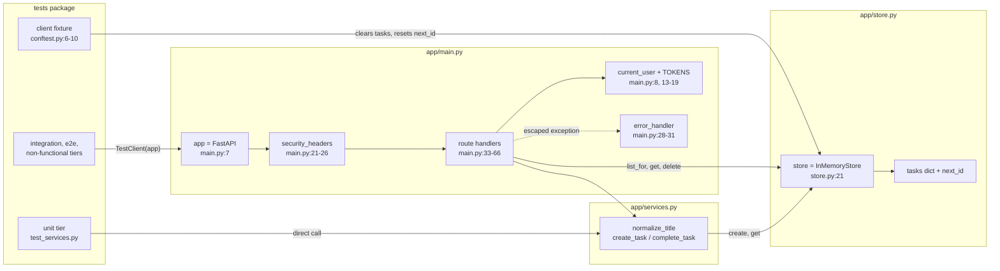

**5.2.7.2 Task record state transitions.** The record has three reachable states and one irreversible edge. Unknown-id requests mutate nothing; a second completion is accepted without a state check.

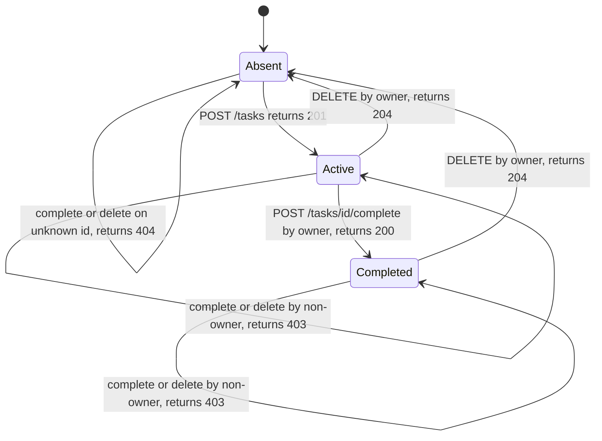

**5.2.7.3 Sequence — create then list (F-003, F-004).** Shows validation, identity resolution, normalization and the store write, then the owner-filtered read.

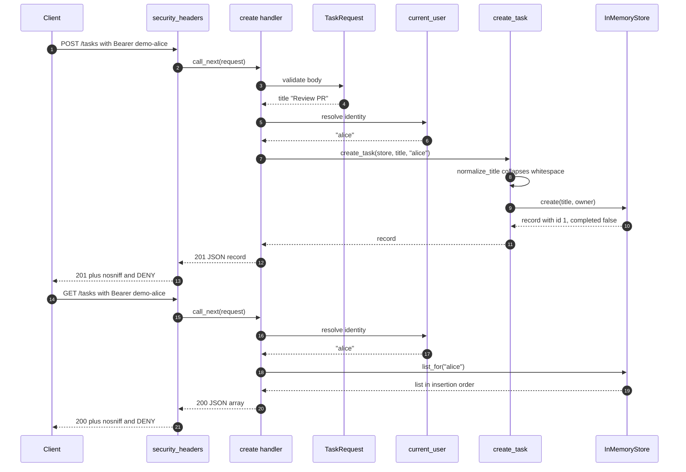

**5.2.7.4 Sequence — cross-owner completion, then an exception escape (F-005 failure path and the 500 path).** The 403 is produced by the domain layer's ownership check; the 500 is produced by `error_handler` when an unexpected exception leaves the router.

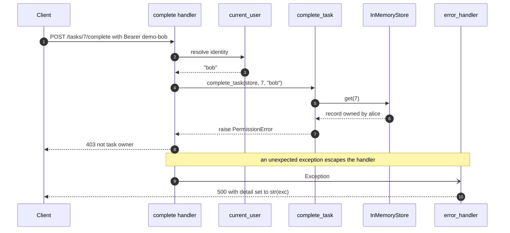

**5.2.7.5 Sequence — delete as a read-then-write pair (F-006).** The ownership decision is made in the handler against a snapshot read, and the removal follows as a separate store call.

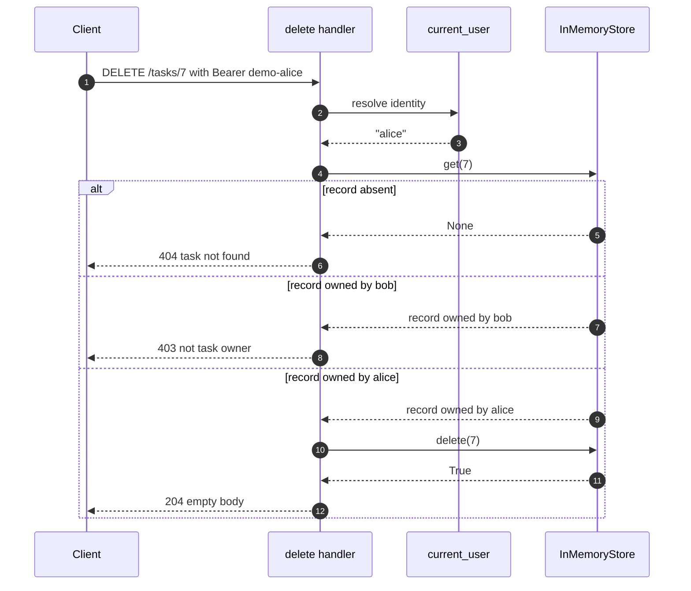


## 5.3 Technical Decisions

### 5.3.1 Architecture Style Decision and Tradeoffs

**The decision.** A single deployable Python process exposing one ASGI application, internally separated into three layers that depend in one direction only: `app/main.py` (transport) → `app/services.py` (rules) → `app/store.py` (state). There is no service split, no shared library, no build step and no runtime configuration.

| Decision | Alternative considered | Why this shape is correct here | Tradeoff accepted |
|---|---|---|---|
| Layered monolith in one process | Independently deployed services per concern | The whole system is 106 lines; the four test tiers need direct access to rules (unit) and to the wire (the other three), and a single process gives both without transport scaffolding | No independent deployability or scaling per component; every change redeploys everything |
| Three flat modules (`main`, `services`, `store`) | Feature packages, e.g. `app/tasks/` | Only one resource exists, so a feature package would be a directory holding one module | Adding a second resource requires either a fourth flat module or a late restructuring |
| FastAPI on Starlette with pydantic | Flask or Django | Auto-generated OpenAPI plus the `/docs` UI named in `README.md:19`; pydantic supplies the 422 path; the ASGI test transport makes in-process HTTP tests trivial | Framework-specific idioms (`Header`, `HTTPException`, `@app.middleware`) are woven through the routing layer |
| Synchronous `def` handlers | `async def` handlers throughout | Every operation is a dict read or write with no I/O to await, so async would add no throughput | Concurrency becomes thread-based, which the unsynchronized store does not tolerate (`docs/coverage_intent.md:10`) |
| Import-time singletons for app, store and tokens | App factory plus a settings object | Server and tests operate on the identical object graph, so tests observe exactly what production code does | Shared mutable global state; isolation depends on a fixture that mutates the production store |
| Convention-based layering | Formal interfaces, repository abstraction, DI container | Two domain functions and four store methods do not justify an abstraction layer | The store contract is implicit; `services.py` requires live references, and nothing declares that |

**Consequences worth naming.** The style makes the *code* easy to read and the *behaviour* easy to test, and it makes the *system* impossible to scale beyond one process without first replacing `app/store.py`. That is a deliberate ordering for a fixture whose purpose is coverage demonstration, not deployment: a single process with a resettable store is what makes twelve tests deterministic (`tests/conftest.py:6-10`), whereas any external store would have added setup, teardown and slow, order-sensitive state.

### 5.3.2 Communication Pattern Decisions

| Pattern | Where it applies | Alternative not taken | Consequence |
|---|---|---|---|
| Client-initiated request/response over JSON/HTTP | The five routes of `app.main:app` | Streaming, long-polling, WebSocket, gRPC | One request produces at most one response; there are no subscriptions or push channels |
| In-process function calls between layers | `main.py` → `services.py` → `store.py` | Serialization between layers, or transport hopping | No mapping or DTO layer; the same dict object flows from the store to the JSON body |
| Exceptions as the internal result channel | `ValueError`, `LookupError`, `PermissionError` raised in `services.py`, caught per route | Result objects or status-returning functions | Each route carries its own `try/except`; an unmapped exception type degrades to 500 |
| Status-code vocabulary fixed at the boundary | 200, 201, 204, 400, 401, 403, 404, 422, 500 | A uniform 200 with an error envelope in the body | Errors are transport-visible; the vocabulary is what the tests assert |
| Single declarative middleware for response headers | `security_headers` (`app/main.py:21-26`) | Per-route header assignment, or a proxy in front | Two headers are guaranteed on routed responses and cannot drift route by route |
| One generic exception handler | `error_handler` (`app/main.py:28-31`) | A handler per exception class | A single 500 envelope, and internal text is disclosed by design |
| No API versioning | Route paths carry no `/v1` prefix and no version negotiation exists | Version prefix or content negotiation | The five paths are the permanent contract; any breaking change breaks the paths in place |
| No outbound calls | Nothing in the codebase dials out | HTTP client, SDK clients, retries | No timeout, retry, backoff or circuit-breaker policy exists anywhere, because no downstream can fail |

The choice of exceptions rather than result objects is the most consequential of these. It keeps the domain layer free of HTTP concepts, which is exactly what lets `tests/unit/test_services.py:9-20` assert with `pytest.raises` and no HTTP machinery. The price is visible in `app/main.py:40-43` and `:51-56`: the translation table lives in the transport layer and must be kept in step with the domain layer manually.

### 5.3.3 Data Storage Solution Rationale

| Decision | Alternative considered | Why chosen here | Tradeoff accepted |
|---|---|---|---|
| In-process `dict` as the system of record (`app/store.py:3`) | SQLite, Postgres, an ORM with an in-memory backend | Zero configuration, no schema, no fixtures to seed, and a state that can be cleared in two statements (`tests/conftest.py:8-9`) | No durability, no cross-process sharing, no query capability, no timestamps |
| Dictionary keyed by integer id | List of records | `get` and `delete` are direct lookups; existence checks are single-key | Listing requires a full scan of `tasks.values()` (`app/store.py:16`) |
| Separate `next_id` counter | `len(tasks) + 1`, or max-id-plus-one | Ids are never reused after a delete, because the counter advances independently of removals | Ids restart at 1 in every new process, so they are not globally unique over time |
| The store returns live record objects | Returning defensive copies | Completion can mutate the record in place with a single assignment (`app/services.py:18`), so no update method is needed | Any caller can mutate stored state; a copy-returning store would silently break completion |
| Owner filter in the store, not in the route | Filtering the listing in the handler | The single place that knows the record layout also applies the isolation rule for reads | Listing logic cannot be reused for administrative views, which do not exist |
| No schema validation at the store boundary | Validating records on write | All writing passes through one domain function that already normalized and length-checked the title | A direct `store.create` call bypasses every rule — which `tests/unit/test_services.py:18` does deliberately |

The storage choice also fixes two system-wide properties. First, **restart is the reset button**: there is no migration, seed or teardown, and a fresh process always begins with an empty `tasks` dict and `next_id = 1`. Second, **one process is one dataset**: because `store` is a module singleton, running the application with multiple workers would create independent, silently divergent task sets. Both properties are acceptable only under the non-production posture stated at `README.md:26`.

### 5.3.4 Caching Strategy Justification

**There is no cache in this system, and the omission is a decision rather than an oversight.** Four properties of the design make a cache valueless:

- **The store is already in memory.** `InMemoryStore` is a dict in the process heap (`app/store.py:3`), so a read is a dictionary traversal. A cache in front of it would add a layer without removing any latency.
- **There is no remote dependency.** Nothing in the codebase performs network or disk I/O, so there is no expensive origin to shield.
- **Write visibility must be immediate.** `tests/integration/test_task_api.py:15-19` deletes a task and asserts the very next listing is `[]`, and `tests/e2e/test_user_journeys.py:5-9` reads back a record it just created. Any cache would have to be invalidated on create, complete and delete — three invalidation points added for no gain.
- **No caching is expressed to clients either.** The only response headers written are the two security headers at `app/main.py:24-25`; no `Cache-Control`, `ETag`, `Last-Modified` or `Expires` is ever set, so the system expresses no client-side or intermediary caching policy.

The cost of the omission is stated plainly: `GET /tasks` performs a full scan of every record held and returns all matches with no limit or offset (`app/store.py:15-16`), so listing cost grows linearly with total tasks and response size grows linearly with the caller's task count. `docs/coverage_intent.md:10` records pagination as one of the six intentional gaps.

**If the storage decision were revisited,** the natural cache candidate would be the per-owner listing, keyed by owner and invalidated on `create`, `complete` and `delete`. That change presupposes an external store, so it is downstream of ADR-003 rather than independent of it.

### 5.3.5 Security Mechanism Selection

| Control | Implementation | Threat addressed | Residual gap |
|---|---|---|---|
| Static bearer-token authentication | `current_user` plus the two-entry `TOKENS` dict (`app/main.py:8`, `:13-19`) | Anonymous access to any `/tasks` route | No expiry, signature, rotation or revocation; two fixed identities; no OpenAPI security scheme declared |
| Owner scoping on every data path | Owner taken from the token (`app/main.py:39`); listing filtered (`app/store.py:15-16`); ownership checked on complete (`app/services.py:16-17`) and delete (`app/main.py:64-65`) | Horizontal privilege escalation between callers | Owner is a bare string with no tenant concept; no administrative role exists |
| Input shape validation | `TaskRequest` with `Field(min_length=1)` (`app/main.py:10-11`) and `task_id: int` (`app/main.py:50`, `:59`) | Malformed bodies and non-integer ids reaching storage | No length cap at the schema level; no fuzzing coverage (declared gap) |
| Input content rules | Title normalization and the 120-character ceiling (`app/services.py:1-9`) | Unbounded or whitespace-only titles | Rules live in the domain layer, so a direct store call bypasses them |
| Response hardening headers | `X-Content-Type-Options: nosniff`, `X-Frame-Options: DENY` (`app/main.py:24-25`) | MIME sniffing and framing of API responses | Applied to routed responses only; 500s produced by the generic handler sit above the middleware (5.2.5) |
| Uniform error envelope | `error_handler` returning `500 {"detail": str(exc)}` (`app/main.py:28-31`) | Inconsistent client-side error parsing | Deliberately discloses internal exception text, as annotated at `app/main.py:30` |

**Controls the system does not need, and controls it lacks.** No CSRF protection is required because no cookie or ambient credential is used — the token travels only in the `Authorization` header. No CORS middleware is configured, so no cross-origin access is granted; because there is no browser client in the repository, this is an absence of policy rather than an exposed hole. What the system genuinely lacks is rate limiting, audit logging of authentication outcomes, secret management (credentials are literal source), transport security (TLS is not configured or referenced anywhere, so it would be the deployment's responsibility), and any verification of the token beyond string equality. Rate limiting and audit logging are both explicitly listed as unexercised areas at `docs/coverage_intent.md:10`; the credential and error-disclosure weaknesses are documented in-source and in `README.md:26`, which prohibits deployment and use of real credentials.

### 5.3.6 Decision Tree Diagram

The tree below encodes where a change belongs, derived from the boundaries established in 5.2 and the records in 5.3.7. Each leaf names the file and line a change would land in.

```mermaid
flowchart TD
    START["New capability requested"] --> Q1{"Must the data survive a restart,<br/>or be shared across processes?"}
    Q1 -->|Yes| R1["The in-memory store is insufficient:<br/>replace the app/store.py boundary first -<br/>ADR-003 must be revisited"]
    Q1 -->|No| Q2{"Is it a rule over a task record -<br/>validation, transformation, ownership?"}
    Q2 -->|Yes| R2["Add to app/services.py,<br/>and map any new exception type<br/>at the route boundary - ADR-007"]
    Q2 -->|No| Q3{"Does it change the record shape<br/>or id allocation?"}
    Q3 -->|Yes| R3["Change InMemoryStore in app/store.py<br/>and the reset in tests/conftest.py:8-9"]
    Q3 -->|No| Q4{"Does it add an HTTP surface?"}
    Q4 -->|Yes| R4["New route in app/main.py that calls<br/>current_user first - ADR-006 -<br/>plus a test in each affected tier"]
    Q4 -->|No| Q5{"Does it apply to every<br/>response or every failure?"}
    Q5 -->|"Response headers"| R5["security_headers middleware<br/>app/main.py:21-26"]
    Q5 -->|"Failure envelope"| R6["error_handler<br/>app/main.py:28-31 - ADR-009"]
```

### 5.3.7 Architecture Decision Records

Every decision below is **implicitly accepted**: the repository contains no decision log, no design document other than `docs/coverage_intent.md`, and no comments recording alternatives, so each record is reconstructed from the code, its status derived from actual usage. Where the source annotates intent — the exception-disclosure weakness at `app/main.py:30` — the record cites it.

| ADR | Decision and status | Rationale | Consequence |
|---|---|---|---|
| ADR-001 | Three-layer single-process monolith — Accepted, used throughout `app/` | One resource, 106 lines, four test tiers needing layer and wire access | Vertical-only scaling; no independent deployability |
| ADR-002 | FastAPI with Starlette and pydantic as the platform — Accepted, `requirements.txt` | Free OpenAPI plus `/docs` UI, pydantic 422 semantics, in-process ASGI test transport | Framework idioms in every route; unpinned ranges allow version drift |
| ADR-003 | In-memory dict as the system of record — Accepted, `app/store.py:21` | No configuration, no seeding, resettable in two statements | No durability; one dataset per process; ids restart at 1 |
| ADR-004 | Import-time singletons instead of an app factory — Accepted, `app/main.py:7`, `app/store.py:21` | Server and tests share one object graph, so tests observe production behaviour | Globals; per-test isolation depends on mutating production state |
| ADR-005 | Static bearer-token table instead of a signed-token scheme — Accepted, `app/main.py:8` | No crypto dependency; exercises the 401 and ownership paths with two actors | No expiry, rotation or revocation; identities fixed at import |
| ADR-006 | Identity resolution as a plain function, not a `Depends` dependency — Accepted, `app/main.py:13-19` | Callable from any handler without building a dependency graph | Repeated call per route; not visible in the OpenAPI security model; invites duplicated ownership logic, as in `app/main.py:64-65` |
| ADR-007 | Domain exceptions mapped to status codes at the route boundary — Accepted, `app/main.py:42-43`, `:53-56` | Keeps `app/services.py` HTTP-free so the unit tier can call it directly | A `try/except` per route; an unmapped exception type becomes a 500 |
| ADR-008 | Shape validation in pydantic, business validation in the domain layer — Accepted, `app/main.py:10-11` vs `app/services.py:6-9` | Separates malformed requests (422) from rejected content with a message (400) | Two different statuses for character-level constraints that look alike; no schema-level length cap |
| ADR-009 | Hardening headers via middleware, all other failures via one generic handler — Accepted, `app/main.py:21-31` | One declaration point for each concern; the disclosure flaw is deliberate and annotated | The generic handler sits above the middleware, so 500 responses do not carry the hardening headers |
| ADR-010 | No caching layer, no cache directives — Accepted, absence across `app/` | The only store is already in memory and writes must be immediately visible to tests | Full-scan listing and unbounded response size; no paginated or cached read path |
| ADR-011 | Synchronous handlers throughout — Accepted, `app/main.py:34-66` | No I/O to await, so async would buy nothing | Concurrency depends on a thread pool writing to an unsynchronized dict |
| ADR-012 | pytest with the in-process `TestClient` as the only transport — Accepted, `tests/conftest.py:10` | No ports, no server lifecycle, deterministic timing | Nothing is exercised over a socket; concurrency and sustained load are out of reach |

**Two records deserve their own statement, because their consequences are the ones a future maintainer is most likely to trip over.**

*ADR-003 — why the store is not a bottleneck to fix and is a wall to respect.* The store satisfies its purpose completely: it holds state long enough for a request cycle and a test, and it can be emptied instantly. It also cannot be scaled by adding workers, cannot survive a restart, and cannot be shared with a second process. Any requirement crossing those lines is a storage-replacement project, not an enhancement, which is why the decision tree in 5.3.6 puts that question first.

*ADR-009 — why the 500 path sits outside the header policy.* Registering `error_handler` for the bare `Exception` type places it in the framework's outermost server-error layer, above the `security_headers` middleware. Route-produced responses — including 400, 401, 403, 404, 422 and 204 — pass back through the middleware and receive both headers; a 500 built by the generic handler does not. Nothing in the suite asserts a 500, so the asymmetry is recorded here rather than defended by a test. The same record carries the disclosure decision: the handler returns `str(exc)`, annotated at `app/main.py:30` as intentional for scanner evaluation, which means a fix that merely masks the message would remove the very evidence the fixture exists to produce.


## 5.4 Cross-Cutting Concerns

### 5.4.1 Monitoring and Observability

**Finding: the system has no monitoring or observability instrumentation.** A search of `app/` for a metrics client, OpenTelemetry, a logging import, a counter or a timing call returns nothing; the package imports only `fastapi`, `fastapi.responses` and `pydantic`, plus its own `app.store` and `app.services` (`app/main.py:1-5`).

| Observability concern | Status | Evidence |
|---|---|---|
| Liveness signal | One unauthenticated static endpoint | `GET /health` returns `{"status": "ok"}` unconditionally (`app/main.py:33-35`) |
| Readiness signal | None. `/health` inspects neither the store nor any dependency, so it reports healthy regardless of internal state | `app/main.py:34-35`; the store cannot fail, being in memory |
| Metrics (counters, latency histograms) | None. No metrics endpoint and no metrics library | absence across `app/` |
| Distributed tracing | None. No trace context, no span, no propagation header handling beyond `Authorization` | absence across `app/` |
| Dashboards and alerting | None. No configuration of any kind is tracked | 13 tracked files, no operational descriptor |
| Error-rate visibility | None server-side. Failures reach the client and leave no record | `app/main.py:28-31` produces a response and nothing else |

Because `/health` is static, a monitoring system pointed at it would measure process liveness only: an instance whose store was corrupt or empty still answers `200 {"status": "ok"}`. That is adequate for the fixture's stated purpose — `tests/non_functional/test_security_resilience.py:13-16` asserts a `200` within one second — and inadequate as readiness for anything with a dependency. The absence is consistent with the declared gaps: `docs/coverage_intent.md:10` names audit logging and sustained-load behaviour among the areas deliberately left unexercised.

### 5.4.2 Logging and Tracing

**Finding: the application writes no log records.** There is no `import logging`, no `print`, no logger instance and no log configuration anywhere in `app/`, `tests/` or the root configuration files. What appears on a developer console during `uvicorn app.main:app --reload` (`README.md:17`) is the ASGI server's own access and error output, produced outside this codebase and not configured by it.

| Event | Recorded by the application | Where it goes instead |
|---|---|---|
| Incoming request line and status | No | uvicorn's server-level access log, if enabled by the server, not by this project |
| Authentication success or failure | No | Nothing is written; the caller receives 401 (`app/main.py:14-18`) |
| Task created, completed or deleted | No | Nothing is written; the store mutates silently (`app/store.py:6-19`) |
| Rejected title or ownership violation | No | Nothing is written; the route converts the exception to 400 or 403 (`app/main.py:42-43`, `:55-56`) |
| Unhandled exception and its traceback | No | The exception text is returned to the client as the 500 body (`app/main.py:28-31`); no server-side record is created |

**Tracing.** There is no trace identifier, no correlation identifier, no request-scoped context and no propagation of any inbound header except `Authorization`. Records themselves carry no timestamps (`app/store.py:7`), so the store cannot reconstruct when anything happened even after the fact. The combined effect is that a failure is observable only in the moment the client receives the response: an exception that is returned as a 500 body leaves no trace once the response is sent, which is the concrete mechanism behind the audit-logging gap declared at `docs/coverage_intent.md:10`.

### 5.4.3 Error Handling Patterns

Four patterns cover every error the system can produce, and each is implemented in exactly one place.

| Pattern | Mechanism | Where | Effect |
|---|---|---|---|
| Framework validation | pydantic model plus typed path parameters | `app/main.py:10-11`, `:50`, `:59` | 422 before any handler body executes |
| Guard exception | `HTTPException(401, ...)` raised by the identity guard | `app/main.py:14-18` | 401 with a string `detail` |
| Domain-exception translation | `try`/`except` per route mapping `ValueError`, `LookupError` and `PermissionError` | `app/main.py:40-43`, `:51-56` | 400, 404, 403 with the exception message as `detail` |
| Catch-all | `@app.exception_handler(Exception)` | `app/main.py:28-31` | 500 with `detail` set to `str(exc)` |

**Two asymmetries are worth recording because they shape the client contract.** First, the `detail` field is not a uniform type: handler-raised and translated errors produce a **string**, while validation errors produce a **list** of per-field objects whose exact keys depend on the resolved pydantic and FastAPI versions. A client that parses `detail` as a string will break on 422. Second, the guard call inside the complete route is *inside* the `try` block (`app/main.py:52`), yet a 401 from it still propagates correctly, because `HTTPException` is not a subclass of any of the three excepted types.

**No error is retried, queued or compensated.** There is no dead-letter path, no retry, and no compensating action; a failed request simply ends. One case deserves explicit statement: because there is no transaction, the only multi-step mutation in the API — `get` then `delete` in the delete route (`app/main.py:61-66`) — has a window in which another request could remove the record between the existence check and the removal; the resulting `store.delete` returns `False` and, since the return value at `app/main.py:66` is ignored, the client still receives 204.

```mermaid
flowchart TD
    REQ["Incoming request"] --> MW["security_headers<br/>app/main.py:21-26"]
    MW --> ROUTE{"Route matched?"}
    ROUTE -->|No| R404A["404 or 405<br/>from the router"]
    ROUTE -->|Yes| VAL{"Body and path valid?"}
    VAL -->|No| R422["422, detail is a list<br/>of field errors"]
    VAL -->|Yes| AUTH{"current_user outcome"}
    AUTH -->|"header absent or no Bearer prefix"| R401A["401 missing bearer token"]
    AUTH -->|"token not in TOKENS"| R401B["401 invalid token"]
    AUTH -->|"identity resolved"| DOM{"Handler, domain and store outcome"}
    DOM -->|"ValueError"| R400["400 title cannot be empty<br/>or title is too long"]
    DOM -->|"LookupError"| R404B["404 task not found"]
    DOM -->|"PermissionError"| R403["403 not task owner"]
    DOM -->|"success"| OK["200, 201 or 204<br/>with both hardening headers"]
    DOM -.->|"any other exception"| R500["500 detail is str(exc)<br/>from error_handler, above the middleware"]
    R400 --> CLIENT["Response to client"]
    R401A --> CLIENT
    R401B --> CLIENT
    R403 --> CLIENT
    R404A --> CLIENT
    R404B --> CLIENT
    R422 --> CLIENT
    OK --> CLIENT
    R500 --> CLIENT
```

### 5.4.4 Authentication and Authorization Framework

**Authentication** is a single pre-handler step: resolve `Authorization: Bearer <token>` through the two-entry `TOKENS` literal and yield a username, or answer 401. It is applied by calling `current_user` from inside each `/tasks` handler (`app/main.py:39`, `:47`, `:52`, `:60`) — not by a framework dependency, security scheme or route-level decorator. `/health` is the one route that skips it (`app/main.py:33-35`).

**Authorization** is ownership-based and per-resource, with no roles, scopes, groups or administrative override anywhere in the codebase. The complete access model is the matrix below.

| Route | Anonymous or unknown token | Owner (token matches `owner`) | Authenticated non-owner |
|---|---|---|---|
| `GET /health` | 200 `{"status": "ok"}` | 200 | 200 — no identity required |
| `POST /tasks` | 401 | 201; owner taken from the token (`app/main.py:39-41`) | Same as owner — the caller is always the owner of what it creates |
| `GET /tasks` | 401 | 200 with own records, `[]` when none (`app/store.py:15-16`) | 200 with only their own records; another owner's data is unreachable |
| `POST /tasks/{task_id}/complete` | 401 | 200 with `completed: true` | 403 if the id exists and belongs to someone else; 404 if the id does not exist |
| `DELETE /tasks/{task_id}` | 401 | 204 | 403 if the id exists and belongs to someone else; 404 if the id does not exist |

**Two properties of this matrix are deliberate and one is a side effect.** Deliberate: the owner of a new record is derived from the credential, never from the request body, so a caller cannot forge ownership; and every read path is filtered, so isolation holds for `GET /tasks` without an explicit check. The side effect: both mutating routes test existence **before** ownership (`app/services.py:14-16`; `app/main.py:61-64`), so an authenticated caller can distinguish an existing id belonging to another user (403) from a nonexistent id (404) — an id-enumeration signal that a stricter design would collapse into a uniform 404. There is no per-caller rate limit to blunt such enumeration, and no audit record of the attempt.

### 5.4.5 Performance Requirements and SLAs

**Finding: the repository declares no availability, throughput or latency SLA.** The only numeric performance requirement anywhere in it is the non-functional assertion that `GET /health` completes in under one second (`tests/non_functional/test_security_resilience.py:13-16`). No timeout, no rate limit, no concurrency target and no response-size budget appears in `app/`, `tests/`, `pytest.ini`, `requirements.txt` or `README.md`; a search for `timeout`, `retry`, `backoff`, `gzip`, `compress` and `cors` across those files returns no match.

| Requirement class | Specified value | Enforcement | Notes |
|---|---|---|---|
| Health latency | Under 1.0 s | `tests/non_functional/test_security_resilience.py:16` | Measured in-process by `TestClient`, so it excludes network and server overhead |
| Title size | 120 characters maximum | `app/services.py:8-9` | Enforced on the normalized title; returns 400, not 422 |
| Listing size | Unbounded | none | No limit, offset or filter beyond owner (`app/store.py:15-16`); pagination is a declared gap |
| Concurrency | Unspecified | none | Thread pool handles synchronous handlers; the store takes no lock |
| Availability, error budget, throughput | Not declared | none | No SLO document, no metrics to measure against |
| Client-visible timeouts | None | none | Neither the app nor any client code in the repository sets one |

**Where the work actually goes.** Per request, the dominant costs are fixed and small: header parsing, a dictionary lookup for the token, and one dict operation; JSON encoding is proportional to the response. `GET /tasks` is the only route whose cost grows with data — a full scan of `tasks.values()` plus serialization of every match — and the only route whose response size grows without bound. Two framework-level facts bound throughput: the handlers are synchronous, so each request occupies a worker thread for its whole duration, and no compression middleware is installed, so responses are sent uncompressed. Every quantitative statement above is a property of code that no performance test in the repository measures, apart from the single health assertion.

### 5.4.6 Disaster Recovery and Resilience

**Recovery posture.** The system's recovery point and recovery time follow directly from the storage decision (ADR-003): state lives only in the process heap, so the **recovery point objective is zero** — every task created since process start is lost — and recovery is a **restart**, after which the store begins empty with `next_id = 1` (`app/store.py:4`, `:21`).

| Failure mode | Detection | Blast radius | Recovery |
|---|---|---|---|
| Process exit or host restart | None inside the application; `/health` disappears with the process | Every task record; clients holding earlier ids begin receiving 404 once ids are reissued to other tasks | Restart the process; state is empty and ids restart at 1 |
| Unhandled exception in one request | None server-side; the caller sees 500 with `str(exc)` | One request | None needed — the exception is contained by `error_handler` (`app/main.py:28-31`); subsequent requests are unaffected |
| Concurrent writes to the store | None; no assertion, no lock, no metric | Potentially a lost update or a lookup during mutation | None available; concurrency is a declared gap (`docs/coverage_intent.md:10`) |
| Lost `TOKENS`-listed credential | None; the caller simply starts receiving 401 | That one identity's access | Edit `app/main.py:8` and restart |
| Running more than one worker process | None; each worker answers healthy | Silent dataset divergence — each worker holds a different set of tasks | Not recoverable; single-worker operation is the only consistent configuration |
| Dependency drift after reinstall | None; no lock file or hash pinning | Any behaviour the resolved FastAPI, Starlette or pydantic version changes | Pin versions outside the repository; `requirements.txt` supplies ranges only |

**Resilience properties that do exist.** Each request is independent and carries no session, so a failed request leaves nothing to clean up. Completion is repeatable without error, since a second completion simply re-asserts `completed = True` (`app/services.py:18`). Deletion of an already-deleted id answers a clean 404. The exception handler isolates a single request's failure from the rest of the process.

**Resilience properties that do not exist.** No backup, snapshot, replication or export of task state; no graceful shutdown or startup hook (no lifespan, `on_event`, signal handler or shutdown flush anywhere in `app/`); no readiness gate; no retry or idempotency key for clients that lose a response; and no degraded-mode behaviour, because there is no dependency that can degrade. There is also **no runbook, no recovery procedure and no operational documentation** in the repository beyond the three-line run instruction at `README.md:12-21` and the deployment prohibition at `README.md:26` — which is the control that keeps this posture acceptable.

```mermaid
flowchart TD
    START["Process running<br/>store holds N tasks"] --> CRASH{"Unexpected exit?"}
    CRASH -->|"No, steady state"| START
    CRASH -->|Yes| LOST["All task records lost<br/>recovery point objective is zero"]
    LOST --> RESTART["Operator restarts uvicorn app.main:app"]
    RESTART --> EMPTY["Fresh process: tasks empty<br/>next_id reset to 1"]
    EMPTY --> CLIENT404["Clients holding old ids<br/>receive 404 for reissued ids"]
    CLIENT404 --> RECREATE["Clients recreate tasks<br/>no restore path exists"]
    RECREATE --> START
```


## 5.5 Architectural Assumptions and Constraints

## 5.5 Architectural Assumptions and Constraints

Each assumption below is load-bearing: the architecture is only coherent while it holds, and each is stated with the evidence that reveals it and the consequence of its violation.

| ID | Assumption | Basis in the repository | Impact if violated |
|---|---|---|---|
| A-1 | Exactly one process serves a dataset at a time | `store` is a module-level singleton (`app/store.py:21`); no shared store, no worker configuration | Multiple workers hold divergent datasets and reissue overlapping ids with no error |
| A-2 | Task state is disposable between runs | `InMemoryStore` over a plain dict (`app/store.py:1-19`); no durability layer | Any durability requirement is a storage replacement, not an enhancement (ADR-003) |
| A-3 | Two fixed identities are sufficient to demonstrate access control | `TOKENS` with `demo-alice` and `demo-bob` (`app/main.py:8`) | Provisioning, rotation or federation requires replacing the guard and the credential source |
| A-4 | Callers tolerate losing server-assigned ids across a restart | `next_id` begins at 1 per process (`app/store.py:4`) | Clients holding ids from a previous run receive 404 or, worse, another task's record once ids are reissued |
| A-5 | Requests do not mutate the store concurrently | No lock, atomic operation or version field (`app/store.py:1-19`); concurrency listed as an unexercised gap (`docs/coverage_intent.md:10`) | Interleaved writes can produce lost updates or reads during mutation |
| A-6 | The test suite runs serially in one process | One shared store; the `client` fixture resets it before each test (`tests/conftest.py:6-10`); no parallel runner configured | Any parallel execution makes the absolute-count assertions (`tests/integration/test_task_api.py:8`, `:19`) non-deterministic |
| A-7 | Python 3.10 or newer is the interpreter | `str.removeprefix` (`app/main.py:16`) requires 3.9+, and the `str \| None` parameter annotations evaluated at import (`app/main.py:38`, `:46`, `:50`, `:59`) require 3.10+ | Import fails outright on an older interpreter, before any route is served |
| A-8 | Traffic reaches the process over a trusted path, or TLS terminates elsewhere | No TLS configuration, no proxy-header handling, no CORS middleware, no origin policy anywhere in the tree | Credentials and payloads would travel in clear text if exposed directly |
| A-9 | The generated documentation surface is public | `FastAPI(title=...)` alone at `app/main.py:7`, so `/docs`, `/redoc` and `/openapi.json` stay enabled | The full API schema, including the optional `authorization` header parameter, is discoverable by any caller |
| A-10 | No operational machinery consumes this deployment | No CI, container, process manager or probe configuration among the 13 tracked files | Nothing detects process death, lost state or elevated error rates; `/health` is the only signal and it is static |
| A-11 | The dependency ranges resolve to a compatible set at install time | Four ranges, no pins, no lock file, no hashes (`requirements.txt`) | A resolved-version change alters framework behaviour without any code change |
| A-12 | The described tree is the delivered tree | `git diff main 2211_01` is empty, so the architecture documented here is identical on both branches named in `README.md:24` and on the checked-out branch | — |

**Hard constraints the architecture cannot cross without redesign.**

- **No outbound network capability exists in the code.** With no client library and no configuration, the system cannot call an identity provider, a database, a message broker or a metrics backend; every such integration begins with new dependencies.
- **No persistence seam exists beyond the `store` singleton.** Because the application and the tests both import that one instance, any replacement must preserve the attribute names `tasks` and `next_id` that the fixture touches (`tests/conftest.py:8-9`) or the suite must change with it.
- **The store must return live references.** Completion mutates the object it receives and never calls an update method (`app/services.py:18`), so a copy-returning store breaks the completion contract silently.
- **Authentication has no declarative surface.** Because `current_user` is a plain function rather than a dependency, every new protected route must remember to call it; a route that omits the call is unauthenticated and nothing in the framework would flag it.
- **Error mapping is manual.** A new exception type raised in `app/services.py` becomes a 500 unless a route adds an `except` clause for it.
- **The project is explicitly non-production.** `README.md:26` prohibits deployment and real credentials, which is the constraint that keeps the static token table, the in-memory store and the exception-text disclosure acceptable rather than defects.

## 5.6 References

- `app/main.py` — the ASGI application object, the five routes, `current_user` and the static `TOKENS` table, the `security_headers` middleware, the generic `error_handler`, and `TaskRequest`; source for every interface, status code and line reference in 5.1 through 5.4.
- `app/services.py` — `normalize_title`, `create_task`, `complete_task`; the domain rules, the 120-character ceiling and the exception types the routes translate.
- `app/store.py` — `InMemoryStore` and the process-wide `store` singleton; the persistence contract, id allocation and the live-reference behaviour completion depends on.
- `app/__init__.py` — empty package marker establishing the `app.main` / `app.services` / `app.store` import paths.
- `tests/conftest.py` — the single `client` fixture and the store reset that constitutes the suite's only isolation mechanism.
- `tests/unit/test_services.py` — direct domain-layer tests and the throwaway-store injection that proves the service layer's dependency seam.
- `tests/integration/test_task_api.py` — in-process HTTP tests for create, list, cross-owner completion and hard deletion.
- `tests/e2e/test_user_journeys.py` — the full create → list → complete → delete lifecycle against one server-assigned id.
- `tests/non_functional/test_security_resilience.py` — hardening-header assertions, the two 401 paths, and the sub-one-second health threshold.
- `tests/` — the four test tiers and their layout, as described in 5.2.6.
- `docs/coverage_intent.md` — the category-to-evidence mapping and the six declared gaps (concurrency, rate limiting, pagination, input fuzzing, audit logging, sustained-load behaviour) cited throughout 5.2, 5.3 and 5.4.
- `README.md` — the fixture's stated non-production purpose (line 4 and line 26), the run sequence and `app.main:app` entry point (lines 12-19), the `/docs` URL (line 19), the `pytest -q` command (line 21) and the scan instructions (lines 23-24).
- `requirements.txt` — the four dependency ranges and the absence of pins, hashes or a lock file.
- `pytest.ini` — test discovery configuration (`testpaths`, `python_files`, `addopts`).
- `app/` — the complete application package, four flat modules, no sub-packages.


# 6. SYSTEM COMPONENTS DESIGN

## 6.1 Core Services Architecture

### 6.1.1 Applicability Determination

**Verdict: Core Services Architecture is not applicable for this system.** In the sense this heading normally denotes — a set of independently deployable services that register with a discovery mechanism, exchange messages over a network, and are individually load-balanced, scaled and failed over — the repository contains no such architecture. Its entire runtime is one ASGI application object, `app = FastAPI(title="Proactive Insights Full-Coverage Demo")` at `app/main.py:7`, executed in a single OS process that owns five routes (`app/main.py:33-66`), three domain functions (`app/services.py:1-19`), one store instance (`app/store.py:21`) and two static credentials (`app/main.py:8`). There is no second deployable unit, no in-system network hop, no registry, no proxy, no container or orchestration descriptor and no configuration surface: of the thirteen tracked files (`git ls-files`), nine are Python modules, two are Markdown, one is the requirements manifest and one is the pytest configuration.

| Indicator | Observed state in this repository | Evidence |
|---|---|---|
| Deployable units | One — `app.main:app` is the only ASGI callable in the tree | `app/main.py:7`; `README.md:17` |
| Process edges | One — client to ASGI only; the test suite crosses the same edge in-process | `tests/conftest.py:2`, `:10` |
| Internal boundaries | Three in-process layers invoked as plain Python function calls | `app/main.py:4-5`; `app/services.py`; `app/store.py` |
| Network infrastructure | None — a recursive search of all thirteen files returns no match for docker, compose, kubernetes, helm, terraform, load balancer, service discovery, consul or eureka | tracked file list (`git ls-files`) |
| Runtime configuration | None — the application is constructed with a title only and no module reads an environment variable | `app/main.py:7`; no `os.environ`, `getenv` or `settings` match anywhere |
| Shared state location | One heap-resident dict plus an integer counter, reachable only inside the process | `app/store.py:3-4`, `:21` |
| Worker topology | One process; the only launch instruction is a development invocation with `--reload` and no `--workers` | `README.md:17`; no `workers` match anywhere |

**Why a service decomposition is not required here.** Every pressure that normally drives a system to split into services is absent, and the fixture's own documentation forbids the deployment that would make such pressures real.

| Decomposition pressure | Present | Evidence |
|---|---|---|
| Independent scaling per capability | No — the whole system is one capability family (task CRUD bound to an identity), and no load is measured; sustained-load behaviour is a declared gap | `docs/coverage_intent.md:10` |
| Fault isolation between capabilities | No — exceptions are already contained per request by the catch-all handler | `app/main.py:28-31` |
| Independent release cadence | No — no CI configuration, pipeline, container or deployment descriptor is tracked | 13 tracked files |
| Heterogeneous persistence or runtime | No — one runtime (CPython) and one store (a built-in `dict`) | `app/store.py:1-21` |
| Team or ownership boundaries | No — a single-author fixture history of three commits | `git log`; `README.md:4`, `:26` |

`README.md:26` states the constraint that settles the question: "This is a synthetic QA fixture, not production software. It uses in-memory storage and demo credentials. Do not deploy it or use real credentials." No runtime topology exists to partition, and the architecture is deliberately shaped for observability per layer rather than for scale (see 5.1.1).

**What this section documents instead.** Rather than stopping at a non-applicability statement, the remainder of 6.1 records the architecture that does exist at the service level and states each requested pattern's status explicitly, so that the gaps are auditable rather than implied:

- **6.1.2 Service Components** — the three logical service boundaries inside the single deployment unit, their responsibilities, the communication contract between them, and the integrity defects observable at those seams.
- **6.1.3 Scalability Design** — what the single unit can and cannot do under horizontal and vertical growth, what auto-scaling signals exist (none), how resources are bounded in code, and the capacity envelope the code imposes.
- **6.1.4 Resilience Patterns** — fault tolerance inside the process, the disaster-recovery posture, data redundancy (none), failover configurations (none) and the degradation behaviour that emerges today.
- **6.1.5 Required Diagrams** — the service interaction, scalability and resilience views of this architecture.

**Section references.** Architecture style and the component inventory are established in 5.1.1 and 5.1.2; per-component interfaces and the phase-7 diagrams in 5.2; the request-level error flow in 5.4.3; the failure-mode and recovery table in 5.4.6; the journeys J-1 through J-7 in 4.1.1; the launch and deployment story in 3.6. This section references those rather than restating them, and confines itself to service-level structure, scaling and resilience.


### 6.1.2 Service Components

#### 6.1.2.1 Service Boundaries and Responsibilities

The single deployment unit decomposes into three logical services with a strictly one-way dependency direction, plus two cross-cutting components. The import graph proves the direction: `app/main.py:4-5` imports the store and the two domain functions, while `app/services.py` and `app/store.py` import nothing at all — not even the standard library. There is no cycle, and the domain layer is transport-agnostic and importable without the web layer.

| Logical service | Responsibility | Public surface | Boundary contract |
|---|---|---|---|
| HTTP API service — `app/main.py:10-19`, `:33-66` | Route matching, body and path validation, identity resolution, exception-to-status translation, response serialization | Five handlers; `current_user`; `TaskRequest`; `TOKENS` | Consumes the domain and persistence services; exposes nothing inward |
| Domain rule service — `app/services.py:1-19` | Title canonicalization, non-empty rule, 120-character ceiling, ownership on completion | `normalize_title`, `create_task`, `complete_task` | Receives the store as an untyped parameter; raises built-in exceptions only; imports nothing |
| Persistence service — `app/store.py:1-21` | Id assignment, record retention, owner filtering, hard deletion | `create`, `get`, `list_for`, `delete` on one `InMemoryStore` singleton | Returns live record references rather than copies; no I/O, schema or transaction |
| Request pipeline (cross-cutting) — `app/main.py:21-31` | Hardening headers on outgoing responses; one uniform 500 envelope for escaped exceptions | `security_headers`, `error_handler` | Wraps every route; keeps no state |
| Credential directory (cross-cutting) — `app/main.py:8` | Token-to-username resolution for two fixed identities | Module-level dict literal | Import-time constant; no expiry, signature or revocation |

**Ownership of state is the decisive boundary.** The domain service holds no state and is re-entrant by construction, and the HTTP service holds no per-request state; the only shared mutable resource in the system is the `store` singleton created at `app/store.py:21`. Every concurrency, scaling and recovery property in 6.1.3 and 6.1.4 follows from that single fact.

**Boundary integrity defects.** Four seams leak, and each is observable in the code rather than hypothetical.

| Boundary leak | Location | Rule violated | Consequence |
|---|---|---|---|
| Listing bypasses the domain service | `app/main.py:47` calls `store.list_for` directly | The domain service is not the sole owner of task semantics | No read-side rule — ordering, visibility, pagination — can be applied centrally later without touching the HTTP layer |
| Deletion re-implements ownership | `app/main.py:61-66` duplicates the check at `app/services.py:16-17` | One rule, two implementations | An ownership-policy change must be made in two places, and the delete path has no domain function for the unit tier to exercise |
| Domain service depends on live references | `app/services.py:18` mutates the dict returned by `store.get` (`app/store.py:12-13`) | The persistence abstraction leaks object identity | A store that returned copies — `dict(task)` or a serialized row — would silently break completion without any change to the store's method signatures |
| Test harness reaches into store internals | `tests/conftest.py:8-9` clears `store.tasks` and resets `store.next_id` | The service boundary is not enforced for tests | Those two attribute names are a de-facto contract: renaming them breaks test isolation, not merely assertions |

#### 6.1.2.2 Inter-Service Communication Patterns

Every call between the three logical services is a synchronous Python function call inside one interpreter. There is no serialization between layers, no RPC framework, no message broker, no event bus, no webhook, no background worker and no scheduler — a recursive search of the tree returns no match for queue, broker, celery, background, cron or webhook. The only network protocol in the system is JSON over HTTP at the outermost edge, and the test suite does not even cross that edge, since `TestClient(app)` (`tests/conftest.py:2`, `:10`) speaks ASGI in-process.

| Interaction | Caller to callee | Mechanism | Failure signalling |
|---|---|---|---|
| Create a task | `create` handler to `create_task` to `store.create` | Direct call chain; the record is returned by reference | `ValueError` mapped to 400 at `app/main.py:42-43` |
| Complete a task | `complete` handler to `complete_task` to `store.get` | In-process call; the record is mutated in place at `app/services.py:18` | `LookupError` to 404, `PermissionError` to 403 at `app/main.py:53-56` |
| List tasks | `listing` handler to `store.list_for` | Direct store call with no domain hop | Cannot fail; returns `[]` when the caller owns nothing (`app/store.py:15-16`) |
| Delete a task | `delete` handler to `store.get`, then `store.delete` | Two sequential calls forming a read-then-write pair | The handler raises 404 or 403 inline at `app/main.py:62-65` |
| Resolve identity | Handler to `current_user` to `TOKENS.get` | Pure function over a module constant | `HTTPException(401, ...)` at `app/main.py:14-18` |
| Cross-cutting | Router to `security_headers`; escaped exception to `error_handler` | ASGI middleware chain and the framework's server-error hook | Added headers, or one 500 envelope (`app/main.py:21-31`) |

Four contract properties complete the picture of how the components talk to one another:

- **Pass-by-reference is the wire format.** Records cross the persistence boundary as live dicts, never as copies, so a downstream component can change stored state without calling a write method. This is what makes completion work (`app/services.py:18`) and what makes the persistence service unsafe to reimplement behind an interface without touching its client.
- **No request context travels with a call.** There is no correlation identifier, no request object below the HTTP layer, no clock read and no logger; identity crosses the boundary as a plain `str`, and the store crosses it as a duck-typed parameter — the codebase's only injection seam, which `tests/unit/test_services.py:10` and `:17` exploit with throwaway `InMemoryStore()` instances.
- **Exception types are the error protocol.** The domain service signals failure with built-in exceptions and the HTTP service translates them by type; any exception type without a matching `except` clause reaches `error_handler` and leaves the process as a 500 whose body is `str(exc)` (`app/main.py:28-31`). Introducing a new domain exception therefore requires a matching translation, or it degrades into an information-disclosing 500.
- **Calls are blocking for the duration of a worker thread.** All five handlers are plain `def` (`app/main.py:34`, `:38`, `:46`, `:50`, `:59`), so the framework dispatches them to a worker thread pool; no handler awaits anything. The shared store is consequently entered from multiple threads with no lock, which is the concurrency gap declared at `docs/coverage_intent.md:10`.

#### 6.1.2.3 Discovery, Load Balancing, Circuit Breaking, Retry and Fallback

Each of these patterns presupposes either a second addressable service or a downstream that can fail. Neither exists, so every pattern is absent as a mechanism. Where a partial analogue exists, the table records what it does *not* do.

| Pattern | Status | Nearest observed analogue | Consequence |
|---|---|---|---|
| Service discovery | Absent | The only endpoint resolution in the project is the hardcoded import path `app.main:app` (`README.md:17`; `tests/conftest.py:3`) | A new component must be imported by name; there is no registry, lookup or health-gated routing |
| Load balancing | Absent | One process and one worker; no proxy, ingress or replica descriptor is tracked | Concurrency is bounded by a single process's thread pool, and there is no distribution layer to balance over |
| Circuit breaker | Absent | `error_handler` (`app/main.py:28-31`) answers once per failure and carries on | It counts no failures, holds no open or closed state and never short-circuits; each failing request still traverses the full path |
| Retry | Absent | None anywhere in `app/` | A failed request ends where it failed; the client must retry, and no idempotency key exists (only completion is naturally repeatable, `app/services.py:18`) |
| Fallback | Partial, static only | A 500 envelope instead of a process crash (`app/main.py:28-31`); an empty array instead of an error for a caller with no tasks (`app/store.py:15-16`) | No cached or stale-read path is available, because no cache or replica exists to read from |
| Timeout | Absent | No timeout setting in `app/`, `requirements.txt`, `pytest.ini` or `README.md` | A request occupies a worker thread until its call chain returns; the only timing assertion in the repository is the sub-second `/health` check (`tests/non_functional/test_security_resilience.py:16`) |
| Bulkhead | Absent | One thread pool and one store shared by every route | A slow `GET /tasks` — a full dict scan at `app/store.py:16` — competes for threads with cheap writes |
| Health-gated routing | Absent | `GET /health` returns a constant `{"status": "ok"}` (`app/main.py:33-35`) | The probe cannot fail, so no routing or scaling decision can depend on it |

**What would make these patterns applicable.** Three prerequisites would have to exist first, in this order: a persistence boundary that survives a process restart (replacing the singleton at `app/store.py:21`); an instrumented health and metrics signal able to distinguish unhealthy from merely idle (5.4.1); and a multi-instance deployment descriptor, which the repository does not have, since `README.md:26` forbids deployment entirely. Once instances multiply, the first correctness problems are already visible in the code: `next_id` restarts at 1 in every process (`app/store.py:4`), so identifiers are unique only within one instance, and each instance would hold a divergent dataset — the divergence recorded in 5.2.4 and 5.4.6.


### 6.1.3 Scalability Design

#### 6.1.3.1 Horizontal and Vertical Scaling Approach

The request path is stateless and would replicate cleanly; the state path would not. Every handler is independent of every other request — no session, no per-request cache, no client-affinity requirement — but the store those handlers share is a module-level singleton created at import time (`app/store.py:21`), so a second instance or a second worker process would own a second, disjoint dataset. The single deployment unit therefore scales *out* only into inconsistency and *up* only until the process's own memory and thread pool are exhausted.

| Scaling direction | Enabler observed | Blocker observed | Evidence |
|---|---|---|---|
| Horizontal (replicas) | Handlers hold no per-request state, so any instance can serve any request | Two instances hold divergent datasets; `next_id` restarts at 1 per process, so identifiers collide across instances | `app/main.py:33-66`; `app/store.py:4`, `:21` |
| Horizontal (worker processes) | The same application object loads in every worker | `uvicorn app.main:app --reload` passes no `--workers`; running more than one worker splits the task table per process | `README.md:17`; no `workers` match anywhere |
| Identity capacity | `TOKENS` is an import-time constant, identical in every process | Exactly two identities; adding one requires a code edit and a restart | `app/main.py:8` |
| Traffic distribution | None exists | No proxy, ingress, replica set or service descriptor is tracked in the thirteen files | `git ls-files` |
| Vertical (CPU and memory) | Work per request is small and constant, except for listing | Memory grows with cumulative record count; the thread pool bounds concurrency; nothing is tunable from the repository | `app/store.py:6-19`, `:16` |

**Vertical headroom.** Per-request work is dominated by fixed costs: header parsing, one dictionary lookup for the token, one dictionary operation, and JSON encoding proportional to the response. Three facts shape the ceiling. Synchronous handlers occupy a worker thread for a request's whole duration (`app/main.py:34`, `:38`, `:46`, `:50`, `:59`), so throughput is bounded by thread count divided by mean request duration. The store retains every task created since process start with no eviction (`app/store.py:6-19`), so memory grows monotonically. `list_for` scans all records regardless of who owns them (`app/store.py:16`), so read cost grows with the system's data, not the caller's. Because CPU work per request is trivial, the practical first limit is the unsynchronized store's correctness rather than raw machine capacity.

**Practical verdict.** Until the persistence boundary is replaced, the only consistent deployment is one instance with one worker. Increased capacity must come from vertical growth of that process, and the application itself configures nothing.

#### 6.1.3.2 Auto-Scaling Triggers and Rules

There is no auto-scaler and, more decisively, no signal an auto-scaler could consume. The application exports no metrics, writes no logs and answers its health probe with a constant, so every candidate trigger is either uninstrumented or structurally unusable.

| Candidate trigger | Instrumented in application | Evidence | Why it cannot drive scaling |
|---|---|---|---|
| CPU saturation | No | No metrics library or endpoint anywhere in `app/` | Readable only from outside the process, by tooling the repository does not configure |
| Request rate or concurrency | No | No counter, no request identifier, no access-log hook in the code | Nothing measures load, and no queue exists to report depth |
| Latency | No | The only timing figure is a test assertion on `/health` under one second (`tests/non_functional/test_security_resilience.py:16`) | Measured in-process during tests, never exported at runtime |
| Error rate | No | `error_handler` builds a response and nothing else (`app/main.py:28-31`) | A failure leaves no server-side trace (5.4.2) |
| Health probe | Present but constant | `GET /health` returns `{"status": "ok"}` unconditionally (`app/main.py:33-35`) | A probe that cannot fail never triggers scale-out, and would never trigger drain-in |
| Memory pressure | No | The `tasks` dict grows without eviction (`app/store.py:3`, `:6-19`) | Growth is invisible until the host terminates the process |
| Startup and shutdown hooks | No | No `lifespan`, `on_event`, `startup`, `shutdown` or signal handler anywhere | Nothing for a scheduler to hook warm-up, drain or pre-stop into |

**Rules.** None are declared, so the de-facto rule is exactly one instance, started manually with the three-step procedure at `README.md:12-21` and stopped by terminating the process. A scheduler added later would still face the state problem: replicas cannot share the task table, so scaling out adds capacity only for requests whose data happens to live in the replica that receives them.

#### 6.1.3.3 Resource Allocation Strategy

The repository allocates nothing explicitly: the application is constructed with a title argument only (`app/main.py:7`), and no resource limit, pool size, body cap or timeout appears in `app/`, `requirements.txt`, `pytest.ini` or `README.md`, so framework defaults govern every remaining dimension.

| Resource | Bound enforced in code | Evidence | Behaviour when exceeded |
|---|---|---|---|
| Title per record | 120 characters after whitespace normalization | `app/services.py:8-9` | 400 `title is too long`; nothing is written |
| Record count per process | None — nothing evicts completed tasks | `app/store.py:6-19` | Linear heap growth until the process is killed, taking state with it |
| Listing response size | None — no limit, offset or sort | `app/store.py:15-16` | Response and scan cost grow with the caller's task count |
| Request body size | None configured by the application | `app/main.py:7` | Bodies are buffered by the framework with no application-level cap |
| Worker threads | Framework default; never configured | `app/main.py:34`-`:59` | Saturation by slow requests, with no queue-depth visibility |
| Timeouts | None | no `timeout` match in `app/` | A slow or abandoned request holds its thread to completion |
| Credential capacity | Fixed at two entries | `app/main.py:8` | A third identity requires a code change and a restart |
| Identifier space | Unbounded counter, unique only within one process | `app/store.py:4` | No exhaustion risk, but identifiers repeat after a restart |

**Allocation actually performed by the application.** The only deliberate allocation is the record itself — `{"id": int, "title": str, "owner": str, "completed": False}` (`app/store.py:7`) — a four-key dict with no timestamps, version or history, so per-record overhead is constant apart from the title, which the 120-character ceiling bounds before the write. Reads allocate nothing: `get` returns the stored object and `create` returns the object it just stored, so the store never copies (`app/store.py:6-13`). With no outbound client anywhere in the tree, there is no connection pool, socket buffer or upstream quota to size.

#### 6.1.3.4 Performance Optimization Techniques

| Technique | Present | Effect on latency or throughput | Evidence |
|---|---|---|---|
| Constant-time credential lookup | Yes | Authentication costs one dict lookup per request | `app/main.py:8`, `:16` |
| Zero-copy record passing | Yes | No serialization or allocation between layers; a read costs one dict access | `app/store.py:12-13`; `app/services.py:18` |
| Input cap before the write | Yes | Bounds per-record allocation and rejects oversized titles before storage | `app/services.py:8-9` |
| Whitespace canonicalization | Yes | Prevents variant duplicate records; linear in title length, already capped | `app/services.py:1-2` |
| Owner index for listing | No | Every listing scans the full table, so cost is O(total records), not O(caller's records) | `app/store.py:16` |
| Pagination | No — declared gap | Scan cost and response size both grow without bound | `docs/coverage_intent.md:10`; `app/store.py:15-16` |
| Result or credential caching | No cache tier of any kind | Every request recomputes; there is no memoization to warm or invalidate | absence across `app/` |
| Response compression | No compression middleware | Bodies are sent uncompressed; the hardening middleware is the only one installed | `app/main.py:21-26`; no gzip or compress match |
| Asynchronous I/O overlap | Not applicable | Handlers await nothing and touch no I/O, so there is nothing to overlap | `app/main.py:34`-`:59` |
| Connection reuse or pooling | Not applicable | No outbound client exists in the codebase | absence across `app/` |

**Where optimization effort belongs.** The write path is already effectively constant-time and allocation-light, so the only superlinear behaviour in the system is `GET /tasks`: a full scan of `tasks.values()` followed by serialization of every owned record (`app/store.py:15-16`). A per-owner index, or a limit and offset on the listing, would change the read from O(total records) to O(caller's records) or O(page) and would bound response size at the same time — the two improvements the code itself shows are missing. Nothing else in the request path has a measurable optimization opportunity at this scale.

#### 6.1.3.5 Capacity Planning Guidelines

The repository supplies one measured number — in-process `/health` under one second (`tests/non_functional/test_security_resilience.py:13-16`) — so capacity must be planned from the constraints the code imposes rather than from a published throughput figure.

| Capacity dimension | Governing rule in the code | Planning implication | Evidence |
|---|---|---|---|
| Concurrent writers | No lock around `tasks` or `next_id`; `create` reads the counter, writes, then increments | The safe concurrent create count is effectively one: two interleaved creates can read the same `next_id`, and the second write overwrites the first record | `app/store.py:6-10` |
| Concurrent reader with a writer | `list_for` iterates `tasks.values()` while other threads may insert | A listing running across an insertion can raise a dict-mutation error, which leaves as a 500 through `error_handler` | `app/store.py:15-16`; `app/main.py:28-31`; gap declared at `docs/coverage_intent.md:10` |
| Records per process | No eviction; completed tasks are retained until deleted | Size memory at the live record count, which equals creates minus deletes since process start | `app/store.py:6-19` |
| Read latency | Full scan plus serialization per listing | Latency grows with total records in the process, not with the caller's own count | `app/store.py:16` |
| Instance count | One instance, one worker, per-process identifiers | Any plan must assume a single instance until persistence is replaced | `app/store.py:4`, `:21`; `README.md:17` |
| Restart | State is heap-resident and unrecoverable | Capacity resets to zero on every restart, with no warm-up or restore path | `app/store.py:21`; 5.4.6 |
| Measured baseline | Only the `/health` timing assertion | Throughput and multi-user latency must be measured, never inferred from the repository | `tests/non_functional/test_security_resilience.py:13-16` |

**Planning procedure implied by the code.** First, fix the deployment at one instance and one worker, because any other configuration silently divides the dataset (`app/store.py:21`). Second, treat writes as serialized: until a lock or a shared store exists, plan for a single writer and measure any concurrency claim against it (`app/store.py:6-10`). Third, size memory as live records multiplied by the constant per-record overhead, allowing for titles up to 120 characters (`app/services.py:8-9`). Fourth, measure `GET /tasks` at the target record count, since it is the only route whose cost grows with data (`app/store.py:16`). Fifth, plan for a recovery point of zero — every restart discards all task state (5.4.6) — and therefore for clients that must recreate their tasks rather than reclaim them.


### 6.1.4 Resilience Patterns

#### 6.1.4.1 Fault Tolerance Mechanisms

Fault tolerance in this system exists only at the granularity of a single request. Nothing in the code protects the process, the data or the availability of the service as a whole.

| Mechanism | Scope of protection | Evidence | Limit |
|---|---|---|---|
| Catch-all exception containment | One request | `@app.exception_handler(Exception)` returns a 500 envelope (`app/main.py:28-31`) | Contains the request, not the process; the response body discloses `str(exc)` |
| Validate before write | One create or complete | Rules run before `store.create` (`app/services.py:5-10`) and before the mutation (`:12-17`) | No partial record is ever stored on a rejected request |
| Error taxonomy to 4xx | The client contract | `ValueError` to 400, `LookupError` to 404, `PermissionError` to 403 (`app/main.py:42-43`, `:53-56`) | An exception type with no mapping becomes an information-disclosing 500 |
| Repeatable completion | A retried completion | `task["completed"] = True` re-asserts the same value (`app/services.py:18`) | A second completion still answers 200; there is no conflict signal |
| Permanent-delete semantics | A repeated delete | `pop` with a `None` default (`app/store.py:18-19`) plus the existence check at `app/main.py:62-63` | A repeat delete answers a clean 404 rather than an error |
| Owner-scoped reads | Cross-owner exposure | `list_for` filters by owner (`app/store.py:15-16`) | Protects listings only; direct-id access is gated by the 403 checks instead |
| Static credential table | Authentication availability | Two-entry dict literal (`app/main.py:8`) | Works with no identity provider and no network, but has no expiry, rotation or revocation |
| Liveness endpoint | Process liveness | `GET /health` (`app/main.py:33-35`) | Cannot detect a corrupt store, a stuck thread or a divergent instance |

**Faults the code does not tolerate.** These are the failure modes that remain open, and each is visible in the source rather than inferred from a test.

| Fault | Detected | Contained | Consequence |
|---|---|---|---|
| Two concurrent creates | No — no lock, no atomic compare-and-set | No | Both can read the same `next_id`; the second write overwrites the first record (`app/store.py:6-10`) |
| A listing running during an insert | No | No | Iterating `tasks.values()` across a concurrent insert can raise a dict-mutation error, surfacing as a 500 (`app/store.py:15-16`) |
| A delete racing another delete | No | Partially | The read-then-write pair at `app/main.py:61-66` has a window; the `False` returned by `store.delete` is ignored, so the caller still receives 204 for a record it did not remove |
| A slow or abandoned request | No — no timeout | No | The request holds a worker thread until its call chain returns |
| Credential compromise | No | No | No revocation path short of editing `app/main.py:8` and restarting |
| Client retry storms | No — no rate limit | No | Every retry re-executes the full path; rate limiting is a declared gap (`docs/coverage_intent.md:10`) |
| Process termination | Externally only | No | All task state is lost with the process (6.1.4.2) |

#### 6.1.4.2 Disaster Recovery Procedures

**No recovery procedure is documented or implemented.** The repository contains no runbook, no backup step, no restore script and no snapshot mechanism; its only operational instructions are the three-step run sequence at `README.md:12-21` and the prohibition on deploying at `README.md:26`.

| Recovery dimension | Observed capability | Evidence | Residual risk |
|---|---|---|---|
| Recovery point objective | Zero retained — every task created since process start is lost | `app/store.py:3-4`, `:21` | Total, silent loss of the only business data the system holds |
| Recovery time objective | One process start; there is no data to restore | `README.md:12-21` | Service returns, data does not |
| Backup and restore | None — no file write, network client or export route exists anywhere | `app/store.py` imports nothing; five routes, none export | No path by which state could be saved or reloaded |
| Recovery verification | None — no verification route, script or check | five routes (`app/main.py:33-66`) | Recovery cannot be confirmed beyond `/health` answering |
| Identifier continuity | `next_id` restarts at 1, so identifiers are reissued | `app/store.py:4` | A client holding an old id receives 404 if it has not been reissued, or 403 if it now belongs to another owner, since existence is tested before ownership (`app/services.py:14-16`; `app/main.py:61-64`) |
| Failure detection | External only — the application's own probe cannot fail | `app/main.py:33-35` | An outage is noticed by clients, not by the system |
| Documented procedure | None beyond the run and do-not-deploy instructions | `README.md:12-21`, `:26` | Recovery depends entirely on operator knowledge |

The posture is defensible only because of the fixture's role: `README.md:26` states this is a synthetic QA fixture that must not be deployed or given real credentials, and the test suite itself assumes amnesia — `tests/conftest.py:8-9` discards all state before every test. Section 5.4.6 records the matching request-level failure-mode table and the process-restart diagram; this sub-section adds only the service-level recovery conclusion: the system's availability model is all-or-nothing per process, with no partial recovery available.

#### 6.1.4.3 Data Redundancy Approach

No redundancy mechanism of any kind exists. There is exactly one copy of every record, held in the process heap, reachable only through the singleton at `app/store.py:21`.

| Redundancy mechanism | Present | Evidence | Consequence of absence |
|---|---|---|---|
| Primary copy | Yes — one `dict` of records | `app/store.py:3` | Single point of loss for all state |
| Second copy or replica | No | one `InMemoryStore()` instance is created in the tree | No failover target and no read replica |
| Snapshot or backup | No | no filesystem write, no serialization, no scheduler | No point-in-time restore |
| Write-ahead log or journal | No | no persistence code and no I/O import | No replay after a crash |
| Cross-process sharing | No | module-level singleton imported directly (`app/main.py:4`) | Each process would hold an isolated, divergent dataset |
| Export or import route | No | five routes, none of them export or import (`app/main.py:33-66`) | No manual escape hatch for an operator |
| Stale-read path for degradation | No | no cache and no replica to read from | Listing cannot fall back to a prior view |
| Isolation copies between tests | No | `tests/conftest.py:8-9` clears the single shared copy instead | Any test that omits the `client` fixture observes another test's data |

The absence is structural rather than an omission: because `app/services.py` and `app/store.py` import nothing at all, there is no library in the process capable of writing a record anywhere. Adding redundancy would require a new dependency, a new component and a change to the completion path, which mutates the live dict rather than calling a write method (`app/services.py:18`).

#### 6.1.4.4 Failover Configurations

No failover configuration exists in the repository — no supervisor definition, replica set, standby, leader election, health-gated router or restart policy. The single health probe that would be the prerequisite for all of them returns a constant, so even an externally supplied orchestrator would have liveness without readiness.

| Failure domain | Detection | Automatic failover | Manual recovery | Evidence |
|---|---|---|---|---|
| One failing request | The catch-all handler | Not applicable | None needed | `app/main.py:28-31` |
| One slow or blocked request | None | None | None | no timeout anywhere in `app/` |
| Process crash | Host or operator only | None — no supervisor, replica or restart policy is tracked | Re-run per `README.md:12-21`; state is empty | 13 tracked files; `app/store.py:21` |
| Host or machine loss | External only | None | Re-run elsewhere; answer begins at `next_id = 1` | `app/store.py:4` |
| Credential exposure | None | None | Edit `TOKENS` and restart; both identities are affected by any redeploy | `app/main.py:8` |
| Loss of the single instance's data | None | None | No restore path exists | 6.1.4.2 |

Two properties rule out failover even for an operator who adds infrastructure: state cannot leave the process (6.1.4.3), so a standby would start empty and share nothing; and identifiers are per-process, so a client's id is meaningful only on the instance that issued it. Under those constraints a second instance is not a failover target — it is a second, unrelated system.

#### 6.1.4.5 Service Degradation Policies

A degradation policy presumes a dependency that can fail. This system has no downstream dependency at all — no database, broker, cache, identity provider or outbound client appears anywhere in the tree — so the usual policy set has nothing to degrade against. What exists instead is a set of emergent behaviours that happen to behave like policies, listed below together with the policies that are genuinely missing.

| Behaviour | Observed effect | Evidence | Assessment |
|---|---|---|---|
| Fail closed on missing identity | 401 before any state change | `app/main.py:14-18` | Correct default; no partial authorization |
| Fail closed on ownership | 403 with no write | `app/services.py:16-17`; `app/main.py:64-65` | Correct default; a rejected mutation leaves the record untouched |
| Empty result instead of an error | `[]` for a caller who owns nothing | `app/store.py:15-16` | Benign; indistinguishable from "all tasks deleted" |
| Contain rather than crash | One 500 envelope, process continues | `app/main.py:28-31` | Protects the process but discloses the exception text |
| Silent success on a lost delete | 204 even when the record vanished between check and removal | `app/main.py:61-66` | Masks a concurrent write as success |
| Load shedding and rate limiting | Absent | declared gap, `docs/coverage_intent.md:10` | No protection against abuse or a retry storm |
| Read-only or maintenance mode | Absent | no configuration surface; `app/main.py:7` passes a title only | Writes cannot be suspended while reads continue |
| Request-size backpressure | Absent | no body limit configured by the application | Arbitrarily large bodies are accepted and buffered |
| Queueing or deferral of failed writes | Absent | no queue or broker in the tree | A failed write is rejected, never retried server-side |
| Stale-read degraded mode | Absent | no cache and no replica | No reduced-fidelity path exists |

The practical policy is therefore binary: while the process is alive it serves every request with full functionality, and when it is not, nothing is served. There is no intermediate mode to configure, and no dependency whose health could justify one.


### 6.1.5 Required Diagrams

**Figure 6.1-1 — Service interaction.** The deployment-level view: one OS process holding three logical services plus the request pipeline, with the only process edge at the client boundary. The dashed edge marks the exception path that bypasses the middleware's headers. Detailed in 6.1.2; the component view and the sequence diagrams are in 5.1.1 and 5.2.7.

```mermaid
flowchart LR
    subgraph ClientEdge["Client boundary"]
        WEB["HTTP client / Swagger UI<br/>README.md:19"]
        PYT["pytest TestClient<br/>tests/conftest.py:10"]
    end
    subgraph Unit["Single deployment unit: app.main:app in one OS process"]
        subgraph Pipeline["Request pipeline - main.py:21-31"]
            MW["security_headers<br/>nosniff + DENY"]
            EH["error_handler<br/>500 envelope"]
        end
        subgraph ApiSvc["HTTP API service - main.py:33-66"]
            RT["5 route handlers"]
            MD["TaskRequest<br/>min_length 1"]
            GD["current_user guard"]
            TK["TOKENS - 2 static tokens"]
        end
        subgraph DomSvc["Domain rule service - services.py"]
            CT["create_task<br/>whitespace, 120-char cap"]
            CP["complete_task<br/>ownership check"]
        end
        subgraph PersSvc["Persistence service - store.py"]
            SG["store singleton<br/>store.py:21"]
            IS["InMemoryStore<br/>create, get, list_for, delete"]
        end
        HEAP[("tasks dict<br/>next_id counter")]
    end
    WEB -->|"JSON over HTTP"| MW
    PYT -->|"in-process ASGI"| MW
    MW --> RT
    RT --> MD
    RT --> GD
    GD --> TK
    RT -->|"create route"| CT
    RT -->|"complete route"| CP
    RT -->|"list and delete routes"| SG
    CT --> SG
    CP --> SG
    SG --> IS
    IS --> HEAP
    RT -.->|"escaped exception"| EH
```

**Figure 6.1-2 — Scalability architecture.** The left branch is the only topology the code supports consistently; the middle records the cost shape each route imposes; the right records what replication would do to state; the bottom records the complete set of inputs a scaler could use, all of which are absent or constant. Detailed in 6.1.3.

```mermaid
flowchart TD
    CL["HTTP clients and Swagger UI<br/>README.md:19"]
    subgraph One["Permitted topology - one instance, one worker"]
        MW2["security_headers<br/>main.py:21-26"]
        POOL["framework worker thread pool<br/>sync def handlers, main.py:34-59"]
        ST2[("store singleton<br/>tasks dict + next_id, store.py:3-4")]
        HDL["5 route handlers<br/>main.py:33-66"]
    end
    subgraph Costs["Cost shape observed in the code"]
        WW["Writes: O(1) dict insert<br/>no lock, store.py:6-10"]
        RW["Listings: O(total records) scan<br/>store.py:15-16"]
        HW["Health: constant 200<br/>main.py:33-35"]
    end
    subgraph Blocked["Rejected topology - replicas or --workers 2"]
        R1[("Instance A<br/>next_id starts at 1")]
        R2[("Instance B<br/>next_id starts at 1")]
        DIV["Divergent datasets and<br/>duplicate identifiers"]
    end
    subgraph Signals["Auto-scaling inputs available"]
        S1["No metrics endpoint"]
        S2["No request, latency or error counter"]
        S3["Static health probe that never fails"]
    end
    CL --> MW2 --> POOL --> HDL
    HDL --> ST2
    HDL --> Costs
    ST2 --> Costs
    R1 --> DIV
    R2 --> DIV
    S1 --> RULE
    S2 --> RULE
    S3 --> RULE
    RULE["De-facto rule: exactly one instance<br/>started manually, README.md:12-21"]
```

**Figure 6.1-3 — Resilience pattern implementations.** The solid path shows the only fault handling the system implements: validate, authenticate, authorize, then write, with every rejection occurring before state changes. The exception branch is the catch-all handler, whose only output is a response. The final group lists the patterns that are absent by construction. Detailed in 6.1.4; the request-level error flowchart, including every status code, is in 5.4.3, and the restart-after-crash path is in 5.4.6.

```mermaid
flowchart TD
    REQ["Request enters the single process"] --> MW["security_headers<br/>main.py:21-26"]
    MW --> RT["route handler<br/>main.py:33-66"]
    RT --> VAL{"Body and path valid?"}
    VAL -->|"no"| R422["422 before the handler body runs"]
    VAL -->|"yes"| AUTH{"Token present in TOKENS?"}
    AUTH -->|"no"| R401["401 fail closed<br/>main.py:14-18"]
    AUTH -->|"yes"| OWN{"Owner matches the record?"}
    OWN -->|"no"| R403["403 fail closed, no write<br/>services.py:16-17"]
    OWN -->|"yes"| STORE{"Store operation<br/>store.py:6-19"}
    STORE -->|"validated write"| OK["200, 201 or 204"]
    STORE -->|"unexpected exception"| EH["error_handler 500<br/>request isolated, process survives"]
    EH --> NR["No server-side record of the fault"]
    subgraph Absent["Resilience patterns absent by design"]
        A1["Retry and backoff"]
        A2["Circuit breaker"]
        A3["Request timeout"]
        A4["Replica and failover target"]
        A5["Backup or snapshot"]
        A6["Rate limiting and load shedding"]
    end
```


### 6.1.6 References

- `app/main.py` — the only deployment-unit entry point (`app = FastAPI(...)` at line 7); the static `TOKENS` table (line 8); `TaskRequest` (lines 10-11); the `current_user` identity guard (lines 13-19); the `security_headers` middleware (lines 21-26); the catch-all `error_handler` (lines 28-31); and the five routes whose synchronous handlers, inline ownership checks and exception translations establish every service boundary, communication path and fault behaviour described in 6.1.2 through 6.1.4.
- `app/services.py` — the domain rule service: `normalize_title` (lines 1-2), `create_task` with the 120-character cap (lines 4-10), and `complete_task` with the ownership rule and in-place mutation (lines 12-19); establishes the exception-as-error-protocol contract and the live-reference dependency.
- `app/store.py` — the persistence service: `InMemoryStore` over a plain `dict` and monotonic `next_id` (lines 1-19) and the module-level singleton (line 21); establishes single-copy state, the absence of locking, the O(total records) listing and per-process identifier scope.
- `app/__init__.py` — the zero-byte package marker that makes `app.main:app` importable.
- `tests/conftest.py` — the `client` fixture (lines 6-10) that clears `store.tasks` and resets `store.next_id`, establishing that test isolation mutates the single production copy.
- `tests/unit/test_services.py` — direct domain-layer tests using throwaway `InMemoryStore()` instances (lines 10, 17), evidencing the store-parameter injection seam.
- `tests/integration/test_task_api.py` — in-process HTTP tests of create/list, cross-owner completion and hard deletion (lines 4-19), evidencing the 403 and 204 contracts.
- `tests/e2e/test_user_journeys.py` — the single lifecycle test (lines 1-10) through a server-assigned id.
- `tests/non_functional/test_security_resilience.py` — the only performance figure in the repository, `/health` under one second (lines 13-16), plus the header and 401 assertions (lines 1-11).
- `docs/coverage_intent.md` — the declared coverage gaps used throughout 6.1.3 and 6.1.4: concurrency, rate limiting, pagination, input fuzzing, audit logging and sustained-load behaviour (line 10).
- `README.md` — the only launch instruction (`uvicorn app.main:app --reload`, line 17), the `/docs` URL (line 19), the test command (line 21), the scan instructions (lines 23-24) and the deployment prohibition that governs the resilience and scaling posture (line 26).
- `requirements.txt` — the four unpinned dependency ranges (`fastapi>=0.110,<1.0`, `uvicorn>=0.27`, `pytest>=8.0`, `httpx>=0.27`) and the absence of any server, orchestration or observability dependency.
- `pytest.ini` — test discovery settings (`testpaths = tests`, `python_files = test_*.py`, `addopts = -ra`), which bound what the four-tier suite actually executes.
- `app/` — the complete application package: four flat modules with no sub-packages, confirming the single deployment unit.
- `tests/` — the four-tier suite (`unit/`, `integration/`, `e2e/`, `non_functional/`), the only consumer that drives the service end to end.
- `docs/` — the coverage policy that makes the unexercised resilience and scaling behaviours interpretable as declared gaps rather than undiscovered defects.
- Installed Starlette 1.10.0, `Starlette.build_middleware_stack` (inspected, not a repository file) — established that the server-error layer carrying the registered `Exception` handler sits outside the user middleware, so the 500 responses produced by `error_handler` bypass `security_headers`; this underwrites the pipeline description in 6.1.2.2 and the containment claim in 6.1.4.1.

No external web sources were consulted for this section; every claim derives from the repository files above or from the installed framework source named in the final entry.


## 6.2 Database Design

### 6.2.1 Applicability Determination

**Verdict: Database Design is not applicable to this system.** The repository contains no database engine, schema definition, driver, ORM, migration tool, connection pool, replica, snapshot or restore path, and no code path that writes application data to disk. Every record the system holds lives in one Python dictionary created at class construction (`self.tasks = {}`, `app/store.py:3`) and reachable only through the module-level singleton `store = InMemoryStore()` at `app/store.py:21`. The application's entire persistence tier is 21 lines of standard-library Python.

| Storage indicator | Observed state | Evidence |
|---|---|---|
| Database artefacts | None — no `.sql`, `.db`, `.sqlite`, schema, seed or migration directory among the 13 tracked files | `git ls-files` |
| Persistence dependencies | None — the manifest declares FastAPI, uvicorn, pytest and httpx only | `requirements.txt` |
| Data-access libraries | None — `app/services.py` and `app/store.py` import nothing at all; `app/main.py:1-5` imports the framework, pydantic and two local modules | `app/*.py` |
| Filesystem or serialization I/O | None — no `open(`, `Path(`, `pickle`, `json.dump`, `shelve` or `tempfile` reference in any tracked file | recursive text search |
| Connection pool or DSN | None — no environment variable is read anywhere; the app is built from a title string alone | `app/main.py:7` |
| Cache tier | None — no Redis or Memcached client, no TTL, no invalidation code | `requirements.txt`; `app/` |
| System of record | One in-process dict of task records plus a monotonic integer counter | `app/store.py:3-4`, `:21` |
| Intended deployment | None — a synthetic QA fixture that must not be deployed or given real credentials | `README.md:26` |

**Why the verdict is "not applicable" rather than "undocumented."** Three properties of the fixture make a database both unnecessary and unusable, and each is stated by the repository itself.

| Property | Effect on database design | Evidence |
|---|---|---|
| Declared role is a scanner-evaluation fixture, not production software | Durability, retention and recovery are out of scope by declaration; the storage posture is part of the artefact under test | `README.md:26` |
| The test suite depends on amnesia | Every test asserts against a store emptied at fixture setup, so durable state would destroy the determinism the suite relies on | `tests/conftest.py:6-10` |
| No deployment topology exists | No container, CI job, IaC module or replica descriptor is tracked, so there is nowhere for a database to be provisioned or connected | `git ls-files`; `README.md:17` |

**What this section documents instead.** The four-key dict literal at `app/store.py:7` performs the function a schema normally performs: it fixes the field set, their types and their initial values, and every consumer — `app/services.py`, `app/main.py` and the tests — reads those keys by name. That makes the in-memory model documentable as a logical schema with a real constraint inventory and real access paths, even though no engine executes it. The section therefore records what the code implements, states each requested storage mechanism's status explicitly so the gaps stay auditable, and leaves the substitution contract for a real datastore to 3.5.

| Requested area | Status in this system | Documented in |
|---|---|---|
| Schema design: entities, relationships, data model | One persisted entity plus one read-only credential table; relationships exist by convention, not by constraint | 6.2.2.1, 6.2.2.2 |
| Indexing and partitioning | One implicit primary key; no secondary index, no partition key | 6.2.2.2, 6.2.2.3 |
| Replication and backup architecture | Absent — a second process yields a divergent copy, not a replica | 6.2.2.4, 6.2.6 |
| Migrations, versioning, archival, caching | Absent — schema change ships as a source edit; no cache exists or is needed | 6.2.3 |
| Compliance: retention, backup, privacy, audit, access | Partial — ownership enforcement and a static credential table only | 6.2.4 |
| Performance: query optimization, pooling, read/write splitting, batching | One real optimization target (the owner scan); pooling and splitting structurally inapplicable | 6.2.5 |
| Required diagrams | Entity-relationship, data-flow and replication-architecture views | 6.2.6 |

Sections 3.5 and 6.1 already establish the member-by-member store inventory, the by-reference update contract and the persistence service boundary; this section builds on those without restating them, and confines itself to schema, constraints, access paths, storage operations and data-governance concerns.


### 6.2.2 Schema Design

A database schema is normally declared in DDL that an engine parses, validates and enforces. This system has no DDL. The equivalent artefacts are the record literal built in `app/store.py:6-10`, the credential table `TOKENS` at `app/main.py:8` and the request model `TaskRequest` at `app/main.py:10-11`. Together they describe two durable-ish datasets and one transient input shape, and they are the only definition of the data the system understands.

#### 6.2.2.1 Entity Relationships and Data Model

Three logical entities are distinguishable, of which two hold data at rest in the process and one exists only for the duration of a request.

| Entity | Kind | Lifetime | Definition |
|---|---|---|---|
| `TASK` | Persisted record | Process lifetime, from creation until hard deletion | Dict literal `{"id", "title", "owner", "completed"}` at `app/store.py:7`, stored under `tasks[id]` |
| `CREDENTIAL_PRINCIPAL` | Read-only constant table | Process lifetime, immutable after import | `TOKENS = {"demo-alice": "alice", "demo-bob": "bob"}` at `app/main.py:8` |
| `TASK_REQUEST` | Transient input DTO | One request | Pydantic model with a single field `title` at `app/main.py:10-11` |

The relationships are few, and only one of them is enforced anywhere.

| Relationship | Cardinality | Enforcement | Evidence |
|---|---|---|---|
| `CREDENTIAL_PRINCIPAL` owns `TASK` | One principal to zero-or-many tasks | Soft: the owner value is taken from the token, and completion and deletion compare it to the caller; no referential check exists when the record is written | `app/main.py:39`, `:64-65`; `app/services.py:16-17` |
| `TASK_REQUEST` becomes `TASK` | One to one per successful create | Hard: the route rejects the request before any write if the model or the title rules fail | `app/main.py:37-43`; `app/services.py:4-10` |
| `TASK` references another `TASK` | None | Not modelled — no parent, dependency or subtask field exists | `app/store.py:7` |

```mermaid
erDiagram
    TASK_REQUEST ||--|| TASK : "validated into a record"
    CREDENTIAL_PRINCIPAL ||--o{ TASK : "owns, reference not enforced"
    TASK {
        int id PK "server-assigned monotonic counter, store.py:4 and :9"
        string title "whitespace-normalized, 1 to 120 characters"
        string owner FK "principal name from the bearer token, main.py:39"
        bool completed "false at create, set true in place, services.py:18"
    }
    CREDENTIAL_PRINCIPAL {
        string bearer_token PK "demo-alice or demo-bob, main.py:8"
        string username "alice or bob, the value stored as owner"
    }
    TASK_REQUEST {
        string title "pydantic min_length 1, main.py:11"
    }
```

**Figure 6.2-1 — Entity-relationship diagram of the logical schema.** The dashed intent of a foreign key from `TASK.owner` to `CREDENTIAL_PRINCIPAL.username` exists only as a convention: the store will accept any string as an owner when called directly, as `tests/unit/test_services.py:18` demonstrates by seeding a record without any authentication step.

**Attribute-level definition of `TASK`.** No column has a default, a nullability rule or a type enforced by an engine; the only enforcement is the assignment that constructs the dict and the functions that later mutate it.

| Field | Type and origin | Constraint in effect | Notes |
|---|---|---|---|
| `id` | `int`, assigned by the store counter and incremented immediately after insertion (`app/store.py:9`) | Unique within one process lifetime; strictly increasing; never reused after deletion | Restarts at 1 on every process start (`app/store.py:4`); never accepted from the client |
| `title` | `str`, taken from the request body and whitespace-normalized before storage (`app/services.py:1-2`, `:5`) | Non-empty after collapse and at most 120 characters (`app/services.py:7`, `:9`) | Uniqueness is not required, so two tasks may share a title even for one owner |
| `owner` | `str`, derived from the bearer token and never read from the body (`app/main.py:39`) | Must equal the caller on complete and delete | Stored as the plain username, so the record carries no token, no session and no tenant id |
| `completed` | `bool`, literal `False` at insert (`app/store.py:7`) | Only ever assigned `True`, in place (`app/services.py:18`) | No completion timestamp, actor or attempt counter is recorded |

**Structures absent from the model.** No `created_at`, `updated_at`, `completed_at`, `deleted_at`, `version` or `etag` field exists; no soft-delete flag, tenant column, ordering column or free-form payload exists. The record is therefore not auditable in itself, and ordering is inferred from the dict's insertion order rather than from a stored column (`app/store.py:3`).

#### 6.2.2.2 Record Structure, Constraints and Indexes

**Constraint inventory.** Every constraint the system applies is listed below; none is declarative, and each is applied by the framework, the domain layer or the route that owns the check.

| Constraint | Applied by | Failure behaviour | Evidence |
|---|---|---|---|
| `title` must be a string of at least one character | Pydantic request model | 422 before the handler body runs | `app/main.py:11` |
| `title` must be non-empty after whitespace collapse | `create_task` | `ValueError` translated to 400 `title cannot be empty` | `app/services.py:5-7`; `app/main.py:42-43` |
| `title` must not exceed 120 characters | `create_task` | `ValueError` translated to 400 `title is too long` | `app/services.py:8-9` |
| Path `task_id` must coerce to an integer | FastAPI path declaration `task_id: int` | 422 before the handler body runs | `app/main.py:50`, `:59` |
| Target task must exist | Route (`store.get`) and domain layer | 404 `task not found` | `app/main.py:61-63`; `app/services.py:14-15` |
| Caller must own the task to complete it | `complete_task` | `PermissionError` translated to 403 `not task owner` | `app/services.py:16-17`; `app/main.py:55-56` |
| Caller must own the task to delete it | Route body, duplicating the domain check | 403 `not task owner` | `app/main.py:64-65` |
| Token must be known | `current_user` | 401 `missing bearer token` or `invalid token` | `app/main.py:13-19` |
| `completed` may only hold `True` or `False` | Literal assignment only | Not reachable through the API | `app/store.py:7`; `app/services.py:18` |

**Constraints the schema does not have.** These omissions are the substantive gaps a reviewer should note, because a conventional schema would supply them and the code does not.

| Absent constraint | Consequence | Evidence |
|---|---|---|
| Uniqueness of `id` under concurrency | Two interleaved creates can read the same `next_id`; the second insert overwrites the first record | `app/store.py:6-10` — read, write, then increment, with no lock |
| Referential integrity from `owner` to the credential table | Any string is storable as an owner; the unit tier does exactly that without authenticating | `tests/unit/test_services.py:18` |
| Uniqueness of `(owner, title)` or any business key | Duplicate titles are accepted for the same owner | `app/store.py:6-10` |
| NOT NULL or default semantics | Guaranteed only because the literal always supplies four values; a hand-built dict could omit a key and every reader indexes by name | `app/store.py:7`; `app/services.py:18` |
| Type enforcement on stored values | Nothing checks that `title` or `owner` remain strings once written; only the request model guards the entry path | `app/main.py:11` |

**Index and access-path inventory.** A dict supplies one index and no query planner. The single physical access structure is the hash table keyed by the integer `id`; everything else is a linear pass.

| Access path | Physical mechanism | Serves | Cost |
|---|---|---|---|
| Primary-key equality lookup | Hash on `tasks[int]` | Complete, delete, existence check, insert | O(1) average |
| Owner-scoped listing | None — full scan of `tasks.values()` filtered on `owner` | `GET /tasks` | O(n) in the total record count, not the caller's count (`app/store.py:15-16`) |
| Natural ordering | Dict insertion order plus the monotonic counter | Listing order is implicitly ascending by `id`; no sort parameter exists | O(1) |
| Secondary, unique, covering or composite index | None defined anywhere | No alternative access path exists | — |

Three consequences follow from having exactly one index. First, a caller who owns one task among thousands still pays the full scan on every listing. Second, there is no way to answer "does owner X already have this title" without a scan, so no duplicate rule could be enforced cheaply even if it were wanted. Third, the ordering guarantee is a CPython implementation property of `dict` rather than a declared schema invariant, so porting the store to another language or container would silently change listing order.

**Transaction and atomicity boundary.** There is no transaction, no commit and no rollback. A single create is one dict assignment plus one integer increment — two operations that are not atomic together (`app/store.py:8-9`). A completion is not a write call at all: `complete_task` mutates the dict object returned by `store.get` at `app/services.py:18`, so the store has no opportunity to validate, log or refuse the change. The operational consequence is recorded in 3.5 as the by-reference contract, and it is why any replacement datastore must return a writable object or the completion path must gain an explicit update method.

#### 6.2.2.3 Partitioning Approach

No partitioning strategy exists in any sense a database would recognize: there is no partition key, no range or list partition, no shard map, no tablespace and no retention partition. The whole dataset is one dictionary in one address space.

| Partitioning dimension | Status | Effect observed | Evidence |
|---|---|---|---|
| By owner (tenant isolation) | Absent — all owners share one dict | Every listing scans records belonging to other owners before filtering | `app/store.py:3`, `:15-16` |
| By time or completion state | Absent — completed records stay in place until deleted | No cold/hot separation and no expiry sweep exists | `app/store.py:6-19` |
| By identifier range | Absent — a single dict holds the whole `id` space | The only range structure is the monotonic counter itself | `app/store.py:4` |
| By process (de facto partition) | Present and unmanaged | Each OS process constructs its own store at import, so the dataset is partitioned by process with no coordination and no shared backing store | `app/store.py:21` |
| By test run (fixture reset) | Present | The dataset is discarded wholesale before each test rather than partitioned | `tests/conftest.py:8-9` |
| Physical partitioning of a data volume | Inapplicable | No engine, volume or file exists to partition | `git ls-files` |

The process-level partition is the one that matters operationally. Because `next_id` is instance state starting at 1 (`app/store.py:4`), identifiers are unique only inside the process that issued them: a client holding `id = 1` from one process addresses a different record — or none — in another. Any future partitioning must therefore begin with a globally assigned identifier, which the current counter cannot supply.

#### 6.2.2.4 Replication Configuration and Backup Architecture

Neither replication nor backup exists. There is exactly one copy of every record, held in the heap of the one process that created it, and no mechanism — in code, configuration or documentation — can persist, copy or restore it.

| Mechanism | Present | Effect of its absence | Evidence |
|---|---|---|---|
| Primary copy | Yes — one dict of records | Single point of loss for all state | `app/store.py:3`, `:21` |
| Read replica or standby | No | No failover target and no stale-read path | One `InMemoryStore()` instantiation in the tree |
| Write-ahead log or journal | No | Nothing to replay after a crash | No I/O import in `app/store.py` |
| Snapshot, dump or export route | No | An operator cannot save state before a restart | Five routes, none of which export (`app/main.py:33-66`) |
| Restore or import path | No | No recovery target even if a dump existed | No route, script or configuration reads stored data |
| Cross-process synchronisation | No | A second worker starts empty and diverges rather than replicating | `app/store.py:21` |
| Continuous archive or retention copy | No | Deleted and completed records leave no trace anywhere | Hard `pop` at `app/store.py:18-19` |

**Recovery posture implied by the architecture.** The recovery point objective is zero retained data: every task created since process start is lost at exit, because nothing leaves the heap. The recovery time objective is a single process start, since there is no data to reload before serving. Verification of recovery is impossible beyond `/health` answering (`app/main.py:33-35`), and identifier continuity does not survive either — the counter restarts at 1, so old identifiers are reissued and may now belong to a different owner. The replication-architecture figure in 6.2.6.3 shows this topology together with the divergence a second process would produce; the request-level failure and restart narrative is in 5.4.6 and 6.1.4.2 and is not repeated here.


### 6.2.3 Data Management

Data management in this system is source-code management. There is no migration runner, no schema-version table, no archival job and no cache to keep in step with a store of record, because there is no engine and no data that outlives the process. What exists is a five-method dictionary wrapper whose entire lifecycle (insert, point read, scan, in-place update, hard delete) fits in 21 lines.

#### 6.2.3.1 Migration Procedures and Versioning Strategy

No migration tool is present: `requirements.txt` declares no Alembic, Django, Flyway or equivalent, the tree contains no migration directory, and `app/main.py` registers no startup or shutdown hook (`lifespan`, `on_event`, `startup`, `shutdown`) where a migration could run. Schema evolution is therefore an ordinary source change to `app/store.py:7` plus matching edits at every site that reads the affected key.

| Migration concern | Mechanism observed | Evidence | Consequence |
|---|---|---|---|
| Authoritative schema definition | The dict literal in `InMemoryStore.create` | `app/store.py:7` | Schema and code cannot drift apart, but the schema cannot be inspected or altered without editing Python |
| Version marker stored with the data | None — no record carries a schema version | `app/store.py:7` | A reader cannot tell which field set a record was written under |
| Migration runner or script | None | no `alembic`/`migrate` reference; `requirements.txt` |
| Startup validation | None — no hook, no health check of data shape | `app/main.py:7`, `:33-35` |
| Forward migration | Edit the literal, then update every reader | `app/services.py:18`; `app/main.py:39`, `:64` | A field rename is a source-wide refactor, not a data operation |
| Rollback | Revert the commit and restart the process | three commits in history; `README.md:17` | Rollback discards all state as a side effect, because restart empties the store |
| Compatibility window | None required | single process, state created only by the running version | No mixed-version data can exist; the store is empty at every start |
| Change prerequisites | The store's consumers and the test fixture | `app/main.py:4`; `tests/conftest.py:4`, `:8-9` | Any field change also touches tests that assert on the record, and the two attribute names the fixture resets |

**Versioning strategy.** Nothing in the data is versioned; everything in the code is, through git. The only revision history of the schema is the commit history of `app/store.py` — three commits exist in the repository (`git log`: initial commit, "Add proactive insights full coverage demo", and the merge commit that left `README.md` in a conflicted state). The HTTP surface is unversioned as well: no route carries a `/v1` prefix (`app/main.py:33-66`), so a breaking change to the record shape is a breaking change to the API with no compatibility channel. FastAPI does publish an OpenAPI description at `/docs` (`README.md:19`), which documents the request model and status codes but is generated from the same source and therefore versions with it.

The migratory burden this creates is currently nil and will not stay nil: because process memory is the only store, a schema change never has to transform existing rows — the next start begins with an empty `tasks` dict (`app/store.py:3`, `:21`). The moment a durable store is introduced, migrations become mandatory, and the substitution contract recorded in 3.5 lists what the replacement must reproduce: `create` returning the stored record, `get` returning a live mutable object, `list_for` filtering by owner, `delete` returning a boolean, and binding to the name `store` that both `app/main.py:4` and `tests/conftest.py:4` import directly.

#### 6.2.3.2 Archival Policies

No archival policy exists. Completed records stay where they were created, deleted records vanish irrecoverably, and nothing is ever written anywhere a later process could read.

| Data class | Retention observed | Archive path | Evidence |
|---|---|---|---|
| Task in the open state | Indefinite, until deleted | None — heap only | `app/store.py:6-10` |
| Completed task | Indefinite; the flag is set and the record stays in place | None | `app/services.py:18` |
| Deleted task | Removed immediately by `pop`, with no tombstone and no history | None | `app/store.py:18-19` |
| Credential principal | Process lifetime; the table is an import-time constant | None; no rotation path | `app/main.py:8` |
| Request and response history | Never recorded — no logger, no access log, no audit trail | None | absence of any logging call in `app/` |
| Test-created records | Discarded before each test | Not archived, deliberately | `tests/conftest.py:8-9` |

Three properties define the policy that exists in place of a policy. Retention is unbounded for live records, since nothing evicts or expires them and no quota or per-owner cap is applied, so heap use grows with the cumulative create count minus deletes. Deletion is permanent, so no historical view of a task survives its removal and the data cannot be reconstructed from the system. And the only event that removes all data at once is a process restart, which destroys rather than archives it. `docs/coverage_intent.md:10` names audit logging as a declared gap, which is consistent with the absence of any archived copy of past state.

#### 6.2.3.3 Data Storage and Retrieval Mechanisms

The store exposes five operations over two pieces of instance state, `tasks` and `next_id`. There is no query language, no predicate push-down, no projection, no pagination, no sort parameter and no aggregation.

| Operation | Mechanism | Return value | Evidence |
|---|---|---|---|
| Insert | Build the record from arguments, assign it to `tasks[next_id]`, then increment the counter | The same dict object that was stored | `app/store.py:6-10` |
| Point read | `tasks.get(task_id)` | The live record object, or `None` for an unknown id | `app/store.py:12-13` |
| Owner scan | List comprehension over `tasks.values()` filtering on `owner`, preserving insertion order | A new list holding references to the live records; `[]` when nothing matches | `app/store.py:15-16` |
| Update | No store method exists; the caller mutates the object it obtained from `get` | None — the mutation is invisible to the store | `app/services.py:18` |
| Delete | `tasks.pop(task_id, None) is not None` | `True` only when a record was actually removed; the boolean is ignored by the only caller | `app/store.py:18-19`; `app/main.py:66` |

**Retrieval and serialization.** Records are plain dicts of JSON-native types (`int`, `str`, `bool`), so response bodies are produced by the framework's JSON encoder directly from the stored objects; there is no row mapper, no serializer layer and no copy step between the store and the wire. Two consequences matter. Because `list_for` returns references rather than copies, a consumer of a listing can modify stored state without any write call. Because `create` returns the object it inserted, a caller holding a create response holds the stored record itself.

**Consistency characteristics of the retrieval path.** All five route handlers are synchronous `def` functions (`app/main.py:34`, `:38`, `:46`, `:50`, `:59`), so they run in worker threads and the store is entered concurrently with no lock. Reads and writes are served from the same structure with no snapshot, no version check and no isolation level: a scan that overlaps an insert iterates a dict being mutated, and an id can be observed by a reader between the counter increment and the write that follows it. These are the mechanisms behind the concurrency and sustained-load gaps declared at `docs/coverage_intent.md:10`, and they are the reason the store cannot be treated as linearly consistent despite being single-process.

#### 6.2.3.4 Caching Policies

There is no cache tier, no TTL, no eviction policy and no invalidation logic anywhere in the tree. The `tasks` dict is the system of record, not a cache in front of one, which removes every invalidation problem but also removes any recovery mechanism.

| Caching concern | Status | Evidence | Note |
|---|---|---|---|
| Application read cache | Absent | `app/store.py:15-16` rescans on every listing | No memoisation to warm, expire or bust |
| Identity or session cache | Absent | `TOKENS` is an import-time constant (`app/main.py:8`), not a cache | No expiry, no revocation, no eviction — a token is valid for the process lifetime |
| Write-through or write-behind | Inapplicable | No second store exists to write through to | The single dict serves both roles |
| HTTP cache directives | Absent | Only `X-Content-Type-Options` and `X-Frame-Options` are set (`app/main.py:24-25`) | No `Cache-Control`, `ETag` or `Last-Modified`, so clients receive no caching guidance |
| Invalidation on mutation | Unnecessary today | Completion mutates the live object (`app/services.py:18`), which every reader already shares | If a cache were introduced, this mutation path would bypass any store-level invalidation hook, because the store is never told about the update |
| Distributed cache client | Absent | No Redis or Memcached dependency in `requirements.txt` | Cross-process sharing of any kind is unavailable |

The design consequence is worth stating explicitly: the absence of a cache is not an omission to be corrected. Adding one would have to solve a problem the current architecture does not have — every read already hits the authoritative structure — while introducing the one problem it currently avoids, namely keeping a derived copy consistent with a mutation that the persistence layer never observes.


### 6.2.4 Compliance Considerations

No compliance control is implemented at the data layer. The repository identifies no regulatory framework, no data classification, no retention schedule, no audit trail and no encryption mechanism, and it states plainly that the system is a fixture which must not hold real credentials (`README.md:26`). The controls that do exist — one ownership check and a two-entry credential table — are authentication and authorization features recorded here because they are the only access controls over stored data.

| Compliance concern | Status in this system | Evidence |
|---|---|---|
| Retention schedule or TTL | Absent — records persist for the process lifetime unless deleted | `app/store.py:6-19` |
| Backup obligation and restore testing | Absent — nothing is written outside the heap | `app/store.py`; `README.md:12-21` |
| Encryption at rest | Absent — records are plaintext dicts in process memory | `app/store.py:7` |
| Audit trail of data changes | Absent — no logger, no timestamp, no history | `app/services.py:18`; `app/store.py:18-19` |
| Access control over stored rows | Partial — owner equality on complete and delete, owner filter on listing | `app/services.py:16-17`; `app/main.py:64-65`; `app/store.py:15-16` |

#### 6.2.4.1 Data Retention Rules

The only retention rule the code enforces is that a record exists until someone removes it. There is no expiry, no sweep, no legal-hold flag and no retention configuration surface: the application is constructed from a title string alone (`app/main.py:7`) and reads no environment variable anywhere.

| Data class | Retention rule in effect | Removal trigger | Evidence |
|---|---|---|---|
| Open task | Indefinite | Owner-issued `DELETE /tasks/{task_id}` | `app/main.py:58-66` |
| Completed task | Indefinite — completion only flips a flag | Same owner-issued delete | `app/services.py:18`; `app/store.py:18-19` |
| Deleted task | Zero — removed in the same call, no tombstone | Immediate `pop` | `app/store.py:18-19` |
| Credential principal | Process lifetime; immutable constant | Code edit plus restart | `app/main.py:8` |
| Whole dataset | Process lifetime of the server | Process exit, which discards everything | `app/store.py:21` |

**Erasure.** The delete route is the only data-subject erasure mechanism in the system, and it is a genuine hard delete: the record is popped, the listing for that owner no longer returns it (`tests/integration/test_task_api.py:15-19` asserts exactly this), and no copy survives. It is scoped correctly — deletion requires the caller to be the owner (`app/main.py:64-65`) — but it produces no record that the erasure happened, offers no confirmation beyond a `204`, and cannot be applied on behalf of a principal without that principal's token. There is consequently no way to satisfy an access request that must be evidenced rather than merely performed.

**Retention risk.** Because nothing evicts records, an instance that stays up retains every task ever created in it, including titles and usernames, for as long as the process lives; and because nothing persists, compliance with any minimum-retention obligation is equally impossible. The two failure modes — indefinite retention while running, and total loss on restart — are the same fact seen from opposite sides: the heap is the whole lifecycle.

#### 6.2.4.2 Backup and Fault Tolerance Policies

There is no backup policy, no recovery commitment and no restore procedure; the repository's only operational guidance is the three-step run sequence at `README.md:12-21` and the prohibition on deploying the fixture at `README.md:26`. The storage-level replication and backup inventory is in 6.2.2.4; this sub-section records the policy position.

| Obligation | Provision observed | Evidence | Gap |
|---|---|---|---|
| Recover from data loss | None — state cannot leave the process | `app/store.py:21` | Recovery point objective is the loss of every record created since start |
| Prove recoverability | None — no restore script, no verification route | five routes, none of which import or export | Recovery cannot be demonstrated or tested |
| Survive a single fault | Partially at request level only: a catch-all handler answers the failing request instead of crashing the process | `app/main.py:28-31` | No protection for the process, the host or the data |
| Protect confidentiality of fault output | None — the handler returns `str(exc)` in the response body, noted in source as intentional | `app/main.py:30-31` | Internal detail is disclosed to the caller on every unexpected failure |
| Preserve data integrity across concurrent writers | None — no lock, no atomic counter update | `app/store.py:6-10` | Duplicate identifiers and lost writes are possible and recorded as a declared gap (`docs/coverage_intent.md:10`) |

The two fault-tolerance controls that exist are worth separating from the absent backup controls. The catch-all exception handler keeps one bad request from terminating the process, and the pre-write validation rules (`app/services.py:5-10`) ensure a rejected create leaves no partial record. Neither protects stored data; both are request-scoped. Section 5.4.6 holds the request-level failure-mode table and 6.1.4.2 the disaster-recovery narrative, so they are not repeated here.

#### 6.2.4.3 Privacy Controls

Personal data in this system is limited to a task title and the username derived from the bearer token; the record stores no contact details, no address, no device identifier, no free-form body and no token (`app/store.py:7`). Data minimisation is therefore structurally satisfied, while the controls that would protect what remains are absent.

| Privacy control | Status | Evidence | Consequence |
|---|---|---|---|
| Encryption at rest | Absent | plaintext dict in the process heap (`app/store.py:7`) | Anyone able to read the process memory reads every task and username |
| Encryption in transit | Not configured by the repository | documented launch is `uvicorn app.main:app --reload` with no TLS options (`README.md:17`) | The documented running mode serves plain HTTP |
| Cross-owner read isolation | Present on listings only | `store.list_for` filters on owner (`app/store.py:15-16`) | No route exposes another owner's task body |
| Existence disclosure | Present, by design of the responses | A missing id answers 404 while another owner's id answers 403, so a caller can distinguish "does not exist" from "exists but is not mine" (`app/main.py:62-65`; `app/services.py:14-17`) | Sequential identifiers plus this distinction let a caller enumerate which ids exist |
| Credential handling | Demo credentials hardcoded in source | `TOKENS` at `app/main.py:8`; warning at `README.md:26` | Credentials are visible to anyone with the source and never expire |
| Error-message hygiene | Absent, deliberately | `{"detail": str(exc)}` at `app/main.py:31` with a comment marking the weakness | Unexpected failures may echo internal identifiers or data into a response |
| Data classification or PII inventory | Absent | no such document in the tree | The minimisation above is incidental to the fixture's scope, not a documented control |
| Consent, retention notice, subject-access tooling | Absent | no route, document or configuration | No mechanism exists to report what is held about a principal |

The enumeration exposure deserves one qualification. It is inferred from observable behaviour rather than exploited by any test: the ordering of the existence test before the ownership test is explicit in both code paths (`app/main.py:61-65` and `app/services.py:13-17`), and identifiers are assigned by a counter starting at 1 (`app/store.py:4`), so a caller who walks the id space learns which ids are allocated. No test in the suite covers this, and `docs/coverage_intent.md:10` does not list it among the declared gaps.

#### 6.2.4.4 Audit Mechanisms

No audit mechanism exists. The application writes nothing to any log — there is no `logging` import, no logger instance, no access-log middleware and no structured event emission anywhere in `app/` — and the data model has no place to record provenance.

| Audit question | Provision | Evidence | Gap |
|---|---|---|---|
| Who changed a record | Nothing recorded | the only mutation is `task["completed"] = True` (`app/services.py:18`), which stores no actor | A completion cannot be attributed beyond the caller who triggered it at the time |
| When it changed | Nothing recorded; no clock is read anywhere in the application | no `datetime` or `time` import in `app/` | No ordering, latency or timeline can be reconstructed from stored data |
| What changed | No before-image is kept | in-place mutation of the live object (`app/services.py:18`) | Prior state is lost the moment the flag flips |
| That a record existed at all | No tombstone, no history | hard `pop` (`app/store.py:18-19`) | A deletion is invisible after it happens |
| Access attempts, including rejected ones | Nothing recorded | 401, 403 and 404 are returned without any side effect (`app/main.py:13-19`, `:53-56`, `:62-65`) | Repeated unauthorized attempts leave no trace |
| Faults | Nothing recorded server-side | `error_handler` builds a response and returns it (`app/main.py:28-31`) | A 500 leaves no server-side evidence, as noted in 5.4.2 |

Two facts keep this honest. First, whatever request trace exists at runtime comes from uvicorn's default access logging, which the application neither configures nor collects and which contains no record of which task changed. Second, the gap is declared rather than overlooked: `docs/coverage_intent.md:10` names audit logging as one of the six intentional coverage gaps, alongside concurrency, rate limiting, pagination, input fuzzing and sustained-load behaviour.

#### 6.2.4.5 Access Controls

Access control over stored data is enforced entirely in application code at request time. There is no storage-level privilege model, because the store is a Python object any in-process code can reach; the test fixture exercises precisely that capability when it clears `store.tasks` and resets `store.next_id` (`tests/conftest.py:8-9`).

| Control | Implemented | Where | Limitation |
|---|---|---|---|
| Authentication | Yes — bearer token resolved against a static table | `app/main.py:8`, `:13-19` | Two fixed identities; no signature, expiry, revocation or rotation; a token is valid as long as the process lives |
| Authentication chokepoint | Partial — a plain helper called inside each handler body, not a framework dependency | `app/main.py:38`, `:46`, `:50`, `:59` | No `Depends`/`dependencies=` exists in the tree, so a new route can be written without auth and no framework check intervenes |
| Row-level authorization on write | Yes — caller must own the record to complete or delete it | `app/services.py:16-17`; `app/main.py:64-65` | The rule is implemented twice, once in the domain layer and once in the delete route, so a policy change must be applied in both places |
| Row-level authorization on read | Yes for listings; no single-task read route exists | `app/store.py:15-16`; `app/main.py:45-47` | No `GET /tasks/{id}` exists, so there is no read path that could leak one record — but also none that would apply an owner check to one |
| Ownership assignment | Implicit — the owner is taken from the authenticated principal, never from the body | `app/main.py:39` | Correct by construction: a client cannot forge ownership of a new task |
| Administrative or privileged role | Absent | no role field, no scope, no admin route | No operator can inspect or repair another principal's data through the API |
| Storage-level access separation | Absent | `app/store.py:21` module singleton | Any code in the process, including tests and any future module, reads and mutates all rows without a check |
| Field-level protection | Absent | `app/store.py:7` | Titles and usernames sit in plaintext with no masking or redaction on read |

The practical conclusion for a reviewer: the authorization model is sound for the two-operation surface it covers — ownership is derived from the credential rather than trusted from the request, and unauthorized writes fail before any mutation — but it provides no defence against code inside the process, no credential lifecycle, and no way to grant or revoke access to stored data other than editing `app/main.py:8` and restarting, which destroys the data being protected.


### 6.2.5 Performance Optimization

Performance in this system is the performance of dictionary operations plus JSON encoding inside a single CPython process. There is no query planner to influence, no index to add without a code change, no network round trip to amortise, and no connection to pool. The one figure measured anywhere is the in-process `/health` assertion below one second (`tests/non_functional/test_security_resilience.py:13-16`), and that route touches no stored data (`app/main.py:33-35`), so it says nothing about the data path.

| Route | Work performed | Cost shape | Evidence |
|---|---|---|---|
| `POST /tasks` | Model validation, one token lookup, whitespace normalisation over the title, length check, one dict insert, one counter increment, JSON encode of one record | Constant, bounded by the 120-character title cap | `app/main.py:37-43`; `app/services.py:4-10`; `app/store.py:6-10` |
| `GET /tasks` | One token lookup, full scan of all records filtered by owner, list construction, JSON encode of every owned record | Linear in total records for the scan and linear in the caller's records for the encode; unbounded response size | `app/store.py:15-16` |
| `POST /tasks/{task_id}/complete` | One token lookup, one dict lookup, one string comparison, one boolean assignment, JSON encode of one record | Constant | `app/services.py:12-19` |
| `DELETE /tasks/{task_id}` | One token lookup, one dict lookup, one string comparison, one `pop` | Constant | `app/main.py:58-66`; `app/store.py:18-19` |

#### 6.2.5.1 Query Optimization Patterns

The code already applies the optimizations available to it, and the one superlinear access path is visible in the source rather than measurable only under load.

| Pattern | Present | Effect | Evidence |
|---|---|---|---|
| Primary-key access for point operations | Yes | Complete, delete and existence checks cost one dict lookup; no scan precedes a write or a delete | `app/store.py:12-13`, `:18-19` |
| Validate before allocating or writing | Yes | Oversized or blank titles are rejected before a record is built, so no rejected request allocates stored state | `app/services.py:5-9` |
| Single-pass filtering | Yes | One traversal of `tasks.values()` per listing; the filter and the projection happen in the same comprehension | `app/store.py:15-16` |
| Zero-copy record passing | Yes | Records cross the domain and persistence boundaries as live objects, so a create or a completion serializes once, at the HTTP edge | `app/store.py:10`; `app/services.py:18` |
| Input canonicalisation to prevent duplicate work | Yes | Whitespace collapse normalises the stored key space, so `"  review  "` and `"review"` cannot become two records that both need scanning later | `app/services.py:1-2` |
| Owner index to bound listing cost | No | Every listing scans all owners' records, so cost follows the whole table rather than the caller's rows | `app/store.py:15-16` |
| Pagination, projection or field selection | No — declared gap | Scan cost and response size both grow with the caller's task count; there is no `limit`, `offset` or `sort` parameter | `docs/coverage_intent.md:10`; `app/store.py:15-16` |
| Join or N+1 avoidance | Not applicable | There are no related entities to join, so the failure mode cannot arise | single entity, `app/store.py:7` |

**Where optimization effort belongs.** Writes, deletes and completions are already constant-time and allocation-light, and no amount of tuning improves them. `GET /tasks` is the only route whose latency and payload grow with stored data, and it can be improved in exactly two ways visible from the code: a per-owner index — a `dict` of owner to id list maintained by `create` and `delete` — would change the scan from O(total records) to O(the caller's records), and a `limit`/`offset` would bound the response. Both are changes to `app/store.py:6-19` and the listing route at `app/main.py:45-47`, and neither can be applied behind the current interface without also touching the test fixture that reaches into `store.tasks` directly (`tests/conftest.py:8`). No compression, cache or batching layer would help at this scale, because the cost is the traversal itself.

#### 6.2.5.2 Caching Strategy, Connection Pooling and Read/Write Splitting

All three mechanisms presuppose a second component to cache from, pool with, or split reads to. None exists.

| Mechanism | Status | Reasoning from the code | Evidence |
|---|---|---|---|
| Cache strategy | Absent and unnecessary today | The `tasks` dict is the authoritative structure, so a cache would duplicate the only copy of the data | `app/store.py:3`, `:21` |
| Cache invalidation hooks | Absent | Completion mutates the stored object without informing the store, so no invalidation point exists even if a cache were added | `app/services.py:18` |
| Identity cache or token cache | Absent | `TOKENS` is an import-time constant lookup, already O(1) and immutable | `app/main.py:8`, `:16` |
| Connection pooling | Not applicable | No outbound client, socket, database connection or HTTP call exists in the codebase; the "connection" between layers is a Python object reference | no import in `app/services.py` or `app/store.py`; `app/main.py:1-5` |
| HTTP connection handling | Delegated | Accepted connections and keep-alive are managed by uvicorn, which the application does not configure | `README.md:17`; no server option appears in the repository |
| Read/write splitting | Absent | One structure serves every route; there is no replica, no read-only handle and no routing layer | `app/store.py:21` |
| Logical read/write separation | Partial | Only `GET /tasks` is read-only; the other four routes either write or answer a constant, but they share the same store object | `app/main.py:33-66` |
| Write serialization | Absent | No lock and no queue protects the store, so concurrent writers interleave inside a worker thread | `app/store.py:6-10` |

The absence of pooling is not a gap to close — it is the direct consequence of having no downstream dependency. The absence of write serialization is a genuine defect, and it is already recorded as the concurrency gap in `docs/coverage_intent.md:10` and analysed in 6.1.3.5.

#### 6.2.5.3 Batch Processing Approach

There is no batch processing anywhere in the system. Every route handles exactly one record per request: one create, one completion or one deletion at a time. There is no bulk endpoint, no multi-record payload, no cursor, no streaming response, no background worker and no scheduled compaction.

| Batch concern | Status | Evidence | Consequence |
|---|---|---|---|
| Bulk insert or multi-record create | Absent — the request model admits a single title | `app/main.py:10-11`, `:37-43` | Creating *n* tasks requires *n* requests |
| Bulk delete or bulk completion | Absent — one `task_id` in the path | `app/main.py:49-50`, `:58-59` | Each record must be addressed individually |
| Multi-record read result | Present only as the full owner listing | `app/store.py:15-16` | The listing is the only plural operation, and it cannot be paginated |
| Streaming or chunked output | Absent | Response bodies are plain JSON arrays or objects (`app/main.py:45-47`) | The whole listing is materialised and encoded before it is returned |
| Background or scheduled processing | Absent | no queue, worker, scheduler, `threading` or `asyncio` task in the tree | No compaction, expiry sweep or async write-back exists |
| Retry or replay of failed writes | Absent | no retry logic in `app/`, no journal to replay | A failed write is lost and must be reissued by the client |
| Seed or fixture bulk loading | Absent | `tests/conftest.py:8-9` empties the store instead of seeding it; tests create records one request at a time | No bulk data path exists even for tests |

For a reviewer sizing a future bulk API, the constraint the current design imposes is identifier assignment: `next_id` is read, written and incremented as three separate statements inside one create (`app/store.py:6-10`), so any batch path must allocate its identifiers atomically — either by incrementing the counter once by the batch size or by serialising the whole batch — or it will reissue identifiers within a single request.


### 6.2.6 Required Diagrams

Three figures follow. The entity-relationship view is **Figure 6.2-1** in 6.2.2.1 and is not reproduced here; this sub-section adds the physical storage layout, and 6.2.6.2 and 6.2.6.3 add the data-flow and replication views. Every figure was parsed by a Mermaid renderer before publication.

#### 6.2.6.1 Database Schema Diagrams

**Figure 6.2-1 — Entity-relationship diagram.** Located in 6.2.2.1. It shows the two datasets the process holds (`TASK` and `CREDENTIAL_PRINCIPAL`), the transient `TASK_REQUEST` shape, the enforced one-to-one relationship from request to record, and the conventional-only ownership relationship that no constraint backs.

**Figure 6.2-2 — Physical storage layout and access paths.** The same schema rendered as the process actually holds it: one hash table keyed by integer identifier, a separate integer counter that assigns those keys, the record objects inside the table, and the credential catalog the `owner` string refers to by convention. The two labelled access paths are the whole query surface — a primary-key lookup and a full owner scan. Detailed in 6.2.2.2 and 6.2.5.1.

```mermaid
flowchart LR
    subgraph Store["store singleton - app/store.py:21"]
        NEXT["next_id counter<br/>int, starts at 1<br/>store.py:4"]
        TASKS[("tasks dict<br/>hash table keyed by int id<br/>store.py:3")]
        subgraph Rows["Stored record objects - store.py:7"]
            R1["id 1<br/>title, owner alice<br/>completed false"]
            R2["id 2<br/>title, owner bob<br/>completed true"]
        end
    end
    subgraph Catalog["Credential catalog - app/main.py:8"]
        TOK["TOKENS dict<br/>demo-alice maps to alice<br/>demo-bob maps to bob"]
    end
    subgraph Paths["Access paths in use"]
        PK["primary key lookup<br/>O of 1, serves get and delete"]
        SC["owner scan over all values<br/>O of n, serves listing"]
    end
    TASKS --> R1
    TASKS --> R2
    PK --> TASKS
    SC --> TASKS
    NEXT -->|"assigned then incremented"| TASKS
    R1 -.->|"owner string, no referential check"| TOK
```

#### 6.2.6.2 Data Flow Diagram

**Figure 6.2-3 — Data flow across the three write and read paths.** The create path shows every rejection point before the record reaches the table, so no request can leave a partial row. The completion path shows the lookup, existence and ownership gates, then the in-place boolean assignment that is the system's only update. The listing path shows the full scan and the serialization step, which together give the route its linear cost. Status codes are the ones the handlers actually raise; the request-level error flowchart is in 5.4.3 and is not duplicated here.

```mermaid
flowchart TD
    subgraph ClientEdge["Client boundary"]
        CL["HTTP client or in-process TestClient"]
    end
    subgraph WritePath["Create path - POST /tasks"]
        BODY["JSON request body"]
        DTO["TaskRequest<br/>title min_length 1<br/>main.py:11"]
        AUTH{"token present in TOKENS?<br/>main.py:16"}
        NORM["normalize_title<br/>strip and collapse, services.py:1-2"]
        RULE{"non-empty and 120 chars or fewer?<br/>services.py:6-9"}
        REC["record literal built in memory<br/>id, title, owner, completed false<br/>store.py:7"]
    end
    subgraph MutatePath["Completion path - POST /tasks/id/complete"]
        LOOKUP["store.get task_id<br/>store.py:12-13"]
        EXISTS{"record present?"}
        OWN{"owner equals caller?"}
        EDIT["task completed set to true<br/>in place, services.py:18"]
    end
    subgraph ReadPath["Listing path - GET /tasks"]
        SCAN["full scan of tasks values<br/>owner filter, store.py:15-16"]
        SER["JSON serialization of owned records"]
    end
    DICT[("tasks dict, key int id<br/>store.py:3")]
    OUT401["401, no state change"]
    OUT400["400, no state change"]
    OUT404["404, no state change"]
    OUT403["403, no state change"]
    OUT201["201 with the stored record"]
    OUT200C["200 with the mutated record"]
    OUT200L["200 with an array"]
    CL --> BODY --> DTO --> AUTH
    AUTH -->|"no"| OUT401
    AUTH -->|"yes"| NORM --> RULE
    RULE -->|"no"| OUT400
    RULE -->|"yes"| REC --> DICT
    REC --> OUT201
    CL --> LOOKUP
    DICT --> LOOKUP
    LOOKUP --> EXISTS
    EXISTS -->|"no"| OUT404
    EXISTS -->|"yes"| OWN
    OWN -->|"no"| OUT403
    OWN -->|"yes"| EDIT --> OUT200C
    EDIT --> DICT
    CL --> SCAN
    DICT --> SCAN
    SCAN --> SER --> OUT200L
```

#### 6.2.6.3 Replication Architecture

**Figure 6.2-4 — Replication architecture, or the absence of one.** The upper group is the only topology the code supports: one process, one worker, one dataset. The middle group shows what a second worker or instance actually produces — not a replica but an independent store whose `next_id` restarts at 1, so identifiers collide across processes while the datasets diverge. The lower group lists the storage-engineering mechanisms that are absent, and the terminal node states the durability consequence. Detailed in 6.2.2.3, 6.2.2.4 and 6.1.3.1.

```mermaid
flowchart TD
    subgraph Supported["Only supported topology - one process, one worker"]
        P1["uvicorn app.main:app<br/>README.md:17, no workers flag"]
        S1[("tasks dict and next_id<br/>store.py:3-4")]
        W1["five synchronous route handlers<br/>main.py:33-66"]
        P1 --> W1 --> S1
    end
    subgraph Divergence["Replication attempt - second worker or second instance"]
        P2["second process<br/>same module imported again"]
        S2[("second tasks dict<br/>next_id restarts at 1")]
        P3["next_id reissued<br/>ids 1..n collide across processes"]
        P2 --> S2
        S2 --> P3
    end
    subgraph Absent["Absent storage-engineering mechanisms"]
        A1["No replica or standby"]
        A2["No shared buffer, page cache or WAL"]
        A3["No snapshot, dump or restore route"]
        A4["No owner secondary index or partition key"]
        A5["No schema version or migration tool"]
    end
    S1 --> A1
    S2 --> A1
    A1 --> IMPACT["Durability window equals process lifetime<br/>recovery point objective of zero"]
```


### 6.2.7 References

- `app/store.py` — the entire persistence tier: `tasks` dict and `next_id` counter (lines 3-4), the four-key record literal that serves as the schema (line 7), insert-and-increment (lines 6-10), point read (lines 12-13), owner scan (lines 15-16), hard delete (lines 18-19) and the module-level singleton (line 21); establishes the single primary index, the absence of any secondary index, partitioning, replication or backup, and the lack of a lock or transaction boundary.
- `app/services.py` — the only pre-write constraints in the system: whitespace normalisation (lines 1-2), non-empty and 120-character title rules (lines 4-10), and completion with existence and ownership checks plus the in-place mutation that serves as the system's only update (lines 12-19).
- `app/main.py` — the `TOKENS` credential catalog (line 8), the `TaskRequest` model with `title` `min_length=1` (lines 10-11), the `current_user` authentication helper (lines 13-19), the hardening middleware (lines 21-26), the catch-all handler that returns `str(exc)` (lines 28-31), and the five routes whose status codes constitute the constraint-failure inventory (lines 33-66), including the duplicated ownership check on delete (lines 64-65).
- `app/__init__.py` — the zero-byte package marker that makes the modules above importable as `app.*`; evidences the absence of any sub-package or data-access module.
- `app/` — the complete application package: four flat modules with no ORM, repository, schema, migration or configuration module.
- `tests/conftest.py` — the `client` fixture (lines 6-10) that clears `store.tasks` and resets `store.next_id = 1`, establishing that test isolation is a wholesale destructive reset of the production dataset and that `tasks` and `next_id` are de-facto contract names.
- `tests/unit/test_services.py` — domain-tier tests that construct throwaway `InMemoryStore()` instances (lines 10, 17) and seed a record with an arbitrary owner without authentication (line 18), evidencing that no referential integrity binds `owner` to the credential table.
- `tests/integration/test_task_api.py` — in-process HTTP tests of create and list (lines 4-8), cross-owner completion (lines 10-13) and hard deletion (lines 15-19), evidencing the 403 contract and that deletion leaves no trace.
- `tests/e2e/test_user_journeys.py` — the single lifecycle test (lines 1-10) that chains create, list, complete and delete through a server-assigned identifier, confirming identifier assignment and in-place completion end to end.
- `tests/non_functional/test_security_resilience.py` — the only performance figure in the repository, `/health` under one second in-process (lines 13-16), plus the header and 401 assertions (lines 1-11).
- `tests/` — the four-tier suite (`unit/`, `integration/`, `e2e/`, `non_functional/`), the only consumer that drives the store end to end and the only code that mutates its internal attributes.
- `docs/coverage_intent.md` — the declared coverage gaps relied on throughout: concurrency, rate limiting, pagination, input fuzzing, audit logging and sustained-load behaviour (line 10).
- `README.md` — the launch command with no workers and no TLS options (line 17), the `/docs` URL (line 19), the run and test procedure (lines 12-21) and the fixture disclaimer that governs the applicability verdict (line 26).
- `requirements.txt` — the four dependency ranges (`fastapi>=0.110,<1.0`, `uvicorn>=0.27`, `pytest>=8.0`, `httpx>=0.27`), evidencing the absence of any database driver, ORM, migration tool or cache client.
- `pytest.ini` — the discovery settings that bound which files the suite executes, and with them which data-path behaviours are ever asserted.

No web sources were consulted for this section; every claim derives from the repository files above or from standard CPython `dict` semantics as exercised by those files. Cross-referenced sections of this document: 3.5 for the member-by-member store inventory and the substitution contract for a replacement datastore, 5.4.2 and 5.4.6 for the logging and failure-mode analysis, 6.1.3.5 for the capacity envelope implied by the unsynchronised store, and 6.1.4.2 for the disaster-recovery narrative that 6.2.2.4 summarises at the storage level only.


## 6.3 Integration Architecture

### 6.3.1 Applicability Determination and Integration Surface Inventory

**Verdict: the system integrates in one direction only — it publishes JSON over HTTP and consumes nothing.** Integration Architecture is therefore *applicable* to the API it exposes (6.3.2) and *not applicable* to everything an integration architecture normally covers on the outbound side: there is no external service to call, no message broker, no event bus, no gateway in front of the application and no legacy interface behind it (6.3.3, 6.3.4). The served contract is fully specified by 34 lines of route declarations — `app/main.py:33-66` — plus one credential table (`app/main.py:8`) and one request model (`app/main.py:10-11`).

| Requested area | Status in this system | Documented in |
|---|---|---|
| Protocol, authentication and authorization of the served API | Present and enforceable in code, though undocumented as a contract | 6.3.2.1 – 6.3.2.3 |
| Rate limiting | Absent by construction; named as an untested gap in the repository's own coverage policy | 6.3.2.4 |
| Versioning | Absent — the surface carries no version anywhere | 6.3.2.5 |
| Documentation standards | Framework-generated only; no hand-authored contract, no response schemas, no security scheme | 6.3.2.6 |
| Message processing: events, queues, streams, batches | Not applicable — no asynchronous path of any kind exists | 6.3.3 |
| External systems: third party, legacy, gateway, contracts | Not applicable — no outbound client, proxy configuration or external agreement is tracked | 6.3.4 |
| Required diagrams | Integration flow, API architecture, message flow | 6.3.5 |

**Why nothing is integrated.** Four facts in the repository settle the question, and each is stated by the code or its documentation rather than inferred:

- **The declared role forbids it.** `README.md:4` calls the project a "Synthetic FastAPI test fixture for Blitzy Proactive Insights", and `README.md:26` adds "Do not deploy it or use real credentials". A fixture whose runtime is forbidden has no downstream to integrate with.
- **No I/O capability is even loaded.** `app/services.py` and `app/store.py` import nothing at all, and `app/main.py:1-5` imports only the web framework, pydantic and two local modules. No library capable of a socket, a file write or an outbound request is present in the process.
- **Every dependency is inbound or build-time.** The four declared ranges (`requirements.txt`) are the web framework, its ASGI server, the test runner and the HTTP client that backs the in-process test transport; the only filesystem path in the project is the one uvicorn is launched from (`README.md:17`).
- **The whole state model is process-local.** State lives in a `dict` on a module singleton (`app/store.py:3`, `:21`), so there is no shared resource an external system could read or write.

A repository-wide search of all thirteen tracked files returns zero matches for each integration category that would otherwise be documented here:

| Category searched | Example terms | Matches |
|---|---|---|
| Broker or queue | `celery`, `kafka`, `rabbit`, `sqs`, `sns`, `pubsub`, `broker`, `consumer`, `producer` | 0 |
| Outbound client | `requests`, `urllib`, `socket`, `aiohttp`, `https://` | 0 |
| Async or scheduled work | `asyncio`, `threading`, `BackgroundTasks`, `cron`, `schedul`, `worker` | 0 |
| Callback surface | `webhook`, `callback`, `retry`, `StreamingResponse`, `EventSource`, `websocket` | 0 |
| Gateway or middleware configuration | `CORSMiddleware`, `GZipMiddleware`, `TrustedHostMiddleware`, `Depends`, `OAuth2`, `HTTPBearer`, `jwt` | 0 |
| Configuration and secrets | `os.environ`, `getenv`, `settings`, `config`, `api_key` | 0 |

**Inbound integration surface inventory.** Six surfaces exist. Five are inbound and one is a build-time supply channel; none carries data out of the process.

| Surface | Direction | Mechanism | Evidence |
|---|---|---|---|
| Task API — five operations | Inbound, request/response | JSON over HTTP through the ASGI server; `Authorization: Bearer <token>` on the four `/tasks` routes | `app/main.py:33-66` |
| Generated documentation — `/docs`, `/redoc`, `/openapi.json` | Inbound, read-only, unauthenticated | Framework defaults, because the application is constructed with a title only | `app/main.py:7`; `README.md:19` |
| ASGI server host | Inbound runtime binding | `uvicorn app.main:app --reload`, a development invocation with no worker, timeout or TLS option | `README.md:17` |
| pytest transport | Inbound, in-process | `TestClient(app)` speaking ASGI without a socket, so the suite never crosses the process edge | `tests/conftest.py:2`, `:10` |
| Proactive Insights scan | Repository-level, static | Reads the checkout; the README states the procedure and no runtime channel exists for it | `README.md:23-24` |
| PyPI via pip | Build-time supply | Four PEP 508 ranges resolved at install time, with no lock file or hash | `requirements.txt` |

**What the integration boundary is not.** Three boundaries that a section of this kind would normally describe are structurally absent:

- **No operations boundary.** No container file, CI pipeline, proxy, ingress or orchestration descriptor is tracked among the thirteen files, so nothing outside the application terminates, authenticates, throttles or versions traffic on its behalf (6.3.4.3).
- **No asynchronous boundary.** Every state change is completed inside the request that caused it; nothing is queued, published, scheduled or replayed (6.3.3).
- **No organizational boundary.** There is one deployment unit with one owner and a three-commit history (`git log`: initial commit, "Add proactive insights full coverage demo", and the merge commit that left `README.md` conflicted), so no cross-team contract, service-level agreement or deprecation negotiation applies.

**Scope of this section.** Sections 5.1.4 and 3.4 already inventory the inbound integration points and establish that no third-party service participates in the runtime path; 6.1 covers the in-process service decomposition and 6.2 the storage tier. This section adds only what those do not: the wire-level contract a consumer must satisfy (6.3.2), the message-processing capabilities the system does and does not have (6.3.3), the external-system integrations that are absent together with what their absence implies for a consumer (6.3.4), and the integration, API and message-flow views (6.3.5).


### 6.3.2 API Design

The entire integration contract of this system is the five decorators and their handler bodies at `app/main.py:33-66`, interpreted through the framework defaults of the web framework declared at `requirements.txt`. Nothing else in the repository constrains a consumer: there is no schema file, no client library, no SDK, no contract test against a recorded fixture and no interface description outside the framework-generated OpenAPI document. The six sub-sections below record that contract as a consumer must satisfy it.

#### 6.3.2.1 Protocol Specifications

**Transport and framing.** Requests arrive over HTTP governed by the ASGI protocol version 3; the documented launch is `uvicorn app.main:app --reload` (`README.md:17`), which binds a development server with no worker count, timeout, keep-alive, proxy-header or TLS option configured anywhere in the repository. Only the HTTP scope is used: no WebSocket route is declared and `websocket` returns zero matches across all tracked files. Every request is a complete request/response exchange — there is no upgrade, no long poll and no server-initiated push.

**Serialization.** JSON is the only representation. Request bodies are decoded into the single pydantic model `TaskRequest` (`app/main.py:10-11`); responses are encoded directly from the stored dicts, which hold only JSON-native `int`, `str` and `bool` values (`app/store.py:7`). There is no content negotiation: `Accept` appears nowhere in the tree, so a consumer always receives `application/json` regardless of what it asks for, and no XML, form-encoded, multipart or protobuf path exists.

| Operation | Request message | Success response | Failure responses |
|---|---|---|---|
| `GET /health` (`app/main.py:33-35`) | No headers, no body | `200` `{"status": "ok"}` | None raised in code |
| `POST /tasks` (`app/main.py:37-43`) | JSON `{"title": <string>}` plus bearer header | `201` with the stored record | `422` body invalid, `401` token, `400` title rule, `500` unmapped exception |
| `GET /tasks` (`app/main.py:45-47`) | Bearer header only | `200` with a bare JSON array of the caller's records | `401` token, `500` unmapped exception |
| `POST /tasks/{task_id}/complete` (`app/main.py:49-56`) | Integer path segment plus bearer header | `200` with the record and `completed: true` | `422` non-integer path, `401`, `404`, `403`, `500` |
| `DELETE /tasks/{task_id}` (`app/main.py:58-66`) | Integer path segment plus bearer header | `204` with no body | `422` non-integer path, `401`, `404`, `403`, `500` |

**Body shapes.** Three response shapes exist and no more. A single record is a four-key JSON object in the key order the store builds it:

```json
{"id": 1, "title": "Review PR", "owner": "alice", "completed": false}
```

A listing is a bare JSON array of such objects, not an envelope — there is no `items` wrapper, no `total`, no `next` cursor and no page metadata, because `store.list_for` returns a new list of the caller's records and nothing else (`app/store.py:15-16`). A successful delete returns an empty body with `204`, which the framework emits without content by protocol. This shape choice is an integration constraint in itself: adding pagination metadata later would change the array into an object and break every consumer.

**Header contract.** Only four headers carry meaning, and two of them are set by the application.

| Header | Direction | Status | Evidence |
|---|---|---|---|
| `Authorization: Bearer <token>` | Request | Required on all four `/tasks` routes; ignored by `GET /health` and by the documentation routes | `app/main.py:38`, `:46`, `:50`, `:59` |
| `Content-Type: application/json` | Request | Implied for every body-carrying route; no alternative type is accepted | `app/main.py:10-11` |
| `X-Content-Type-Options: nosniff` | Response | Set on every response that returns through the router | `app/main.py:24` |
| `X-Frame-Options: DENY` | Response | Set on the same responses | `app/main.py:25` |

The headers a consumer would ordinarily rely on are absent, and each absence changes how a client must be written:

| Missing header | Consequence for an integrating client | Evidence |
|---|---|---|
| `Location` | A `201` does not tell the client where the new resource lives; it must read `id` from the body | `app/main.py:37-43` sets no header |
| `Cache-Control`, `ETag`, `Last-Modified` | No response is cacheable by contract, and no conditional-request or optimistic-concurrency flow is possible | only two headers are written, `app/main.py:24-25` |
| `Retry-After`, `X-RateLimit-*` | No backpressure signal exists to drive client-side backoff | zero matches, 6.3.2.4 |
| `WWW-Authenticate` | A `401` arrives without a challenge, so a generic HTTP client cannot discover that a bearer token is expected | `app/main.py:13-19` raises the exception without headers |
| `Access-Control-Allow-*` | Browser clients on another origin cannot read any response, because no CORS middleware is installed | `CORSMiddleware` returns zero matches |
| `Set-Cookie` | No cookie, session or CSRF contract exists | zero matches across the tree |

**Error envelope.** Two different JSON shapes travel under the same `detail` key, and a consumer must handle both. Handler-raised failures carry a **string**: `{"detail": "invalid token"}` (`app/main.py:15`, `:18`), `{"detail": "title is too long"}` (`app/services.py:9` via `app/main.py:42-43`), `{"detail": "not task owner"}` (`app/main.py:56`, `:65`). Framework validation failures carry a **list** of per-field error objects at status `422`, produced by the framework's default validation handler before any application code runs; the published schema declares that shape as `HTTPValidationError` containing a `detail` array. A client that assumes a string in every case will fail on its first malformed request.

**Operation semantics.** The contract's safety and idempotency properties are not declared in any document; they follow from the handlers.

| Operation | Safe | Idempotent | Observed behaviour on repetition |
|---|---|---|---|
| `GET /health` | Yes | Yes | Constant response (`app/main.py:33-35`) |
| `GET /tasks` | Yes | Yes | Same array until a write intervenes; ordering follows dict insertion order (`app/store.py:15-16`) |
| `POST /tasks` | No | No | Every call creates a new record with a new `id` (`app/store.py:6-10`); a retried create duplicates the task |
| `POST /tasks/{task_id}/complete` | No | Effectively yes | The flag is re-assigned `True` and `200` is returned again; no conflict or already-completed signal exists (`app/services.py:18`) |
| `DELETE /tasks/{task_id}` | No | Effectively yes, but not visibly | The first call answers `204`; the second answers `404` because the existence check precedes the removal (`app/main.py:61-63`) |

**Request-side limits.** No request body cap, header size limit, timeout or connection limit is configured by the application; the framework and the server buffer bodies using their own defaults, and no value for any of them appears in `app/`, `requirements.txt`, `pytest.ini` or `README.md`. Path parameters are typed `task_id: int` (`app/main.py:50`, `:59`), so a non-numeric segment is rejected as `422` before the handler body runs rather than answered `404`.

#### 6.3.2.2 Authentication Methods

**Mechanism.** Authentication is a hand-written bearer-token check, not a framework security dependency. `current_user(authorization)` at `app/main.py:13-19` requires the header value to begin with the literal `Bearer `, strips that prefix with `str.removeprefix`, and looks the remainder up in a module constant:

```python
TOKENS = {"demo-alice": "alice", "demo-bob": "bob"}   # app/main.py:8
```

On success it returns the mapped username, which becomes the record's `owner`; on failure it raises `HTTPException(401, ...)`. The token itself never crosses into the domain layer — only the username does (`app/main.py:41`, `:47`, `:52`, `:60`).

| Attribute | Observed contract | Evidence |
|---|---|---|
| Header and scheme | `Authorization: Bearer <token>`; the scheme prefix is matched case-sensitively on the header **value** | `app/main.py:14` uses `startswith("Bearer ")` |
| Credential space | Exactly two tokens, `demo-alice` and `demo-bob`, committed in source | `app/main.py:8` |
| Lifetime and rotation | Valid for the lifetime of the process; rotating or adding a token requires editing the source and restarting, which also discards all task state | `app/main.py:8`; `app/store.py:21` |
| Revocation | None — there is no blocklist, no expiry claim and no signature | no token state anywhere |
| Transport protection | None configured; the documented launch is plain HTTP with no TLS option | `README.md:17` |
| Failure status | `401` with a `detail` string; no `WWW-Authenticate` challenge | `app/main.py:15`, `:18` |
| Alternate schemes | None — no Basic, API key header, cookie/session, mutual TLS, OIDC, SAML or JWT path exists | zero matches for `OAuth2`, `HTTPBearer`, `jwt`, `Set-Cookie` |
| Unauthenticated surface | `GET /health` and the three generated documentation routes require no credentials | `app/main.py:33-35`; framework defaults |

**Parsing edge cases are part of the contract.** Because the prefix test is a literal, case-sensitive `startswith` and the lookup is an exact dictionary key, superficially equivalent credentials produce different messages:

| Presented header | Result | Message |
|---|---|---|
| Absent, or with no `Bearer ` prefix (for example `Basic xyz`) | `401` | `missing bearer token` (`app/main.py:14-15`) |
| `Bearer bearer-case` style lowercase scheme, such as `bearer demo-alice` | `401` | `missing bearer token` — the value does not start with the capitalised prefix |
| `Bearer  demo-alice` with a doubled space | `401` | `invalid token` — the lookup key retains the leading space |
| `Bearer demo-alice` | Authenticated as `alice` | Proceeds to the handler |
| Any other well-formed value, such as `Bearer invalid` | `401` | `invalid token` (`app/main.py:16-18`) |

The two distinct messages are a deliberate diagnostic convenience in the fixture and, as recorded in 3.4, an aid to credential probing for an attacker: a caller learns whether a token merely lacks the prefix or is well-formed but unknown. The distinction is asserted by `tests/non_functional/test_security_resilience.py:6-11`, which checks the `401` status for both a missing and an invalid token but not the messages themselves.

**Consequences for an integrating consumer.** Four follow directly from the code and shape how a client must be built:

- **The credential is a build-time constant, not a provisioned secret.** A consumer obtains `demo-alice` or `demo-bob` by reading the repository; there is no enrollment endpoint, no issue path and no environment-specific value, because the application reads no configuration at all.
- **The scheme is invisible in the published contract.** Because authentication is a plain function called inside each handler rather than a `Security`/`Depends` object, the generated OpenAPI document lists `authorization` as an ordinary optional header parameter and declares no `securitySchemes` entry (as recorded in 5.2.1). Tooling cannot discover the scheme, and no global "Authorize" affordance appears in the Swagger UI at `/docs`.
- **There is no session, so there is nothing to refresh.** No cookie is set, no token is returned on success, and a client must resend the same static string on every request.
- **Both identities are equally privileged.** The credential determines ownership scope only; it grants no role, so the two tokens differ solely in which records they can see and modify (6.3.2.3).

#### 6.3.2.3 Authorization Framework

**Model.** Authorization has exactly one dimension: identity-derived ownership of a task record. There are no roles, scopes, permissions, policies, groups, tenants or administrative routes in the tree — no `role`, `scope`, `permission`, `admin` or `Depends` construct appears in any tracked file. A caller may act only on records whose stored `owner` string equals the username resolved from its token, and may create records only in its own name.

| Operation | Authorization rule applied | Denial | Evidence |
|---|---|---|---|
| `POST /tasks` | The owner is taken from the resolved identity and never from the request body, so a caller cannot create a record for another principal | None possible beyond authentication: `401` only | `app/main.py:39-41` |
| `GET /tasks` | The listing is filtered to the caller by `list_for(owner)`, so other principals' records are never returned | None — a caller with no records receives `[]` | `app/main.py:47`; `app/store.py:15-16` |
| `POST /tasks/{task_id}/complete` | Delegated to `complete_task`, which compares the record's owner with the caller before mutating | `403 not task owner`; `404 task not found` when the id is unknown | `app/services.py:12-17`; `app/main.py:53-56` |
| `DELETE /tasks/{task_id}` | Re-implemented inline in the handler with an explicit identity comparison against a snapshot read | `403 not task owner`; `404 task not found` | `app/main.py:61-65` |
| `GET /health` | None — deliberately unauthenticated so a probe needs no credential | Not applicable | `app/main.py:33-35` |

**Order of evaluation is part of the contract.** The layers decide in a fixed order, and a consumer observing only status codes can rely on it:

| Order | Gate | Status produced | Where |
|---|---|---|---|
| 1 | Framework body and path validation | `422` | before the handler body, so a malformed body outranks a bad token |
| 2 | Token presence and validity | `401` | `app/main.py:14-18` |
| 3 | Target record exists | `404` | `app/services.py:14-15`; `app/main.py:61-63` |
| 4 | Caller owns the record | `403` | `app/services.py:16-17`; `app/main.py:64-65` |
| 5 | Title content rules (create only) | `400` | `app/services.py:5-9` via `app/main.py:42-43` |

Two integration-relevant consequences follow. First, **existence is disclosed before ownership**: an unknown id answers `404` while another principal's id answers `403`, so a caller can distinguish "does not exist" from "exists but is not mine". Combined with identifiers assigned by a counter starting at `1` (`app/store.py:4`, `:9`), this lets a consumer — or an attacker — enumerate which ids are allocated; the analysis is in 6.2.4.3. Second, **authorization is never reached for a malformed request**, so a client that reports `422` as an authorization problem will misdiagnose its own payload errors.

**Enforcement-point analysis.** The rule is applied at four call sites (`app/main.py:39`, `:47`, `:52`, `:60`) and implemented twice — once in `app/services.py:16-17` and once inline at `app/main.py:64-65`. No framework dependency or decorator centralizes it.

| Control | Implemented | Limitation observed |
|---|---|---|
| Authentication chokepoint | Partial — a helper invoked inside each handler body | A new route that omits the call is silently unauthenticated, and no framework check intervenes; `Depends` appears nowhere |
| Row-level authorization on write | Yes, for complete and delete | Two independent implementations of one rule, so a policy change must be made in both places |
| Row-level authorization on read | Yes, for listings only | No single-record read route exists, so there is no path that would need one — and none that would apply one |
| Ownership assignment | Yes — derived from the credential, never from the payload | Correct by construction |
| Field-level or verb-level rules | None | Any owner may complete or delete any of its own records unconditionally; completion cannot be reverted |
| Administrative override | None | No operator can inspect or repair another principal's data through the API |

**Consumer-facing guarantees.** A consumer can rely on three properties and no others: another principal's records never appear in a listing; a write addressed to another principal's record fails with `403` and leaves the record unchanged; and every record is created under the caller's own identity. It cannot rely on any notion of a shared workspace, delegation or read-only sharing, because no such concept is modelled in the record (`app/store.py:7`) or checked anywhere in the routes.

#### 6.3.2.4 Rate Limiting Strategy

**No rate limiting exists at any layer.** There is no request counter, no token bucket, no sliding window, no concurrency cap, no quota store and no `429` path: the application raises only `400`, `401`, `403`, `404` (`app/main.py:14-43`, `:53-56`, `:62-65`) and the framework adds `422`; `X-RateLimit-*` and `Retry-After` return zero matches across the tree. The absence is declared rather than overlooked — `docs/coverage_intent.md:10` lists "rate limiting" among the six intentional coverage gaps, alongside concurrency, pagination, input fuzzing, audit logging and sustained-load behaviour.

| Mechanism | Status | Effect on an integrating consumer | Evidence |
|---|---|---|---|
| Request-rate quota (per client or global) | Absent | Unlimited request acceptance; a client cannot be throttled into backoff | no counter, no limiter in `app/` |
| Per-token or per-owner quota | Absent | The two identities share the process's full capacity | `app/main.py:8` is a lookup table only |
| Concurrent-request cap | Absent | Concurrency is bounded only by the server's worker thread pool, which the repository never configures | synchronous handlers, `app/main.py:34`-`:59` |
| `429` response and `Retry-After` guidance | Absent | Overload is indistinguishable from a normal response; the client receives no advice on when to retry | zero matches |
| Load shedding or request queueing | Absent | Excess load is absorbed by the thread pool rather than rejected | no queue of any kind, 6.3.3.2 |
| Request timeout | Absent | A slow request holds its worker thread until its call chain returns | no `timeout` anywhere in `app/` |
| Body-size cap | Absent | Arbitrarily large bodies are buffered by the framework with no application limit | `app/main.py:7` passes a title only |
| Documented client guidance | Absent | `README.md` documents running, testing and scanning the fixture and nothing about call patterns | `README.md:12-24` |

**What the absence means in practice.** Four effects bear on integration design rather than on internal quality:

- **Retries are unguarded and, for creates, destructive.** `POST /tasks` is not idempotent (6.3.2.1), so an aggressive retry policy duplicates tasks; there is no idempotency key, no `If-Match` and no deduplication of any kind. Only completion is naturally repeatable.
- **One expensive route amplifies any burst.** `GET /tasks` scans every record in the process and serializes all of the caller's matches (`app/store.py:15-16`), so a high-frequency polling client degrades the same process that serves writes; pagination is absent and declared as a gap in the same line of `docs/coverage_intent.md:10`.
- **Overload surfaces as latency, not as a status code.** Because no rejection path exists, a client sees requests slow down rather than fail fast, which is the hardest failure mode for a naive retry loop to handle correctly.
- **The natural insertion point already exists.** The HTTP middleware at `app/main.py:21-26` wraps every routed response and is the obvious seam for a limiter; what a limiter would additionally need is a shared counter, which the in-process singleton store cannot provide across restarts or workers (6.1.3.1), and a `429` response path, which no handler raises today.

**Client obligation.** Until a limiter exists, the integrating party must self-limit: cap concurrency, poll `GET /tasks` at a low frequency, and make creates single-attempt or deduplicated by title on its own side. Nothing in the repository states this, so it is an architectural conclusion drawn from the code rather than a documented requirement.

#### 6.3.2.5 Versioning Approach

**The API is unversioned in every conventional sense.** No route carries a version segment (`app/main.py:33-66` declares `/health` and `/tasks` with no prefix), no version media type or custom header is read, the application is constructed with a title only so no framework-level version is declared (`app/main.py:7`), and no deprecation marker, changelog, migration note or compatibility policy exists in the tree.

| Versioning dimension | Observed state | Evidence |
|---|---|---|
| URI path versioning | Absent — no prefix, no `/v1` | `app/main.py:33-66`; zero matches for `/v1` |
| Media-type or custom-header versioning | Absent — no `Accept` handling, no API-version header read | zero matches for `accept` |
| Query-parameter versioning | Absent | no query parameters are declared on any route |
| Application version metadata | Absent from the code; the generated document therefore carries the framework's default `info.version` of `0.1.0` | `app/main.py:7` passes `title` only [web] |
| Deprecation policy or sunset headers | Absent | zero matches for `deprecat` |
| Changelog or release notes | Absent; history is three commits | `git log` |
| Contract tests against a recorded schema | Absent; the twelve test functions assert behaviour, not a schema | `tests/` |
| Canonical schema artefact in the repository | Absent; the OpenAPI document is generated at runtime from the same source | framework defaults |

**What does version the contract.** Two things, neither of which a consumer can negotiate against:

- **Git.** The contract changes when `app/main.py` changes. The repository has three commits (`git log`: initial commit, "Add proactive insights full coverage demo", and a merge that left `README.md` in a conflicted state), so a consumer can pin only by checkout, branch or commit hash — and the two branches carry different README content, which is itself evidence that no release discipline exists.
- **The framework range.** `requirements.txt` declares `fastapi>=0.110,<1.0` with no pin, so the resolved framework version can drift within a major line; that range is the only compatibility statement in the project.

**Integration consequences.** All three are direct readings of the code rather than predictions: any change to a record key, a path or a status code is immediately breaking for every consumer, with no compatibility channel; a consumer cannot detect the version it is talking to, because neither a response header nor a documented field carries one; and because a listing is a bare array while a single read is an object, the one additive change consumers usually tolerate — wrapping the list in an envelope to carry paging metadata — would itself be breaking.

**Forward-compatibility properties that do exist.** They are incidental but worth recording: records are JSON objects, so a lenient consumer tolerates an added field; unknown routes answer the framework's default `404` and unmatched methods `405`; and the delete contract (`204` with no body) is stable under any future representation change.

#### 6.3.2.6 Documentation Standards

**No contract is authored by hand.** There is no OpenAPI or JSON Schema file in the tree, no docstring in any handler, no `summary`, `description`, `tags`, `response_model` or `responses=` declaration, and no example payload — all return zero matches across the thirteen files. Documentation is therefore exactly what the framework derives from the type annotations that do exist: the route decorators, the `task_id: int` path declarations and the `TaskRequest` model with `Field(min_length=1)` (`app/main.py:10-11`, `:50`, `:59`).

| Documentation artefact | Present | Evidence |
|---|---|---|
| Generated OpenAPI document | Yes, by framework default | `app/main.py:7` disables nothing |
| Swagger UI and ReDoc browsers | Yes, at the framework's default paths; the README points a reader at the first | `README.md:19` [web] |
| Request schema for create | Yes — one field, `title`, minimum length 1 | `app/main.py:10-11` [web] |
| Success response schemas | No — handlers carry no return annotation or `response_model`, so no success shape is described | `app/main.py:37-47`, `:50`, `:59` |
| Declared error responses | Only the framework's own `422`; `400`, `401`, `403` and `404` are absent from the document | `app/main.py:14-65` raises them untyped |
| Security scheme | Absent — authentication surfaces as an optional `authorization` header parameter | `app/main.py:13-19`; 5.2.1 |
| Operation identifiers, tags, summaries | Absent | no decorator arguments anywhere |
| Examples or usage samples | Absent in the generated document; the README gives a run sequence and a URL, not call examples | `README.md:12-21` |
| Rate-limit and versioning guidance | Absent | 6.3.2.4, 6.3.2.5 |
| Narrative documentation | `README.md` and `docs/coverage_intent.md` only | `README.md`; `docs/coverage_intent.md` |

**The two documents that do exist, and their state.** `README.md` is the de facto integration guide: it gives the install-and-run sequence (`README.md:12-18`), the documentation URL (`README.md:19`), the test command (`:21`), the scan procedure (`:23-24`) and the prohibition on deployment with real credentials (`:26`). It is also committed in an unresolved merge-conflict state — `<<<<<<< HEAD` at line 1, `=======` at line 27 and `>>>>>>> 2eee6fe...` at line 29 — so a reader sees both branches' titles and the run instructions survive only inside the conflict block. `docs/coverage_intent.md` maps the four Proactive Insights test categories to their files and names the six declared gaps (`docs/coverage_intent.md:10`); it is a coverage policy, not an API document.

**Why the generated document is thinner than a consumer needs.** Three properties of the code determine what the framework can publish: untyped return values mean no response schema, `HTTPException` raised inside handlers means the error set is undeclared, and authentication performed by a plain function call means no security scheme. The consequently discoverable contract is five paths, one request model and a single framework-declared `422` — everything else a consumer needs, including the bearer requirement, the `403`/`404` distinction, the record's four fields and the absence of pagination, must be learned from the source or from this document.

**The minimum set of changes that would meet conventional standards** is small and localized, which is worth stating because each item maps to a specific line: annotate handlers with a response model so success shapes are published (`app/main.py:37-47`, `:50`, `:59`); declare `responses={400, 401, 403, 404}` with their `detail` shapes (`app/main.py:42-43`, `:53-56`, `:62-65`); move `current_user` behind a `Depends`/security object so the scheme appears in `securitySchemes` (`app/main.py:13-19`); pass `version=` and per-route `tags`/`summary` to the constructor and decorators (`app/main.py:7`, `:33-66`); and resolve the conflict markers in `README.md:1-29`.


### 6.3.3 Message Processing

**Finding: message processing is not applicable to this system.** The application has no asynchronous path. Every state change — create, complete, delete — is performed and completed inside the thread handling the request that caused it, and nothing is published, queued, scheduled, streamed or replayed. A repository-wide search confirms the absence at the dependency level as well as the code level: `celery`, `kafka`, `rabbit`, `sqs`, `sns`, `pubsub`, `broker`, `message`, `topic`, `consumer`, `producer`, `asyncio`, `threading`, `BackgroundTasks`, `cron`, `schedul`, `worker`, `webhook` and `callback` all return zero matches across the thirteen tracked files.

The only message in the system is an HTTP request and its response. What follows records, for each requested pattern, the mechanism's status and the nearest observed analogue, so that the gap is auditable rather than implied. Error handling — the one part of this area that does exist — is documented in full at 6.3.3.5, because the error contract is a real integration surface that every consumer must implement against.

#### 6.3.3.1 Event Processing Patterns

| Pattern | Status | Nearest observed analogue | Consequence for a consumer |
|---|---|---|---|
| Domain-event publication on state change | Absent | `task["completed"] = True` mutates the stored dict in place and notifies nothing (`app/services.py:18`) | Completion is observable only by re-reading the listing |
| Subscriber or listener registration | Absent | None — no callback registry, no hook list, no signal import | No consumer can subscribe to anything |
| Application lifecycle hooks | Absent | No `lifespan`, `on_event`, `startup` or `shutdown` handler is registered anywhere | No warm-up, drain or notification point exists |
| Outbox, inbox or change log | Absent | No journal, no sequence table, no change feed | A consumer cannot learn *what changed* since its last call |
| Event schema or event versioning | Absent | The only schema is the stored record (`app/store.py:7`) | No event contract exists to version |
| Webhook emission to a downstream | Absent | No outbound client of any kind (6.3.4.1) | Push integration is unavailable; only polling is possible |

**What replaces events, and why it is insufficient.** The nearest substitute is polling `GET /tasks` (`app/main.py:45-47`), and the record model makes polling weakly useful: a record carries `id`, `title`, `owner` and `completed` only (`app/store.py:7`) — no timestamps, no version, no revision counter — so a poller cannot determine which records changed since its previous call without holding a full local copy and diffing it. Completion is irreversible and unannotated, so the transition to `completed: true` is visible but undated and unattributed. This is the same absence recorded as the declared audit-logging gap in `docs/coverage_intent.md:10`.

#### 6.3.3.2 Message Queue Architecture

| Queue concern | Status | Evidence |
|---|---|---|
| Broker dependency (any vendor) | Absent | `requirements.txt` declares the web framework, its server, the test runner and the test HTTP client only |
| Queue, topic or subscription declaration | Absent | zero matches for `queue`, `topic`, `exchange` in `app/` |
| Producer | Absent | no code path enqueues anything; handlers return their result directly |
| Consumer or worker process | Absent | one ASGI process, five routes, no separate entry point |
| Delivery guarantee, acknowledgement, visibility timeout | Absent | nothing is in flight, so no delivery semantics exist |
| Retry, backoff or dead-letter handling | Absent | zero matches for `retry` across the tree |
| Ordering guarantee | Absent at the queue level | In-process listing order follows dict insertion order (`app/store.py:15-16`) |
| Buffering of bursts | Absent | Requests are handled on arrival in the server's worker thread pool |

**Consequences that matter for integration.** Three follow directly. First, **no work survives the request that produced it**: if a write fails, the failure is returned to the caller and nothing is retried server-side, so the client owns all retry logic. Second, **bursts are absorbed by threads rather than by a queue**, which is why overload appears as latency rather than as a status code (6.3.2.4). Third, **adding workers would not add throughput in the way a queue-backed design would**, because each process constructs its own store at import (`app/store.py:21`) and would hold a divergent dataset rather than sharing a work backlog.

#### 6.3.3.3 Stream Processing Design

| Streaming mechanism | Status | Evidence |
|---|---|---|
| Chunked or streaming response body | Absent | `StreamingResponse` and `FileResponse` return zero matches; handlers return dicts and lists |
| Server-sent events | Absent | `EventSource` returns zero matches |
| WebSocket or long-poll channel | Absent | `websocket` returns zero matches; only the HTTP scope is served |
| Async generator or `yield`-based producer | Absent | `async for` and `yield` return zero matches in `app/` |
| Incremental cursor, offset or continuation token | Absent | `store.list_for` takes only an owner (`app/store.py:15-16`) |
| Continuous or change-data-capture feed | Absent | no journal or change log exists (6.3.3.1) |
| Backpressure signalling to a slow reader | Absent | the entire listing is materialized and encoded before the response begins (`app/main.py:45-47`) |

**Consequence.** A listing is produced in full: the store scans every record, the handler returns the caller's matches as one list, and the framework encodes the whole array before the first byte is sent. A consumer cannot page through a large result set, cannot tail changes, and cannot bound the memory it must reserve for a response. The related cost analysis is in 6.2.5.1 and the declared pagination gap at `docs/coverage_intent.md:10`.

#### 6.3.3.4 Batch Processing Flows

| Batch concern | Status | Consequence for an integrating client |
|---|---|---|
| Bulk create | Absent — `TaskRequest` admits one title (`app/main.py:10-11`) | Creating *n* tasks requires *n* authenticated round trips |
| Bulk completion or bulk delete | Absent — both address a single `task_id` path segment (`app/main.py:49-50`, `:58-59`) | Each record must be addressed and authorized individually |
| Multi-record read | Present only as the complete owner listing (`app/store.py:15-16`) | The only plural operation is also the only unpaginated one |
| Scheduled or background batch job | Absent | No compaction, expiry sweep, export or reconciliation job exists |
| Import, seed or export path | Absent — no route reads or writes a data file | There is no bulk load or migration channel even for operators |
| Retry or replay of a failed batch | Absent | A partially applied batch has no reconciliation handle |

**The integration consequence worth naming.** Because a create is non-idempotent and assigns the identifier server-side (`app/store.py:6-10`), a client cannot supply a natural key for a record it is about to create. A batch that fails halfway therefore leaves a set of records the client cannot distinguish from ones it already created, without re-reading the listing and matching on title. Per-record cost and identifier-assignment constraints are recorded in 6.2.5.3 and are not repeated here.

#### 6.3.3.5 Error Handling Strategy

**Strategy in one sentence:** every failure is reported to the caller as a single HTTP response with a JSON `detail` field, produced either by an explicit status translation in the handler, by the framework's validation layer, or by a catch-all handler that returns the exception's text at status `500`. There is no retry, no dead-letter path, no fallback and no server-side record of the failure.

| Failure class | Status and body | Raised at | What the client should conclude |
|---|---|---|---|
| Body or path shape invalid | `422`, `{"detail": [ ... ]}` list of field errors | Framework validation before the handler body | Fix the payload; no authorization decision was made |
| Header missing or not a bearer token | `401`, `{"detail": "missing bearer token"}` | `app/main.py:14-15` | Add a correctly capitalised `Authorization: Bearer <token>` header |
| Token well-formed but unknown | `401`, `{"detail": "invalid token"}` | `app/main.py:16-18` | The credential is not one of the two committed tokens |
| Target record absent | `404`, `{"detail": "task not found"}` | `app/services.py:14-15`; `app/main.py:62-63` | The id is unknown — possibly because the process restarted and ids were reissued from 1 |
| Record owned by another principal | `403`, `{"detail": "not task owner"}` | `app/services.py:16-17`; `app/main.py:65` | Retrying with the same credential will never succeed |
| Title empty after normalization | `400`, `{"detail": "title cannot be empty"}` | `app/services.py:5-7` via `app/main.py:42-43` | A payload problem, surfaced as `400` rather than `422` |
| Title longer than 120 characters | `400`, `{"detail": "title is too long"}` | `app/services.py:8-9` via `app/main.py:42-43` | Truncate or redesign the input |
| Any exception type with no mapping | `500`, `{"detail": "<exception text>"}` | catch-all handler, `app/main.py:28-31` | An internal fault; the body is diagnostic text, not a stable contract |

**Five properties of this strategy shape client behaviour.**

- **The mapping is by exception type, and it is closed.** Handlers translate exactly three domain exception types — `ValueError` to `400`, `LookupError` to `404`, `PermissionError` to `403` (`app/main.py:42-43`, `:53-56`) — plus the delete route's inline `404`/`403` (`app/main.py:62-65`). Any new exception raised below the routes reaches the catch-all and leaves as a `500`, so the error taxonomy is a property of the boundary, not of the domain layer.
- **The `500` body discloses internal detail by design.** `error_handler` returns `{"detail": str(exc)}` and the source annotates this as an intentional weakness — `app/main.py:30`: "Intentional weakness for scanner evaluation: exception details are exposed." A consumer must therefore treat the `500` body as opaque; parsing it for a stable error identifier will fail, and logging it verbatim may persist internal paths or data.
- **The `500` path is also a header path.** Because the generic handler is registered for `Exception`, its response is assembled above the middleware that adds the two hardening headers (5.2.5), so a `500` arrives without `X-Content-Type-Options` or `X-Frame-Options`. A consumer whose own security checks assert those headers on every response will see them missing exactly when something goes wrong.
- **Nothing is retried, recorded or escalated.** There is no retry, no dead-letter queue, no circuit breaker, no fallback path, no correlation identifier, no logger and no metric — zero matches for each across the tree. A request that fails fails once, and the failure leaves no server-side trace beyond the response itself (5.4.2, 6.1.4.1).
- **Partial failure inside a request is impossible.** Each request mutates at most one record, and the create path validates before allocating anything (`app/services.py:5-10`), so a rejected request never leaves a half-written record. What is *not* protected is partial failure across a client's own sequence of requests (6.3.3.4).

**Retry guidance implied by the contract.** Because only `GET /health`, `GET /tasks` and repeated completion are idempotent, a client's retry policy must be operation-specific:

| Operation | Blind retry safe | Correct handling of a retry |
|---|---|---|
| `GET /health`, `GET /tasks` | Yes | Retry freely; no state is affected |
| `POST /tasks/{task_id}/complete` | Yes | A repeated call returns `200` with `completed: true`; no conflict signal is produced |
| `DELETE /tasks/{task_id}` | Effectively | After a `204`, a retry returns `404` — treat `404` following a `204` as success, not as a failure |
| `POST /tasks` | No | A retry creates a second record; the client must deduplicate by re-reading the listing and matching on its own title, since no idempotency key or client-supplied id exists |


### 6.3.4 External Systems

**Finding: the system has no external systems.** It calls nothing, subscribes to nothing, imports nothing from a third party at runtime, and is fronted by nothing. Section 3.4 already establishes that no third-party service participates in the runtime path and 5.1.4 that every integration point is inbound or build-time; this sub-section records the consequences for the external-systems half of the integration architecture, member by member, because their absence is what determines how a consumer must integrate.

#### 6.3.4.1 Third-Party Integration Patterns

| Integration pattern | Status | Nearest observed analogue | Effect |
|---|---|---|---|
| Synchronous outbound request/response | Absent | The only HTTP client in the tree is the in-process test transport (`tests/conftest.py:2`, `:10`) | The system never initiates a call, so no consumer can rely on a notification or a downstream side effect |
| Publish/subscribe to an external topic | Absent | None | No event leaves the process (6.3.3.1) |
| Webhook or callback delivery | Absent | None — no outbound client and no retry producer | Push integration must be built by an intermediary that polls |
| Inbound webhook receiver | Absent | None — the five routes are all task operations plus a health probe | No third party can notify this system either |
| File exchange (drop, pickup, transfer) | Absent | `open(` and `Path(` return zero matches | There is no batch interface to satisfy a file-based partner |
| Polling of an external feed | Absent | No scheduler, timer or background task exists | Nothing refreshes from outside |
| Embedded SDK, widget or client library | Absent | None published; no packaging metadata of any kind | Consumers integrate against raw HTTP or write their own client |
| Identity federation to a provider | Absent | The static `TOKENS` table (`app/main.py:8`) | Credentials cannot be delegated to or verified by an external authority |
| Third-party SDK of any kind (payment, mail, SMS, storage) | Absent | None in `requirements.txt` | Every such capability would be new work, not configuration |

**On the one HTTP client in the dependency list.** `httpx>=0.27` is declared in `requirements.txt`, but it is never imported by application code: the only reference is `from fastapi.testclient import TestClient` at `tests/conftest.py:2`, and `TestClient` uses httpx for its in-process ASGI transport. It is therefore a test-time dependency, not an outbound integration, and the application itself still contains zero outbound calls.

**What a consumer must supply itself.** Because the application cannot call out, three common integration needs have no in-system answer: notifying a downstream system when a task is completed (only `GET /tasks` reveals it, and records carry no timestamps, so a poller must diff a full local copy); synchronising tasks into another store (no export route exists); and deduplicating creates (no idempotency key, so the intermediary must match on title per owner). The compensating advantage is that the process needs no egress at all: it can run in a network-restricted environment with no allow-list, credential store or certificate trust configuration, since none is referenced anywhere in the repository.

#### 6.3.4.2 Legacy System Interfaces

No legacy interface of any style exists. There is no SOAP or XML endpoint, no EDI or fixed-width record format, no FTP or SFTP drop, no database link or shared schema, no screen-scraping or terminal interface, no CORBA/RMI stub, no shared filesystem handshake and no broker bridge. Serialization is JSON exclusively (`app/main.py:10-11`; `app/store.py:7`), and nothing in the application reads or writes a file.

| Legacy interface style | Status | Evidence |
|---|---|---|
| SOAP or XML over HTTP | Absent | no XML parsing, no `text/xml` handling, no schema |
| EDI, fixed-width or delimited flat file | Absent | no file I/O anywhere; `open(` returns zero matches |
| File transfer (FTP, SFTP, shared mount) | Absent | same evidence |
| Direct database access or shared schema | Absent | no driver, no DSN, no environment read (6.2.1) |
| Terminal, screen-scrape or queue bridge | Absent | no socket, no queue client |
| Adapter or anti-corruption layer | Absent | no translation module; the four modules in `app/` are the whole package |

**Why this matters rather than being a formality.** Two properties make the served contract unusually easy for an old client to consume, and both are accidents of the fixture rather than design goals. The representation is plain JSON with no envelope, no hypermedia and no extensions, so almost any HTTP-capable client can parse it. And the transport is plain HTTP with no TLS option in the documented launch (`README.md:17`), so an ageing client that cannot negotiate modern TLS can still call the API — convenient for a demo, unacceptable for production, and the reason the README forbids deployment.

Conversely, the absence of an adapter layer means a legacy consumer that requires XML, a fixed-width record or a non-HTTP transport has nowhere to attach: there is no translation module in `app/`, no content-type negotiation (6.3.2.1) and no route that accepts a non-JSON body.

#### 6.3.4.3 API Gateway Configuration

**No gateway, proxy, ingress or reverse proxy is configured in this repository.** No container file, compose descriptor, server block, route table or infrastructure module is tracked among the thirteen files, and the application itself installs only one middleware — the hardening-header function at `app/main.py:21-26`. A client therefore addresses the ASGI server directly, exactly as the documented launch implies (`README.md:17`).

| Gateway function | Configured in repository | Consequence today |
|---|---|---|
| Ingress, routing and path rewriting | No | The five paths are served as declared; nothing rewrites or prefixes them |
| TLS termination and certificate trust | No | Traffic is plain HTTP in the documented mode (`README.md:17`) |
| Authentication delegation or validation | No | The application validates the static token itself (`app/main.py:13-19`); no header-injection or trusted-principal contract exists |
| Rate limiting or quota enforcement at the edge | No | No limiter exists anywhere (6.3.2.4) |
| CORS policy | No | No CORS middleware is installed, so browser clients on another origin cannot read responses |
| Host or origin allow-listing | No | `TrustedHostMiddleware` returns zero matches; the `Host` header is not validated |
| Request-size and header-size limits | No | No limit is set by the application |
| Request identifiers, tracing or access logging | No | No correlation header is read or emitted; nothing is logged |
| Schema publication or import | No | The OpenAPI document is generated at runtime and served unauthenticated at the framework's default paths |
| Path-version routing | Impossible today | There is no version segment to route on (6.3.2.5) |
| Health gating and readiness separation | Partly | `GET /health` answers a constant `{"status": "ok"}` (`app/main.py:33-35`) and cannot fail, so a gateway gains liveness without readiness |

**Two consequences deserve emphasis for anyone planning to front this application with a gateway.** First, the generated documentation is served without authentication: `/docs`, `/redoc` and `/openapi.json` are framework defaults enabled because the constructor receives a title only (`app/main.py:7`), so a gateway would have to block those three paths itself to avoid publishing the schema and the Swagger UI to anonymous callers. Second, **a shared gateway credential would collapse the authorization model**: a record's owner is the username resolved from the bearer token (`app/main.py:39`), so if every client reached the application through one gateway-minted token, all tasks would be created under a single owner and `GET /tasks` would return one merged listing. Per-consumer identity has to survive to the application, which means the gateway can terminate TLS and throttle but cannot substitute the credential.

#### 6.3.4.4 External Service Contracts

**No contract binds this system to any external party.** There is no service-level agreement, no uptime commitment, no endpoint inventory, no credential or secret reference, no allow-list, no certificate trust store, no retry or timeout policy and no incident escalation path. The repository contains no configuration file at all — `config`, `settings`, `os.environ` and `getenv` return zero matches across the tree — so there is no place one could be recorded.

| Contract type | Exists | Evidence |
|---|---|---|
| Service-level agreement or availability commitment | No | no such document; `README.md` gives a run recipe and a do-not-deploy warning |
| Endpoint, credential or secret agreement | No | no configuration surface, no environment read, credentials are source literals (`app/main.py:8`) |
| Published interface description with a version | No | generated at runtime, unversioned, no success schemas (6.3.2.6) |
| Dependency version contract | Partial and defective | four unpinned PEP 508 ranges in `requirements.txt`, one file with no lock, hashes or constraints |
| Transport security contract | No | plain HTTP in the documented mode (`README.md:17`) |
| Executable contract test | Partial | twelve test functions across four tiers; they assert status codes and one body field in process, never across a socket |
| Consumer onboarding documentation | Partial | `README.md`, committed in an unresolved conflict state (`README.md:1`, `:27`, `:29`) |

**The supply-chain contract is worth flagging as a concrete defect.** `requirements.txt` is a single physical line whose four requirements are separated by literal `\n` escape sequences rather than newlines (62 bytes, one line). A consumer provisioning an environment with `pip install -r requirements.txt` — the command the README documents at `README.md:16` — faces a manifest the installer cannot split into four requirements, so environment creation is itself unreliable. Even if the encoding is corrected, the ranges pin nothing but the framework's major version (`fastapi>=0.110,<1.0`), so two consumers installing at different times may run different framework versions with different generated schemas.

**What a consumer can actually rely on.** Only the behaviour of the code, and only in the version it pinned. Practically, that means pinning a commit hash rather than a branch — the repository has three commits and two branches with divergent README content — resolving the dependency set at build time, and treating the twelve in-process test functions as the executable specification. Those tests are a genuine contract statement for status codes (`tests/integration/test_task_api.py:4-19`, `tests/non_functional/test_security_resilience.py:1-11`) and for completion state (`tests/e2e/test_user_journeys.py:9`), but because the transport is in-process they say nothing about TLS, proxy headers, gateway timeouts or any other property of the network edge.


### 6.3.5 Required Diagrams

Five figures follow. Each was parsed by a Mermaid renderer before publication. Component views and internal call sequences already appear in 5.1.1, 5.2.7, 6.1.5 and 6.2.6 and are not repeated; every figure below is drawn at the integration boundary — the consumer's side of the wire.

#### 6.3.5.1 Integration Flow Diagrams

**Figure 6.3-1 — Integration flow and the absent outbound edge.** The left group is everything that reaches the application from outside, the middle is the inbound edge and the five published operations, and the lower group is the process-local collaborators that are *not* integrations — they are ordinary Python calls inside one process. The dashed-edge group at the right is the point of the figure: the outbound half of an integration architecture does not exist, so no arrow leaves the process. Detailed in 6.3.1 and 6.3.4.

```mermaid
flowchart LR
    subgraph Consumers["Integration consumers - outside the process"]
        HC["HTTP client or curl"]
        SW["Swagger UI or ReDoc<br/>served by the app itself"]
        PYT["pytest TestClient<br/>in-process ASGI, no socket"]
        SCAN["Proactive Insights scan<br/>static read of the source tree"]
    end
    subgraph Inbound["Inbound edge"]
        ASGI["uvicorn app.main:app<br/>README.md:17"]
        MW["security_headers<br/>main.py:21-26"]
    end
    subgraph Contract["Published contract - main.py:33-66"]
        H["GET /health"]
        CR["POST /tasks"]
        LS["GET /tasks"]
        CP["POST /tasks/{task_id}/complete"]
        DL["DELETE /tasks/{task_id}"]
        DOC["/docs, /redoc and /openapi.json<br/>framework defaults"]
    end
    subgraph Local["Process-local collaborators - not integrations"]
        GD["current_user and TOKENS<br/>main.py:8, 13-19"]
        SV["services.py<br/>create_task, complete_task"]
        ST[("store singleton<br/>store.py:21")]
    end
    subgraph Absent["Outbound integration - none exists"]
        N1["No HTTP client or SDK"]
        N2["No database, broker or cache client"]
        N3["No webhook, callback or polling loop"]
    end
    HC -->|"JSON over HTTP with Authorization header"| ASGI
    PYT -->|"in-process transport"| ASGI
    SW -->|"reads the generated schema"| DOC
    ASGI --> MW
    MW --> H
    MW --> CR
    MW --> LS
    MW --> CP
    MW --> DL
    CR --> GD
    CP --> GD
    CR --> SV
    CP --> SV
    LS --> ST
    SV --> ST
    N1 --- N2
    N2 --- N3
```

#### 6.3.5.2 API Architecture Diagrams

**Figure 6.3-2 — API architecture: operations, wire elements, gates and cross-cutting behaviour.** The gates are drawn in the order they execute, and every rejection path converges on the one error envelope, which is the contract's single failure representation. Two shapes travel under `detail` — a string from handlers and a list from framework validation — so a client must inspect the type rather than assume. Detailed in 6.3.2.1 through 6.3.2.3.

```mermaid
flowchart TD
    subgraph Surface["Published operations - app/main.py:33-66"]
        H["GET /health<br/>200, unauthenticated"]
        CR["POST /tasks<br/>201 with the record"]
        LS["GET /tasks<br/>200 bare JSON array"]
        CP["POST /tasks/{task_id}/complete<br/>200 with completed true"]
        DL["DELETE /tasks/{task_id}<br/>204 empty body"]
    end
    subgraph Wire["Wire contract elements"]
        AH["Authorization: Bearer demo-alice or demo-bob<br/>needed on all four /tasks routes"]
        BODY["Request body TaskRequest<br/>title, min_length 1"]
        REC["Response record<br/>id, title, owner, completed"]
        ENV["Error envelope<br/>detail string or list"]
    end
    subgraph Gates["Request gates in the order they run"]
        PARSE["Framework parse and validate"]
        AUTH["current_user token lookup"]
        OWN["Ownership comparison"]
        NF["Existence check"]
        VAL["Title rules in create_task"]
    end
    subgraph Behaviour["Cross-cutting behaviour"]
        HDR["Hardening headers added to routed responses<br/>nosniff and DENY"]
        E500["Catch-all handler for unmapped exceptions<br/>500 carrying str of the exception"]
    end
    BODY --> CR
    AH --> CR
    AH --> LS
    AH --> CP
    AH --> DL
    CR --> PARSE
    CP --> PARSE
    DL --> PARSE
    LS --> AUTH
    PARSE -->|"422 on bad body or path type"| ENV
    PARSE --> AUTH
    AUTH -->|"401 missing or invalid token"| ENV
    AUTH --> OWN
    OWN -->|"403 not task owner"| ENV
    OWN --> NF
    NF -->|"404 task not found"| ENV
    NF --> REC
    CR --> VAL
    VAL -->|"400 empty or over 120 characters"| ENV
    VAL --> REC
    E500 --> ENV
    DL --> REC
```

#### 6.3.5.3 Message Flow Diagrams

**Figure 6.3-3 — Message flow of an authenticated create followed by a listing.** The figure is drawn at the wire level: the headers and bodies a consumer sends and receives, and what the application does with each, rather than the internal call graph (which is in 5.2.7.3). Note that the create response carries no `Location` header and the listing returns a bare array with no paging metadata, so the consumer must read `id` from the body and must accept an unbounded result. Detailed in 6.3.2.1.

```mermaid
sequenceDiagram
    autonumber
    participant C as Consumer
    participant S as ASGI server and security_headers
    participant R as create handler
    participant G as current_user
    participant V as create_task
    participant T as store singleton

    C->>S: POST /tasks
    Note over C,S: Authorization Bearer demo-alice<br/>Content-Type application/json<br/>body title Review PR
    S->>R: route match, TaskRequest validated
    R->>G: authorization header value
    G-->>R: alice
    R->>V: create_task store, title, alice
    V->>V: normalize whitespace, enforce 1 to 120 characters
    V->>T: create title, owner
    T-->>V: id 1, completed false
    V-->>R: record
    R-->>S: 201 JSON record
    S-->>C: 201 body id 1, plus nosniff and DENY
    C->>S: GET /tasks with the same Bearer header
    S->>R: route match
    R->>G: authorization header value
    G-->>R: alice
    R->>T: list_for alice
    T-->>R: array in insertion order
    R-->>C: 200 bare JSON array, no pagination metadata
```

**Figure 6.3-4 — Message flow of every failure branch, including the catch-all.** Each branch is produced by a distinct gate, and the ordering matters to a consumer: a malformed body outranks a bad credential, and a missing record outranks a foreign owner, which is what lets a caller distinguish "not found" from "not yours". The final note records the header asymmetry of the `500` path established in 5.2.5. Detailed in 6.3.3.5.

```mermaid
sequenceDiagram
    autonumber
    participant C as Consumer
    participant R as route handler
    participant G as current_user
    participant D as services or store
    participant H as error_handler

    C->>R: request without Authorization header
    R->>G: None
    G-->>C: 401 missing bearer token
    C->>R: request with Bearer not-a-demo-token
    R->>G: unknown token
    G-->>C: 401 invalid token
    C->>R: POST /tasks/7/complete with Bearer demo-bob
    R->>D: complete_task store, 7, bob
    D-->>C: 404 task not found when id 7 is absent
    C->>R: POST /tasks/7/complete with Bearer demo-bob
    R->>D: complete_task store, 7, bob
    D-->>C: 403 not task owner when id 7 belongs to alice
    C->>R: POST /tasks with a 200 character title
    R->>D: create_task store, title, alice
    D-->>C: 400 title is too long
    Note over R,H: an exception type with no mapping escapes the handler
    R-)H: arbitrary exception
    H-->>C: 500 with detail set to str of the exception
    Note over C,H: the 500 is produced above the middleware<br/>so it carries no hardening headers
```

**Figure 6.3-5 — The synchronous message flow that exists, and the asynchronous flows that do not.** The upper group is the complete message lifecycle in this system: one request in, one response out, with nothing left in flight. The middle group names the asynchronous mechanisms that would normally appear in a message-flow diagram and confirms that none is present. The lower group states the three integration consequences a consumer must design around. Detailed in 6.3.3.

```mermaid
flowchart TD
    subgraph Sync["The only message flow that exists - synchronous request and response"]
        REQ["Consumer sends one HTTP request"]
        PIPE["Middleware, router, validation, identity, domain, store"]
        RES["One HTTP response is returned before the request ends"]
    end
    subgraph Absent["Asynchronous message flows - none exist"]
        EV["No domain event is published on create, complete or delete"]
        Q["No queue, topic or broker client"]
        W["No consumer, worker or scheduler"]
        STREAM["No streaming or server-sent output"]
        BATCH["No bulk or batch endpoint"]
        HOOK["No webhook, callback or retry producer"]
    end
    subgraph Outcome["Consequence for integration"]
        LOSS["A failed request is answered once and never replayed server-side"]
        NOIDEM["No idempotency key, so a retry creates a second record"]
        COUPLE["Every consumer must be online and synchronous"]
    end
    REQ --> PIPE --> RES
    RES --> LOSS
    RES --> NOIDEM
    RES --> COUPLE
```


### 6.3.6 References

- `app/main.py` — the entire integration surface. Line 7 (`app = FastAPI(title=...)`) establishes that every framework default applies: the documentation routes exist, no version is declared and nothing is disabled. Line 8 (`TOKENS`) is the complete credential space. Lines 10-11 (`TaskRequest`, `title` with `Field(min_length=1)`) are the only request model. Lines 13-19 (`current_user`) establish the bearer parsing rules, the two distinct `401` messages and the absence of a security scheme. Lines 21-26 (`security_headers`) are the only response headers the application writes. Lines 28-31 (`error_handler`) establish the catch-all `500` envelope and the deliberate `str(exc)` disclosure annotated in-source. Lines 33-66 (the five routes) establish every path, status code, gate order and duplicate ownership check documented in 6.3.2 and diagrammed in 6.3.5.
- `app/services.py` — the domain-side contract: `normalize_title` (lines 1-2), the `400` title rules (lines 5-9) and `create_task`/`complete_task` with the existence-before-ownership order (lines 12-19) that makes `404` outrank `403` for a caller.
- `app/store.py` — the record shape `{"id", "title", "owner", "completed"}` (line 7), the per-process identifier counter (line 4) behind the existence-disclosure consequence, the owner scan with no pagination (lines 15-16) behind the streaming and cost findings, and the module singleton (line 21) behind the per-process state conclusions in 6.3.3.2.
- `app/__init__.py` — the empty package marker; confirms the application package is four flat modules with no adapter or client module.
- `app/` — the complete application package: four modules, no sub-packages, no configuration, schema or client module — the basis for the inbound-only verdict in 6.3.1.
- `tests/conftest.py` — the `client` fixture (lines 6-10) and the `fastapi.testclient` import (line 2), establishing that the only HTTP client in the project is the in-process test transport and that the suite never crosses a socket.
- `tests/integration/test_task_api.py` — in-process assertions on the create/list, cross-owner `403` and delete `204` contracts (lines 4-19) that constitute the executable part of the integration contract.
- `tests/non_functional/test_security_resilience.py` — assertions that both hardening headers are present (lines 1-4) and that both a missing and an invalid token yield `401` (lines 6-11); the only executable statement of the authentication and header contracts.
- `tests/e2e/test_user_journeys.py` — the lifecycle test whose `completed is True` assertion (line 9) is the only check of the completion body shape.
- `tests/` — the four-tier suite; establishes that the twelve test functions cover behaviour rather than schema, and never exercise the network edge.
- `docs/coverage_intent.md` — the declared coverage gaps relied on throughout, in particular rate limiting and pagination (line 10), which the repository itself names as untested rather than implemented.
- `README.md` — the run sequence and dry-HTTP launch with no TLS or worker options (lines 12-18), the documentation URL (line 19), the test command (line 21), the scan procedure (lines 23-24), the do-not-deploy disclaimer (line 26) and the unresolved conflict markers (lines 1, 27, 29) that leave the integration guide half-merged.
- `requirements.txt` — the four unpinned PEP 508 ranges that are the only compatibility statement in the project, the `httpx` entry that is reached only through `TestClient`, and the single-physical-line literal-`\n` encoding recorded as a supply-chain defect in 6.3.4.4.
- `pytest.ini` — the discovery settings; cited to confirm that no server, timeout, limiter or client configuration exists in the project's tooling files.
- `docs/` — the only documentation folder in the tree: a single coverage-policy file and no API guide, which bounds what 6.3.2.6 can record as hand-authored documentation.
- [web] FastAPI documentation, *Metadata and Docs URLs* (`https://fastapi.tiangolo.com/tutorial/metadata`) — confirmed the default documentation routes (`/docs`, `/redoc`, `/openapi.json`) that apply because the application is constructed with a title only.
- [web] FastAPI documentation, *First Steps* (`https://fastapi.tiangolo.com/tutorial/first-steps`) — confirmed the generated document's default `openapi: "3.1.0"` and `info.version` of `0.1.0`, the basis for the versioning findings in 6.3.2.5.
- [web] FastAPI documentation, *Handling Errors* and *Query Parameters* (`https://fastapi.tiangolo.com/tutorial/handling-errors`, `https://fastapi.tiangolo.com/tutorial/query-params`) — confirmed the `{"detail": <string>}` body for `HTTPException`, the `422` `{"detail": [ ... ]}` body for validation failures and the prohibition on a body for `204`, which together establish the two-shape error envelope in 6.3.2.1 and 6.3.3.5.
- [web] FastAPI 0.110.0 `fastapi/applications.py` and `fastapi/exception_handlers.py` (`https://raw.githubusercontent.com/fastapi/fastapi/0.110.0/fastapi/applications.py`) — confirmed that the defaults above are byte-identical at the lower bound of the declared dependency range, so the described behaviour holds for any version the manifest can resolve.

No other external sources were consulted. Framework behaviour is attributed to the sources above only where the repository itself configures nothing and the default therefore governs; every claim about this system's own contract derives from the repository files listed.


## 6.4 Security Architecture

### 6.4.1 Security Architecture Overview and Trust Zones

The system has a security architecture, but an intentionally thin one. Every control it owns lives in twenty-four lines of `app/main.py`: a bearer-token guard (`app/main.py:13-19`), a two-header response middleware (`app/main.py:21-26`), a catch-all handler that returns the exception text to the caller (`app/main.py:28-31`), plus two ownership comparisons (`app/services.py:16-17`, `app/main.py:64-65`). No other security component — identity provider, policy engine, key store, audit sink, rate limiter, encrypted store — exists among the thirteen tracked files.

Production-grade security is out of scope by explicit constraint rather than by omission. `README.md:26` states the fixture "uses in-memory storage and demo credentials. Do not deploy it or use real credentials", which is recorded as assumption A-001 and constraint C-010 in 2.6.1 and 2.6.2. The controls below are therefore documented as implemented, and the absent ones as designed out, with the risk each would carry if the constraint were ignored.

**Security control inventory.** The complete set of controls the system applies, in evaluation order:

| Layer | Control as built | Location | Test coverage |
|---|---|---|---|
| Transport | None. No TLS termination, no HTTPS redirect, no HSTS | `README.md:17`,`:19`; no `ssl`/`TLS` match in code | None |
| Response hardening | `X-Content-Type-Options: nosniff`, `X-Frame-Options: DENY` on every response that passes the user middleware | `app/main.py:21-26` | `tests/non_functional/test_security_resilience.py:1-4` (on `/health` only) |
| Authentication | Static table lookup of `Authorization: Bearer <token>`, called explicitly by each handler | `app/main.py:8`, `:13-19` | `tests/non_functional/test_security_resilience.py:6-11` |
| Authorization | `owner` equality against the resolved identity | `app/services.py:16-17`; `app/main.py:64-65`; filter at `app/store.py:15-16` | `tests/integration/test_task_api.py:10-13`; `tests/unit/test_services.py:16-20` |
| Input validation | pydantic `TaskRequest` with `min_length=1`; whitespace normalization and a 120-character cap | `app/main.py:10-11`; `app/services.py:1-9` | `tests/unit/test_services.py:5-14` |
| Session | Stateless; no cookie, no session identifier, no server-side session record | no `set_cookie` match; `app/store.py:3-4` holds tasks only | None |
| Secrets management | None. Token material is a literal in version control | `app/main.py:8` | None |
| Audit | None. No log record is written by the application | no `logging` import in `app/` | None |
| Error disclosure | Full exception text returned in the 500 body | `app/main.py:28-31` | None |

**Trust boundaries.** Five boundaries exist; only one of them carries a control of its own.

| Boundary | Crossing | Control applied | Residual exposure |
|---|---|---|---|
| B1 — client to process | HTTP request carrying `Authorization` and a JSON body | Bearer guard on four of five routes (`app/main.py:39`, `:47`, `:52`, `:60`) | Token travels in cleartext; `/health`, `/docs`, `/redoc` and `/openapi.json` need no credential |
| B2 — handler to store | In-process Python call | None — same memory, same privilege | Any handler defect reaches all records; the store takes no lock |
| B3 — process to operator | Source edit and restart | None beyond repository access control | Editing `app/main.py:8` mints or removes an identity |
| B4 — process to client (response) | Response headers and body | Two hardening headers | Absent from 500 responses, and no CSP, HSTS, `Referrer-Policy` or `Permissions-Policy` anywhere |
| B5 — client to API documentation | `GET /docs`, `/redoc`, `/openapi.json` | None; the defaults are not overridden | Unauthenticated schema disclosure, and no `Authorize` control because no security scheme is declared |

**Security zones.** The deployment is a single zone. Nothing in the repository separates networks, processes or privilege levels, so the diagram below distinguishes zones by *control* rather than by topology: the untrusted client zone, the uncontrolled transport hop, the process zone with its four internal stages, and the handler that sits outside the hardening path.

```mermaid
flowchart TD
    subgraph UntrustedClient["Untrusted client zone"]
        CALLER["API client holding demo-alice or demo-bob<br/>tests use TestClient in process"]
        BROWSER["Browser at the documentation UI<br/>no credential required"]
    end

    subgraph TransportHop["Transport hop - no control in this repository"]
        PLAIN["Plain HTTP on 127.0.0.1:8000<br/>bearer token readable on the wire"]
    end

    subgraph ProcessZone["Application process zone - single uvicorn worker"]
        subgraph HardeningStage["Response hardening stage"]
            HDR["security_headers middleware<br/>nosniff and DENY added to the outgoing response"]
        end
        subgraph RoutingStage["Routing and validation stage"]
            ROUTER["Five routes<br/>pydantic TaskRequest and typed path ids"]
            PUBLIC["/health, /docs, /redoc, /openapi.json<br/>no credential inspected"]
        end
        subgraph IdentityStage["Identity and policy stage"]
            GUARD["current_user guard<br/>static TOKENS lookup"]
            OWNER["Ownership comparisons<br/>services.py:16 and main.py:64"]
        end
        subgraph DataStage["Data stage - process heap"]
            MEM["InMemoryStore tasks dict<br/>plaintext, unencrypted, unsynchronised"]
        end
        SINK["error_handler registered as the Exception handler<br/>returns str of exception, outside the user middleware"]
    end

    CALLER --> PLAIN
    BROWSER --> PLAIN
    PLAIN --> HDR
    HDR --> ROUTER
    ROUTER --> PUBLIC
    ROUTER --> GUARD
    GUARD --> OWNER
    OWNER --> MEM
    ROUTER -.->|"unhandled exception"| SINK
    SINK -.->|"500 body with neither hardening header"| CALLER
```

**Three structural facts concentrate the risk.** First, authentication is *opt-in per handler*, not a global dependency, middleware or security scheme: `current_user` is called from inside each `/tasks` handler, so a route added without that call is public by default — `/health` (`app/main.py:33-35`) is the existing example. Second, the application is *transport-blind*: it neither terminates TLS nor insists on it, so the confidentiality of the bearer token depends entirely on a deployment topology the repository does not define. Third, *error responses sit outside the hardening path*: because the catch-all is registered as the `Exception` handler (`app/main.py:28`), Starlette runs it in its outermost `ServerErrorMiddleware`, so the response it produces never re-enters the `security_headers` middleware. Detail of each is developed in 6.4.2, 6.4.3 and 6.4.4; the consolidated control matrix is 6.4.5.


### 6.4.2 Authentication Framework

Authentication is one function, `current_user` (`app/main.py:13-19`), called by hand from the four `/tasks` handlers and by nothing else. There is no `Depends`, no `Security`, no OAuth2 password-bearer scheme and no API-key scheme in the repository — zero matches for `Depends(` and `Security(` across all tracked files — so the guard is a plain Python call whose invocation each route must remember. `GET /health` (`app/main.py:33-35`) does not call it.

The whole credential surface is therefore one header and one dictionary:

```python
TOKENS = {"demo-alice": "alice", "demo-bob": "bob"}                  # app/main.py:8
if not authorization or not authorization.startswith("Bearer "):     # app/main.py:14
    raise HTTPException(401, "missing bearer token")
```

#### 6.4.2.1 Identity Management

Two identities exist, both hardcoded, both named in the source: `alice` and `bob`, reachable through the tokens `demo-alice` and `demo-bob` (`app/main.py:8`). There is no user entity, no registration path, no profile and no identity store beyond that literal — the only identity attribute persisted anywhere is the `owner` string written onto a task record (`app/store.py:7`). This is assumption A-002 in 2.6.1 and constraint C-005 in 2.6.2: changing an identity is a source change plus a restart, not a configuration change.

| Identity aspect | Implementation | Evidence |
|---|---|---|
| Identity count and names | Exactly two: `alice`, `bob` | `app/main.py:8` |
| Identifier form | Bare username string; no email, UUID, tenant or group | `app/main.py:8`; `app/store.py:7` |
| Credential form | One static opaque token per identity, `demo-<name>` | `app/main.py:8` |
| Provisioning and deprovisioning | Edit the `TOKENS` literal, redeploy, restart the process; no runtime API | `app/main.py:8`; route list `app/main.py:33-66` |
| Propagation to data | Username returned by the guard is passed as `owner` to the domain function or store | `app/main.py:39-41`, `:47`, `:52-53`, `:60` |

**Ownership cannot be forged.** The identity used for authorization is always the one the credential resolved to, never a value taken from the request. `TaskRequest` declares a single field, `title` (`app/main.py:10-11`), and no pydantic `extra=` setting is configured anywhere, so the model default of ignoring unknown keys applies: a client that posts `{"title": "x", "owner": "bob"}` cannot set the owner. `create_task(store, payload.title, owner)` derives the owner from the guard alone (`app/main.py:41`). This is the strongest single control in the system, and it is structural rather than asserted.

**Identity is unverified beyond possession.** Nothing binds `alice` to a person, a device or a mailbox; the string is only a label for "whoever holds `demo-alice`".

#### 6.4.2.2 Token Handling

The guard is a four-step string operation: reject an absent header, require the literal prefix `Bearer `, strip it with `removeprefix`, and use the remainder as an exact key into `TOKENS` (`app/main.py:14-18`). Both failure paths raise `HTTPException(401)`, so the router answers with a JSON `detail` string.

| Token property | Implementation | Security consequence |
|---|---|---|
| Issuance | Hardcoded, never generated | No enrolment; the credential is as confidential as the repository |
| Structure | Opaque, no segments, claims, issuer or audience | Nothing to parse or validate beyond equality |
| Validation | Exact dictionary-key lookup (`app/main.py:16`) | No signature, expiry, `nbf`, audience or revocation check can fail, because none exists |
| Lifetime | Indefinite; valid for the life of the process and beyond | Unlimited replay: a leaked token keeps working until the source changes |
| Rotation and revocation | Source edit and restart only | No per-token invalidation, no logout effect, no compromise response |
| Transport | `Authorization` header over plain HTTP (`README.md:17`, `:19`) | Any on-path observer obtains the identity in full |
| Granularity | One token per identity, granting everything that identity may do | No scopes, no per-resource tokens, no delegation |
| Failure semantics | Two distinct messages: `missing bearer token` (`:15`) and `invalid token` (`:18`) | Distinguishes an absent credential from a wrong one — a credential-probing aid that a uniform 401 would deny |
| Challenge semantics | No `WWW-Authenticate` header on the 401 (zero matches in the tree) | Non-conformant with RFC 7235 challenge requirements; generic clients cannot discover the scheme |

**Parsing is strict and case-sensitive.** The scheme comparison is `startswith("Bearer ")` and the strip is `removeprefix("Bearer ")`, both exact-case, both requiring exactly one space. `bearer demo-alice`, `Bearer  demo-alice` (double space) and `Bearer\tdemo-alice` all resolve to a key that is not in `TOKENS` and are answered 401 `invalid token`; only the byte-exact `Bearer demo-alice` authenticates. The comparison is a dictionary lookup rather than a constant-time compare, which is not a practical oracle against a two-entry static table but means no constant-time discipline is established for a future credential store.

**Nothing is recorded about a token attempt.** No log line is written on success or failure (see 6.4.3.4), so guessing is neither rate-limited nor observable: `docs/coverage_intent.md:10` lists both rate limiting and audit logging among the deliberately unexercised areas.

```mermaid
flowchart TD
    REQ["Request to a task route"] --> HAS{"authorization header present"}
    HAS -->|"no, Header default None"| R401A["401 missing bearer token<br/>main.py line 15"]
    HAS -->|"yes"| PREFIX{"starts with the literal Bearer plus one space"}
    PREFIX -->|"no, including lowercase bearer"| R401A
    PREFIX -->|"yes"| STRIP["removeprefix strips the scheme<br/>remainder used verbatim as the dictionary key"]
    STRIP --> LOOK{"key present in TOKENS"}
    LOOK -->|"no, including padded or misspelt values"| R401B["401 invalid token<br/>main.py line 18"]
    LOOK -->|"yes"| ID["demo-alice resolves to alice<br/>demo-bob resolves to bob"]
    ID --> PASS["Handler proceeds<br/>no expiry, scope or second-factor check"]
    R401A --> CLIENT["Response to caller<br/>nosniff and DENY attached"]
    R401B --> CLIENT
    PASS --> OK["200, 201 or 204 from the handler<br/>nosniff and DENY attached"]
```

#### 6.4.2.3 Multi-Factor Authentication

**No second factor exists.** Each of the four guarded handlers declares exactly one security-relevant input, `authorization: str | None = Header(default=None)` (`app/main.py:38`, `:46`, `:50`, `:59`); no route accepts a second credential, challenge response, device code or client certificate, and `TOKENS` maps one token to one username with no auxiliary secret. There is no challenge endpoint and no pending-authentication state in the store (`app/store.py:3-4` holds `tasks` and `next_id` only).

The single factor is *possession of a static string*, and it is the weakest possible form of it: the string is committed to version control, is readable in `app/main.py`, and is reconstructed in the test suite (`tests/integration/test_task_api.py:1-2` builds it from `f"Bearer demo-{user}"`). MFA would add nothing while the primary factor is public, so its absence is consistent with assumption A-001 rather than an independent gap.

#### 6.4.2.4 Session Management

**The system has no sessions.** Every request is independently authenticated by re-reading the header (`app/main.py:13-19`), and no per-client record is retained: the store holds tasks and an id counter, nothing else (`app/store.py:3-4`). Zero matches for `set_cookie` exist in the tree, so the application never issues a cookie.

| Session property | Implementation | Evidence |
|---|---|---|
| Session creation | None; the token *is* the ongoing credential | `app/main.py:13-19` |
| Server-side session state | None; the only mutable state is the task table | `app/store.py:3-4` |
| Login and logout endpoints | None; the full route list is `/health`, `POST /tasks`, `GET /tasks`, `POST /tasks/{task_id}/complete`, `DELETE /tasks/{task_id}` | `app/main.py:33-66` |
| Idle and absolute timeout | None; the token table carries no timestamp | `app/main.py:8` |
| Server-side termination | None; the client stops sending the header, the token stays valid | `app/main.py:8` |
| Fixation and CSRF exposure | Not applicable to fixation; CSRF is structurally absent because the credential is never ambient — no cookie, and no CORS middleware is installed, so browsers fall back to the same-origin default | zero `set_cookie` and zero `CORS` matches |

Two properties deserve explicit credit because they are consequences of the stateless design and would be lost if cookies were introduced. Cross-site request forgery has no foothold: a browser does not attach the `Authorization` header on its own, so a forged cross-origin request arrives unauthenticated and receives 401. And no session identifier can be fixed or stolen from a cookie jar, because none is issued. The trade: there is no way to cut off a compromised credential short of editing `app/main.py:8` and redeploying, and no idle timeout to retire an abandoned one.

#### 6.4.2.5 Password Policies

**Passwords do not exist in this system, so no password policy applies.** There is no login route, no password field in any model (`app/main.py:10-11` is the only request model), and no hashing library among the four dependencies in `requirements.txt`; a text search for `passw` across every tracked file returns no application match. Consequently nothing implements length or complexity rules, hashing and salting, hash upgrade, lockout after failed attempts, rotation, reset or MFA binding — and nothing can, because there is no verifier to harden.

| Policy area | Status | Reason |
|---|---|---|
| Credential strength and complexity | Not applicable | No password is ever chosen or checked |
| Storage and hashing | Not applicable | Zero matches for `hashlib`, `hmac`, `bcrypt`, `passlib`; no password material to hash |
| Failed-attempt lockout | Not applicable | The credential is compared by dictionary lookup; no counter exists |
| Rotation, reset, recovery | Not applicable | No self-service or administrative credential flow exists |
| Secret custody for the credential that does exist | Missing | The bearer tokens are a source literal (`app/main.py:8`), the sole custody mechanism being repository read access |

If a password factor were ever added, three prerequisites are absent today and would each be a new architectural element: a hashing dependency (the manifest pins only `fastapi`, `uvicorn`, `pytest` and `httpx`), a configuration layer to supply peppers and policy values (constraint C-005: no settings module or environment read anywhere), and an attempt counter with lockout, which the declared rate-limiting gap already indicates is missing.


### 6.4.3 Authorization System

The authorization model is ownership-based discretionary access control with an authenticated subject: a caller may act only on records whose `owner` field equals the username its token resolved to. There are no roles, groups, scopes or administrative identities. The rule is stated in three places — an explicit check in `app/services.py:16-17`, an explicit check in `app/main.py:64-65`, and an implicit filter in `app/store.py:15-16` — which is the whole policy layer.

#### 6.4.3.1 Access Control Model

The matrix below is the complete authorization contract; every cell is exercised by a route in `app/main.py:33-66` or by a test in the suite.

| Route | No credential or unknown token | Owner of the record | Authenticated non-owner |
|---|---|---|---|
| `GET /health` | 200 `{"status": "ok"}` — guard not called | 200 | 200 |
| `POST /tasks` | 401 | 201; `owner` is the caller's identity, never the body | Same as owner: the creator is always the owner |
| `GET /tasks` | 401 | 200 with own records, `[]` when none | 200 with only their own records; another owner's records are unreachable |
| `POST /tasks/{task_id}/complete` | 401 | 200 with `completed: true` | 404 if the id does not exist, 403 if it belongs to someone else |
| `DELETE /tasks/{task_id}` | 401 | 204 and the record is gone | 404 if the id does not exist, 403 if it belongs to someone else |

**Isolation is achieved two different ways, and both are complete.** For writes, an explicit comparison rejects a foreign record (`app/services.py:16-17`; `app/main.py:64-65`). For the listing, no comparison is made at all: `store.list_for(owner)` returns only matching records (`app/store.py:15-16`), so `GET /tasks` cannot leak another user's data even though the handler never reasons about authorization (`app/main.py:45-47`). Filtering at the read boundary rather than after it is the more robust of the two patterns, because it fails closed for every caller.

**Two asymmetries weaken the model.** Existence is tested before ownership on both mutating routes (`app/services.py:14-16`, `app/main.py:61-64`), so an authenticated caller can tell a record that belongs to someone else (403) apart from one that never existed (404) — an id-enumeration oracle a stricter design would collapse into a uniform 404. And the messages confirm it in words: `not task owner` (`app/services.py:17`) asserts that the id exists and is someone else's. With no rate limit and no audit record (6.4.3.4), an enumeration sweep is both cheap and invisible.

#### 6.4.3.2 Role-Based Access Control

**Role-based access control is absent.** A text search across every tracked file returns no match for `role`, `scope`, `permission`, `group`, `is_admin` or `principal`, and the only attribute consulted for an authorization decision is `owner` (`app/store.py:7`).

| RBAC element | Status | Evidence |
|---|---|---|
| Role definitions and assignments | None | No role field on any record (`app/store.py:7`) and no role table |
| Permission catalog and grants | None | No permission object, decorator or dependency in `app/` |
| Role hierarchy or administrative override | None | No route performs an action on another user's behalf; both mutating routes reject non-owners |
| Separation of duties | Not expressible | `alice` and `bob` are functionally identical; they differ only in which records they can see |

The practical consequence is that the two identities are interchangeable in capability and disjoint in data. Nothing in the system can express "bob may read but not complete", "an operator may list all tasks", or "an auditor may read but not mutate". Adding such a model would require a new attribute on the record, a policy layer between handler and store, and — because there is no configuration surface (constraint C-005) — a source change for every grant.

The one least-privilege property that does hold is worth stating: a token grants no path to data it does not own, because every read is filtered and every write is compared. Least privilege here is *per record*, not per capability.

#### 6.4.3.3 Resource Authorization and Policy Enforcement Points

Four enforcement points exist, and every one of them is opt-in at the call site.

| Enforcement point | Kind | Location | Decision it makes |
|---|---|---|---|
| `current_user` guard | Identity check, invoked by each handler | `app/main.py:13-19`, called at `:39`, `:47`, `:52`, `:60` | 401 versus a resolved username |
| `store.list_for` | Implicit read filter | `app/store.py:15-16` | Which records a listing contains |
| `complete_task` | Explicit ownership comparison | `app/services.py:12-19` | 404 on missing id, 403 on foreign owner |
| Delete route inline check | Explicit ownership comparison | `app/main.py:61-66` | 404 on missing id, 403 on foreign owner |

**The enforcement architecture has one structural weakness: there is no default-deny.** Authorization is not a middleware, a router dependency or a declared security scheme, so a route that simply omits the `current_user` call is public. `GET /health` (`app/main.py:33-35`) is that case by design; a future handler could become the same case by accident, and no test or framework mechanism would flag it. Moving the guard to `app.router` dependencies or a `Security` scheme would invert the default, and would require an explicit exemption for `/health`.

**The ownership rule is duplicated, so it can drift.** `complete_task` compares `task["owner"] != owner` and raises `PermissionError` (`app/services.py:16-17`), which the route translates to 403 (`app/main.py:55-56`); the delete route repeats the comparison inline and raises `HTTPException(403)` directly (`app/main.py:64-65`). The two paths currently agree, but they are independent code, so a change to one — for example introducing delegation or an administrator role — would silently leave the other behind. A shared `assert_owner(task, owner)` helper is the obvious consolidation.

**Two smaller behaviours are worth recording.** The guard call in the complete route sits inside the `try` block (`app/main.py:51-56`), which is safe only because `HTTPException` is not one of the three caught types, so a 401 still propagates rather than becoming a 400. And the delete route checks existence, then deletes, with no lock: a concurrent deletion in between makes `store.delete` return `False`, whose value is ignored (`app/main.py:66`), so the caller receives 204 for a record another request removed. That is a benign race — no authority is gained and no foreign record is touched — but it means 204 does not prove this request performed the deletion.

```mermaid
flowchart TD
    START["Authenticated request to a mutating route"] --> WHICH{"which route"}
    WHICH -->|"POST /tasks"| CREATEONLY["owner taken from the credential<br/>no resource check required"]
    WHICH -->|"POST complete"| L1{"task id present in store"}
    WHICH -->|"DELETE task"| D1{"task id present in store"}
    L1 -->|"no"| N404A["404 task not found"]
    L1 -->|"yes"| L2{"task owner equals caller"}
    L2 -->|"no"| F403A["403 not task owner<br/>confirms the id exists"]
    L2 -->|"yes"| L3["completed set to true<br/>services.py line 18"]
    D1 -->|"no"| N404B["404 task not found"]
    D1 -->|"yes"| D2{"task owner equals caller"}
    D2 -->|"no"| F403B["403 not task owner<br/>confirms the id exists"]
    D2 -->|"yes"| D3["record removed from the dict<br/>204 returned"]
    CREATEONLY --> OK201["201 with the new record"]
    L3 --> OK200["200 with completed true"]
```

#### 6.4.3.4 Audit Logging

**The application writes no audit record, or any log record at all.** There is no `import logging`, no logger, no print and no log configuration anywhere in `app/`; the only occurrences of the words *audit* and *logging* in the repository are inside the declared-gap sentence at `docs/coverage_intent.md:10`. Section 5.4.2 records the same finding for observability generally; the security consequence is spelled out here.

| Security event | Recorded | Consequence of not recording |
|---|---|---|
| Authentication success or failure | No | Token guessing leaves no trace; nothing can alert, and there is no rate limit to slow it (`docs/coverage_intent.md:10`) |
| Authorization denial (403) | No | A cross-user attempt, including an id-enumeration sweep, is invisible after the fact |
| Task created, completed, deleted | No | No change history and no non-repudiation: a caller can deny having deleted a record, and the hard delete leaves nothing to recover (`app/store.py:18-19`) |
| Unhandled exception (500) | No | The exception text is sent to the client instead (`app/main.py:28-31`); the server keeps no copy |
| Access to `/docs`, `/redoc`, `/openapi.json` | No | Schema reconnaissance is unrecorded |

Three properties make the gap worse than a simple omission. Records carry no timestamps (`app/store.py:7`), so even post-hoc reconstruction from the surviving data is impossible. Nothing correlates a request across its stages: no request id, no trace id, no user id in any output beyond the record it touched. And the identity that a log line would need is available — `current_user` returns it (`app/main.py:19`) — but is discarded once the handler finishes, so adding audit later requires threading it into a logging call at each of the four enforcement points rather than reading it from an ambient context. What reaches a developer console during `uvicorn app.main:app --reload` is the ASGI server's own access log, produced outside this codebase, not configured by it, and carrying no authenticated identity.


### 6.4.4 Data Protection

The system holds four fields of task data and one credential type, and it protects neither with cryptography. There is no cipher, no key, no TLS configuration and no redaction anywhere in the tree; the confidentiality of everything the system touches rests on the deployment topology that `README.md:26` forbids deploying.

#### 6.4.4.1 Encryption Standards and Key Management

**No encryption is implemented, at rest or in transit.** At rest, records are plain Python dictionaries in the process heap (`app/store.py:3-10`) — there is no serializer, file write, socket or database connection in `app/store.py`, so no ciphertext exists to protect. In transit, the application neither terminates TLS nor requires it: uvicorn is launched with no certificate flags (`README.md:17`), the documented entry point is `http://127.0.0.1:8000/docs` (`README.md:19`), `HTTPSRedirectMiddleware` is never added, and no `Strict-Transport-Security` header is set (`app/main.py:24-25` sets only two headers). The dependency set confirms the absence rather than an unreviewed implementation: `requirements.txt` lists `fastapi`, `uvicorn`, `pytest` and `httpx` only, none of which the application invokes for cryptography.

| Data class | At rest | In transit | Key material |
|---|---|---|---|
| Bearer token (`demo-alice`, `demo-bob`) | Plaintext literal in a tracked source file | Plaintext `Authorization` header on every request | None; the string is its own secret |
| Task records (`id`, `title`, `owner`, `completed`) | Plaintext dicts in process memory, unencrypted, unsynchronised | Plaintext JSON body over HTTP | None |
| Identity names (`alice`, `bob`) | Plaintext in source and on every record | Plaintext in the response body | None |
| Exception text on a 500 | Not stored at all | Plaintext in the response body | None |

**Key management does not exist, and there is no place to put it.** No key, certificate, pepper or salt appears in the repository; there is no KMS or vault client, and no environment read of any kind (zero matches for `getenv` or `environ` in application code, recorded as constraint C-005 in 2.6.2). The nearest thing to a managed secret is `TOKENS` (`app/main.py:8`), whose custody mechanism is git history: it is readable by anyone with repository access, retained in every clone, and changed only by a commit. Three consequences follow directly — the credential cannot be rotated without a code change, rotation does not revoke the old value for any client that still holds it, and a leak cannot be remediated by key replacement alone.

**Where TLS would have to come from.** Nothing in the repository prevents an operator from terminating TLS in front of the process, and that is the only route to confidential transport. It would not be configuration supplied by the application: there is no settings module, no environment read and no documented proxy setup, so the composition is entirely outside the codebase and, per constraint C-010, out of scope for the fixture.

#### 6.4.4.2 Data Masking and Disclosure Controls

**No masking or redaction is applied to any field.** Zero matches exist for `mask`, `redact`, `sanitize` or `escape` in the tree. What keeps data from crossing between identities is scoping, not transformation: listings are filtered by owner (`app/store.py:15-16`) and mutations are compared against owner (`app/services.py:16-17`, `app/main.py:64-65`), so a caller only ever sees records that are already theirs.

| Field | Classification | Masking | Exposure path |
|---|---|---|---|
| `id` | Internal sequential integer | None | Returned to the owner; sequential, so guessable — the basis of the enumeration oracle in 6.4.3.1 |
| `title` | Caller-supplied free text, up to 120 characters after normalization | None | Echoed verbatim in the create response (`app/main.py:41`) and in every listing |
| `owner` | Username, the only identity attribute stored | None | Present on each record returned to that owner; never reaches another identity because the listing is filtered |
| `completed` | Boolean state flag | None | Returned with the record; no sensitivity |

**The one deliberate disclosure is exception text.** `error_handler` returns `{"detail": str(exc)}` with a status of 500, and the source carries the comment `# Intentional weakness for scanner evaluation: exception details are exposed.` (`app/main.py:28-31`). The effect is that any unhandled exception's message reaches the caller, which can reveal internal structure — module and type names, key lookups that failed, and the text of domain errors — and reaches no log, because none is written (6.4.3.4). It is a designed behaviour of the fixture, recorded as such rather than as an accident, and it is the defect a static scanner is expected to flag.

**Error granularity is a second disclosure channel.** `403 not task owner` (`app/services.py:17`, `app/main.py:65`) confirms that an id exists and belongs to someone else, while `404 task not found` denies existence. An authenticated caller can therefore map the id space of other users' records. Because ids are sequential from `next_id = 1` (`app/store.py:4`, `:9`), the map is trivial to build; because nothing is logged or rate-limited, building it is invisible.

**Input is normalized, not sanitized.** A title is stripped, whitespace-collapsed and length-capped (`app/services.py:1-9`), which is data-quality enforcement rather than injection defence: no character is escaped or removed. On this surface that is sufficient, because every response is JSON produced by FastAPI and `X-Content-Type-Options: nosniff` (`app/main.py:24`) prevents a browser from reinterpreting it as markup. It would not be sufficient for any consumer that renders a title into HTML, which is a constraint on future clients rather than a defect today.

**No regulated data category is present.** There is no email address, phone number, postal address, government identifier, payment instrument, health record or free-form note: the record literal at `app/store.py:7` is exhaustive, and `TaskRequest` accepts only a title (`app/main.py:10-11`). The only personal datum is a username string chosen by the developer.

#### 6.4.4.3 Secure Communication and Response Hardening

Two response headers are applied to every response that returns through the user middleware, by a single function-based middleware declared at `app/main.py:21-26`.

| Header | Value | Effect | Source |
|---|---|---|---|
| `X-Content-Type-Options` | `nosniff` | Stops a browser from MIME-sniffing the JSON body into HTML or script | `app/main.py:24` |
| `X-Frame-Options` | `DENY` | Blocks framing of any response, including the Swagger UI at `/docs` | `app/main.py:25` |

| Missing header | Purpose it would serve | Consequence of absence |
|---|---|---|
| `Strict-Transport-Security` | Pin browsers to HTTPS | No protection against a cleartext downgrade; meaningless while the app is served over HTTP |
| `Content-Security-Policy` | Contain injected script | `/docs` and `/redoc` serve HTML with no CSP; the API's own JSON responses are unaffected |
| `Referrer-Policy` | Limit referrer leakage | The default browser behaviour applies, so a document URL may travel in `Referer` |
| `Cache-Control` | Mark credential-scoped responses non-cacheable | No explicit directive; cacheability is left to default heuristics for authenticated responses |

**The hardening path has a hole: 500 responses carry neither header.** The catch-all is registered with `@app.exception_handler(Exception)` (`app/main.py:28`), and Starlette assigns `Exception` and `500` handlers to its outermost `ServerErrorMiddleware`, outside the user middleware stack, while handlers for `HTTPException` stay in the innermost `ExceptionMiddleware`. A response produced by `error_handler` therefore never re-enters `security_headers`, so it arrives without `nosniff` and without `DENY`. Handled errors — 400, 401, 403, 404, 422 — are produced inside the stack and do carry both headers. This asymmetry is unverified by the suite: the only header assertion targets `GET /health`, which returns 200 (`tests/non_functional/test_security_resilience.py:1-4`).

**Everything else is left at framework defaults.** No `CORSMiddleware`, `TrustedHostMiddleware`, `GZipMiddleware` or `HTTPSRedirectMiddleware` is added — zero matches for each across the tree — so cross-origin reads fall back to the browser's same-origin policy, which is the restrictive default; host-header validation is absent; and no redirect upgrades the scheme. Accepting the defaults is a defensible choice for a fixture reachable only on the loopback interface, and it is the choice made.

**The documentation surface is unauthenticated.** `docs_url`, `redoc_url` and `openapi_url` are never overridden (zero matches), so FastAPI serves `/docs`, `/redoc` and `/openapi.json` to anyone who can reach the process. The schema discloses the five routes, their parameters and their response codes — reconnaissance value — but discloses no credential structure, because no security scheme is registered: there is no `HTTPBearer`, `APIKeyHeader`, `OAuth2PasswordBearer` or `Security` dependency anywhere, so the `authorization` header appears as an ordinary optional parameter (`app/main.py:38`, `:46`, `:50`, `:59`) and the Swagger UI shows no *Authorize* control. A caller reading the documentation would not learn that every task route in fact requires a bearer token.

#### 6.4.4.4 Data Retention and Lifecycle Controls

**Retention is bounded by the process, not by policy.** Records live only in `InMemoryStore.tasks` (`app/store.py:3`), so they persist exactly as long as the process does; a restart destroys every record and resets `next_id` to 1 (`app/store.py:4`, `:21`). The recovery-point consequence is recorded in 5.4.6; the data-protection consequence is that no retention schedule, archival tier, backup copy or purge job can exist, because there is no store to schedule them against.

| Lifecycle stage | Behaviour | Evidence |
|---|---|---|
| Creation | Record built in memory with `id`, `title`, `owner`, `completed`; no timestamp | `app/store.py:6-10` |
| Use | Read back only through owner-filtered listings or owner-checked mutations | `app/store.py:12-19` |
| Archive and backup | None; nothing is written to disk, replicated or exported | no file, socket or DB access in `app/store.py` |
| Erasure | Owner-only hard delete, or process exit | `app/store.py:18-19`; `app/main.py:58-66` |
| Export | None; no export endpoint and no bulk read | route list `app/main.py:33-66` |

**Erasure is real but narrow.** `DELETE /tasks/{task_id}` pops the record from the dictionary and returns 204; the integration test proves the record is gone rather than flagged, asserting that the subsequent listing is exactly `[]` (`tests/integration/test_task_api.py:15-19`). Three limits apply: only the owner can erase, so an identity cannot relinquish all its data in one operation; there is no cascade to consider because no other entity references a task (assumption A-007 in 2.6.1); and erasure leaves no tombstone, which means no audit trail of the deletion even in principle.

**Two lifecycle controls are absent that a production data-protection posture would require.** There is no retention limit — data lives until restart, with no age-based expiry — and no data-subject export. Both are moot while the payload is a synthetic title and a username, and both would become obligations the moment real user data entered the same model.

**Concurrency, finally, is unmanaged.** `InMemoryStore` takes no lock (`app/store.py:1-19`), so concurrent mutations of `tasks` or `next_id` from the thread pool have no atomicity guarantee, which is the *concurrency* gap named at `docs/coverage_intent.md:10`. For data protection this matters less as a confidentiality risk than as an integrity one: the store offers no defense against a lost update or a duplicated id under load.


### 6.4.5 Security Control Matrix

The matrix consolidates every control discussed above into one inventory, with the status vocabulary **Implemented**, **Partial**, **Absent**, and **Not applicable**, meaning the system has no artefact for the control to protect or no mechanism to which it could attach.

| Security domain | Control | Status | Verified by test |
|---|---|---|---|
| Authentication | Identity resolution via static token table, two identities | Implemented (fixture scope) | `tests/non_functional/test_security_resilience.py:6-11` |
| Authentication | Credential rejection when absent, malformed or unknown | Implemented | same, `:6-11` |
| Authentication | Owner derived from the credential, never from the request body | Implemented | `tests/integration/test_task_api.py:4-8` |
| Authentication | Token expiry, rotation, revocation | Absent | none |
| Authentication | Multi-factor authentication | Not applicable | none |
| Authentication | Password policy, hashing, lockout, reset | Not applicable | none |
| Authentication | Session object, idle or absolute timeout | Absent (stateless by design) | none |
| Authentication | `WWW-Authenticate` challenge on 401 | Absent | none |
| Authorization | Ownership enforcement on completion and deletion | Implemented | `tests/integration/test_task_api.py:10-13`; `tests/unit/test_services.py:16-20` |
| Authorization | Read isolation by owner filter | Implemented | `tests/integration/test_task_api.py:4-8`; `tests/e2e/test_user_journeys.py:6` |
| Authorization | Default-deny forSolution: new routes (global guard) | Absent — guard is opt-in per handler | none |
| Authorization | Role-based access control, scopes, admin override | Absent | none |
| Authorization | Resistance to id enumeration (uniform 404) | Absent — 403 versus 404 discloses existence | `tests/integration/test_task_api.py:10-13` asserts the 403 |
| Authorization | Audit logging of authentication, denial and mutation | Absent | none |
| Authorization | Rate limiting or failed-attempt lockout | Absent | none |
| Data protection | Transport encryption (TLS, HSTS, HTTPS redirect) | Absent | none |
| Data protection | Encryption at rest | Absent — heap only, nothing persisted | none |
| Data protection | Secret and key management | Absent — token literal in version control | none |
| Data protection | Response hardening headers | Partial — 2 of 6, and absent from 500 responses | `tests/non_functional/test_security_resilience.py:1-4` |
| Data protection | Cross-origin policy | Default same-origin, no middleware added | none |
| Data protection | Error-detail minimization | Absent by design — `str(exc)` returned | none |
| Data protection | Data masking or redaction | Absent — scoping substitutes for masking | none |
| Data protection | Input validation (type, emptiness, length) | Implemented | `tests/unit/test_services.py:8-14` |
| Data protection | Input sanitization or escaping | Partial — whitespace collapsed, nothing escaped | `tests/unit/test_services.py:5-6` |
| Data protection | Erasure of a record | Implemented, owner-only, hard delete | `tests/integration/test_task_api.py:15-19` |
| Data protection | Retention limit or archival | Absent — process lifetime is the only boundary | none |
| Data protection | Dependency pinning and integrity hashes | Absent — version ranges, no lock file | none |
| Data protection | Concurrency integrity (locking) | Absent | none |
| Data protection | Restriction of the documentation surface | Absent — `/docs`, `/redoc`, `/openapi.json` public | none |

**Residual risk register.** Ranked by what an attacker gains, assuming the fixture is reachable by an untrusted party — a condition `README.md:26` forbids.

| Risk | Cause | Severity if deployed | Control that would close it |
|---|---|---|---|
| Full identity takeover from a sniffed or read token | Static token in source, cleartext HTTP, no expiry or revocation | High | TLS termination, secret manager, short-lived signed tokens with revocation |
| Silent cross-user reconnaissance | 403 versus 404 discloses record existence; ids are sequential | Medium | Uniform 404 on foreign and absent ids, plus a rate limit |
| Internal structure disclosed through errors | `str(exc)` in the 500 body (`app/main.py:28-31`) | Medium (deliberate) | Generic error body with server-side correlation id |
| Undetected abuse | No audit log and no rate limiting | Medium | Structured log of authentication and denial events; per-identity limit |
| Hardening headers missing on error responses | Catch-all runs outside the user middleware stack | Low | Wrap the app so headers are applied at the outermost layer |
| Integrity loss under concurrent writes | `InMemoryStore` takes no lock | Low | Atomic operations or a lock; single-worker operation today |
| Schema disclosure | `/docs` and `/openapi.json` unauthenticated | Low | Disable the docs routes or place them behind the guard |

**What the test suite actually verifies.** Security coverage is four assertions in one non-functional file plus two authorization tests, so the matrix's "Verified by test" column is thin by construction.

| Tier | Asserted | Not asserted |
|---|---|---|
| `tests/non_functional/test_security_resilience.py` | Both hardening headers on `/health` (`:1-4`); 401 for a missing token (`:6-7`) and for an invalid one (`:9-11`); health latency (`:13-16`) | Headers on any non-200 response; 500 behaviour entirely; token rotation, expiry or scope; rate limiting; audit output |
| `tests/integration/test_task_api.py`, `tests/unit/test_services.py` | Non-owner completion yields 403 (`:10-13`); `PermissionError` from the domain layer (`:16-20`); own listing isolates records (`:4-8`) | Non-owner deletion; the 404-versus-403 distinction; `GET /tasks` isolation asserted across two identities in one test |
| `tests/e2e/test_user_journeys.py` | One identity's full lifecycle with a valid token (`:1-10`) | Any negative path |

The gaps are consistent with the declared intent: `docs/coverage_intent.md:10` names rate limiting, audit logging, input fuzzing, concurrency, pagination and sustained-load behaviour as deliberately unexercised.


### 6.4.6 Compliance Requirements

**The repository declares no target compliance standard.** A text search across every tracked file returns no match for GDPR, CCPA, PCI DSS, HIPAA, SOC 2, ISO 27001 or OWASP, and there is no `SECURITY.md`, threat model, data-flow inventory, risk register, control evidence or vulnerability-disclosure policy among the thirteen files. Applicability is therefore decided by the one governance statement the repository does make: `README.md:26` forbids deployment and real credentials, formalized as assumption A-001 and constraint C-010 in 2.6. That prohibition is the compensating control under which the absences catalogued in 6.4.5 are accepted rather than treated as defects. If it is broken, the assessments below invert.

| Standard or regime | Applies to this repository | Basis |
|---|---|---|
| GDPR / CCPA-style personal-data law | Not applicable while C-010 holds | The only personal datum is a username (`alice`, `bob`); no real subject, no lawful-basis question, no transfer. Would apply on real users, and subject-access export does not exist |
| PCI DSS | Not applicable | No cardholder data, no payment flow, and no field capable of holding one (`app/store.py:7` is the full record) |
| HIPAA | Not applicable | No protected health information; the record model has no clinical field |
| SOC 2 / ISO 27001 | Not applicable | No production operation, no control documentation, no monitoring, no change-management evidence to audit |
| OWASP ASVS Level 1 (informative baseline) | Partially unmet | Authentication, session, logging, transport and configuration requirements fail as itemized below |

**Where the system would fail an ASVS Level 1 baseline if it were a product.** Each row cites the implementation that causes the failure, so the remediation list is concrete.

| ASVS area | Requirement it would miss | Current implementation |
|---|---|---|
| V2 Authentication | Credentials must not be hardcoded, must be resistible to brute force, must be rotatable | Static literal (`app/main.py:8`), no expiry, no lockout, no rate limit |
| V3 Session | Sessions must expire, and must be terminable server-side | Stateless bearer credential with no timeout and no revocation (`app/main.py:8`) |
| V7 Error handling and logging | No sensitive detail in error output, and security events must be logged | `str(exc)` returned to the caller (`app/main.py:28-31`); no log written at all |
| V9 Communications | TLS for all client connections; HSTS | Plain HTTP (`README.md:17`, `:19`), no HSTS, no HTTPS redirect |
| V14 Configuration | Secrets out of source; dependencies pinned and checked | Token literal in git; ranges only, no lock file or hashes (`requirements.txt`) |

**Compliance-relevant gaps the repository itself declares.** `docs/coverage_intent.md:10` names six areas deliberately left unexercised: concurrency, rate limiting, pagination, input fuzzing, audit logging, and sustained-load behaviour. Three of them are security obligations in any regime above — the absence of rate limiting and audit logging, and the untested concurrency behaviour of an unsynchronised store.

**Obligations that would attach on deployment.** Ordered by what unblocks the most: replace the static credential with a short-lived, revocable, signed token or an external identity provider (task 3.4 records that no configuration layer exists to hold provider settings); terminate TLS and add HSTS at the edge; add structured logging of authentication, denial and mutation events with a correlation id; add per-identity rate limiting; move secrets out of source into an injected configuration surface (constraint C-005 is the blocker for all three of the preceding items); encrypt stored state once a persistent store replaces the heap; introduce roles where capability separation is required; replace `str(exc)` with a generic body plus a server-side record; and pin dependency versions with hashes.

**Verification evidence available to an assessor.** An assessor reviewing this repository can rely only on: the four security assertions in `tests/non_functional/test_security_resilience.py`, the two authorization assertions in `tests/unit/test_services.py:16-20` and `tests/integration/test_task_api.py:10-13`, the header middleware at `app/main.py:21-26`, and the deployment prohibition at `README.md:26`. No control is documented in a policy, no control is monitored, and no control is provable after the fact, because nothing is recorded. Any statement in this section about an absent control is therefore grounded in the absence of the implementation, not in the absence of documentation about it.


### 6.4.7 References

- `app/main.py` — the complete authentication, authorization, response-hardening and error-handling surface: `TOKENS` (`:8`), `TaskRequest` (`:10-11`), `current_user` (`:13-19`), `security_headers` (`:21-26`), the catch-all `error_handler` (`:28-31`), and the five routes (`:33-66`) whose guard call sites and ownership checks define the authorization contract.
- `app/services.py` — the explicit ownership comparison and its `LookupError`/`PermissionError` ordering (`:12-19`), plus the whitespace normalization and 120-character title cap that are the only input constraints (`:1-9`).
- `app/store.py` — the plaintext, unencrypted, unsynchronised `InMemoryStore` (`:1-19`), the owner filter that provides read isolation (`:15-16`), owner-only hard deletion (`:18-19`), the four-field record literal (`:7`) and the module-level singleton (`:21`).
- `tests/non_functional/test_security_resilience.py` — the only security assertions in the suite: both hardening headers on `/health` (`:1-4`), 401 for a missing and an invalid token (`:6-11`), health latency (`:13-16`).
- `tests/integration/test_task_api.py` — the `auth(user)` bearer-header helper (`:1-2`), owner-scoped listing (`:4-8`), the 403 on cross-user completion (`:10-13`) and hard deletion verified by an empty listing (`:15-19`).
- `tests/unit/test_services.py` — `PermissionError` from the domain layer for a non-owner (`:16-20`) and the blank-title and over-long-title rejections (`:8-14`).
- `tests/e2e/test_user_journeys.py` — one identity's full lifecycle with a valid token, the only end-to-end path the suite asserts.
- `tests/conftest.py` — the shared `client` fixture that resets `store.tasks` and `store.next_id`, the suite's sole isolation mechanism and the reason absolute-count security assertions are deterministic.
- `docs/coverage_intent.md` — the declared gaps (`:10`): concurrency, rate limiting, pagination, input fuzzing, audit logging and sustained-load behaviour.
- `README.md` — the run command without certificate flags (`:17`), the cleartext documentation URL (`:19`) and the prohibition on deployment and real credentials (`:26`) that governs the applicability of every compliance statement.
- `requirements.txt` — the four dependency ranges that establish the absence of any authentication, cryptography or compliance library.
- `pytest.ini` — test discovery configuration for the four-tier suite referenced in 6.4.5.
- [web] Starlette `starlette/applications.py` at tags 0.36.3, 0.37.2, 0.38.6 and 0.40.0 — `build_middleware_stack` places `ServerErrorMiddleware` outermost and assigns the `Exception`/`500` handlers to it; confirms the 500 responses bypass user middleware.
- [web] Starlette `starlette/middleware/errors.py` at tag 0.40.0 — `ServerErrorMiddleware.__call__` sends the handler's response without re-entering the application, the mechanism behind the missing hardening headers on 500.
- [web] Starlette `docs/middleware.md` and issue #1175 — state that custom 500 or `Exception` handlers do not run through user middleware.
- [web] FastAPI `pyproject.toml` at tags 0.110.0 through 0.115.3 — the Starlette version each FastAPI release pins, bounding the framework behaviour above to the ranges admitted by `requirements.txt`.


## 6.5 Monitoring and Observability

### 6.5.1 Applicability Determination

**Detailed Monitoring Architecture is not applicable for this system.**

The repository is a synthetic QA fixture, not production software: `README.md:26` states "This is a synthetic QA fixture, not production software. It uses in-memory storage and demo credentials. Do not deploy it or use real credentials." It carries no metrics client, no logging statement, no tracing SDK, no alert rule, no dashboard definition, no probe configuration and no operational descriptor of any kind. A case-insensitive search of all thirteen tracked files for `logging`, `prometheus`, `statsd`, `datadog`, `sentry`, `opentelemetry`, `jaeger`, `zipkin`, `alert`, `pagerduty`, `grafana`, `dashboard`, `monitor`, `sla`, `timeout` and `threshold` returns exactly five lines: the `/health` route declaration (`app/main.py:33`), two `/health` test calls plus the elapsed assertion (`tests/non_functional/test_security_resilience.py:2`, `:14`, `:16`), and the declared "audit logging" gap (`docs/coverage_intent.md:10`). The declared dependency set — `fastapi`, `uvicorn`, `pytest`, `httpx` (`requirements.txt`) — contains no observability library, and there is no container, orchestrator manifest or CI pipeline that could host instrumentation (`3.6 Development and Deployment`).

| Capability | Status in repository | Evidence |
|---|---|---|
| Health signal | One unauthenticated static endpoint | `GET /health` returns the literal body `{"status": "ok"}` (`app/main.py:33-35`) |
| Metrics collection or exposition | Absent; no `/metrics` route among the five routes | `app/main.py:33`, `:37`, `:45`, `:49`, `:58`; `requirements.txt` |
| Log records written by the application | Absent; no logger, handler, level or formatter | `app/main.py:1-5` imports only `fastapi`, `fastapi.responses`, `pydantic`, `app.store`, `app.services` |
| Distributed tracing | Absent; no trace context, span, correlation identifier or propagation | no header is read except `Authorization` (`app/main.py:38`, `:46`, `:50`, `:59`) |
| Alert rules, routing or paging | Absent | thirteen tracked files, no operational descriptor (`git ls-files`) |
| Dashboards | Absent | no Grafana/JSON/YAML artefact anywhere in the tree |
| SLA/SLO document, error budget | Absent | no value declared outside the health-latency assertion (`tests/non_functional/test_security_resilience.py:16`) |

This determination is consistent with, and does not contradict, the cross-cutting findings already recorded in `5.4.1 Monitoring and Observability` and `5.4.2 Logging and Tracing`; this section adds the signal definitions, threshold matrix, SLA documentation, incident-response design and the three required diagrams that those cross-cutting summaries do not enumerate.

#### 6.5.1.1 Basic Monitoring Practices Followed Instead

Because no monitoring architecture exists to describe, the operative practices are the seven that the code and its documentation actually support. Each is a manual or test-time practice, not an automated monitoring control.

| Practice | Mechanism | Evidence |
|---|---|---|
| Liveness probing | Treat a `200` from `GET /health` as evidence that the single ASGI process is answering HTTP; the body is a constant, so it carries no state information | `app/main.py:33-35` |
| Console request inspection | Read uvicorn's own access and error output during `uvicorn app.main:app --reload`; the application contributes nothing to it | `README.md:17`; `5.4.2 Logging and Tracing` |
| Latency sanity check | Run `pytest -q` and accept the non-functional assertion that `GET /health` returns `200` in under 1.0 s | `tests/non_functional/test_security_resilience.py:13-16`; `README.md:21` |
| Status-code contract check | Interpret the fixed status vocabulary as the health of a request: `200`, `201`, `204`, `400`, `401`, `403`, `404`, `422`, `500` | `app/main.py:33-66` |
| Error-detail inspection | Read the client-visible `detail` string on a `500` to learn the exception, since the application keeps no server-side record | `app/main.py:28-31` |
| Restart-and-verify | After any restart, assume the dataset is empty and server-assigned ids restart at `1`; no restore path exists | `app/store.py:4`, `:21`; `5.4.6 Disaster Recovery and Resilience` |
| Deployment prohibition | Keep the fixture off any production host, which is the control that makes the absent monitoring acceptable | `README.md:26` |

**Boundary of what this section asserts.** Every status, threshold and procedure below is either (a) observed in the thirteen tracked files, (b) verified framework behaviour of the resolved FastAPI/Starlette/uvicorn stack, or (c) explicitly labelled a **recommendation** for a consumer who wants to instrument the fixture. Recommendations are never presented as existing implementation.


### 6.5.2 Monitoring Infrastructure

No monitoring infrastructure component exists in the repository: there is no collector, no agent, no exposition endpoint, no log pipeline, no tracing collector, no rule evaluator and no dashboard service. The runtime it would have to observe is a single ASGI process started by `uvicorn app.main:app` (`README.md:17`), holding all state in a module-level `InMemoryStore` (`app/store.py:21`). The five sub-sections below record, capability by capability, what exists, what is absent, and the exact seam in the code where each capability would attach.

#### 6.5.2.1 Metrics Collection

No metrics library appears in the dependency set (`fastapi`, `uvicorn`, `pytest`, `httpx` — `requirements.txt`), no `/metrics` route exists among the five declared routes (`app/main.py:33`, `:37`, `:45`, `:49`, `:58`), and `app/` contains no counter, timer, histogram or gauge call. The application therefore emits no measurements to any sink.

Two quantities that would make the most direct metrics do exist in memory, and both are provably unexposed:

| Quantity | Where it lives | Read by any route? |
|---|---|---|
| Number of task records held | `self.tasks` dict (`app/store.py:3`) | No. Only `list_for` filters it per owner (`app/store.py:15-16`) |
| Total tasks ever created | `self.next_id` monotonic counter, incremented on every create (`app/store.py:4`, `:9`) | No. Only the test fixture resets it (`tests/conftest.py:9`) |

The router itself produces the raw material for a request-rate or status-code metric, but that material leaves the process only as uvicorn access output, which the repository neither configures nor captures. There is no sampling, no scrape interval, no aggregation window and no retention configuration anywhere in the tree, because there is no configuration mechanism at all (no environment reads, no settings module, no YAML/TOML file).

**Instrumentation seam available today.** The security-headers middleware (`app/main.py:21-26`) already wraps every request and calls `await call_next(request)`, so it is the one place in the codebase where a duration measurement and a status-code counter could be recorded without restructuring. Nothing occupies that seam today; a reader should treat it as the recommended attachment point, not as existing instrumentation.

#### 6.5.2.2 Log Aggregation

The application writes no log records. `app/main.py:1-5` imports `fastapi`, `fastapi.responses`, `pydantic`, `app.store` and `app.services` only — there is no `import logging`, no `print`, no logger instance, no handler, formatter, level or rotation setting in `app/`, `tests/`, `pytest.ini` or `requirements.txt`. Because the project ships no container, orchestrator manifest or agent (`3.6 Development and Deployment`), there is also no log shipper and nothing to aggregate from.

| Record | Producer | Destination today | Retention |
|---|---|---|---|
| Startup and shutdown lines, access lines | uvicorn, from the server's own logging configuration | Process stderr | The lifetime of the terminal session started per `README.md:17` |
| Unhandled-exception traceback | uvicorn: Starlette's `ServerErrorMiddleware` re-raises after invoking the registered handler so that "servers can log the error" (verified in starlette 1.10.0 `ServerErrorMiddleware.__call__`) | Process stderr | The lifetime of the terminal session |
| Client-visible `500` detail | Application — `error_handler` (`app/main.py:28-31`) | HTTP response body | Wherever the caller stores it; nowhere on the server |
| Authentication failure, ownership violation, create, complete, delete | Nobody | Nowhere | None |

**Consequence.** The single place a failure record survives is the server console, and it arrives there from the ASGI server rather than from application code. Nothing parses, enriches, indexes or retains those lines, so no query across time, route or caller is possible, and whether the record exists at all depends on how the operator launched the process. This is the mechanism behind the "audit logging" gap declared at `docs/coverage_intent.md:10`.

#### 6.5.2.3 Distributed Tracing

Distributed tracing is absent, and structurally so: there is one deployable unit, no outbound network client (the only `httpx` use in the repository is `TestClient`'s transport, `tests/conftest.py:2`), no message broker and no second service (`6.1 Core Services Architecture`). There is no hop for a trace to span.

| Tracing element | Status | Evidence |
|---|---|---|
| Trace or span creation | None | No tracing import in `app/main.py:1-5` or anywhere else |
| Correlation identifier | None issued, none echoed, none accepted from the caller | The only inbound header read is `Authorization` (`app/main.py:38`, `:46`, `:50`, `:59`) |
| Propagation to downstream calls | Not applicable — no downstream call exists | no HTTP client, queue producer or RPC in `app/` |
| Event timestamps | Absent from stored state: a task record holds exactly `id`, `title`, `owner`, `completed` | `app/store.py:7` |
| Sampling or exporter configuration | None | no configuration file of any kind |

The practical effect is that a failure cannot be followed across the request boundary even after the fact: the caller knows what the response said, the console may hold a traceback, and nothing ties the two together in time or identity because records carry no timestamps and responses carry no request identifier.

#### 6.5.2.4 Alert Management

No alert rule, evaluation loop, severity model, receiver, deduplication window, silence or paging integration exists. The repository also has no CI pipeline (`.github/` is absent; `3.6 Development and Deployment`), so there is no automated gate that could fail a build on a monitoring condition.

| Alert dimension | Status | Evidence |
|---|---|---|
| Rule definitions and thresholds | None | thirteen tracked files; no rules file, no query language expression, no threshold constant |
| Evaluation schedule | None | no scheduler, background task, cron or worker in the tree |
| Notification receivers | None | no webhook, mail, chat or paging configuration |
| Human-facing verdict that does exist | `pytest -q` pass/fail, with `addopts = -ra` listing every non-passing outcome in the short summary | `pytest.ini`; `README.md:21` |

**Consequence.** Detection latency is bounded entirely by when a human next runs the suite or looks at the console. The `-ra` summary is the closest thing in the repository to an alert payload: it names each failing test, so a failure that the suite covers arrives with an identifier a human can act on, whereas anything that happens between runs — a burst of `500`s, a memory climb, a lost dataset — is undetected.

#### 6.5.2.5 Dashboard Design

No dashboard exists: no Grafana JSON, no dashboard-as-code, no HTML template, no static asset of any kind. FastAPI's generated `/docs` (Swagger UI) and `/redoc` pages are reachable at the framework's default URLs because the constructor passes only `title` (`app/main.py:7`), but they are API explorers, not operational dashboards, and a reader should not mistake them for monitoring surfaces.

The recommended minimum layout is drawn in **Figure 6.5-3** (`6.5.6.3 Dashboard Layouts`). It is organised in three rows — liveness and traffic, latency and errors, business and capacity — and every panel names its data source today, which for most panels is "none".

| Panel | Signal it would show | Data source today | Instrumentation required |
|---|---|---|---|
| Process liveness | `GET /health` availability and uptime | The endpoint itself (`app/main.py:33-35`); nothing scrapes it | An external synthetic check with a scrape interval |
| Request rate by route | Requests per route per interval | uvicorn access lines, uncaptured | Console capture plus parsing, or a request counter |
| Status mix | Share of `2xx` / `4xx` / `5xx` | uvicorn access lines, uncaptured | Same counter, keyed by status class |
| Health latency | `/health` duration against the 1.0 s budget | The pytest assertion only (`tests/non_functional/test_security_resilience.py:16`) | A duration histogram emitted per request |
| `5xx` count and exception text | Failure volume and the failing exception | Client-side only — the body carries `str(exc)` (`app/main.py:28-31`) | A server-side error log or counter |
| `401` and `403` counts | Rejected credentials and ownership violations | None | Counters at `app/main.py:15`, `:18`, `:65` |
| Tasks created, completed, deleted | Domain throughput | None | Counters inside `app/store.py:6-19` and `app/services.py:18` |
| Store size and `next_id` | Occupancy and total creations | None | A read path or `/metrics` exposition |


### 6.5.3 Observability Patterns

The patterns a reader would expect under this heading — liveness versus readiness, latency and error measurement, domain counters, objective tracking, capacity headroom — are mostly unpopulated. Each is treated below at the precision the code permits, so that an operator knows exactly which question the system can and cannot answer.

#### 6.5.3.1 Health Checks

`GET /health` (`app/main.py:33-35`) is the only operational signal in the system, and it is deliberately minimal: the handler takes no parameters, calls nothing, and returns the constant body `{"status": "ok"}` with status `200`. It never touches the store, the token table or any dependency, so its answer cannot vary with internal state — a process whose task dict was corrupt or empty still answers `200`. It is also the only route that skips identity resolution: `current_user` is called by the four `/tasks` handlers (`app/main.py:39`, `:47`, `:52`, `:60`) and not by `health`, so an unauthenticated prober can reach it. It is not exempt from middleware: because `security_headers` wraps every response (`app/main.py:21-26`), the health response carries `X-Content-Type-Options: nosniff` and `X-Frame-Options: DENY`, and that is exactly what the non-functional suite asserts (`tests/non_functional/test_security_resilience.py:1-4`).

| Probe type | Supported | Evidence |
|---|---|---|
| Liveness (process answers HTTP) | Yes, in the weak sense that the handler is static | `app/main.py:33-35` |
| Readiness (dependencies usable) | No. No dependency is consulted; the store cannot fail, being in memory | `app/main.py:34-35`; `app/store.py:1-21` |
| Startup probe | No. No lifespan, `on_event`, signal handler or warm-up hook exists | `app/` has no startup or shutdown hook |
| Container or orchestrator probe declaration | No. No Dockerfile, compose file or pod spec exists | `git ls-files` |
| Automated latency budget on the probe | Yes — one assertion, in-process | `tests/non_functional/test_security_resilience.py:16` |

Because no orchestration exists, nothing polls the endpoint in the repository's own workflow: the only two callers are the test functions at `tests/non_functional/test_security_resilience.py:2` and `:14`. Any liveness usage today is a human or an external synthetic check pointed at the documented address (`http://127.0.0.1:8000/docs` at `README.md:19` implies the same host and port).

#### 6.5.3.2 Performance Metrics

The system records no server-side timing. There is no duration histogram, no percentile, no throughput counter and no error-rate counter, and no timeout is configured on anything — a search for `timeout`, `retry`, `backoff` and `latency` across the tracked files matches only the two `elapsed` assertions in the test module.

| Performance dimension | Measured | Where the number would have to come from |
|---|---|---|
| Health-endpoint response time | Yes, once: `< 1.0 s` | `TestClient` elapsed time inside pytest (`tests/non_functional/test_security_resilience.py:16`) |
| Per-route latency for `POST /tasks`, `GET /tasks`, `POST /tasks/{id}/complete`, `DELETE /tasks/{id}` | No | None available |
| Request rate and status distribution | No | uvicorn access output only, uncaptured |
| Concurrent in-flight requests | No | Nothing tracks occupancy of the worker thread pool |
| Client-observed latency over a socket | No | The only measurements are in-process; `TestClient` bypasses the server entirely (`tests/conftest.py:10`) |

Two facts bound what could ever be measured without redesign. All five handlers are synchronous `def` functions (`app/main.py:34`, `:38`, `:46`, `:50`, `:59`), so each request holds a worker thread for its whole duration and queueing effects appear in the thread pool rather than in any instrumented layer. And the measured figure is taken in-process, so it excludes uvicorn's parsing, the socket and any proxy — the assertion at `tests/non_functional/test_security_resilience.py:16` is a regression guard for handler cost, not a latency SLO for a deployed service. The dominant per-request costs are a header parse, a dictionary lookup and one dict operation; `GET /tasks` is the only route whose cost and response size grow with data, because `list_for` scans every task (`app/store.py:15-16`) and returns all matches unpaginated.

#### 6.5.3.3 Business Metrics

Every domain event in the system is a single line of code with no counter beside it. The table lists the events a business-metric or audit-metric consumer would care about, where each occurs, and whether anything counts it.

| Business event | Code location | Counted today |
|---|---|---|
| Task created | `app/store.py:6-10`, reached through `app/services.py:10` | No |
| Title rejected as empty or over 120 characters | `app/services.py:7`, `:9` | No |
| Task completed (including a repeat completion) | `app/services.py:18` | No |
| Task deleted | `app/store.py:18-19`, called from `app/main.py:66` | No |
| Owner-scoped listing served | `app/store.py:15-16` | No |
| Credential missing or malformed | `app/main.py:15` | No |
| Credential unknown | `app/main.py:18` | No |
| Ownership violation on complete | `app/services.py:17` | No |
| Ownership violation on delete | `app/main.py:65` | No |

Two of these deserve emphasis because they are security-relevant and invisible. First, the counts of `401` and `403` responses would be the primary indicator of credential-guessing or id-enumeration pressure; nothing records them, and the existence-before-ownership check order makes `403` versus `404` an information signal a caller can mine (`5.4.4 Authentication and Authorization Framework`). Second, `complete_task` sets `completed = True` with no guard against a record that is already complete (`app/services.py:18`), so repeat completions are indistinguishable from first completions even in principle — there is no state transition log from which they could be recovered. This is the same deficiency that `docs/coverage_intent.md:10` records as the "audit logging" gap and that `6.4 Security Architecture` documents under audit logging.

#### 6.5.3.4 SLA Monitoring

No service-level objective is declared anywhere in the repository. There is no availability target, no error budget, no throughput commitment and no durability target; the only numeric performance requirement in the tree is the health-latency assertion, and the only durability fact is the one implied by in-memory storage.

| SLA dimension | Declared value | Where it is stated | Monitored automatically |
|---|---|---|---|
| Availability | None | — | No; nothing is scraped or polled |
| Latency, health endpoint | Under 1.0 s | `tests/non_functional/test_security_resilience.py:16` | Only when `pytest -q` is run by hand |
| Latency, task routes | None | — | No |
| Error rate | None | — | No |
| Throughput / concurrency | None | — | No; concurrency is a declared gap (`docs/coverage_intent.md:10`) |
| Durability, recovery point objective | Effectively zero — state lives in the process heap | `app/store.py:3`, `:21`; `5.4.6 Disaster Recovery and Resilience` | No |
| Recovery time objective | One manual restart of the process | `README.md:17` | No |

Because no availability objective exists, an error budget cannot exist either, and no metric in the system could measure consumption of one. The health assertion measures handler cost in process, so it cannot substantiate a statement about availability even if one were declared. Any consumer who needs an SLA from this fixture must declare it outside the repository and instrument the four signals named in `6.5.5.1 Metric Definitions` first — until then, the honest statement is that availability and latency are unmeasured rather than that they are met.

#### 6.5.3.5 Capacity Tracking

No capacity signal is tracked. The state that grows is the `tasks` dict (`app/store.py:3`), which has no size cap, no eviction, no TTL and no page-out; the identifier counter `next_id` (`app/store.py:4`) is a monotonically increasing integer with no ceiling. Nothing exposes either value, so occupancy is observable only by reading process memory from inside the interpreter.

| Capacity dimension | Observable today | Hard limit | Consequence under pressure |
|---|---|---|---|
| Stored task records | No | None — unbounded growth until the process runs out of memory | Process death, after which every record is lost (recovery point zero) |
| Listing response size | No | None — `list_for` returns every match for the caller | Response size and serialization cost grow without bound on `GET /tasks` |
| Listing scan cost | No | None — full `tasks.values()` scan per call (`app/store.py:15-16`) | Latency grows linearly with total records, across all owners, not just the caller's |
| Concurrent requests | No | The server's worker-thread pool, which nothing counts | Queueing is invisible; `next_id` increment is unsynchronised (`app/store.py:9`), so concurrent creates can collide |
| Worker processes | No | One, by design — the store is a per-process singleton (`app/store.py:21`) | A second worker would hold a divergent dataset while answering healthy (`5.4.6`) |

The declared gap "sustained-load behaviour" (`docs/coverage_intent.md:10`) is precisely the missing evidence for this table: no test exercises the fixture long enough or concurrently enough to reveal where any of these limits actually binds, and the absence of instrumentation means a capacity incident would appear as a process disappearance rather than as a climbing metric.


### 6.5.4 Incident Response

The repository defines no incident-response process: no on-call rotation, no severity model, no runbook, no post-mortem template and no ownership metadata (there is no `CODEOWNERS`, `CONTRIBUTING`, `SECURITY.md` or `LICENSE` among the thirteen tracked files). What the code does provide is an enumerable, small failure surface, so routing destinations, severity triggers and runbook steps can each be derived from observed behaviour. Items marked **recommended** are proposals for an operator of the fixture; they are not present in the repository.

#### 6.5.4.1 Alert Routing

Every signal that exists today terminates at the person who launched the process. There is no receiver, no webhook, no chat integration, no mailbox and no paging endpoint in the tree, and no CI pipeline that could host an automated reaction (`3.6 Development and Deployment`).

| Signal | Current destination | Routing hook that would be needed |
|---|---|---|
| A failing test | The console running `pytest -q`, named individually by `addopts = -ra` (`pytest.ini`) | A pipeline that runs the suite and reports failures |
| An unhandled exception | Two places with no shared identity: the traceback uvicorn writes to stderr, and the `500` body the caller receives holding `str(exc)` (`app/main.py:28-31`) | A structured error log or a counter that a rule can read |
| A `4xx` rejection | The caller only — `401` (`app/main.py:15`, `:18`), `403` (`app/main.py:55-56`, `:65`), `404` (`app/main.py:53-54`, `:63`), `422` from validation | Counters keyed by status and route |
| Process exit or host loss | Nobody. `/health` stops answering, and nothing polls it | A synthetic check with its own alerting |

**Routing consequence.** The only signal that reaches a human with an actionable identifier is the test failure, because `-ra` prints each non-passing test name. The others require a human to be watching a console at the moment of failure, and the exception case requires correlating two records that share neither timestamp nor request identifier (`6.5.2.3 Distributed Tracing`).

#### 6.5.4.2 Escalation Procedures

No escalation path exists: no severity definitions, no response-time commitments, no escalation contacts, no ownership metadata in the repository. The following severity mapping is a **recommendation** derived from the failure modes the code can actually produce; the "handling available today" column records what the repository supplies for each.

| Severity | Trigger | Handling available today | Minimum recommended response |
|---|---|---|---|
| Sev-1 | The process will not start, or `GET /health` stops answering `200` | Manual restart per `README.md:17`; all task state is lost (`5.4.6`) | Treat as total outage; recreate state by hand; the fixture has no data to restore |
| Sev-2 | Any `500` response | Read the `detail` string in the body and the uvicorn traceback on the console; nothing else exists | Capture the body and the console output before restart, since a restart destroys the only copy of the state the bug touched |
| Sev-3 | A pattern of `403` / `404` responses across task ids | None recorded; the caller sees the status only | Assume id enumeration and stop the process if the fixture is reachable beyond the loopback host, which `README.md:26` already forbids |
| Sev-4 | A declared test gap is suspected (concurrency, rate limiting, pagination, fuzzing, audit logging, sustained load) | Documented at `docs/coverage_intent.md:10`; untested | Record it against the gap list rather than treating it as a defect |

#### 6.5.4.3 Runbooks

No runbook is tracked. The closest artifact is the four-command run sequence at `README.md:12-21`. The table below is **derived from the code** and states, for each symptom, the diagnosis the implementation implies and the action that resolves it. It is the runbook the repository's behaviour supports; it is not a document the repository contains.

| Symptom | Diagnosis | Action |
|---|---|---|
| `Connection refused` on the documented host and port | No process is listening; `README.md:17` starts a single uvicorn process with no supervisor | Start `uvicorn app.main:app --reload` from the repository root; imports are absolute over the `app` package (`app/main.py:4`), so the working directory must be the repository root |
| `500` whose `detail` reads like a Python exception message | `error_handler` returns `str(exc)` verbatim (`app/main.py:28-31`) | Diagnose from the response body plus the traceback uvicorn re-raised to stderr; no server-side record will remain afterwards |
| All tasks gone after a restart, ids restarting at `1` | Expected: state is the process-heap `InMemoryStore` singleton (`app/store.py:4`, `:21`) | Nothing to restore; re-create the tasks. Do not treat as data loss to investigate |
| `401` on a token that previously worked | The token table is the static literal `TOKENS` with exactly `demo-alice` and `demo-bob` (`app/main.py:8`) | Use a listed token; the app has no provisioning, expiry or revocation path |
| `403` "not task owner" on a task the caller believes they own | Ownership is taken from the credential, never from the request body (`app/main.py:39`) | Check which token issued the create; another identity owns the record |
| `pytest` aborts before collecting anything, reporting `pytest.ini:1: unexpected value continuation` | `pytest.ini` holds its directives as one line of literal `\n` escapes (constraint C-001, `3.6`) | Repair the file's newlines before running the suite |
| `pip install -r requirements.txt` fails with `InvalidRequirement` | `requirements.txt` has the same single-line encoding defect (constraint C-002) | Install the four packages by name |
| Intermittent `500`s or duplicated or skipped ids under concurrent use | `create` reads `next_id`, writes, then increments with no lock (`app/store.py:6-9`) | Keep usage single-threaded; concurrency is a declared gap (`docs/coverage_intent.md:10`) |

#### 6.5.4.4 Post-Mortem Process

No post-mortem template, process document or incident record exists in the repository. The evidence a post-mortem could be built from today is correspondingly thin, and it is worth stating precisely which questions can and cannot be answered after an incident.

| Post-mortem question | Answerable | Why |
|---|---|---|
| When did it happen? | No | Task records hold only `id`, `title`, `owner`, `completed` (`app/store.py:7`); no timestamp exists anywhere, and no log is retained |
| How many requests or tasks were affected? | No | No counters exist (`6.5.3.3 Business Metrics`), and a restart clears the dataset |
| What exception occurred? | Partly | The caller's `500` body carries `str(exc)` (`app/main.py:28-31`), and uvicorn's console may hold the traceback if it was captured |
| When did the change that caused it land? | Yes | Git history is the only durable event record: three commits (`2eee6fe`, `1788ffc`, `279d651`) on one date, with `README.md` still holding conflict markers at lines 1, 27 and 29 |

A **recommended** minimum post-mortem for this fixture is therefore: the commit range from git, the console excerpt the operator captured, and the client-visible `detail` strings — followed by the one structural conclusion such incidents usually produce, which is that an audit or error record would have been needed. The absence of any durable event record is the same reason the system's own "improvement tracking" register is a prose line rather than a metric (next sub-section).

#### 6.5.4.5 Improvement Tracking

No issue tracker, backlog file or template is tracked in the repository. Two in-repository registers of known weaknesses exist, and they use different mechanisms:

| Register | Mechanism | Content |
|---|---|---|
| Test-coverage gaps | Prose list of six named areas (`docs/coverage_intent.md:10`): concurrency, rate limiting, pagination, input fuzzing, audit logging, sustained-load behaviour | Four of the six are observability-relevant: audit logging directly, and the other three are the conditions under which monitoring would matter |
| Deliberate implementation weaknesses | Source comment at the point of the defect — `# Intentional weakness for scanner evaluation: exception details are exposed.` (`app/main.py:30`) | Records that the `str(exc)` disclosure in the `500` body is intentional, so a reviewer does not "fix" the scanner target by accident |

Tracking is otherwise manual. Because no metric or log records a defect's recurrence, improvement can only be confirmed by re-running `pytest -q` and observing that a named assertion — such as the `1.0 s` health budget or the `403` cross-user assertion (`tests/integration/test_task_api.py:8-10`) — still passes. Any observability improvement added by a consumer of this fixture should extend the same register rather than replace it: the two rows above are the only place the project states what it knows is missing.


### 6.5.5 Signal Definitions, Alert Threshold Matrix and SLA Requirements

Nothing in this sub-section is instrumented. It fixes the definitions, identifiers and thresholds a consumer would use so that any instrumentation later added to the fixture is comparable across implementations, and it documents the SLA position exactly as the repository states it. Every row carries an explicit implementation status; no threshold below is claimed to be enforced.

#### 6.5.5.1 Metric Definitions

| Signal | Definition and unit | Source in code today | Status |
|---|---|---|---|
| M-01 Liveness | Share of `GET /health` probes answered `200` over a window, percent | Endpoint exists (`app/main.py:33-35`); nothing probes it | Endpoint only; no prober |
| M-02 Health latency | Duration of `GET /health`, seconds | One in-process assertion, `< 1.0 s` (`tests/non_functional/test_security_resilience.py:16`) | Test only |
| M-03 Request rate | Requests per route per interval, count | uvicorn access output, uncaptured (`README.md:17`) | Not implemented |
| M-04 Status mix | Ratio of `2xx`, `4xx`, `5xx` responses, percent | uvicorn access output, uncaptured | Not implemented |
| M-05 Server errors | Count of `500` responses | Body only, `str(exc)` (`app/main.py:28-31`) | Not implemented |
| M-06 Auth rejections | Count of `401` responses, split by "missing bearer token" and "invalid token" | `app/main.py:15`, `:18` | Not implemented |
| M-07 Ownership violations | Count of `403` responses on `complete` and `delete` | `app/services.py:17`; `app/main.py:65` | Not implemented |
| M-08 Creations | Count of tasks created | `app/store.py:6-10`; total implied by `next_id` (`app/store.py:4`), unexposed | Not implemented |
| M-09 Completions | Count of `POST /tasks/{id}/complete` successes | `app/services.py:18`; repeat completions are indistinguishable | Not implemented |
| M-10 Deletions | Count of tasks deleted | `app/store.py:18-19` | Not implemented |
| M-11 Occupancy | Task records currently held, count | `len(store.tasks)` (`app/store.py:3`), unexposed | Not implemented |
| M-12 Concurrency | Requests in flight, count | The server's worker-thread pool; nothing counts it | Not implemented |
| M-13 Validation rejects | Count of `400` responses for empty or over-long titles | `app/services.py:7`, `:9` | Not implemented |
| M-14 Dataset loss | Count of process restarts, which implies loss of all records | No startup hook, no uptime endpoint (`app/`) | Not implemented |

Two definitions are deliberately absent because the system cannot produce them. There is no *readiness* metric: `/health` consults no dependency, so nothing can be measured beyond liveness (`6.5.3.1`). There is no *repeat-completion* metric: `complete_task` re-asserts `completed = True` with no guard and writes no transition record (`app/services.py:18`), so the second completion leaves no trace to count.

#### 6.5.5.2 Alert Threshold Matrix

The matrix below is the **recommended baseline** for the signals in `6.5.5.1`, ordered by severity. No rule engine, scheduler or receiver exists in the repository, so no row is evaluated by the system; the "available check today" column records what a human can do with the code as shipped.

| Signal and condition | Severity | Rationale | Available check today |
|---|---|---|---|
| M-01 probe failure: one consecutive failed `GET /health`, or success below 99% over 5 minutes | Sev-1 | The single process is gone; every record is lost with it | None automated; a human notices the connection being refused |
| M-14 restart observed (uptime reset) | Sev-2 | Restart implies total dataset loss, recovery point zero (`5.4.6`) | None; the emptiest `GET /tasks` is the only symptom |
| M-05 more than 0 `500` responses in 5 minutes | Sev-2 | Each `500` leaks `str(exc)` to the caller and leaves no server record (`app/main.py:28-31`) | The caller's response body, and the uvicorn traceback on the console |
| M-02 health latency above 1.0 s | Sev-3 | This is the only latency budget the code declares (`tests/non_functional/test_security_resilience.py:16`) | `pytest -q`, run by hand |
| M-07 any sustained `403` responses, at least 1 per interval | Sev-3 | Ownership violations indicate probing of other users' task ids, which the existence-before-ownership check order rewards | None; the caller receives the status only |
| M-06 `401` rate spike for one token value | Sev-3 | Credential guessing against the two-entry static table (`app/main.py:8`) | None |
| M-09 completions exceeding M-08 creations within a window | Sev-3 | Impossible in a correct run; indicates repeat completions, which the code cannot distinguish (`app/services.py:18`) | None |
| M-11 occupancy growing with zero M-10 deletions | Sev-4 | Records are never evicted (`app/store.py:3`); memory exhaustion is the only terminal state | None; capacity has no defensible numeric ceiling because no load test exists (`docs/coverage_intent.md:10`) |

Every threshold in this matrix is a recommendation, not an observation: the 1.0 s figure is the only number the repository itself declares, and it is a per-request handler budget measured in-process rather than an aggregate latency objective.

#### 6.5.5.3 SLA and SLO Requirements

| Requirement | Declared value | Evidence | Automated monitoring |
|---|---|---|---|
| Availability or uptime objective | None declared | no SLA/SLO document among the tracked files | None |
| Health-endpoint latency | Under 1.0 s per call | `tests/non_functional/test_security_resilience.py:16` | Only via a manual `pytest -q` |
| Task-route latency, throughput | None declared | `5.4.5 Performance Requirements and SLAs` | None |
| Error-rate objective or error budget | None declared | no metric can measure one (`6.5.5.1`) | None |
| Durability, recovery point objective | Zero by design: all records are lost on restart | `app/store.py:3`, `:21` | None |
| Recovery time objective | One manual restart | `README.md:17` | None |
| Deployment constraint that supersedes SLA | The fixture must not be deployed and must not hold real credentials | `README.md:26` | Enforced by policy, not code |

**Documented position.** This system has no SLA. The only committed performance figure is the sub-second health budget, and because it is measured through `TestClient` inside the process it excludes socket, server and network cost; it protects against handler regression rather than describing service quality. Any availability, latency or durability commitment a consumer needs must be declared outside this repository, and cannot be substantiated until at least M-01, M-05 and M-02 are instrumented as server-side signals. Until then, the accurate statement is that availability is unmeasured, not that it is satisfied.


### 6.5.6 Required Diagrams

The three figures below show the monitoring architecture as it exists, the path a failure takes in the absence of alerting, and the recommended dashboard layout with each panel's real data source. Dashed edges denote absent or manual paths rather than implemented ones.

#### 6.5.6.1 Monitoring Architecture

**Figure 6.5-1** separates the implemented runtime — client or `TestClient`, the middleware, the five route handlers, the in-memory store, the global exception handler, uvicorn's own console output and the one non-functional latency assertion — from the five monitoring layers that have no code or configuration in the repository. The dashed edges are the points at which instrumentation would attach; none of them carries traffic today.

```mermaid
flowchart LR
    subgraph CURRENT["Implemented runtime"]
        CLIENT["Client or pytest TestClient<br/>in-process transport"]
        MW["security_headers middleware<br/>app/main.py:21-26"]
        ROUTES["Five route handlers<br/>app/main.py:33-66"]
        HEALTH["GET /health<br/>static status ok body<br/>app/main.py:33-35"]
        ERR["error_handler for Exception<br/>returns 500 detail str exc<br/>app/main.py:28-31"]
        STORE["InMemoryStore singleton<br/>app/store.py:21"]
        UVLOG["uvicorn access and error output<br/>server-level, not application code"]
        PYNFT["pytest non-functional tier<br/>health elapsed below 1.0 s"]
        CLIENT --> MW
        MW --> ROUTES
        ROUTES --> STORE
        ROUTES --> HEALTH
        ROUTES -.->|any unhandled exception| ERR
        UVLOG -.->|request line and status| CLIENT
        PYNFT --> HEALTH
    end
    subgraph ABSENT["Absent: no code or configuration in the repository"]
        METRICS["Metrics registry and exposition"]
        AGENT["Log shipping and aggregation"]
        TRACE["Tracing SDK and collector"]
        ALERT["Alert rules and paging"]
        DASH["Dashboards"]
    end
    ROUTES -.->|no instrumentation hook| METRICS
    MW -.->|no log statement| AGENT
    ERR -.->|no span, no log record| TRACE
    PYNFT -.->|no automated gate| ALERT
    METRICS -.-> DASH
```

Three structural facts the figure makes explicit: the store is reachable only from the routes, so occupancy (`M-11`) has no read path; the exception handler is a terminal response builder rather than a reporter, so a failure leaves the process as a client body; and the only request record in existence originates in uvicorn, outside this codebase.

#### 6.5.6.2 Alert Flow

**Figure 6.5-2** traces how a failure reaches a human today. The three surfacing paths — a translated `4xx`, the `500` returned by `error_handler`, and a failing test named by `pytest -q` — all converge on manual observation, and triage proceeds without logs, metrics or timestamps. The dormant path is the one optional control an operator could add without touching the application: an external synthetic check against `GET /health`, which detects only that the process answers HTTP.

```mermaid
flowchart TD
    FAIL["A request fails or misbehaves"] --> KIND{"How does it surface today?"}
    KIND -->|"HTTPException from current_user<br/>app/main.py:14-18"| RESP4["4xx status returned to caller<br/>no record kept anywhere"]
    KIND -->|"ValueError, LookupError or PermissionError<br/>translated in the route"| RESP4
    KIND -->|"any other Exception"| HANDLER["error_handler returns 500<br/>detail is str exc<br/>app/main.py:28-31"]
    HANDLER --> RESP5["Caller receives exception text<br/>no server-side record"]
    RESP4 --> HUMAN["A human notices, since nothing<br/>detects or pages automatically"]
    RESP5 --> HUMAN
    TESTFAIL["pytest -q reports a non-passing test<br/>addopts equals -ra short summary"] --> HUMAN
    HUMAN --> TRIAGE["Triage without logs, metrics<br/>or timestamps: records hold<br/>only id, title, owner, completed"]
    TRIAGE --> FIX["Edit code, commit, restart the process<br/>in-memory state is lost, next id returns to 1"]
    OPTION["Dormant option: point an external synthetic<br/>check at GET /health"] -.-> DETECT["Liveness detection only<br/>reports the process answers HTTP"]
    DETECT -.-> HUMAN
```

#### 6.5.6.3 Dashboard Layouts

**Figure 6.5-3** gives the recommended three-row layout for a dashboard over this fixture. Each panel names the data source that exists today, which for most panels is "none": the panels are placed by the question they answer, not by the availability of data, so the layout doubles as an instrumentation backlog. The accompanying table in `6.5.2.5 Dashboard Design` lists the instrumentation each panel requires.

```mermaid
flowchart TB
    subgraph ROW1["Row 1 - Liveness and traffic"]
        P1["Process liveness and /health uptime<br/>source: none configured, endpoint exists"]
        P2["Request rate by route<br/>source: uvicorn access log only"]
        P3["Status mix 2xx, 4xx, 5xx<br/>source: uvicorn access log only"]
    end
    subgraph ROW2["Row 2 - Latency and errors"]
        P4["/health latency against the 1.0 s budget<br/>source: pytest assertion only"]
        P5["5xx count and exception text<br/>source: none server-side, body only"]
        P6["Auth rejections 401 by reason<br/>source: none"]
    end
    subgraph ROW3["Row 3 - Business and capacity"]
        P7["Tasks created, completed, deleted<br/>source: none"]
        P8["Ownership violations 403<br/>source: none"]
        P9["Store size and next id<br/>source: none, needs a read path"]
    end
```

Row 1 answers "is it up and how much traffic is it taking", row 2 answers "is it slow and is it failing", and row 3 answers "what is the domain doing and how much headroom remains". Only the first panel of row 2 has any figure behind it today, and that figure comes from a test assertion rather than from the running process.


### 6.5.7 References

- `app/main.py` — the five routes including the static `GET /health` (`:33-35`), the `security_headers` middleware (`:21-26`), the `Exception` handler that returns `str(exc)` (`:28-31`), the static `TOKENS` table (`:8`), `current_user` (`:13-19`) and the `Authorization` header parameters; established every claim about what the application does and does not emit.
- `app/services.py` — domain events and their exceptions: title validation (`:7`, `:9`), ownership rejection (`:17`) and the unguarded in-place completion (`:18`) that makes repeat completions indistinguishable.
- `app/store.py` — `InMemoryStore` fields and methods (`:3-19`) and the module singleton (`:21`); established unbounded occupancy, the unsynchronised `next_id` increment (`:9`), the linear owner scan (`:15-16`) and the absence of a read path for internal counts.
- `app/` — the whole package: four flat files whose imports are limited to `fastapi`, `fastapi.responses`, `pydantic`, `app.store` and `app.services`, proving no observability library is loaded.
- `tests/non_functional/test_security_resilience.py` — the security-header assertions on `/health` (`:1-4`), the two `401` cases (`:6-11`) and the only latency budget in the repository, `elapsed < 1.0 s` (`:13-16`).
- `tests/integration/test_task_api.py` — the cross-user `403` assertion (`:10-13`) and the create/list/delete flows (`:4-8`, `:15-19`) used as the repository's only behavioural guards.
- `tests/conftest.py` — the `client` fixture: `TestClient(app)` over in-process transport (`:10`) and the store reset that is the suite's only isolation mechanism (`:8-9`), which also shows the two internal counters are reachable only from tests.
- `tests/` — the four-tier pytest suite, the only automated verdict the project has.
- `README.md` — the run sequence (`:12-21`), the documented `/docs` address (`:19`), the test command (`:21`) and the deployment prohibition quoted in `6.5.1` (`:26`).
- `requirements.txt` — the complete dependency set (`fastapi`, `uvicorn`, `pytest`, `httpx`), established as containing no observability, logging, tracing or alerting package.
- `pytest.ini` — `testpaths`, `python_files` and `addopts = -ra`, the mechanism that makes a failing test name the closest artifact to an alert payload.
- `docs/coverage_intent.md` — the declared gap list (`:10`): concurrency, rate limiting, pagination, input fuzzing, audit logging and sustained-load behaviour, the only tracked register of monitoring-relevant omissions.
- `docs/` — the single coverage-policy document, confirming no operational or runbook documentation exists in the repository.
- [web] Starlette 1.10.0 `ServerErrorMiddleware.__call__` (`/usr/local/lib/python3.12/dist-packages/starlette/middleware/errors.py`, read via `inspect.getsource`) — confirmed the middleware always re-raises after invoking the registered `Exception` handler "so that servers can log the error", which is why a `500` traceback reaches uvicorn's stderr while the application itself writes nothing.
- Cross-referenced specification sections within this document: `3.6 Development and Deployment` (no build, CI or container; `/health` as the sole operational signal), `5.4.1` and `5.4.2` (cross-cutting absence of monitoring and logging), `5.4.4` (existence-before-ownership ordering), `5.4.5` (performance and SLA position), `5.4.6` (recovery point zero), `6.1 Core Services Architecture` (single deployable unit, no distributed hops) and `6.4 Security Architecture` (audit logging).


## 6.6 Testing Strategy

### 6.6.1 Testing Approach

**Applicability.** A detailed testing strategy *is* applicable here, unlike the monitoring or database concerns of the neighbouring sections. This repository is a synthetic QA fixture whose principal deliverable is its layered pytest suite: `docs/coverage_intent.md:3-8` maps four required coverage categories to four specific test modules, and the suite is the only automated verdict the project possesses. Twelve test functions across four tiers exercise a five-route FastAPI application whose entire state lives in one module-level `InMemoryStore` (`app/store.py:21`).

**Scope of what this section asserts.** Everything below is either (a) present in the thirteen tracked files, (b) measured by executing the suite in this checkout, or (c) explicitly labelled **absent** or **recommended**. The repository declares no coverage threshold, no CI pipeline, no load harness and no quality gate; those are reported as missing rather than proposed as existing practice. Measurements were taken on CPython 3.12.3 with the resolved dependency set (fastapi 0.165.0, starlette 1.10.0, httpx 0.28.1, pytest 9.2.0); percentages will shift slightly with a different resolution, because `requirements.txt` pins only lower bounds.

| Tier | Module | Tests | Primary target |
|---|---|---|---|
| Unit | `tests/unit/test_services.py` | 4 | `app/services.py` rules with a locally constructed `InMemoryStore` |
| Integration | `tests/integration/test_task_api.py` | 3 | HTTP route, auth, ownership and deletion behaviour through `TestClient` |
| End-to-end | `tests/e2e/test_user_journeys.py` | 1 | Full create → list → complete → delete journey for one identity |
| Non-functional | `tests/non_functional/test_security_resilience.py` | 4 | Security headers, credential rejection, health latency |

**Tier contribution measured on its own** — each tier was run alone under `coverage --branch --source=app`. No single tier exceeds 79%, and the 90% union is reached only by running all four, so the tiers are complementary rather than redundant.

| Tier run alone | Coverage of `app/` | Strongest module | Weakest module |
|---|---|---|---|
| Unit | 54% | `app/store.py` 88% | `app/main.py` 38% |
| Integration | 79% | `app/store.py` 100% | `app/services.py` 64% |
| End-to-end | 77% | `app/store.py` 100% | `app/services.py` 68% |
| Non-functional | 48% | `app/main.py` 60% | `app/services.py` 12% |

The matrix explains the tier design: because HTTP tiers drive the real store and therefore reach `app/store.py:6-19` completely, the store module needs no dedicated unit tests, while the unit tier is the only place domain rules are checked without routing or serialization in the way.

#### 6.6.1.1 Unit Testing

The unit tier is one module of four parameterless functions that call `app.services` directly and assert exception *types* only. It never imports the application object, never opens a transport, and never touches the process-wide store.

| Concern | Tool or convention | Declared in | Observed |
|---|---|---|---|
| Test runner | pytest | `requirements.txt` (`pytest>=8.0`) | pytest 9.2.0 |
| HTTP transport (other tiers) | `httpx`, backing `fastapi.testclient.TestClient` | `requirements.txt` (`httpx>=0.27`) | httpx 0.28.1 |
| Framework under test | `fastapi` + `pydantic` | `requirements.txt` (`fastapi>=0.110,<1.0`) | fastapi 0.165.0, pydantic 2.14.2 |
| Coverage measurement | none configured | — | no `pytest-cov`, no `--cov`, no `fail_under` anywhere |
| Interpreter | none pinned | — | CPython 3.12.3 |

**Test organization.** One directory per tier, one module per directory, no `__init__.py` and no nesting: `tests/unit/test_services.py`, `tests/integration/test_task_api.py`, `tests/e2e/test_user_journeys.py`, `tests/non_functional/test_security_resilience.py`. Because the tier directories are not packages, module basenames must stay unique, and they do. Discovery relies entirely on the `pytest.ini` directives `testpaths = tests` and `python_files = test_*.py` — which, as shipped, cannot take effect: the file stores its three directives on one physical line separated by literal `\n` escapes, so `python -m pytest -q` aborts before collection with `ERROR: pytest.ini:1: unexpected value continuation` (constraint C-001, `3.6 Development and Deployment`). Running with the configuration bypassed yields `12 passed in 0.05s`.

**Isolation inside the unit tier.** The four tests construct their own store instead of importing the singleton — `create_task(InMemoryStore(), "  ", "alice")` (`tests/unit/test_services.py:10`), the same call with `"x" * 121` (`:13`), and a locally seeded store in the ownership case (`:17-19`). No fixture is requested by the tier at all, so unit results are independent of test order and of the shared-state reset that the HTTP tiers depend on.

**Mocking strategy.** There is no mocking: a search of all thirteen tracked files for `mock`, `patch` and `monkeypatch` returns nothing but the one `@pytest.fixture` decorator in `tests/conftest.py:6`. Substitution is achieved with a working implementation rather than a test double framework.

| Collaborator | Treatment in the unit tier | Consequence |
|---|---|---|
| `InMemoryStore` | Real instance constructed per test (a hand-written fake, not a mock) | Store logic runs for real; no interaction assertions exist |
| `TOKENS` identity table | Not reached — `owner` is passed as the literal `"alice"` / `"bob"` | No authentication behaviour is exercised here |
| FastAPI app / middleware / `TestClient` | Not used | Routing and serialization are out of scope for this tier |

The absence of a substitution seam has one concrete cost: nothing in the suite can force an unexpected exception, so the global handler at `app/main.py:28-31` is never executed — `TestClient` defaults to `raise_server_exceptions=True` (verified against the installed starlette signature), so a test would see the raised exception rather than the `500` body designed for it.

**Code coverage requirements.** None are declared. `docs/coverage_intent.md` states which tiers must exist, not what they must reach, and no `--cov`, `fail_under`, `.coveragerc`, `[coverage:*]` section or `pytest-cov` requirement exists in the tree. The measured state of the suite as a whole is 92% line and 90% branch coverage of `app/` (88 statements, 7 missed, 16 branches, 3 partial); the unit tier alone reaches 54%. These figures are descriptive — a regression against them would be caught by no gate, because no gate exists.

**Test naming conventions.**

| Element | Convention | Example |
|---|---|---|
| Module | `test_<subject>.py`, matched by `python_files = test_*.py` | `test_services.py` |
| Function | `test_<subject>_<expected outcome>`, plain `def`, no class | `test_create_task_rejects_blank_title` |
| Assertion | Bare `assert` for values; `pytest.raises` for exception contracts | `with pytest.raises(ValueError):` |
| Selectors | No markers, no `parametrize`, no `skip`/`xfail`, no custom ids | — |

**Test data management.** There is no data layer to manage: no fixtures directory, factory, seed script, golden file, JSON payload asset or database snapshot anywhere under `tests/`. Each test inlines its own literals, and boundary values are chosen at the rule edges — `"  "` to prove post-normalization emptiness, `"x" * 121` to sit one character above the 120-character cap in `app/services.py:9`, `"  prepare   release "` to prove whitespace collapse in `normalize_title`. Identities are the two static token values `alice` and `bob` from `app/main.py:8`. The persistence state itself is managed by the harness rather than by data files (`6.6.1.2`).

**Example test patterns in use.**

```python
def test_create_task_rejects_long_title():
    with pytest.raises(ValueError):
        create_task(InMemoryStore(), "x" * 121, "alice")
```

| Pattern | Shape | Repository example |
|---|---|---|
| Exception contract | Arrange a collaborator, call, assert exception type only | `tests/unit/test_services.py:8-14` |
| Pure-function value | Call with messy input, assert exact normalized output | `tests/unit/test_services.py:5-6` |
| Rule boundary | One step outside the allowed range | `tests/unit/test_services.py:12-14` |

#### 6.6.1.2 Integration Testing

**Service integration approach.** Integration is exercised *in process* rather than across a deployment boundary. The `client` fixture (`tests/conftest.py:6-10`) clears `store.tasks`, resets `store.next_id = 1`, and returns `TestClient(app)` over the module-level application object imported at `tests/conftest.py:3`. Requests therefore traverse the genuine ASGI stack — router, pydantic request model, `current_user`, `security_headers` middleware, route-level exception translation, JSON encoding — while no socket is opened, no uvicorn process runs and nothing leaves the interpreter.

| Layer crossed | Real or substituted | Evidence |
|---|---|---|
| Routing, request validation, JSON serialization | Real (FastAPI) | `tests/conftest.py:10`; `app/main.py:10-11`, `:37-66` |
| `security_headers` middleware | Real | `app/main.py:21-26`, asserted at `tests/non_functional/test_security_resilience.py:1-4` |
| Bearer identity | Real lookup against the static two-entry `TOKENS` map | `app/main.py:8`, `:13-19` |
| Persistence | Real `InMemoryStore` singleton, shared with the application | `app/store.py:21`; `tests/conftest.py:4`, `:8-9` |
| Server, sockets, network | Absent by design — `TestClient` uses an in-process transport | `tests/conftest.py:2` |

**API testing strategy.** Tests are black-box with respect to routes: they assert status codes, echoed JSON fields and response headers; they never import route handlers. The suite is selective, and the uncovered responses line up exactly with the measured missing lines in `app/main.py` (31, 42-43, 54, 63, 65) and `app/services.py` (15).

| Route | Asserted today | Not asserted |
|---|---|---|
| `GET /health` | 200, `nosniff`/`DENY` headers, elapsed < 1.0 s | — |
| `POST /tasks` | 201, echoed `title`, effect on the listing | 400 for blank/over-long title; 422 for schema violations |
| `GET /tasks` | Listing length, id containment, 401 with no token, 401 with unknown token | Owner-scoped exclusion of another user's task |
| `POST /tasks/{id}/complete` | 200 with `completed: true`, 403 for a non-owner | 404 for unknown id; repeat completion of an already complete task |
| `DELETE /tasks/{id}` | 204, subsequent listing is `[]` | 404 for unknown id; 403 for a non-owner deleting |

Two of those gaps matter more than the rest. The `400` path is the only place `app/services.py:6-9` is reachable over HTTP, so title validation is proven only at unit level — and there it is proven for the whitespace and length rules but never for the `422` that pydantic raises *before* the handler for an empty string, meaning the two-layer validation ordering (`app/main.py:10-11` before `:39-43`) is untested. The owner-scoped listing filter (`app/store.py:15-16`) is covered by execution but not by an isolation assertion: `test_create_and_list_tasks` counts one task created and listed for one identity, and no test ever creates a task as `bob` and asserts that alice's listing excludes it. Cross-tenant leakage of the listing would therefore not fail the suite.

**Database integration testing: not applicable.** There is no database, ORM, driver, schema or migration anywhere in the tree, and no connection string is read — the application consumes no environment variables at all. The persistence boundary is the module-level `InMemoryStore` singleton (`app/store.py:21`) shared between application and tests, so "database integration" collapses into the in-process `204`-then-`[]` assertion sequence in `tests/integration/test_task_api.py:15-19`, which proves hard deletion through the store's `pop` (`app/store.py:18-19`) and nothing about durability, since a restart or a second worker would produce a divergent dataset (`6.2 Database Design`, `5.4.6 Disaster Recovery and Resilience`).

**External service mocking: not applicable.** The application makes no outbound call: the only `httpx` reference in the project is the requirement line that supplies `TestClient`'s transport, and there is no queue producer, webhook, identity provider or payment client to stub. Identity is a literal dictionary (`app/main.py:8`), which is why authentication needs no mock — and also why no expiry, revocation or malformed-signature behaviour can be tested.

**Test environment management.** The environment is a developer workstation with a hand-built virtual environment, and it is fully documented in one place (`README.md:12-21`).

| Concern | State | Evidence |
|---|---|---|
| Provisioning | `python -m venv .venv` then `source .venv/bin/activate` | `README.md:14-15` |
| Dependency install | `pip install -r requirements.txt`, which cannot be parsed: the packaging requirement parser raises `InvalidRequirement` on the single escaped line, so the four packages must be named individually | `requirements.txt`; constraint C-002 in `3.6` |
| Configuration surface | None — no environment variable, `.env`, settings module or profile is read by `app/` or `tests/` | no `os.environ` anywhere in the tree |
| Environment parity | One interpreter (CPython 3.12), no container, no service dependency, no network | `git ls-files` (13 files, no Dockerfile) |

Because there is no configuration surface, there is no per-environment branch to test and no way to point the suite at a different backend; the suite is hermetic and deterministic, running in 0.69 s wall time with an 83.8 MB peak resident footprint, but also incapable of exercising anything that a real deployment would change.

**State isolation and its limits.** The `client` fixture performs setup only — it returns `TestClient(app)` without yielding, so no teardown runs and the shared store is left dirty after the last test. This is sufficient because every HTTP test requests `client`, which always clears first, and because the unit tier never shares the singleton. The coupling is therefore deterministic rather than accidental, but it means the suite cannot be extended with a test that must inspect state left by a previous test, and any future session-scoped state would need a real teardown.

#### 6.6.1.3 End-to-End Testing

**E2E scenarios.** One journey test exists, and it is the only place the four operations are chained through server-assigned identifiers.

| Scenario | Steps | Assertions |
|---|---|---|
| Complete task lifecycle | `POST /tasks` → read `id` → `GET /tasks` → `POST /tasks/{id}/complete` → `DELETE /tasks/{id}` as `demo-alice` | 201, id present in listing, 200 with `completed: true`, 204 |

The test (`tests/e2e/test_user_journeys.py:1-10`) hardcodes `{"Authorization": "Bearer demo-alice"}` at line 2 and asserts only status codes plus the `completed` flag; it never re-reads the listing after completion or deletion, so its final `204` proves the delete was accepted but not that the record is gone — that second guarantee lives in the integration tier (`tests/integration/test_task_api.py:15-19`).

**Scope boundary.** This is end-to-end *within the process*, not across a deployed system: there is no server process, no socket, no browser and no external service. The tiers are separated by intent and transport rather than by deployment topology, which is the honest description of what a single-process fixture can offer.

**UI automation approach: not applicable.** The repository contains no template, static asset, client-side script or server-rendered page — `app/` is four Python modules. The only browser-reachable surface is FastAPI's auto-generated Swagger UI and ReDoc, mounted at framework-default URLs because the constructor passes nothing but `title` (`app/main.py:7`); neither is exercised by any test, and neither is an application UI. No Selenium, Playwright, Cypress or similar tool appears in `requirements.txt`.

**Test data setup and teardown.** Setup is the fixture reset (`tests/conftest.py:8-9`) plus inline literals per test ("Review PR", "Private", "Temporary", "Ship feature"). Teardown is absent: the store is neither cleared nor restored after a test, and no temporary file, database transaction, container or network resource is created that would need releasing. The practical consequence is that a failing test leaves the singleton populated for whatever runs next in the same interpreter; only the next `client` request re-clears it.

**Performance testing requirements.** One performance assertion exists — `response.elapsed.total_seconds() < 1.0` on `GET /health` (`tests/non_functional/test_security_resilience.py:16`) — and it is an in-process handler-cost guard, not a load test. Measured over 200 calls in this checkout the endpoint returned in 1.13 ms minimum, 1.31 ms median and 9.49 ms maximum, roughly three orders of magnitude inside the budget, so the assertion is insensitive to any realistic regression short of a full second. No load generator (locust, k6, JMeter), no benchmark plugin, no throughput or concurrency test and no profiling configuration exists; "sustained-load behaviour" is one of the six gaps the repository itself declares (`docs/coverage_intent.md:10`).

**Cross-browser testing strategy: not applicable.** With no HTML interface there is no browser matrix, no viewport or device coverage, and no visual regression baseline to maintain. Cross-browser concerns would apply only to the generated API documentation pages, which are framework-supplied.

#### 6.6.1.4 Non-Functional, Security and Performance Testing

The non-functional tier is where security requirements are proven, and it is deliberately narrow: four tests that touch the health route and the authentication gate.

| Test | Control verified | Production line exercised |
|---|---|---|
| `test_security_headers_are_present` | `X-Content-Type-Options: nosniff` and `X-Frame-Options: DENY` present | `app/main.py:21-26` |
| `test_unauthenticated_requests_are_rejected` | Request with no `Authorization` header is refused | `app/main.py:14-15` via `:46` |
| `test_invalid_token_is_rejected` | Unknown bearer value is refused | `app/main.py:16-18` |
| `test_health_response_time_sanity` | Health answers 200 within one second | `app/main.py:33-35` |

Security testing requirements, as evidenced rather than as recommended:

| Control | Test evidence | Status |
|---|---|---|
| Response hardening headers | Asserted, but only through `GET /health`; the middleware applies to every response yet no other route is inspected | Partial |
| Authentication rejection | Both rejection branches asserted, but only on `GET /tasks`; `POST`, `complete` and `DELETE` are never called without credentials | Partial |
| Cross-tenant authorization | 403 asserted for a non-owner completing a task (`tests/integration/test_task_api.py:10-13`) | Covered for completion only |
| Non-owner deletion, unknown-id 404 | No assertion for either path | Absent |
| Error-detail disclosure on `500` | No test; the handler at `app/main.py:28-31` is annotated in-source as an intentional weakness for scanner evaluation, and `TestClient`'s default `raise_server_exceptions=True` prevents the response from being observed without explicit configuration | Absent |
| Rate limiting, input fuzzing, concurrency, audit logging | Listed as declared gaps with no test | Absent |

Two further properties fall inside "resilience" but are untestable in the current design rather than merely untested. Concurrency cannot be exercised meaningfully because `next_id` is read, written and incremented without a lock (`app/store.py:6-9`) and the store is a per-process singleton, so a parallel test would assert whichever interleaving it happened to hit; and durability cannot be asserted at all, because the dataset is the process heap. The malformed manifests (`pytest.ini`, `requirements.txt`) are themselves an unguarded regression surface: no test, linter or hook validates that the suite's own configuration parses, which is why the documented command currently fails.


### 6.6.2 Test Automation

**Automation verdict.** Execution is automated; orchestration is not. pytest runs unattended and reports a machine-readable exit status, but nothing in the repository ever invokes it. There is no pipeline, no hook, no scheduler and no artefact retention: the suite runs when a human types `pytest -q` as `README.md:21` instructs.

#### 6.6.2.1 CI/CD Integration

No CI/CD system is integrated. The repository is hosted on GitHub (`origin` = `github.com/lakshya-blitzy/proactive_insights_full_coverage_demo.git`) yet contains no `.github/` directory, no workflow file, and no pipeline definition for any other provider; `3.6 Development and Deployment` records the same finding for the build and release path.

| Integration point | Present | Evidence |
|---|---|---|
| Pipeline definition | No | thirteen tracked files; no `.github/`, no `.gitlab-ci.yml`, no `Jenkinsfile` |
| Build or package step | No | no `pyproject.toml`, `setup.py`, `Makefile`, `tox.ini`, `noxfile.py` |
| Test step in a pipeline | No | no configuration references `pytest` outside `README.md:21` and `requirements.txt` |
| Artefact or report publication | No | no `junitxml`, HTML coverage or badge configuration anywhere |

The consequence is visible in the repository's own history: `README.md` is committed with unresolved conflict markers at lines 1, 27 and 29, which is the kind of defect a single automated parse check would have caught before the merge landed. Integration is manual, so branch and pull-request verification carry no automated evidence.

**Recommended minimum pipeline** (not present in the repository): create a virtual environment on CPython 3.12, install `fastapi`, `uvicorn`, `pytest` and `httpx` by explicit name because `requirements.txt` cannot be parsed by pip, repair or validate `pytest.ini` as a precondition, run `python -m pytest -q`, and publish the exit status plus a coverage report produced by a separately installed `coverage` package.

#### 6.6.2.2 Automated Test Triggers

| Trigger | State | Effect today |
|---|---|---|
| Human command `pytest -q` | Documented | Aborts at configuration load with `ERROR: pytest.ini:1: unexpected value continuation`; nothing is collected |
| Human command with configuration bypassed | Undocumented | Collects and runs 12 tests, all passing, in 0.05 s |
| Commit, push or pull request | None | No hook, no pipeline |
| Schedule or watchdog | None | No cron, no file watcher, no `pytest-watch` dependency |
| Pre-commit hook | None | No `.pre-commit-config.yaml`, no `.git/hooks` content in the tree |

Because the documented trigger fails before collection, the honest statement of current automation is that the *configuration* is broken and only manual work-arounds produce a verdict. The defect is a two-character-class error — literal `\n` sequences instead of newlines — in both `pytest.ini` and `requirements.txt` (constraints C-001 and C-002), and neither file is validated by any test.

#### 6.6.2.3 Parallel Test Execution

No parallelism is configured or supported. `addopts` holds `-ra` only; `pytest-xdist` is absent from `requirements.txt`; no `-n`, `--dist` or worker setting appears anywhere.

| Property | Observed |
|---|---|
| Execution model | Serial, single process, 12 tests in 0.05 s of in-pytest time (0.69 s wall including interpreter start) |
| Isolation available per worker | None beyond the function-scoped `client` fixture, which mutates one process-wide singleton (`app/store.py:21`) |
| Suitability for naive parallelisation | Poor — concurrent workers in separate processes would be safe but pointless at this size, while threads inside one process would race the unsynchronised `next_id` increment (`app/store.py:6-9`) |

Parallelism is therefore not a missing optimisation but a non-goal: the whole suite costs less than a second, so the only defensible reason to add workers would be future growth in tier count. Note also that the ambient interpreter used for this inspection carried `pytest-asyncio`, which emitted a deprecation warning about an unset `asyncio_default_fixture_loop_scope`; that plugin is not a declared dependency and the repository contains no asynchronous test.

#### 6.6.2.4 Test Reporting Requirements

Reporting is whatever pytest prints to a terminal. `addopts = -ra` is intended to add a short summary listing every non-passing outcome, and the shape was verified with a deliberately failing test in a scratch directory: the run printed the failure traceback, then `FAILED ...::test_demo_failure - assert 1 == 2`, then `1 failed in 0.03s`, and exited with status 1.

| Report capability | State | Evidence |
|---|---|---|
| Per-test progress and failure traceback | Yes, terminal only | pytest default output |
| Short summary of non-passing outcomes | Configured as `-ra`, inactive while `pytest.ini` is unparsable | `pytest.ini` |
| Machine-readable report (JUnit XML, JSON) | No | no `--junitxml`, no reporter plugin |
| Coverage report | No | no `pytest-cov`, no `--cov`, no coverage configuration |
| Historical trend, badge or dashboard | No | no artefact publication, no CI |

No report is retained: the output exists only in the terminal that produced it, so there is no way to compare results across runs, which is why the stability evidence in `6.6.2.6` had to be gathered by repeating the run rather than by reading a history.

#### 6.6.2.5 Failed Test Handling

| Behaviour | State |
|---|---|
| Exit status on failure | 1, as verified; 0 on success |
| Stop-on-first-failure | Not configured — no `--maxfail`, so every test runs and every failure is reported together |
| Retry or rerun of failures | None — no `pytest-rerunfailures`, no `--lf`/`--ff` usage documented |
| Quarantine, skip list or known-failure register | None — no `skip`, `xfail`, marker or ignore file in the tree |
| Consumer of the exit status | None; no pipeline reads it, so a failure blocks nothing |

Failure handling is thus confined to a human reading the terminal. Because `pytest.ini` is malformed, the most common failure mode today is not a failed assertion but a *configuration abort* — an error that occurs before collection, reports no test names, and looks identical for every code change.

#### 6.6.2.6 Flaky Test Management

No flake-management mechanism exists: no rerun plugin, no retry count, no quarantine directory, no seed control, no stability report. Stability rests instead on determinism by design, and it was verified directly: five consecutive full runs each reported `12 passed in 0.05s`, and every tier and several individual tests pass when run alone, so no test depends on another's execution order. Order independence follows from the fixture, which resets the store before each HTTP test, and from the unit tier, which never touches the singleton.

| Potential flake source | Risk today | Reasoning |
|---|---|---|
| Wall-clock assertion | Low | Budget 1.0 s against a measured median of 1.31 ms — a margin near 700× |
| Shared singleton store | Low, by construction | Every HTTP test requests `client`, which clears state first; the unit tier uses private instances |
| Server-assigned ids in assertions | Low | Ids are only compared to values returned by the same test after a reset |
| Dependency drift | Moderate | Ranges only (`fastapi>=0.110,<1.0`, `pytest>=8.0`), no lock file, so a resolver change can alter behaviour without a code change |

The dependency-drift row is the one real flake risk: because nothing pins versions, a future resolver could change framework validation messages or defaults and turn a passing run into a failing one with no repository change to explain it.


### 6.6.3 Quality Metrics

**Metrics verdict.** The repository defines one measurable quality figure — a one-second health-endpoint budget — and discovers a second one only by being measured. No coverage target, success-rate requirement, gate or threshold is declared anywhere, so the numbers below are the recorded state of the suite, not commitments it enforces.

#### 6.6.3.1 Code Coverage Targets

**Declared targets: none.** There is no `--cov`, `fail_under`, `.coveragerc`, `[coverage:report]` section, `pyproject.toml` coverage table or `pytest-cov` requirement in the tree. The only coverage document is `docs/coverage_intent.md`, which requires that each of four categories has a named evidence file and that six gaps are acknowledged — a structural policy, expressed as a two-column table, with no percentage in it.

**Measured coverage** (coverage.py 7.17.4, `--branch --source=app`, all twelve tests):

| File | Line coverage | Branch coverage | Behaviour left uncovered |
|---|---|---|---|
| `app/main.py` | 89% | 87% | `ValueError` → 400 translation (:42-43), `LookupError` → 404 (:54), delete 404 (:63) and delete 403 (:65), global `500` handler (:31) |
| `app/services.py` | 94% | 92% | `LookupError("task not found")` in `complete_task` (:15) |
| `app/store.py` | 100% | 100% | — |
| Total `app/` | 92% | 90% | 7 of 88 statements, 3 of 16 branch pairs partial |

The uncovered set is coherent rather than random: every missing statement is an error path whose status code no test asserts, which is exactly what the per-route matrix in `6.6.1.2` predicts. Closing it needs five assertions — `400` for a blank title, `400` for a title over 120 characters, `404` and `403` on delete, `404` on complete — and one test configuration change, `TestClient(app, raise_server_exceptions=False)`, before the `500` envelope can be observed at all.

| Coverage dimension | Configured | Measured |
|---|---|---|
| Statement coverage | None | 92% of `app/` |
| Branch coverage | None | 90% of `app/` |
| Per-tier contribution | None | 48%–79% per tier alone; 90% only in union |
| Coverage of `tests/` itself | None | Not measured by any tool in the repository |

#### 6.6.3.2 Test Success Rate Requirements

No success-rate requirement is declared, and no run history is retained, so there is no trend to appeal to. The observed state on this checkout is unambiguous:

| Measurement | Result |
|---|---|
| Full suite, five consecutive runs | `12 passed` each time, 0 failures, 0 errors |
| Per-tier runs (unit, integration, e2e, non-functional) | 4, 3, 1 and 4 passed respectively |
| Individual tests run in isolation | Pass; no order dependency |
| Documented command `pytest -q` | Fails at configuration load — 0 tests executed, non-zero exit |

That last row is the important one: the *suite* succeeds while the *documented workflow* does not. Any downstream consumer adopting this fixture must treat `pytest.ini` repair (or an explicit `-c` override) as a precondition before success rate means anything.

#### 6.6.3.3 Performance Test Thresholds

| Metric | Threshold | Measured | Status |
|---|---|---|---|
| `GET /health` response time | < 1.0 s per call, asserted in-process | median 1.31 ms, p95 1.54 ms, max 9.49 ms over 200 calls | Enforced by one assertion |
| Task route latency (`POST`, `GET`, `complete`, `DELETE`) | None | Not measured | Absent |
| Throughput, concurrency, sustained load | None | Not measured | Declared gap (`docs/coverage_intent.md:10`) |
| Suite duration | None | 0.05 s in-pytest, 0.69 s wall | Not asserted |

The single threshold is a regression guard on handler cost, not a service-level objective: it is measured through `TestClient` inside the interpreter, so it excludes socket, server and network cost and could never substantiate a latency commitment (`6.5.5.3 SLA and SLO Requirements`). Its 700× margin means it will not fire on any plausible degradation short of a blocking call on the request path.

#### 6.6.3.4 Quality Gates

| Gate | Configured | Would live in |
|---|---|---|
| Suite must pass before merge | No | a CI workflow; none exists |
| Coverage floor | No | `--cov-fail-under` in `addopts`, or a coverage config |
| Manifest and configuration parse | No | a pre-commit hook or the first pipeline step |
| Lint, format, type check | No | no ruff, flake8, black, mypy or pyright configuration |
| Dependency or container scan | No | no scanner, no container, no lock file |
| Licence compliance | No | no `LICENSE` file, no dependency-licence check |

No gate blocks anything: a failing test, a syntax error in the application or a corrupt configuration file all reach the default branch provided a human commits them, which is how `README.md` came to be committed with conflict markers.

#### 6.6.3.5 Documentation Requirements

| Document | State | Evidence |
|---|---|---|
| Coverage policy: category → evidence file, plus declared gaps | Present | `docs/coverage_intent.md:3-10` |
| Test-tier description for contributors | Present, four bullets | `README.md:7-10` |
| Test execution instructions | Present, one command | `README.md:21` |
| Test plan, case catalogue, environment prerequisites | Absent | no document exists beyond the two above |
| Feature-to-test traceability record | Absent in the repository; supplied by the matrix below | no such file tracked |

**Feature-to-test traceability** (feature identifiers as defined in `2.2 Functional Requirements Tables`) is the documentation artefact the repository most visibly lacks, since `docs/coverage_intent.md` maps *categories* to files but never maps a requirement to an assertion.

| Feature | Requirement area | Test evidence | Status |
|---|---|---|---|
| F-001 | Health probe endpoint | `tests/non_functional/test_security_resilience.py:13-16` | Covered |
| F-002 | Bearer-token authentication and identity binding | `:6-11` (both rejection branches) | Partial — one route only |
| F-003 | Task creation with title hygiene | `tests/integration/test_task_api.py:4-8`; `tests/unit/test_services.py:8-14` | Partial — 400 and 422 paths unasserted |
| F-004 | Owner-scoped task listing | `tests/integration/test_task_api.py:8`, `:19` | Partial — no cross-owner exclusion assertion |
| F-005 | Task completion with ownership enforcement | `tests/e2e/test_user_journeys.py:7-9`; `tests/integration/test_task_api.py:10-13` | Partial — 404 and repeat completion unasserted |
| F-006 | Task deletion with ownership enforcement | `tests/integration/test_task_api.py:15-19` | Partial — 404 and 403 unasserted |
| F-007 | Response security-header hardening | `tests/non_functional/test_security_resilience.py:1-4` | Partial — asserted on `/health` only |
| F-008 | Uniform error-handling envelope | none | Absent — `500` handler never executed |
| F-009 | In-memory persistence with server-assigned ids | `tests/e2e/test_user_journeys.py:3-10`; `tests/integration/test_task_api.py:15-19` | Covered at behaviour level |
| F-010 | Four-tier automated test suite | the whole of `tests/`; `docs/coverage_intent.md:3-8` | Covered |

#### 6.6.3.6 Resource Requirements for Test Execution

| Resource | Requirement as measured | Note |
|---|---|---|
| CPU | 1 core; 0.64 s user, 0.05 s system for a full run | No parallelism, no worker pool |
| Memory | 83.8 MB peak resident for the whole pytest process | Dominated by the framework import, not by test data |
| Wall time | 0.69 s including interpreter start; 0.05 s inside pytest | Fast enough to run on every save |
| Network and ports | None | `TestClient` uses an in-process transport; no service to start |
| External dependencies | None at run time | Four pip packages; the environment must be provisioned by hand |
| Disk | 13 tracked files, 220 lines; no fixtures, assets or databases | Coverage measurement requires installing `coverage` separately, since it is not a declared dependency |


### 6.6.4 Required Diagrams

Three figures describe the suite as it runs today. Each is drawn from observed behaviour: the execution path was reproduced in this checkout, the environment boundary reflects the thirteen tracked files, and the data flow follows the request from inline literals to assertion. Dashed edges mark paths that do not exist rather than implemented ones.

#### 6.6.4.1 Test Execution Flow

**Figure 6.6-1** follows a run from the documented command to an exit status. The first decision is the one that decides everything today: unless `pytest.ini` is repaired or bypassed, the run ends before a single test is collected. Beyond that gate, four tiers fan out, the three HTTP tiers converge on the `client` fixture reset, and both outcomes collapse into an exit code that no pipeline consumes.

```mermaid
flowchart TD
    RUN["Developer runs pytest -q<br/>README.md line 21"] --> CFG{"pytest.ini parses?"}
    CFG -->|"No: literal escapes"| ABORT["Abort before collection<br/>unexpected value continuation"]
    CFG -->|"Only after repair or -c override"| COLLECT["Collect 12 tests<br/>testpaths equals tests"]
    COLLECT --> PICK{"Which tier runs next?"}
    PICK -->|unit| UNIT["tests/unit/test_services.py<br/>4 tests, private InMemoryStore"]
    PICK -->|integration| INT["tests/integration/test_task_api.py<br/>3 tests"]
    PICK -->|e2e| E2E["tests/e2e/test_user_journeys.py<br/>1 test"]
    PICK -->|non_functional| NFT["tests/non_functional/test_security_resilience.py<br/>4 tests"]
    INT --> FIX["client fixture setup<br/>clear tasks, next_id set to 1"]
    E2E --> FIX
    NFT --> FIX
    FIX --> CALL["TestClient request, in process"]
    UNIT --> ASSERT{"Assertion holds?"}
    CALL --> ASSERT
    ASSERT -->|Yes| PASS["Progress dot only"]
    ASSERT -->|No| FAIL["Traceback plus FAILED line<br/>short summary from addopts -ra"]
    PASS --> EXIT0["Exit status 0"]
    FAIL --> EXIT1["Exit status 1, read by no pipeline"]
    ABORT --> EXIT2["Exit status non-zero, zero tests run"]
```

The figure isolates the three structural facts of the current flow: collection is gated on a file that does not parse; the unit tier is the only one that bypasses the shared-store reset; and the terminal state of every run is an exit status with no automated consumer.

#### 6.6.4.2 Test Environment Architecture

**Figure 6.6-2** shows everything a run touches — one workstation, four packages, a checkout, and the in-process pair of `TestClient` and the application singleton over a heap-resident store — and, in the second block, the six environment components a conventional test architecture would add and this one does not have.

```mermaid
flowchart LR
    subgraph WORKSTATION["Developer workstation, CPython 3.12.3"]
        VENV["Virtual environment .venv<br/>README.md lines 14-15"]
        PKGS["fastapi, uvicorn, pytest, httpx<br/>installed by explicit name"]
        subgraph CHECKOUT["Repository checkout, 13 tracked files"]
            APK["app package<br/>main.py, services.py, store.py"]
            TST["tests, four tiers<br/>conftest.py plus four modules"]
            CFGF["pytest.ini and requirements.txt<br/>single line of escaped directives"]
        end
        PYRUN["pytest 9.2.0 process<br/>serial, one process"]
        TC["TestClient in-process ASGI transport"]
        APPOBJ["app.main app object<br/>five routes, middleware, handler"]
        STORE2["InMemoryStore singleton<br/>app/store.py line 21"]
        VENV --> PKGS
        PKGS --> PYRUN
        CFGF --> PYRUN
        PYRUN --> TST
        TST --> TC
        TC --> APPOBJ
        APK --> APPOBJ
        APPOBJ --> STORE2
    end
    subgraph ABSENT2["Absent from the test environment"]
        CI["CI pipeline or runner"]
        CONT["Container or orchestrator"]
        DB2["Database or fixture service"]
        NET["Listening socket or proxy"]
        BROWSER["Browser or UI automation host"]
        LOAD["Load generator"]
    end
    PYRUN -.->|"no workflow invokes it"| CI
    APPOBJ -.->|"not containerised"| CONT
    STORE2 -.->|"no persistence target"| DB2
    TC -.->|"no socket opened"| NET
    TST -.->|"no browser driver"| BROWSER
    PYRUN -.->|"no load tool"| LOAD
```

Because the application object and the store are both module-level singletons, the environment has no per-test construction cost and also no substitution point: the store in the diagram is the same object the running application would use, which is why the reset fixture (`tests/conftest.py:8-9`) is the environment's only isolation mechanism.

#### 6.6.4.3 Test Data Flow

**Figure 6.6-3** traces one request's data from the literals a test hardcodes, through validation, identity resolution, domain rules and the store's identifier assignment, to the four assertion surfaces. The dashed edges mark the two things the flow does not do: reuse state across tests, and read any of the error-path responses.

```mermaid
flowchart LR
    subgraph INPUT["Test-authored input"]
        LIT["Inline literals per test<br/>title strings and boundary values"]
        TOK["Static identity demo-alice<br/>integration auth helper"]
        RESET["client fixture reset<br/>clear tasks, next_id set to 1"]
    end
    subgraph PIPELINE["In-process request path"]
        REQ["JSON body and Authorization header"]
        VAL["pydantic TaskRequest<br/>title min_length 1"]
        AUTHN["current_user lookup in TOKENS<br/>app/main.py line 8, 13-19"]
        SVC["services rules<br/>normalize, empty and 120-char checks"]
        WRT["store.create assigns next id<br/>id, title, owner, completed"]
        OUT["JSON body and status code"]
    end
    subgraph VERIFY["Assertion surface"]
        AS1["Status code and echoed title"]
        AS2["Listing length and id containment"]
        AS3["completed flag, then 204 on delete"]
        AS4["Hardening headers and elapsed time"]
    end
    LIT --> REQ
    TOK --> REQ
    RESET -->|"empty store before each test"| WRT
    REQ --> VAL
    VAL --> AUTHN
    AUTHN --> SVC
    SVC --> WRT
    WRT --> OUT
    OUT --> AS1
    OUT --> AS2
    OUT --> AS3
    OUT --> AS4
    AS2 -.->|"next test re-enters here"| RESET
    MISS["Unasserted data paths<br/>400, 404, 422 and 500 responses"] -.->|"no test reads these"| OUT
```

Read together with the coverage gaps in `6.6.3.1`, the figure shows why the store reaches 100% while `app/main.py` does not: the write path in the middle is traversed by every HTTP tier, whereas the failure branches that would divert the flow before `store.create` — validation rejection, missing identity, unknown record, ownership refusal — are never asserted by any test.


### 6.6.5 References

- `tests/conftest.py` — the suite's only fixture (`:6-10`): clears `store.tasks` (`:8`), resets `store.next_id = 1` (`:9`), returns `TestClient(app)` (`:10`), and imports the application and store singletons (`:3-4`); established the in-process transport, the sole isolation mechanism, the absence of teardown, and why every HTTP test starts from an empty store.
- `tests/unit/test_services.py` — the four unit tests (`:5-20`), their inline `InMemoryStore()` construction and boundary literals (`"  "`, `"x" * 121`); established the unit tier's target, naming and exception-type-only assertion style.
- `tests/integration/test_task_api.py` — the `auth()` helper (`:1-2`) and the three integration tests covering create/list (`:4-8`), cross-user `403` (`:10-13`) and delete (`:15-19`); established the asserted API surface and the unasserted owner-isolation gap.
- `tests/e2e/test_user_journeys.py` — the single lifecycle journey (`:1-10`) with its hardcoded `demo-alice` header (`:2`); established the E2E scenario, its in-process scope and its status-code-only assertions.
- `tests/non_functional/test_security_resilience.py` — security-header assertions on `/health` (`:1-4`), both `401` cases (`:6-11`) and the only latency budget in the repository, `elapsed < 1.0` (`:13-16`); established the security test inventory and the performance threshold.
- `tests/` — the four-tier suite as a whole (one module per tier, no `__init__.py`, no fixtures directory, no mocks, no data assets); established the organisation, discovery and isolation design.
- `app/main.py` — the five routes (`:33`, `:37-43`, `:45-47`, `:49-56`, `:58-66`), the `security_headers` middleware (`:21-26`), the global `Exception` handler annotated as an intentional weakness (`:28-31`), the static `TOKENS` table (`:8`) and `TaskRequest` (`:10-11`); established every per-route assertion matrix and uncovered line cited.
- `app/services.py` — `normalize_title` (`:1-2`), `create_task` validation (`:6-9`) and `complete_task` exceptions (`:15`, `:17`); established the unit tier's rule coverage and the `LookupError` line left uncovered.
- `app/store.py` — `InMemoryStore` fields and methods (`:3-19`) and the module singleton (`:21`); established the persistence boundary that substitutes for database integration testing and the unsynchronised `next_id` increment that rules out meaningful concurrency testing.
- `pytest.ini` — `testpaths = tests`, `python_files = test_*.py`, `addopts = -ra` stored as literal escapes on one physical line; established the discovery configuration, the reporting intent and the collection abort that blocks the documented command.
- `requirements.txt` — the complete dependency set (`fastapi>=0.110,<1.0`, `uvicorn>=0.27`, `pytest>=8.0`, `httpx>=0.27`) on one escaped line; established the tool inventory, the absence of coverage/parallel/report plugins, the unpinned ranges and the pip parse failure.
- `README.md` — the four test-tier bullets (`:7-10`), the provisioning and run sequence (`:12-17`), the `pytest -q` instruction (`:21`), the scan note (`:24`) and the deployment prohibition (`:26`); established the documented workflow, the environment-management facts and the unresolved conflict markers at lines 1 and 29.
- `docs/coverage_intent.md` — the category-to-evidence mapping (`:3-8`) and the six declared gaps (`:10`); established the repository's only coverage policy and the acknowledged omissions used throughout this section.
- `docs/` — the single coverage-policy document, confirming no test plan, case catalogue or traceability record is tracked.
- `app/` — the four flat modules, showing no template, static asset or UI artefact exists to automate.
- Repository root (`""`) — six children, thirteen tracked files, no CI directory, no container file and no build system; established every automation-absence claim.
- Cross-referenced specification sections within this document: `2.2 Functional Requirements Tables` (feature identifiers F-001 to F-010 used in the traceability matrix), `3.6 Development and Deployment` (constraints C-001 malformed `pytest.ini` and C-002 malformed `requirements.txt`, no build system, no CI, no container), `4.1 System Workflows` (journeys J-1 to J-7 behind the E2E scenario), `5.1 High-Level Architecture` and `5.2 Component Details` (component boundaries exercised by each tier), `5.4.6 Disaster Recovery and Resilience` (why durability cannot be asserted), `6.2 Database Design` (no persistent store, hence no database integration tier) and `6.5.5.3 SLA and SLO Requirements` (the scripting of the single latency figure).
- [tool] `pytest 9.2.0` on CPython 3.12.3 — executed the suite in this checkout: `12 passed` per run across five consecutive runs, per-tier and single-test runs, and the `-ra` failure shape with exit status 1 confirmed against a scratch failing test.
- [tool] `coverage.py 7.17.4` — produced the measured figures: 92% line and 90% branch over 88 statements and 16 branches, the per-file and per-tier breakdowns, and the missing-line sets for `app/main.py` and `app/services.py`.
- [tool] `mmdc` (Mermaid CLI with a Puppeteer configuration) — rendered Figures 6.6-1 to 6.6-3 from their sources with no parse errors, confirming the diagrams are valid Mermaid.


# 7. User Interface Design

## 7.1 UI Determination and Scope

**No user interface required.**

The project defines no first-party user interface: no screen, view, template, component, stylesheet, static asset or client-side application. It is a headless JSON HTTP API, and every one of its five application routes answers with JSON (or an empty 204 body) rather than HTML.

### 7.1.1 Evidence for the Determination

The absence is exhaustive, not incidental. `git ls-files` reports the entire repository as **14 tracked files**, of which 5 are test modules, 3 are application modules, 3 are configuration/manifest files, 1 is a document and 1 is `app/__init__.py` (0 bytes).

| Check | Result |
|---|---|
| Total tracked files | 14 — `README.md`, `app/__init__.py`, `app/main.py`, `app/services.py`, `app/store.py`, `docs/coverage_intent.md`, `pytest.ini`, `requirements.txt`, `tests/conftest.py`, `tests/e2e/test_user_journeys.py`, `tests/integration/test_task_api.py`, `tests/non_functional/test_security_resilience.py`, `tests/unit/test_services.py` |
| Client-side framework or build (React, Vue, Svelte, Angular, Tailwind) | 0 matches across all tracked files |
| Server-rendered templates (`Jinja2Templates`, `templates/`, `jinja`) | 0 matches |
| Static file serving (`StaticFiles`, `static/`) | 0 matches |
| HTML responses (`HTMLResponse`, `media_type="text/html"`) | 0 matches |
| Asset files (`.html`, `.htm`, `.js`, `.jsx`, `.ts`, `.tsx`, `.css`, `.scss`, `.vue`, `.svelte`, `.svg`, `.png`, `.jpg`, `.gif`, `.ico`, `.woff`, `.ttf`) | 0 of the 14 files |
| Package/build manifests (`package.json`, `pyproject.toml`, `Dockerfile`, CI config) | 0 — the only manifests are `requirements.txt` and `pytest.ini` |

### 7.1.2 The One Browser-Rendered Surface

Although the repository ships no UI, the deployed application still renders two browser pages. `app/main.py:7` constructs the application as a bare `FastAPI(title="Proactive Insights Full-Coverage Demo")` with no `docs_url`, `redoc_url`, `openapi_url` or asset override anywhere in `app/` or `tests/`, so FastAPI's default documentation routes are registered. The complete route table of the running application is nine entries — four framework-generated, five application-owned:

| Route | Methods | Registered by | Purpose |
|---|---|---|---|
| `/docs` | GET, HEAD | `app/main.py:7` (FastAPI default, route name `swagger_ui_html`) | Swagger UI console |
| `/redoc` | GET, HEAD | `app/main.py:7` (default, name `redoc_html`) | ReDoc reference |
| `/openapi.json` | GET, HEAD | `app/main.py:7` (default, name `openapi`) | The OpenAPI 3.1.0 document both consoles read |
| `/docs/oauth2-redirect` | GET, HEAD | `app/main.py:7` (default, name `swagger_ui_redirect`) | Inert here — no OAuth2 scheme is declared |
| `/health` | GET | `app/main.py:33-35` (`health`) | Unauthenticated liveness JSON |
| `/tasks` | POST | `app/main.py:37-43` (`create`) | Create a task |
| `/tasks` | GET | `app/main.py:45-47` (`listing`) | List the caller's tasks |
| `/tasks/{task_id}/complete` | POST | `app/main.py:49-56` (`complete`) | Mark a task complete |
| `/tasks/{task_id}` | DELETE | `app/main.py:58-66` (`delete`) | Delete a task |

`README.md:19` points operators at this surface directly — "Open http://127.0.0.1:8000/docs." — after starting the app with `uvicorn app.main:app --reload` (`README.md:17`). Sections 7.2 through 7.8 therefore document that generated documentation console and the JSON contract it renders; they document no product UI, because none exists.

### 7.1.3 Scope Boundaries

- **In scope:** the `/docs` and `/redoc` consoles, the OpenAPI document that drives them, the request/response schemas they render, the HTTP boundary between browser and backend, and the presentation behaviour those defaults impose.
- **Out of scope by absence:** navigation architecture, design systems, component libraries, responsive breakpoints, accessibility conformance testing, internationalisation, theming and client-side state management. None has any artefact in this repository.
- **Caveat on the operator entry point:** the single instruction that leads a user to the UI sits inside an unresolved merge conflict — `README.md:1` carries `<<<<<<< HEAD`, `README.md:27` carries `=======`, and `README.md:29` carries `>>>>>>> 2eee6fee99de85ca7200483f3ee6b9a2349215af`. The rendered repository page therefore shows conflict markers around the run and docs instructions.


## 7.2 Core UI Technologies

The UI tier is entirely framework-supplied at runtime. Nothing in the repository is authored, bundled, versioned or hosted by the project itself.

### 7.2.1 Technology Stack

| Layer | Technology | Version / source | Evidence |
|---|---|---|---|
| Console renderer | Swagger UI (`swagger-ui-dist`) | `swagger-ui-dist@5`, loaded from jsDelivr | `/docs` HTML contains `https://cdn.jsdelivr.net/npm/swagger-ui-dist@5/swagger-ui-bundle.js` and `.../swagger-ui.css` |
| Reference renderer | ReDoc (`redoc.standalone.js`) | `redoc@2`, loaded from jsDelivr | `/redoc` HTML contains `https://cdn.jsdelivr.net/npm/redoc@2/bundles/redoc.standalone.js` |
| Web fonts (ReDoc only) | Montserrat (300, 400, 700) and Roboto (300, 400, 700) | Google Fonts | `/redoc` HTML contains `https://fonts.googleapis.com/css?family=Montserrat:300,400,700\|Roboto:300,400,700` |
| Favicon (both consoles) | FastAPI project icon | `fastapi.tiangolo.com` | Both pages reference `https://fastapi.tiangolo.com/img/favicon.png` |
| Schema format | OpenAPI | **3.1.0** | `GET /openapi.json` returns `"openapi": "3.1.0"` |
| Schema producer | FastAPI route introspection + pydantic v2 model reflection | `fastapi>=0.110,<1.0` (`requirements.txt`), resolved 0.165.0; `pydantic` inherited via FastAPI, resolved 2.14.2 | `app/main.py:1-2`, `:7`, `:10-11`; `HTTPValidationError` / `ValidationError` schemas are pydantic-generated |
| Document shell | Starlette response layer serving `text/html; charset=utf-8` | inherited via FastAPI | `content-type: text/html; charset=utf-8` on `/docs` and `/redoc` |
| HTTP server / origin | uvicorn serving `app.main:app` | `uvicorn>=0.27` (`requirements.txt`), resolved 0.54.0 | `README.md:17`; the consoles call `/openapi.json` on the same origin |

No JavaScript dependency management exists: there is no `package.json`, no `node_modules`, no bundler, no transpiler and no CSS source file. Swagger UI and ReDoc are consumed as pre-built browser bundles.

### 7.2.2 Console Configuration

The configuration the application actually emits into `/docs`, read verbatim from the served page, is FastAPI's default:

```
url: '/openapi.json'
"dom_id": "#swagger-ui", "layout": "BaseLayout"
"deepLinking": true, "showExtensions": true, "showCommonExtensions": true
oauth2RedirectUrl: window.location.origin + '/docs/oauth2-redirect'
```

`deepLinking: true` gives every operation a stable anchor URL, which is the closest thing this project has to a navigation model. `oauth2RedirectUrl` is emitted although the document declares no OAuth2 scheme, so the redirect route exists but is never exercised.

### 7.2.3 Runtime Dependencies and Constraints

- **Outbound internet access is mandatory.** The application wheel bundles no JavaScript or CSS; both consoles reference their assets on `cdn.jsdelivr.net`, and ReDoc additionally references `fonts.googleapis.com`. On an air-gapped or egress-filtered network, `/docs` and `/redoc` return HTTP 200 with a page that renders blank, while `/openapi.json` still works because it contains no external references.
- **The consoles are same-origin.** Every request they issue targets the origin that served them, so no CORS configuration is required or present.
- **No asset customisation is possible without code change.** FastAPI exposes no constructor parameter for the asset URLs; self-hosting the bundles would require disabling the automatic docs routes and registering replacements with `get_swagger_ui_html` / `get_redoc_html`. The repository contains no such code.
- **The consoles inherit the application's response hardening**, because the middleware at `app/main.py:21-26` stamps headers after `call_next` and therefore covers framework routes too: `X-Content-Type-Options: nosniff` and `X-Frame-Options: DENY` are both present on `/docs`.


## 7.3 UI Use Cases

No end-user task-management interface exists. A person in a browser can only reach the task lifecycle through the raw JSON forms the documentation console generates, so the use cases below are operator and developer journeys rather than product journeys.

| ID | Use case | Actor | Screen | Path and evidence |
|---|---|---|---|---|
| UC-01 | Read the API contract without cloning code | Client developer | `/redoc` (prose-oriented) or `/docs` | Both render `GET /openapi.json`; document is OpenAPI 3.1.0 with 5 paths |
| UC-02 | Confirm the service is alive before authenticating | Operator | `/docs` → `GET /health` → Try it out → Execute | `app/main.py:33-35`; returns `{"status": "ok"}` with no token; `tests/non_functional/test_security_resilience.py:13-16` asserts a sub-1-second response |
| UC-03 | Exercise the full task lifecycle by hand | Operator or QA engineer | `/docs`, operations in sequence | create → list → complete → delete, mirroring `tests/e2e/test_user_journeys.py:1-10` |
| UC-04 | Demonstrate the ownership boundary | Reviewer or QA engineer | `/docs` with two tokens | Create as `demo-alice`, then complete as `demo-bob` → `403 {"detail": "not task owner"}`; the same boundary is asserted in `tests/integration/test_task_api.py:10-13` |
| UC-05 | Capture exact request/response envelopes for a test or client | Integration developer | `/docs`, `/openapi.json` | Documented bodies are only success and 422; the 400/401/403/404 envelopes must be observed live (section 7.5.3) |
| UC-06 | Drive a Proactive Insights scan demonstration | QA engineer | `/docs` plus the terminal | `README.md:23-24` ("Connect the repository root, select `main`, and initially leave the environment unset") |

### 7.3.1 What a UI User Cannot Do

Because there is no product front end, these are absent rather than merely undocumented:

- **No task board, list view or detail view.** `GET /tasks` returns a bare JSON array (`app/main.py:45-47`, `app/store.py:15-16`) with no rendered presentation.
- **No login or session screen.** Identity arrives only as a bearer token typed into a header field; the token table is a literal in source (`app/main.py:8`).
- **No sign-up, password reset or profile flow.** `TOKENS` is read-only at runtime and has no persistence.
- **No undo for completion.** No route clears `completed`; the only reversal is `DELETE /tasks/{task_id}` (`app/main.py:58-66`), which destroys the record.
- **No filtering, sorting or pagination controls.** `list_for` returns every task belonging to the caller in insertion order, and `docs/coverage_intent.md:10` names pagination as a deliberate gap.


## 7.4 UI / Backend Interaction Boundaries

The boundary is unusually clean because there is no client application: the browser holds only the pre-built Swagger UI or ReDoc bundle, and **every** state change, identity check and validation decision happens server-side in a single HTTP round trip.

```mermaid
flowchart LR
    JS["cdn.jsdelivr.net<br/>swagger-ui-dist@5 / redoc@2"]
    GF["fonts.googleapis.com<br/>Montserrat / Roboto"]
    subgraph Browser["Browser - presentation only"]
        SUI["Swagger UI console<br/>GET /docs"]
        RUI["ReDoc reference<br/>GET /redoc"]
    end
    subgraph Server["uvicorn app.main:app"]
        MW["security_headers middleware<br/>app/main.py:21-26"]
        DOCS["framework docs routes<br/>/docs /redoc /openapi.json"]
        API["JSON API<br/>/health /tasks"]
        SVC["app.services<br/>create_task / complete_task"]
        STORE["InMemoryStore singleton<br/>app/store.py:21"]
        EH["error_handler<br/>app/main.py:28-31"]
    end
    JS --> SUI
    JS --> RUI
    GF --> RUI
    SUI -->|"Try it out: HTTP + Authorization header"| MW
    RUI -->|"read-only"| MW
    MW --> DOCS
    MW --> API
    API --> SVC
    SVC --> STORE
    API -.->|"unhandled Exception"| EH
```

### 7.4.1 Responsibility Split

| Concern | Owned by the UI layer (browser) | Owned by the backend |
|---|---|---|
| Layout, theming, widgets | Swagger UI / ReDoc bundles fetched from the CDN | nothing |
| Identity | only transmits the value typed into the `authorization` header field | verifies it against `TOKENS` in `current_user` (`app/main.py:13-19`); raises 401 `missing bearer token` or `invalid token` |
| Input validation, field rendering | renders `minLength: 1` from the schema | pydantic enforces `min_length=1` on `TaskRequest.title` → 422; `app/services.py:1-9` then enforces non-blank after whitespace collapse and a 120-character ceiling → 400 |
| Ownership enforcement | nothing | `app/services.py:16-17` and `app/main.py:64-65` → 403 `not task owner` |
| State and persistence | nothing; no local storage, no client cache | the process-wide `store = InMemoryStore()` singleton (`app/store.py:21`) |
| Error presentation | renders whatever JSON arrives | `{"detail": ...}` envelopes shaped by `HTTPException` or by the global handler (`app/main.py:28-31`) |
| Deep links | `deepLinking: true` anchors per operation | the operation ids derive from the five route handlers |

### 7.4.2 The HTTP Contract at the Boundary

| Method | Path | Token | Request body | Success | Failure envelopes |
|---|---|---|---|---|---|
| GET | `/health` | not required | — | `200 {"status": "ok"}` | none defined |
| POST | `/tasks` | required | `{"title": "<string>"}` | `201` task object | `400 title cannot be empty` / `400 title is too long`; `401`; `422` validation array |
| GET | `/tasks` | required | — | `200` array of the caller's task objects | `401` |
| POST | `/tasks/{task_id}/complete` | required | — | `200` task object with `completed: true` | `403 not task owner`; `404 task not found`; `401` |
| DELETE | `/tasks/{task_id}` | required | — | `204` empty body | `403 not task owner`; `404 task not found`; `401` |

The task object crossing the boundary is `{"id": <int>, "title": <string>, "owner": <string>, "completed": <bool>}` (`app/store.py:7`). `owner` is derived server-side from the token and is never client-supplied.

### 7.4.3 Boundary Characteristics Worth Noting

- **Authentication is invisible to the schema.** Because `current_user` is a plain helper invoked inside each handler rather than a `Depends`/`Security` dependency (`app/main.py:13-19`, `:38-39`), the OpenAPI document declares **no** `components.securitySchemes` and no `security` requirement. Swagger UI consequently shows no Authorize button; the `authorization` header appears only as an ordinary optional header parameter (`required: false`, `anyOf: [string, null]`) on the four task operations. A user must type the complete header value, including the `Bearer ` prefix, into that field for each request.
- **No server-side session or cookie** crosses the boundary; there is no `Set-Cookie` and no CORS middleware, so the console works only because it is same-origin.
- **The console and the automated tests speak the identical contract.** `tests/conftest.py:2-10` drives the same `app` object through `TestClient`, so the interaction sequences asserted in `tests/e2e/test_user_journeys.py:1-10` are an executable specification of what a human does in `/docs`.
- **State is shared and non-durable.** The console mutates the same in-process singleton the test fixture clears (`tests/conftest.py:8-9`), so any browser-created task survives only until the process restarts and is not visible to a second uvicorn worker.
- **Internal details can cross the boundary.** An unhandled exception is rendered by the global handler as `500 {"detail": str(exc)}` (`app/main.py:28-31`, comment on line 30 marks this as an intentional weakness), so raw Python exception text is displayed inside the console.


## 7.5 UI Schemas

The only schema in the UI tier is the OpenAPI document served at `/openapi.json`; the consoles contain no schema knowledge of their own. The document reports `openapi: 3.1.0` with `info: {title: "Proactive Insights Full-Coverage Demo", version: "0.1.0"}` — the title comes from `app/main.py:7`, and `0.1.0` is FastAPI's default because no application version is declared.

### 7.5.1 Declared Components

`components.schemas` contains exactly three entries, all framework-generated:

| Schema | Origin | Shape |
|---|---|---|
| `TaskRequest` | `app/main.py:10-11` (pydantic `BaseModel`) | `{"title": {"type": "string", "minLength": 1, "title": "Title"}}`, `required: ["title"]` |
| `HTTPValidationError` | pydantic / FastAPI | `{"detail": [ValidationError]}` |
| `ValidationError` | pydantic / FastAPI | `{loc: [string \| integer], msg: string, type: string}` required, plus optional `input` and `ctx` |

```json
"TaskRequest": {
  "properties": { "title": { "type": "string", "minLength": 1, "title": "Title" } },
  "type": "object", "required": ["title"], "title": "TaskRequest"
}
```

### 7.5.2 Where the Schema Diverges from Runtime Behaviour

The console is an incomplete description of the API. Three structural gaps follow from the source:

| Gap | Runtime reality | Why the schema omits it |
|---|---|---|
| No maximum length | Titles over 120 characters are rejected | The ceiling lives in `app/services.py:8-9` (`ValueError("title is too long")`), not in the pydantic model, so no `maxLength` is emitted and Swagger UI's form accepts a longer value |
| No task response schema | Successful calls return `{"id", "title", "owner", "completed"}` | No handler declares `response_model`; the task is a plain dict built in `app/store.py:7`, so `components.schemas` has no task entry and the console shows responses without a typed model |
| No error responses beyond 422 | 400, 401, 403, 404 and 500 all occur | Handlers raise `HTTPException` inside the body, which FastAPI does not auto-document, so each operation declares only its success status plus 422 |

### 7.5.3 Documented Responses vs Observed Envelopes

| Operation | Declared responses | Envelopes actually observed |
|---|---|---|
| `GET /health` | 200 | `{"status": "ok"}` |
| `POST /tasks` | 201, 422 | 201 task object; 400 `{"detail": "title cannot be empty"}`; 400 `{"detail": "title is too long"}`; 401 `{"detail": "missing bearer token"}`; 401 `{"detail": "invalid token"}`; 422 `{"detail": [{"type": "missing", "loc": ["body", "title"], "msg": "Field required", "input": {}}]}` |
| `GET /tasks` | 200, 422 | 200 `[...]`; 401 `{"detail": "missing bearer token"}` |
| `POST /tasks/{task_id}/complete` | 200, 422 | 200 task object with `"completed": true`; 403 `{"detail": "not task owner"}`; 404 `{"detail": "task not found"}` |
| `DELETE /tasks/{task_id}` | 204, 422 | 204 empty body; 403 `{"detail": "not task owner"}`; 404 `{"detail": "task not found"}` |

Note that a 422 body is an **array** under `detail` while every other error is a **string** under `detail`; a consumer of the console must handle both shapes.

### 7.5.4 Request Normalisation Visible Only After Submission

`normalize_title` collapses internal whitespace and trims the value (`app/services.py:1-2`), so a submitted `"  a   b  "` is echoed back as `{"id": 2, "title": "a b", "owner": "alice", "completed": false}`. The console cannot predict this: the transformation appears only in the response body.


## 7.6 Screens Required

Four screens are served. All four are generated by the framework from the route table — none is authored in this repository — so the "screens required" inventory is exactly the set FastAPI registers when `app/main.py:7` runs.

| # | Screen | URL | Renderer | Screens shown | State / notes |
|---|---|---|---|---|---|
| S1 | Swagger UI console | `/docs` | `swagger-ui-dist@5` from jsDelivr | One page: grouped operations with collapsible panels, schema models section, "Try it out" forms | Route name `swagger_ui_html`; `layout: "BaseLayout"`, `deepLinking: true` |
| S2 | ReDoc reference | `/redoc` | `redoc@2` from jsDelivr | One scrolling page: three-column documentation layout with request/response samples | Route name `redoc_html`; loads Montserrat and Roboto from Google Fonts |
| S3 | Raw OpenAPI document | `/openapi.json` | browser JSON/text view | Machine document, not a designed screen | Route name `openapi`; OpenAPI 3.1.0 |
| S4 | OAuth2 redirect stub | `/docs/oauth2-redirect` | Swagger UI callback page | Blank/inert | Route name `swagger_ui_redirect`; unreachable in practice because no OAuth2 scheme is declared |

```mermaid
flowchart TD
    Entry["Operator follows README.md:19<br/>http://127.0.0.1:8000/docs"] --> S1["S1 Swagger UI console<br/>/docs"]
    S1 -->|"reads schema from"| S3["S3 /openapi.json"]
    Entry2["Operator opens /redoc"] --> S2["S2 ReDoc reference<br/>/redoc"]
    S2 -->|"reads schema from"| S3
    S1 -->|"Try it out"| API["5 JSON operations<br/>/health, /tasks"]
    S4["S4 /docs/oauth2-redirect<br/>inert stub"] -.->|"never invoked"| S1
```

### 7.6.1 Navigation Model

There is no application navigation. Each screen is a single document with in-page interaction only:

- S1 groups the five operations by path, expands one operation at a time, and — with `deepLinking: true` — exposes a stable anchor per operation. That anchor is the only shareable deep link in the product.
- S2 presents all five operations in one continuously scrolling page with a fixed left-hand index.
- S3 has no navigation; it is a document.
- S4 has no application state.

### 7.6.2 Screens Not Required

No screen for the following exists or is expected, since the corresponding backend capability is absent: login or token entry screen, account or profile screen, task list screen, task detail screen, task creation form, confirmation or success screen, error page, and any administrative screen. `docs/coverage_intent.md:10` additionally records that audit logging and rate-limit feedback are out of scope, which removes the two status screens such features would normally drive.


## 7.7 User Interactions

Every interaction below is an HTTP round trip; no interaction is handled locally except expanding a panel and editing a text field.

| # | Interaction | Trigger | Requests fired | Rendered result | Evidence |
|---|---|---|---|---|---|
| I-1 | Discover available operations | Load `/docs` | `GET /docs`, then `GET /openapi.json` | Five operations grouped by path, plus three model schemas | route table from `app/main.py:7`, `:33-66` |
| I-2 | Browse the read-only reference | Load `/redoc` | `GET /redoc`, then `GET /openapi.json` | Prose-style reference with request/response samples | same document, ReDoc renderer |
| I-3 | Expand or deep-link an operation | Click a panel, or follow an anchor | none | Panel opens; URL updates because `deepLinking: true` | inline Swagger UI config |
| I-4 | Supply identity | Click "Try it out" on a task operation, type into `authorization` | none until Execute | The typed value is sent verbatim as the `Authorization` header. Because the parameter is a raw header (`in: header`, `required: false`), the console does **not** add a `Bearer ` prefix — the user must type `Bearer demo-alice`. The token is then mapped to `alice` by `TOKENS` (`app/main.py:8`). Omitting it yields `401 {"detail": "missing bearer token"}` | `app/main.py:13-19`; schema in section 7.5.1 |
| I-5 | Create a task | Execute `POST /tasks` with `{"title": "Ship feature"}` | `POST /tasks` | `201` plus the task object; the title comes back whitespace-collapsed | `app/main.py:37-43`, `app/services.py:1-10`; scripted in `tests/e2e/test_user_journeys.py:3-5` |
| I-6 | Observe client-side validation | Submit `{}` or an empty title | `POST /tasks` | `422` with a `detail` **array** naming the offending `loc` | pydantic `Field(min_length=1)`, `app/main.py:11` |
| I-7 | Observe domain validation | Submit 121 characters, or characters that collapse to blank | `POST /tasks` | `400 {"detail": "title is too long"}` or `400 {"detail": "title cannot be empty"}` — only after submission, since the schema carries no `maxLength` | `app/services.py:4-10` |
| I-8 | List own tasks | Execute `GET /tasks` | `GET /tasks` | `200` array scoped to the token's owner; `[]` when none | `app/main.py:45-47`, `app/store.py:15-16`; `tests/integration/test_task_api.py:15-19` |
| I-9 | Complete a task | Execute `POST /tasks/{task_id}/complete` | one request | `200` with `"completed": true`; the mutation is in place on the stored dict | `app/services.py:12-19`; `tests/e2e/test_user_journeys.py:7-9` |
| I-10 | Trigger the ownership boundary | Repeat I-9 using `Bearer demo-bob` on `demo-alice`'s task | one request | `403 {"detail": "not task owner"}` | `app/services.py:16-17`, `app/main.py:55-56`; `tests/integration/test_task_api.py:10-13` |
| I-11 | Delete a task | Execute `DELETE /tasks/{task_id}` | one request | `204` with an empty body; the console shows no content | `app/main.py:58-66`; `tests/integration/test_task_api.py:15-19` |
| I-12 | Read an undocumented error | Trigger 401, 403 or 404 | one request | A `{"detail": "<string>"}` envelope the schema does not declare | `app/main.py:13-19`, `:53-56` |
| I-13 | Survive a server fault | Trigger any unhandled exception | one request | `500 {"detail": "<python exception text>"}` | `app/main.py:28-31` |

### 7.7.1 The Canonical Interaction Script

The one complete flow the repository both documents and asserts, followed as a user would in `/docs`:

1. `GET /health` — confirm `{"status": "ok"}` without a token (I-3, `app/main.py:33-35`).
2. Set the `authorization` header to `Bearer demo-alice` (I-4).
3. `POST /tasks` with `{"title": "Ship feature"}` → `201`, capture `id` (I-5).
4. `GET /tasks` → the new task appears in the owner's array (I-8).
5. `POST /tasks/{id}/complete` → `completed: true` (I-9).
6. `DELETE /tasks/{id}` → `204`, and the subsequent `GET /tasks` returns `[]` (I-11).

This is exactly the sequence asserted in `tests/e2e/test_user_journeys.py:1-10`; the only difference between the human and automated paths is that the test injects the header through `TestClient` (`tests/conftest.py:2-10`) instead of typing it.

### 7.7.2 Interaction Limits

- **No unsaved-state protection.** Every edit lives only in the browser form until Execute; nothing is persisted client-side and there is no local storage.
- **No polling, live update or websocket.** The console shows only the snapshot returned by the call just made; a change made in another browser tab or by a test run is invisible until the next request.
- **No confirmation dialogs.** `DELETE` and the irreversible `complete` fire immediately on Execute.
- **No loading, empty or error states of the application's own design** — the console's generic spinner and JSON viewer stand in for all of them.


## 7.8 Visual Design Considerations

No visual design system exists in this repository. There is no stylesheet, palette, type scale, spacing token, icon set, logo, illustration or layout definition — the asset filter over all 14 tracked files returns nothing. Every visual property of the UI is an upstream default of `swagger-ui-dist@5` or `redoc@2`.

| Aspect | Determination | Evidence |
|---|---|---|
| Layout | Swagger UI `BaseLayout` preset with `deepLinking`, `showExtensions` and `showCommonExtensions` enabled; ReDoc's default three-column layout | inline `SwaggerUIBundle` configuration on `/docs` |
| Typography | ReDoc pulls Montserrat (300/400/700) and Roboto (300/400/700) from Google Fonts; Swagger UI supplies its own CSS | `/redoc` HTML `<link>` to `fonts.googleapis.com` |
| Branding | Only the application title `Proactive Insights Full-Coverage Demo` (`app/main.py:7`) and the default version `0.1.0` are shown. No logo, wordmark or brand colour; the favicon is loaded from `fastapi.tiangolo.com`, not from the project | `/openapi.json` `info` block; favicon reference in both pages |
| Theming | `swagger_ui_parameters`, `swagger_ui_init_oauth` and any custom CSS are unused; changing appearance would require new code, which does not exist | `app/main.py:7` passes only `title` |
| Colours and contrast | Inherited from the upstream default themes; nothing in the repository overrides them | no CSS artefact exists |
| Responsiveness | Not configured; whatever the Swagger UI and ReDoc bundles provide by default | no media queries or viewport code in repo |
| Accessibility | No project-authored markup, ARIA attributes, focus management or skip links. Any conformance is the upstream bundle's responsibility and nothing here tests it | no template or HTML artefact exists |
| Internationalisation | None. All strings are English literals in source: route messages such as `"task not found"`, `"not task owner"`, `"title is too long"` (`app/main.py:13-19`, `app/services.py:4-17`) | source literals |
| Framing and embedding | The console cannot be embedded in another application's page: the middleware sets `X-Frame-Options: DENY` on `/docs` itself, and `X-Content-Type-Options: nosniff` on every response | `app/main.py:21-26`, verified present on the `/docs` response |
| Error presentation | The 500 handler prints raw exception text into the console's response viewer — a deliberate information-disclosure weakness, not a designed error state | `app/main.py:28-31`, comment on line 30 |
| Documentation surface leading to the UI | The only signpost (`README.md:19`) is committed inside unresolved merge-conflict markers (`README.md:1`, `:27`, `:29`), so the repository's rendered documentation shows conflict noise around the instructions for reaching the UI | `README.md` |

### 7.8.1 Design Implications

- **Do not expect visual consistency across releases.** Both bundles are fetched by moving major tags (`swagger-ui-dist@5`, `redoc@2`) rather than pinned versions, so a redeploy can change the appearance with no repository change. The `fastapi>=0.110,<1.0` range in `requirements.txt` permits the same drift for the generated HTML shell.
- **Treat the console as a developer tool, not a product surface.** It exposes raw JSON, requires a hand-typed bearer header per request, and offers no task-oriented visual affordance. Section 7.1 records that no product UI is required; if one were commissioned, its visual language would be new work with no existing tokens to inherit.
- **Keep the offline constraint in mind for any demo.** Because styling, scripts and fonts all arrive from third-party origins, a network-restricted demonstration renders unstyled or blank pages even though the API itself remains fully functional.


## 7.9 References

**Repository files**

- `README.md` — the operator entry point for the UI (`README.md:19`, "Open http://127.0.0.1:8000/docs."), the run command at `:17`, the scan instructions at `:23-24`, and the unresolved merge-conflict markers at `:1`, `:27`, `:29`.
- `app/main.py` — the whole UI-relevant backend: the `FastAPI(title=...)` construction whose defaults register `/docs`, `/redoc` and `/openapi.json` (`:7`); the static token table (`:8`); `current_user` and its 401 messages (`:13-19`); the `security_headers` middleware (`:21-26`); the global exception handler (`:28-31`); and the five JSON routes (`:33-66`).
- `app/services.py` — `normalize_title`, the 120-character ceiling and blank-title rule (`:1-9`), and ownership enforcement in `complete_task` (`:12-19`); the source of the 400 and 403 envelopes.
- `app/store.py` — the task record shape `{"id", "title", "owner", "completed"}` (`:7`) and the process-wide `store = InMemoryStore()` singleton (`:21`) that the UI mutates.
- `app/__init__.py` — confirmed 0 bytes; part of the evidence that the package holds no other module.
- `requirements.txt` — the only dependency declaration: `fastapi>=0.110,<1.0`, `uvicorn>=0.27`, `pytest>=8.0`, `httpx>=0.27`; establishes that no front-end dependency exists.
- `tests/conftest.py` — `TestClient(app)` and store reset (`:2-10`), proving the console and the tests share one contract and one in-process store.
- `tests/e2e/test_user_journeys.py` — the canonical create → list → complete → delete interaction script (`:1-10`).
- `tests/integration/test_task_api.py` — the ownership (403) and deletion behaviours asserted through the same HTTP surface (`:4-19`).
- `tests/non_functional/test_security_resilience.py` — asserts the two hardening headers on every response (`:1-4`), the 401 paths (`:6-11`) and the health response-time sanity check (`:13-16`).
- `docs/coverage_intent.md` — the declared test-coverage intent and the named gaps (concurrency, rate limiting, pagination, input fuzzing, audit logging, sustained load) at `:10`, which bound what a UI could ever display.

**Repository folders**

- `app/` — the complete four-file application package; established that no template, static or route-module directory exists.
- `tests/` — the four-tier test suite used as the executable specification of UI interactions.
- `docs/` — contained `coverage_intent.md` and nothing else.

**Runtime verification**

- Executed `app.main:app` in-process to capture the nine-entry route table, the `/docs` and `/redoc` HTML and their remote asset URLs, the inline `SwaggerUIBundle` configuration, the OpenAPI 3.1.0 document (including the absence of `securitySchemes`), and every observed HTTP status body. Resolved versions in that environment: fastapi 0.165.0, pydantic 2.14.2, uvicorn 0.54.0.

**Web sources**

- [web] FastAPI — *Metadata and Docs URLs* (https://fastapi.tiangolo.com/tutorial/metadata) — confirmed the `docs_url='/docs'`, `redoc_url='/redoc'` and `openapi_url='/openapi.json'` defaults that apply because `app/main.py:7` overrides none of them.
- [web] FastAPI — *Custom Docs UI Static Assets (Self-Hosting)* (https://fastapi.tiangolo.com/how-to/custom-docs-ui-assets) — confirmed that Swagger UI and ReDoc assets are served from a CDN by default, that no `FastAPI(...)` parameter changes their URLs, and that the pages render blank on an air-gapped network.
- [web] FastAPI source — `fastapi/openapi/docs.py` at tag 0.165.0 (https://raw.githubusercontent.com/fastapi/fastapi/0.165.0/fastapi/openapi/docs.py) — confirmed the `swagger-ui-dist@5` / `redoc@2` jsDelivr URLs, the Google Fonts reference in the ReDoc page, the FastAPI favicon, and the default `SwaggerUIBundle` parameters (`dom_id`, `layout: BaseLayout`, `deepLinking`, `showExtensions`, `showCommonExtensions`).
- [web] FastAPI — *OpenAPI docs* reference (https://fastapi.tiangolo.com/reference/openapi/docs) — confirmed the framework generates its docs pages in the browser and defines OpenAPI 3.1.0 documents.
- [web] Swagger — *Swagger UI Configuration* (https://swagger.io/docs/open-source-tools/swagger-ui/usage/configuration) — confirmed that for an HTTP bearer scheme the value entered must be the token alone because the UI adds the prefix, which is why the raw `authorization` header parameter this application exposes instead requires the user to type `Bearer <token>` themselves.


# 8. Infrastructure

## 8.1 Deployment Environment

**Detailed Infrastructure Architecture is not applicable for this system.**

The repository is a synthetic QA fixture, not deployable software. It holds thirteen tracked files (`README.md`, `pytest.ini`, `requirements.txt`, four modules under `app/`, five files under `tests/`, and `docs/coverage_intent.md`), with no build system, no container definition, no infrastructure-as-code, no pipeline and no cloud provider reference anywhere in the tree. Its only documented execution mode is a single uvicorn process bound to the developer's loopback interface (`README.md:17`, `:19`), and the README closes with an explicit prohibition: "This is a synthetic QA fixture, not production software. It uses in-memory storage and demo credentials. Do not deploy it or use real credentials." (`README.md:26`).

This section therefore documents the two things that are real — the **minimal build and distribution requirements** verified in the checkout, and the **measured resource envelope** of the single process — and records each infrastructure domain the specification asks about together with the evidence for its absence, so a reader can tell a verified gap from an unexamined one. The empty domains are stated once here and are not repeated as prose elsewhere in this section.

| Infrastructure domain | Status | Evidence |
|---|---|---|
| Build system, packaging (`pyproject.toml`, `setup.py`, `Makefile`, `tox.ini`) | Absent | `git ls-files` returns exactly thirteen files; none is a build descriptor |
| Container image, compose file, devcontainer | Absent | no `Dockerfile`, `*.dockerignore`, `*compose*` or devcontainer file found by name across the tree |
| Infrastructure as Code (Terraform, Pulumi, Ansible, CloudFormation, Helm, Kubernetes) | Absent | name probe found no `*.tf`, `*.yaml`, `*.yml` or chart; the repository contains zero YAML files |
| CI/CD pipeline configuration | Absent | no `.github/` directory and no pipeline file of any other provider |
| Cloud provider SDK or service binding | Absent | combined grep for `aws|azure|gcp|boto3|s3|ec2|lambda|cloudwatch` over tracked files returns nothing |
| Process manager, reverse proxy, TLS terminator | Absent | no `gunicorn`, `hypercorn`, `daphne`, `nginx`, `systemd`, `supervisor` or `Procfile` |
| Configuration or secret store | Absent | `git grep` for `os.environ|getenv|Settings|dotenv` returns no match; every value is a source literal |
| Monitoring, alerting, dashboarding agent | Absent | documented in `6.5 Monitoring and Observability`, which reaches the same determination at signal level |

The single exception to this "no infrastructure" inventory is outbound asset loading by the framework-generated documentation pages: `GET /docs` references `cdn.jsdelivr.net` (Swagger UI bundle and stylesheet) and `https://fastapi.tiangolo.com/img/favicon.png`, and `GET /redoc` additionally references `fonts.googleapis.com`. Those requests are made by the reader's browser, not by the API surface, which performs no outbound call of any kind.

### 8.1.1 Target Environment Assessment

#### Environment Type and Distribution

The system targets exactly one environment: a single-tenant developer workstation, one operating-system process, one interpreter, one loopback network interface. Uvicorn's own defaults produce that binding when no flags are supplied — a live start of `python3 -m uvicorn app.main:app` logged `Uvicorn running on http://127.0.0.1:8022` — and the README's documented address `http://127.0.0.1:8000/docs` (`README.md:19`) is consistent with the defaults documented in uvicorn's `Config`: `host=127.0.0.1`, `port=8000`, `workers=None` (one process), `access_log=True`, `timeout_keep_alive=5`, `backlog=2048`.

| Dimension | State | Evidence |
|---|---|---|
| Environment type | On-premises only in the trivial sense: a developer machine running the checkout directly. Not cloud-hosted, not hybrid, not multi-cloud | no cloud SDK, manifest or provider reference in any tracked file |
| Host count | One host, one process, one Python interpreter | `README.md:17` starts a single `uvicorn` command; uvicorn `workers` default is `None` |
| Geographic distribution | None. No region, zone, DNS name, CDN or failover site is defined; the only address in the repository is `127.0.0.1:8000` | `README.md:19` |
| Process model | Single ASGI process; all five handlers are synchronous `def` (`app/main.py:34`, `:38`, `:46`, `:50`, `:59`) dispatched to a worker-thread pool, whose anyio default limiter allows 40 concurrent requests | verified: `anyio.to_thread` default `CapacityLimiter.total_tokens == 40` |
| State location | Process heap only — the `InMemoryStore` singleton at `app/store.py:21` | no database, file write, cache or message broker exists |
| External network dependency | Documentation pages only (`cdn.jsdelivr.net`, `fonts.googleapis.com`, `fastapi.tiangolo.com`); the API surface makes no egress | live `GET /docs` and `GET /redoc` output |

#### Resource Requirements

Requirements are measured rather than specified, because the repository declares no resource target. The figures below come from starting the application under `uvicorn` in the inspected environment (CPython 3.12.3, fastapi 0.165.0, uvicorn 0.54.0, starlette 1.10.0) and driving it over a loopback socket.

| Resource | Measured value | Condition |
|---|---|---|
| Compute | 1 process, 2 OS threads at idle; sync concurrency ceiling 40 requests | idle, then anyio default thread limiter |
| Memory (resident) | 47 MiB (48,220 kB) | freshly started, no records held |
| Memory growth | ~373 bytes per stored task record; 51,864 kB resident with 10,000 records | 10,000 `POST /tasks` calls |
| Storage (repository) | 180 KB working tree, 148 KB `.git`, 220 tracked lines | `du -sh --exclude=.git`, `git ls-files \| xargs wc -l` |
| Storage (runtime data) | Zero bytes — nothing is written to disk; a restart discards every record | `app/store.py:1-21` |
| Network — API | Loopback only; responses range from 15 bytes (`GET /health`) to 657,785 bytes for a 10,000-record `GET /tasks` | measured over the socket |
| Network — startup | No install-time or startup egress; no migration, seeding or remote fetch step exists | `app/main.py` imports only `fastapi`, `fastapi.responses`, `pydantic`, `app.store`, `app.services` |
| Latency baseline | `GET /health` mean 0.4 ms over a socket (200 calls in 0.079 s); `POST /tasks` 0.7 ms; `GET /tasks` 36.8 ms at 10,000 records | in-environment measurement, single client, no concurrency |
| Test execution | Full suite: 12 tests, ~0.05 s reported, 0.69 s wall, 83.8 MB peak child RSS | `pytest -q` with the configuration defect bypassed (`-c /dev/null`); see `6.6 Testing Strategy` |

#### Compliance and Regulatory Requirements

No compliance control, data-classification statement, retention rule, residency constraint or audit obligation is implemented or claimed. The repository holds no real personal data by construction — the task records carry only `id`, `title`, `owner` and `completed` (`app/store.py:7`), and the only identities are the two literal demo tokens in `TOKENS` (`app/main.py:8`). The operative requirement is therefore a prohibition rather than an obligation: the fixture "must not be deployed" and must not "use real credentials" (`README.md:26`). Any consumer who overrides that prohibition inherits the full compliance burden themselves; the control position is documented in `6.4 Security Architecture`, and the declared test gaps — concurrency, rate limiting, pagination, input fuzzing, audit logging, sustained-load behaviour (`docs/coverage_intent.md:10`) — mean no regulatory claim could be substantiated from the code as it stands.

### 8.1.2 Environment Management

Every discipline this sub-section normally covers is absent, and in each case the absence is structural rather than an oversight: the system has exactly one environment to manage, and its state is disposable by design.

| Discipline | State | Consequence |
|---|---|---|
| Infrastructure as Code | None. No Terraform, Pulumi, Ansible, CloudFormation, Helm or Kubernetes manifest exists | The environment is not reproducible from code; it is reproduced by a human following `README.md:13-19` |
| Configuration management | None. No environment variable is read, no settings module exists, no `.env` or YAML/TOML file is present | Behaviour changes only by editing source: the token table (`app/main.py:8`), title limits (`app/services.py:8`), and the bind address via uvicorn CLI flags |
| Environment promotion (dev → staging → prod) | None. One environment, no promotion path, no separate configuration per stage, no release artefact to promote | The only statement resembling environment selection is the scanning instruction "initially leave the environment unset" (`README.md:24`), which belongs to the Proactive Insights scan workflow, not to a deployment topology |
| Configuration drift control | None. There is no `.gitignore`, so bytecode and pytest caches appear as untracked files, and dependency versions are unpinned ranges | Two runs can resolve different library versions; see `3.3 Open Source Dependencies` |
| Backup | None. No snapshot, dump, export or replication path exists, because no durable state exists | Nothing to back up; a restart discards all records |
| Disaster recovery | Restart only. Recovery point objective is zero (all records lost), recovery time objective is one manual `uvicorn` start | Cross-referenced in `5.4.6 Disaster Recovery and Resilience` and `6.5.4.3 Runbooks` |
| Secret management | None. Credentials are two literal strings in the source (`app/main.py:8`), visible in git history | Rotation requires a code change; no revocation, expiry or scoping mechanism exists |

**Why this is acceptable for this system.** The fixture exists to exercise the Proactive Insights test-coverage categories mapped in `docs/coverage_intent.md:3-8`, not to serve users. Because it holds no durable data and no real credential, the absence of promotion, backup and recovery machinery removes no protection that the system relies on. A consumer who promoted it toward a shared environment would need to supply, at minimum, all seven disciplines in the table above; none of them can be derived from the repository.

### 8.1.3 Build and Distribution Requirements

There is no build. The project is never packaged, compiled or installed as a distribution: `git ls-files` contains no `pyproject.toml`, `setup.py`, `setup.cfg`, `Makefile`, `tox.ini` or `noxfile.py`, no console-script entry point is defined, and no wheel, sdist, container image or release artefact is produced by any step. Distribution is a source checkout plus a hand-built virtual environment, exactly as `README.md:13-19` prescribes.

```bash
python -m venv .venv && source .venv/bin/activate
pip install -r requirements.txt        # currently unparsable: see 8.1.3.1
uvicorn app.main:app --reload
```

| Requirement | Value | Evidence |
|---|---|---|
| Interpreter | CPython 3.10 or newer is required by the source (`str \| None` annotations evaluated at import, `str.removeprefix`); FastAPI 0.165 additionally requires ≥3.11. Observed and verified on 3.12.3 | `app/main.py:38`, `:46`, `:50`, `:59`, `:16`; resolved fastapi metadata |
| Declared dependencies | Four ranges, no pins: `fastapi>=0.110,<1.0`, `uvicorn>=0.27`, `pytest>=8.0`, `httpx>=0.27` | `requirements.txt` |
| Working directory | The repository root must be the process working directory, or on `PYTHONPATH`, because imports are absolute over the `app` package | `app/main.py:4-5` |
| Entry point | ASGI module attribute `app.main:app`, served by uvicorn; no packaging hook discovers it | `app/main.py:7`; `README.md:17` |
| Bind address | `127.0.0.1:8000` by uvicorn default; override per invocation with `--host` / `--port` | verified uvicorn `Config` defaults; `README.md:19` |
| Reload support | `--reload` works but degrades to uvicorn's polling `StatReload`, because `watchfiles` is neither installed nor declared | `uvicorn.supervisors` falls back on `ImportError`; `requirements.txt` |
| Server performance extras | `uvloop` and `httptools` are absent and undeclared; the server runs on `asyncio` with the pure-Python `h11` protocol | verified import probes |
| Test invocation | `pytest -q` from the repository root, discovery governed by `pytest.ini` | `README.md:21`; `pytest.ini` |
| Build artefacts | None produced at any point | no build descriptor, no ignore file, no `dist/` or `build/` |

#### 8.1.3.1 Blocking Defects Any Build or Distribution Step Inherits

Two tracked files are stored as a single line of literal `\n` escape sequences instead of real newlines, so both the install step and the test step fail as shipped. These were reproduced in the checkout and are documented as constraints C-001 and C-002 in `2.6 Assumptions and Constraints` and as tooling state in `3.6 Development and Deployment`.

| Defect | Reproduced failure | Effect on build/distribution |
|---|---|---|
| `pytest.ini` single-line encoding | `python -m pytest -q` aborts before collection: `ERROR: pytest.ini:1: unexpected value continuation` | A test gate fails immediately; the suite passes (12 passed, 0.05 s) only with the file repaired or `-c /dev/null` |
| `requirements.txt` single-line encoding | The standard requirement parser raises `InvalidRequirement` on the file's single line | `pip install -r requirements.txt` cannot be automated; packages must be named explicitly |
| `README.md` unresolved merge conflict | `<<<<<<< HEAD` at line 1, `>>>>>>> 2eee6fee…` at line 29 | Documentation-driven setup steps rest on a conflicted file |
| Unpinned ranges, no lock or constraints file | Two installs can resolve different versions | No reproducible environment; resolved versions are captured nowhere in the repository |

### 8.1.4 Resource Sizing Guidelines and Cost Estimates

Sizing guidance follows from the measured envelope in `8.1.1` and from two structural facts: the process is single-instance (the store is a per-process singleton at `app/store.py:21`, so a second worker would hold a divergent dataset), and records are never evicted (no cap, TTL or pagination at `app/store.py:3`, `:15-16`).

| Sizing dimension | Guideline derived from measurement | Basis |
|---|---|---|
| Memory floor | 64 MiB is sufficient for the interpreter, framework and empty store, with headroom over the measured 47 MiB idle | idle `VmRSS` 48,220 kB |
| Memory per record | Budget ~0.5 KB per task record including dict and string overhead; 1 GiB of heap holds on the order of 2 million records | measured ~373 bytes/record over 10,000 records |
| CPU | 0.1–0.25 vCPU covers single-client use; `GET /health` costs 0.4 ms and `POST /tasks` 0.7 ms, so the ceiling is concurrency, not compute | socket-level timings |
| Concurrency | 40 simultaneous sync requests; beyond that, requests queue in the anyio thread limiter while the event loop stays responsive | anyio default limiter = 40 tokens |
| Response size | `GET /tasks` returns every task the caller owns with no pagination: 658 KB at 10,000 records, growing linearly | measured 657,785-byte response |
| Disk | Under 1 MB for the checkout; zero bytes of runtime data | `du -sh`; no write path in `app/` |
| Network | Loopback only; 100 GB/month of egress is far beyond any plausible use of the fixture | no outbound API call exists |

**Cost of the system as shipped: USD 0 in recurring cloud spend.** No cloud service is subscribed, no resource is provisioned and no licence fee applies, because the fixture runs on a developer machine that is already paid for. The only real cost is the human time in the four-command setup at `README.md:13-19` and the time to repair the two encoding defects described in `8.1.3.1`.

The table below is **only for a consumer who chooses to override the README prohibition** and host the fixture. It is included because the specification requires cost estimates; none of these figures is drawn from the repository, and the monthly totals are arithmetic on published unit rates for a continuously running instance with negligible traffic, excluding taxes, support plans and storage.

| Hosting option | Shape | Indicative monthly cost (USD) | Basis |
|---|---|---|---|
| Fly.io `shared-cpu-1x` | 256 MB shared CPU, always on | 2.19 | $0.0030/hr list price |
| Render `0.5c-512mb` | 0.5 CPU / 512 MB, always on | 7.00 | flat plan price |
| AWS Fargate | 0.25 vCPU / 0.5 GB task, continuous | 9.01 x86, 7.21 ARM | $0.04048/vCPU-hr + $0.00445/GB-hr |
| Google Cloud Run | 1 vCPU / 512 MiB, minimum instances = 1, request-based billing | ~9.86 before free tier | idle CPU/memory rates |
| AWS App Runner | 0.25 vCPU / 0.5 GB, processing continuously | 14.24 | $0.064/vCPU-hr + $0.007/GB-hr |
| Single small VM | 2 vCPU / 4 GB Linux (DigitalOcean Basic, or EC2 t3.medium at 30.37) | 24.00 | provider list price |

Egress, if the API were ever exposed beyond loopback, is charged at $0.09/GB on AWS, $0.12/GiB on Google Cloud premium tier, $0.01/GiB over the DigitalOcean allowance and $0.02/GB on Fly.io in North America and Europe. Because a 10,000-record listing is 658 KB, a single unfiltered listing is a material egress event relative to those rates — one more reason the unpaginated `GET /tasks` in `app/store.py:15-16` is the wrong shape for any hosted deployment. List prices are as published at the time of writing; see `8.8 References` for sources.

## 8.2 Cloud Services

**The system does not use cloud services, and this area is not applicable.**

Three independent facts establish it, and any one of them would be sufficient. First, no cloud provider is referenced anywhere in the thirteen tracked files: a combined case-insensitive search for `aws|azure|gcp|boto3|s3|ec2|lambda|cloudwatch|terraform|cloudformation` returns no match, and `requirements.txt` lists only `fastapi`, `uvicorn`, `pytest` and `httpx`. Second, no cloud capability could be consumed even if a provider were chosen, because the application reads no configuration (no environment variable, settings module or `.env` file: `git grep` for `os.environ|getenv|Settings|dotenv` returns nothing), writes nothing outside its own heap (`app/store.py:1-21`), and performs no outbound network call — the only external URLs in the running system are the CDN and font assets fetched by the browser when rendering `/docs` and `/redoc`. Third, hosting it is explicitly forbidden: "Do not deploy it or use real credentials" (`README.md:26`).

| Cloud capability | Status in repository | Why it does not apply |
|---|---|---|
| Compute (containers, functions, PaaS) | Absent | No container image, no function handler, no platform manifest; the process is started by hand with `uvicorn app.main:app` (`README.md:17`) |
| Managed database or object storage | Absent | State is the in-process `InMemoryStore` singleton (`app/store.py:21`); nothing is persisted, so nothing needs a managed store |
| Managed cache or queue | Absent | No broker client, no cache client, no background worker in the tree; every request is handled inline |
| Identity provider (OIDC, IAM, secret manager) | Absent | Authentication is a dictionary lookup over two literal tokens (`app/main.py:8`, `:16`) with no issuer, signature, expiry or revocation |
| Object storage for artefacts | Absent | No build produces an artefact to store; see `8.1.3` |
| CDN, DNS, load balancing, WAF | Absent | The only address in the repository is loopback (`README.md:19`); there is one process behind no proxy |
| Observability SaaS | Absent | No metrics, logging or tracing SDK is loaded; documented at signal level in `6.5 Monitoring and Observability` |
| Infrastructure as Code provider plugins | Absent | No `*.tf`, `*.yaml` or `*.yml` file exists anywhere in the tree |

**Consequence for the specification.** Because there is no provider selection to justify, no core-service inventory to version, no high-availability topology to describe, no committed-spend or reserved-capacity decision to optimise and no cloud-specific compliance control to attest, the remaining cloud-service sub-topics — provider justification, HA design, cost optimisation strategy, cloud security and compliance posture — have no content beyond the statement that the fixture is deliberately single-host and disposable.

If a consumer elects to host the fixture despite the prohibition, the required capability set is small and entirely generic: a container or buildpack runtime able to start an ASGI process, a public port on which `/health` can be probed, a log sink for the server's own stderr, and an HTTPS terminator in front of the API. Indicative monthly costs for the smallest instance of each such shape are tabulated in `8.1.4`, and none of them requires a managed database, cache, queue or message service, because the application uses none.


## 8.3 Containerization

**The system does not use containers, and this area is not applicable.**

No `Dockerfile`, `.dockerignore`, `docker-compose.yml`, devcontainer definition, buildpack descriptor or pod specification exists among the tracked files, and no container runtime, registry or image reference appears anywhere in the tree. `requirements.txt` contains no container tooling, and the only documented execution path is a virtual environment on the host: `python -m venv .venv`, `pip install -r requirements.txt`, then `uvicorn app.main:app --reload` (`README.md:13-19`).

The absence is a design consequence, not a gap to be filled in this specification. A container would add nothing the fixture needs: it holds no durable state that a volume could preserve, has no OS-level dependency beyond CPython, makes no outbound call that a network policy would govern, and is explicitly not to be deployed (`README.md:26`). The distribution unit is the source checkout, whose whole working tree is 180 KB.

| Container concern | State in repository | What a consumer would have to supply |
|---|---|---|
| Container platform | None selected; nothing runs in a container | A runtime able to start `uvicorn app.main:app` over a Python base image |
| Base image strategy | Undefined — no base image, tag or digest is recorded | A pinned `python:3.12-slim`-class image, since the source needs CPython ≥3.10 and FastAPI 0.165 needs ≥3.11 |
| Image versioning | No image is built, so no tag scheme exists | Tag by git commit; the repository has no tags of its own and three commits (`2eee6fe`, `1788ffc`, `279d651`) |
| Build optimisation | N/A — no layer caching, multi-stage build or dependency-split design exists | Copy `requirements.txt` and install before copying source to exploit layer caching; repair the manifest first, because `pip install -r requirements.txt` currently fails to parse (`8.1.3.1`) |
| Security scanning | No scanner, no SBOM, no base-image refresh policy | Image scanning plus dependency scanning; note the source comment marking the `str(exc)` 500 body as an intentional weakness for scanner evaluation (`app/main.py:30`), so a scan is expected to raise it |
| Ignore policy | No `.gitignore` and no `.dockerignore` exists, and `__pycache__/` plus `.pytest_cache/` already appear as untracked files | An ignore file, or a build context that copies only `app/`, `requirements.txt` and `pytest.ini` |
| Runtime configuration | No variable is read (`git grep` for `os.environ|getenv` returns nothing) | Nothing to inject — a container needs no environment at all; the bind address comes from command flags and the tokens are source literals (`app/main.py:8`) |

Because the application exposes `/health` and starts without a warm-up step, a minimal image would be operationally straightforward; the only non-obvious requirement is the working directory, which must keep the repository root on the import path because `app/main.py:4-5` imports the `app` package absolutely.


## 8.4 Orchestration

**The system does not require orchestration, and this area is not applicable.**

No orchestration platform is used: there is no Kubernetes manifest, Helm chart, Nomad job, ECS task definition, Swarm file or Procfile, and the repository contains no YAML at all. A single process started by hand is the entire runtime topology (`README.md:17`), with `workers=None` in uvicorn's defaults meaning one worker rather than a pool of them.

More than absent, orchestration would be actively incompatible with the current design. Task state lives in a module-level `InMemoryStore` singleton (`app/store.py:21`), so every replica would hold a private, divergent dataset while answering `GET /health` with `200` — the probe cannot distinguish a healthy replica from an out-of-sync one, because the handler consults nothing (`app/main.py:33-35`). The store also takes no lock (`app/store.py:6-9`), so the scheduler's assumption that an instance can be replaced or duplicated at will does not hold, and there is no startup, shutdown or lifespan hook in `app/` from which a warm-up or drain could be driven.

| Orchestration concern | State in repository | Constraint a consumer would face |
|---|---|---|
| Platform selection | None | Nothing to select; the fixture is one host and one process |
| Cluster architecture | None — no node pool, namespace, service, ingress or service mesh exists | No cluster-level design can be derived; there is no inter-process communication to route |
| Service deployment strategy (rolling, canary, blue-green) | None | All three would require more than one usable instance; the shared-state design makes any second instance incorrect |
| Auto-scaling configuration | None. No CPU, memory, request-rate or queue-depth signal is exposed, so no scaling trigger input exists | Would require the instrumentation listed in `6.5.5.1 Metric Definitions`, none of which is implemented |
| Replica count | Exactly one, implicitly | More than one replica splits the dataset; the store's `next_id` counter would also diverge per process (`app/store.py:4`) |
| Health probes | One static liveness endpoint; no readiness or startup probe | A liveness probe on `/health` would pass during a data-loss or divergence incident, since the body is a constant |
| Resource requests and limits | None declared; measured envelope is 47 MiB resident idle, ~373 bytes per record | A defensible request would be ~64 MiB memory and 0.1 vCPU with a limit near 256 MiB (`8.1.4`) |
| Graceful shutdown and drain | Absent — no shutdown hook, no SIGTERM handling in application code | Terminating the process loses every record instantly, with no drain and no hand-off |
| Scheduling placement, affinity, spread | None | Every placement decision is moot while there is one instance and no shared state |

**When orchestration would become necessary.** Only after the persistence layer stops being process-local. Section `6.2 Database Design` and `3.5 Databases and Storage` record the substitution contract for replacing the in-memory store; once state is external, replicas become meaningful, `/health` would need a readiness sibling that actually probes the datastore, and a deployment controller could then roll instances without losing data. Until that change lands, the correct orchestration decision is to run exactly one process — which is what the repository does, and what the `README.md:26` deployment prohibition asks of every consumer.


## 8.5 CI/CD Pipeline

**No CI/CD pipeline exists.** The repository is hosted on GitHub (`origin` = `https://github.com/lakshya-blitzy/proactive_insights_full_coverage_demo.git`) but carries no `.github/` directory, no workflow file, no pipeline definition of any other provider, no release tag and no publish step. This sub-section records the pipeline as it is actually performed — a manual sequence executed by a developer — and the minimum automation a consumer would need, marked as a recommendation wherever it does not exist today.

### 8.5.1 Build Pipeline

There is no build stage because there is no build: no artefact is compiled, packaged or stored (`8.1.3`). What exists is a manual prepare-and-verify sequence, and the evidence that it is not gated is in the repository's own history — the merge commit `279d651` landed `README.md` with unresolved conflict markers at lines 1, 27 and 29, and both encoding defects in `pytest.ini` and `requirements.txt` reached the branch, which no automated check would have permitted.

| Build-stage concern | State today | Evidence |
|---|---|---|
| Source control trigger | None. Pushes to `main` or `2211_01` trigger nothing; branches present are `main`, `2211_01`, `origin/main`, `origin/2211_01` | `git branch -a`; no workflow file exists |
| Build environment requirement | CPython ≥3.10 (source) with FastAPI ≥3.11; verified on 3.12.3. No service dependency, no database, no network access needed at build time | `app/main.py:38`; resolved fastapi metadata |
| Environment provisioning | Manual virtual environment, then `pip install -r requirements.txt` | `README.md:14-16` |
| Dependency management | Four unpinned ranges in one manifest; no lock file, no constraints file, no hash pinning, no dev/prod split | `requirements.txt` |
| Manifest usability | Install step fails as shipped: the requirement parser raises `InvalidRequirement` on the single-line encoding (constraint C-002) | reproduced in the checkout; `2.6 Assumptions and Constraints` |
| Artefact generation and storage | None — no wheel, sdist, image or archive; no registry, bucket or release asset is referenced | no build descriptor among the thirteen tracked files |
| Test step | `pytest -q` from the repository root, aborts as shipped with `ERROR: pytest.ini:1: unexpected value continuation` (constraint C-001); 12 tests pass in 0.05 s once the file is repaired | `README.md:21`; `pytest.ini`; reproduced |
| Quality gates | None. No lint, format, type-check or coverage threshold is configured; measured coverage is 92% line / 90% branch, but nothing enforces it | `git ls-files`; measurement recorded in `6.6 Testing Strategy` |
| Build cost and duration | Effectively zero: full suite 0.69 s wall, ~84 MB peak child RSS, no external service | measured in this environment |

**Recommended minimum build pipeline.** Four steps, ordered, each gate blocking the next: (1) repair or replace `pytest.ini` and `requirements.txt`, or generate a constraints file at container-build time; (2) create CPython 3.12 and install the four packages by name; (3) run `pytest -q` from the repository root, treating any non-passing test as a failure — the `-ra` short summary already names each one, so no reporter configuration is needed; (4) assert that `README.md` contains no conflict markers, which is a one-line grep and would have caught the defect that shipped. A lint or type-check gate is optional for a fixture of 220 lines and would need dependencies the manifest does not declare.

### 8.5.2 Deployment Pipeline

**There is no deployment pipeline, because there is no deployment.** The documented target is the developer's own loopback interface (`README.md:17`, `:19`) and the README forbids anything further (`README.md:26`). No strategy, promotion path, rollback mechanism, validation step or release process exists in the repository; each row below records the substitute for it.

| Deployment concern | State today | Substitute available |
|---|---|---|
| Strategy (blue-green, canary, rolling) | None apply. The design is one process holding all state in its heap (`app/store.py:21`), so no two versions can run side by side over the same data | Stop the process, edit, start it again |
| Environment promotion workflow | None. One environment only; no separate configuration per stage exists because no configuration layer exists at all | Not applicable; see `8.1.2` |
| Release artefact and versioning | None. No tag exists, no changelog, and the only version string in the system is the `0.1.0` that FastAPI emits in `/openapi.json` because the constructor passes no `version` argument (`app/main.py:7`) | Git commit hash as the effective release identifier |
| Rollback procedure | No automated rollback. Because nothing is persisted, rolling back code also discards the state the new version created | `git checkout <commit>`, restart, re-create tasks by hand |
| Post-deployment validation | No automated step. The available checks are a `200` from `GET /health` (`app/main.py:33-35`), the security headers `X-Content-Type-Options: nosniff` and `X-Frame-Options: DENY` on a successful response (`app/main.py:24-25`), and a `pytest -q` run | Manual; the same assertions the non-functional tier already makes in process |
| Release management process | None: no release notes, no approval step, no ownership metadata (`CODEOWNERS`, `CONTRIBUTING`, `SECURITY.md` are all absent) | Commit message and git history (three commits, all on one date) |
| Rollback risk profile | Low by construction — no durable data and no consumer — but high if a consumer violates the prohibition, since every record written between deploy and rollback is unrecoverable | Stated in `README.md:26` |

**Recommended minimum deployment pipeline, if one were ever required.** It cannot be a rolling or blue-green design while state is process-local: the honest options are a single-instance replace with an explicit maintenance window, or externalising the store first (`6.2 Database Design`). Either way the sequence is: start the process with a pinned interpreter and the four pinned packages, poll `GET /health` until it returns `200` within a timeout, check the two security headers on that response, then declare success. Rollback is then a redeploy of the previous commit hash plus the explicit acknowledgement that the in-memory dataset from the failed version is gone.


## 8.6 Infrastructure Monitoring

**No infrastructure monitoring layer exists.** There is no agent, collector, scrape target, dashboard, rule engine or log pipeline in the repository; `requirements.txt` declares no observability library, and the process exposes nothing beyond the static `GET /health` route (`app/main.py:33-35`). Signal definitions, alert thresholds and the incident-response position are documented in `6.5 Monitoring and Observability`; this sub-section covers only the infrastructure view — resource consumption, performance baselines, cost, security telemetry and maintenance — and cross-references that section rather than restating it.

### 8.6.1 Resource Monitoring

Nothing measures resources at runtime. The values below were taken externally, with `ps`/`/proc` and a loopback load generator against a live server, which is exactly the position an operator is in: all resource facts about this system must be observed from outside it.

| Resource | Observable today | Instrument required | Recommended threshold |
|---|---|---|---|
| Process liveness | `GET /health` returns `200`; nothing polls it | An external synthetic check on the bound port | Treat one consecutive failure as an outage; every record is lost with the process |
| Resident memory | Nothing. Measured externally at 47 MiB idle, ~373 bytes per additional record | Container or host memory metric, or `process_resident_memory_bytes` from an agent | Warn at 70% of the 64 MiB sizing floor, alarm at 90% |
| Record count (occupancy) | Nothing exposes it; `len(store.tasks)` is reachable only from inside the interpreter | A read path or `/metrics` counter | Warn when growth is monotonic with zero deletions; records are never evicted (`app/store.py:3`) |
| Thread-pool saturation | Nothing. The anyio limiter caps sync concurrency at 40 requests; queueing beyond that is invisible | In-flight request gauge at the middleware seam (`app/main.py:21-26`) | Alarm when in-flight approaches 40, since requests then queue with no visible symptom |
| Disk | Nothing to monitor — the application writes no bytes to disk | None needed | Not applicable |
| Restart and uptime | Nothing. No startup hook, no uptime field, no version endpoint | A start counter or a process uptime gauge | Any restart is a total data-loss event; treat as Sev-2 (`6.5.5.2`) |
| Worker count | Implicitly one; uvicorn `workers` defaults to `None` | Deployment descriptor, if one ever exists | Must remain one while state is process-local (`8.4`) |

### 8.6.2 Performance Metrics Collection

No server-side timing is recorded: no histogram, percentile, throughput counter or error-rate counter exists, and no timeout is configured anywhere. The only figure the repository commits to is an in-process assertion that `GET /health` completes in under 1.0 s (`tests/non_functional/test_security_resilience.py:16`), which measures handler cost through `TestClient` and excludes the socket and the server.

| Measurement | Value obtained in this environment | Collection method |
|---|---|---|
| `GET /health` over a socket | Mean 0.4 ms (200 sequential calls in 0.079 s) | external client against a live uvicorn process |
| `POST /tasks` | 0.7 ms per call including JSON serialisation | same |
| `GET /tasks` with 10,000 records | 36.8 ms, 657,785-byte response | same; cost grows linearly with records because `list_for` scans all tasks (`app/store.py:15-16`) |
| Startup to first successful probe | Under 4 s including interpreter and framework import | process launch measured with a probe loop |
| Declared budget | `< 1.0 s` for `/health`, asserted only when `pytest -q` is run by hand | `tests/non_functional/test_security_resilience.py:16` |

**Instrumentation seam.** The `security_headers` middleware (`app/main.py:21-26`) already wraps every request and awaits `call_next`, so it is the one place where a duration histogram and a status-code counter could be added without restructuring. Nothing occupies that seam today; treating it as available is a recommendation, not a description.

### 8.6.3 Cost Monitoring and Optimisation

Cost monitoring is not applicable as the system is shipped: no cloud resource is provisioned, so recurring spend is USD 0 (`8.1.4`). There is no billing signal to watch, no budget to set and no reserved-capacity decision to make. For a consumer who hosts the fixture anyway, the cost levers are structural rather than tunable, because the application exposes no metric on which a right-sizing or scaling policy could operate.

| Cost lever | Current state | Action if hosted |
|---|---|---|
| Instance sizing | Measured floor is 47 MiB resident; 64 MiB is sufficient | Pick the smallest instance class available (0.25 vCPU / 256–512 MB) instead of defaulting to a general-purpose size |
| Horizontal scaling | Must stay at one replica while state is process-local (`app/store.py:21`) | Do not pay for replicas that would also split the dataset; externalise the store first |
| Egress | `GET /tasks` is unpaginated and returns every owned record: 658 KB at 10,000 tasks | Add pagination before exposing the API; at $0.09/GB on AWS a single unfiltered listing is measurable |
| Managed dependencies | None used — no database, cache, queue or object store | Keep it that way; the application needs none |
| Idle cost | N/A (a workstation already running) | Scale to zero is impossible without warm-up tolerance, since the dataset does not survive a restart |

### 8.6.4 Security Monitoring

The only security control in the running system is the response-header middleware that stamps `X-Content-Type-Options: nosniff` and `X-Frame-Options: DENY` on every completed response (`app/main.py:21-26`). No security event is recorded, counted or forwarded.

| Security signal | Recorded today | Where the event originates |
|---|---|---|
| Authentication rejection — missing or malformed credential | No | `app/main.py:14-15` (`401 "missing bearer token"`) |
| Authentication rejection — unknown token | No | `app/main.py:16-18` (`401 "invalid token"`) |
| Ownership violation on completion | No | `app/services.py:16-17` (`403 "not task owner"`) |
| Ownership violation on deletion | No | `app/main.py:64-65` (`403 "not task owner"`) |
| Unhandled exception with leaked detail | Partly: the client receives `str(exc)` in the `500` body and uvicorn writes a traceback to stderr; no application record and no shared identifier | `app/main.py:28-31`, with the in-source note "Intentional weakness for scanner evaluation" |
| Rate limiting or abuse throttling | No limiter exists at all; the absence is a declared gap | `docs/coverage_intent.md:10` |
| Dependency or image vulnerability scanning | No pipeline, no container and no scanner | `8.5.1` |
| Secret scanning | No scanner; the two bearer tokens are source literals committed in git history | `app/main.py:8` |

Because `401` and `403` counts are the primary indicator of credential guessing and task-id enumeration, their absence is the most consequential monitoring gap in infrastructure terms — the existence-before-ownership check order (`404` before `403`) makes the status code itself an information signal a caller can mine (`5.4.4`). Cross-referenced in `6.4 Security Architecture`.

### 8.6.5 Compliance Auditing

No audit trail exists. No log record is written by application code (`app/main.py:1-5` imports only `fastapi`, `fastapi.responses`, `pydantic`, `app.store` and `app.services`), task records carry only `id`, `title`, `owner` and `completed` with no timestamp (`app/store.py:7`), and no event store, retention policy or immutable sink is defined. The only durable record of what changed in the system is git history — three commits, all on one date.

| Audit question | Answerable today | Why |
|---|---|---|
| Who created, completed or deleted a task, and when? | No | No log record and no timestamp; `complete_task` mutates the record in place (`app/services.py:18`) with no transition record |
| Which credential was rejected, and how often? | No | Neither `401` branch records anything (`app/main.py:15`, `:18`) |
| What code version produced the observed behaviour? | Partly | Git commit hash, if the operator recorded it; the application exposes no version beyond the framework default `0.1.0` in `/openapi.json` |
| What data was lost in a restart? | No | State is per-process and unrecoverable; the loss is total by design (`5.4.6`) |

This is the same deficiency the project itself declares as the "audit logging" gap (`docs/coverage_intent.md:10`). Any compliance claim about this system must be made by the consumer's own controls, not by the repository.

### 8.6.6 Maintenance Procedures

Maintenance is a manual, code-level activity: there is no upgrade tool, migration framework, release process or operational runbook. The procedures that the repository's behaviour supports are listed below; the symptom-to-action mapping for failures is in `6.5.4.3 Runbooks`.

| Procedure | Steps the repository supports | Constraint |
|---|---|---|
| Interpreter upgrade | Install a newer CPython and rebuild the virtual environment | Source needs ≥3.10; FastAPI ≥0.110 range needs ≥3.11; verified on 3.12.3 |
| Dependency upgrade | Edit the ranges in `requirements.txt` and reinstall by package name | No lock file and no constraint file, so an upgrade is only as reproducible as the ranges; the manifest is unparsable as shipped (`8.1.3.1`) |
| Token rotation | Edit the `TOKENS` literal and redeploy | Credentials live in source (`app/main.py:8`); no secret store, no expiry, no revocation path |
| Data reset | Restart the process, or clear the store as the test fixture does (`tests/conftest.py:8-9`) | Resets ids to `1`; intended for tests, not for shared use |
| Schema change to the task record | Edit the record literal at `app/store.py:7` and any reader | No migration mechanism exists; a restart discards the old shape anyway |
| Monitoring addition | Attach a duration/status measurement at the middleware seam (`app/main.py:21-26`) | No agent, exporter or dashboard service is declared, so this is new work rather than configuration |


## 8.7 Required Diagrams

The four figures describe the runtime as it exists. They use the measured values and file references recorded in `8.1` through `8.6`; dashed edges denote paths that are manual, absent or merely possible, never traffic the repository carries today. Each figure was rendered to validate its syntax.

### 8.7.1 Infrastructure Architecture

**Figure 8.7-1** shows the whole deployment: one workstation, one source checkout, one virtual environment and one uvicorn process holding a single in-memory store. The four boxes on the right are the infrastructure layers that have no representation in the repository — no cloud provider, no image, no orchestrator, no configuration store — and they are drawn precisely so a reader can see that their absence is total rather than partial.

```mermaid
flowchart TB
    subgraph HOST["Developer workstation - the only supported environment"]
        CHECKOUT["Source checkout<br/>13 tracked files, 180 KB<br/>origin on github.com"]
        VENV["Virtual environment .venv<br/>CPython 3.12.3<br/>4 declared packages"]
        subgraph PROC["Single uvicorn process - one worker"]
            UV["uvicorn 0.54.0<br/>asyncio + h11, no uvloop<br/>bound to 127.0.0.1:8000"]
            MW["security_headers middleware<br/>app/main.py:21-26"]
            ROUTES["Five route handlers<br/>app/main.py:33-66"]
            EH["error_handler for Exception<br/>app/main.py:28-31"]
            STORE["InMemoryStore singleton<br/>app/store.py:21<br/>47 MiB idle resident"]
        end
        PYTEST["pytest suite<br/>12 tests across 4 tiers"]
    end
    subgraph ABSENT["Not present anywhere in the repository"]
        CLOUD["No cloud provider<br/>or managed service"]
        CONT["No container image,<br/>Dockerfile or registry"]
        ORCH["No orchestrator,<br/>cluster or autoscaler"]
        CFG["No IaC, no pipeline,<br/>no config or secret store"]
    end
    BROWSER["Browser on the same host"] --> UV
    CHECKOUT --> VENV --> PROC
    UV --> MW --> ROUTES --> STORE
    ROUTES -.-> EH
    PYTEST -.->|"in-process TestClient"| ROUTES
```

Three relationships carry the architecture: the checkout only ever feeds a virtual environment (there is no artefact in between), the middleware wraps every request before any route sees it, and the store is reachable only through the handlers — which is why occupancy has no read path and no resource metric exists (`8.6.1`).

### 8.7.2 Deployment Workflow

**Figure 8.7-2** is the deployment workflow the repository actually supports: a manual sequence with two repair branches, because both the install and the test step fail as shipped (`8.1.3.1`). There is no build stage and no gate — the diamonds are human decisions, and every failure lands on the developer's console.

```mermaid
flowchart TD
    START(["Developer wants to run or change the fixture"]) --> CLONE["Clone or pull the repository root"]
    CLONE --> VENV["python -m venv .venv<br/>source .venv/bin/activate<br/>README.md:14-15"]
    VENV --> PIPC{"pip install -r requirements.txt<br/>parses?"}
    PIPC -->|"no: InvalidRequirement<br/>on the single-line manifest"| FIXREQ["Repair requirements.txt or name<br/>the four packages explicitly"]
    PIPC -->|yes| RUN
    FIXREQ --> RUN["uvicorn app.main:app --reload<br/>README.md:17"]
    RUN --> UP["Log: Application startup complete<br/>listening on 127.0.0.1:8000"]
    UP --> PROBE{"GET /health returns 200?"}
    PROBE -->|no| DIAG["Read uvicorn stderr on the console<br/>application keeps no log record"]
    DIAG --> RUN
    PROBE -->|yes| VERIFY["Run pytest -q<br/>README.md:21"]
    VERIFY --> PYC{"pytest.ini parses?"}
    PYC -->|"no: unexpected value continuation"| FIXINI["Repair pytest.ini newlines<br/>or run with -c /dev/null"]
    PYC -->|yes| RESULT
    FIXINI --> RESULT{"All 12 tests pass?"}
    RESULT -->|no| CHG["Edit source and commit<br/>addopts -ra names each failure"]
    CHG --> RUN
    RESULT -->|yes| DONE(["Fixture usable on loopback<br/>state held in process memory only"])
```

The terminal node is the honest end state: a passing suite and a responding health probe, with the dataset existing only for as long as the process does.

### 8.7.3 Environment Promotion Flow

**Figure 8.7-3** contrasts the single environment that exists with the promotion path that does not. There is exactly one hop — a `git pull` from a commit — and it is ungated: the merge commit `279d651` delivered `README.md` with conflict markers and both encoding defects to the branch, which no automated check intercepted. Staging and production are drawn as absent stages with the specific control each would need.

```mermaid
flowchart LR
    subgraph TODAY["Today - one environment, no promotion"]
        COMMIT["Commit on main or 2211_01<br/>no tag, no release artefact"]
        LOCAL["Developer workstation<br/>127.0.0.1:8000, state in heap"]
        COMMIT -->|"git pull, no automated gate"| LOCAL
        LOCAL -->|"restart discards every record"| LOCAL
    end
    subgraph GAP["Absent stages and controls"]
        GATE["No quality gate<br/>no pipeline, no coverage threshold"]
        STAGE["No staging environment<br/>no configuration layer"]
        PROD["No production environment<br/>README.md:26 forbids deployment"]
    end
    GATE -.-> COMMIT
    COMMIT -.->|"would need a build artefact"| STAGE
    STAGE -.->|"would need promotion and rollback"| PROD
```

The self-loop on the workstation is the only repetition in the topology: the same single environment, restarted, each time from an empty dataset.

### 8.7.4 Network Architecture

**Figure 8.7-4** records the network position, which is deliberately minimal: one loopback-bound listener with no ingress tier in front of it. The only traffic that leaves the host is the browser's fetch of Swagger UI and font assets from third-party hosts when a reader opens `/docs` or `/redoc`; the API surface itself opens no connection.

```mermaid
flowchart TB
    subgraph HOSTS["Workstation - no external ingress"]
        CURL["curl or scripted client"]
        BROWSER["Browser rendering<br/>/docs or /redoc"]
        TESTC["pytest TestClient<br/>no socket involved"]
        subgraph LISTEN["Loopback interface only"]
            PORT["127.0.0.1:8000<br/>uvicorn default bind"]
            APP["Single uvicorn process<br/>app.main:app"]
        end
        CURL --> PORT
        BROWSER --> PORT
        PORT --> APP
        TESTC -->|"in-process ASGI transport"| APP
    end
    BROWSER -->|"asset fetch from browser"| CDN["Third-party asset hosts<br/>cdn.jsdelivr.net<br/>fonts.googleapis.com<br/>fastapi.tiangolo.com"]
    subgraph MISSING["Absent network tier"]
        T1["No TLS termination"]
        T2["No reverse proxy or ingress"]
        T3["No DNS record or load balancer"]
        T4["No WAF, firewall rule or rate limiter"]
    end
```

Two consequences follow from the absence of that tier. First, there is no component that could enforce authentication at the edge, so the only credential check is `current_user` inside the process (`app/main.py:13-19`). Second, there is no rate limiter or WAF anywhere, which is why credential-guessing pressure would be invisible even if the `401` branches did record something — the gap the project itself lists at `docs/coverage_intent.md:10`.


## 8.8 References

- `README.md` — the only documented execution path: virtual environment creation, `pip install -r requirements.txt`, `uvicorn app.main:app --reload` (`:13-19`), the loopback `/docs` address (`:19`), the test command (`:21`), the scanning instruction "leave the environment unset" (`:24`), and the deployment prohibition quoted in `8.1` (`:26`); also the unresolved conflict markers at lines 1, 27 and 29 that evidence the absence of a merge gate.
- `requirements.txt` — the complete dependency set and its encoding: `fastapi>=0.110,<1.0`, `uvicorn>=0.27`, `pytest>=8.0`, `httpx>=0.27` on one line of literal `\n` escapes, with no pins, hashes, lock file, constraints file or dev/prod split; established the install-step defect in `8.1.3.1` and the absence of any cloud, container or observability package.
- `pytest.ini` — `testpaths = tests`, `python_files = test_*.py`, `addopts = -ra` stored as one line of literal `\n` escapes; established the test-step defect and the mechanism by which a failing test is named in the short summary.
- `app/main.py` — the ASGI entry point (`app = FastAPI(...)` at `:7`), the literal token table (`:8`), the `security_headers` middleware (`:21-26`), the `Exception` handler returning `str(exc)` with the intentional-weakness note (`:28-31`), the static `GET /health` (`:33-35`) and the five route handlers (`:33-66`); established the process topology, the absence of configuration reads, the middleware instrumentation seam and the unprobed health signal.
- `app/services.py` — domain rules: title normalisation and the 120-character cap (`:1-9`), completion with `LookupError`/`PermissionError` and the unguarded in-place mutation (`:12-19`); established the `403` origin that carries no counter and the missing completion transition record.
- `app/store.py` — `InMemoryStore` fields and methods (`:1-19`) and the module-level singleton (`:21`); established the per-process, non-durable state that makes replicas and orchestration incorrect, the unbounded occupancy that sizes memory, and the linear owner scan behind the 658 KB unpaginated listing.
- `app/` — the package as a whole: four flat files whose only imports are `fastapi`, `fastapi.responses`, `pydantic`, `app.store` and `app.services`, proving no cloud, container, logging or metrics library is loaded; the absolute imports at `:4-5` establish the working-directory requirement for build, distribution and container contexts.
- `tests/conftest.py` — the `client` fixture returning `TestClient(app)` over in-process transport (`:10`) and the store reset (`:8-9`); established that the suite requires no network, no service dependency and no test data.
- `tests/non_functional/test_security_resilience.py` — the security-header assertions (`:1-4`), the two `401` cases (`:6-11`) and the only latency budget declared anywhere, `elapsed < 1.0 s` (`:13-16`); established the sole performance figure and the post-deployment checks available.
- `tests/integration/test_task_api.py` — the create/list, cross-user `403` and delete flows (`:4-19`) used as the repository's only behavioural guards.
- `tests/` — the four-tier suite: 12 tests, ~0.05 s reported, 0.69 s wall, ~84 MB peak child RSS, the figures behind the build-stage resource estimate.
- `docs/coverage_intent.md` — the category-to-file mapping (`:3-8`) and the declared gap list (`:10`) naming concurrency, rate limiting, pagination, input fuzzing, audit logging and sustained-load behaviour; established the audit and rate-limiting absences cited in `8.6.4` and `8.6.5`.
- `docs/` — the single coverage-policy document, confirming no operational, runbook or capacity documentation exists in the repository.
- [lib] uvicorn 0.54.0 (`Config.__init__` defaults and `uvicorn.supervisors` import fallback, read from the installed package) — confirmed `host=127.0.0.1`, `port=8000`, `workers=None`, `access_log=True`, `timeout_keep_alive=5`, `backlog=2048`, and that `--reload` degrades to `StatReload` when `watchfiles` is absent.
- [lib] anyio default thread limiter (`anyio.to_thread.current_default_thread_limiter`, queried inside a running event loop) — confirmed `CapacityLimiter.total_tokens == 40`, the ceiling on concurrent synchronous request handling that `8.1.1` and `8.4` cite.
- [lib] FastAPI-generated documentation pages, fetched from a live `uvicorn` process at `/docs` and `/redoc` — established the sole outbound dependencies: `cdn.jsdelivr.net`, `fonts.googleapis.com` and `fastapi.tiangolo.com`.
- [web] AWS Fargate Pricing and Amazon ECS Pricing — https://aws.amazon.com/fargate/pricing, https://aws.amazon.com/ecs/pricing — per-vCPU-second and per-GB-second rates behind the $7.21–$9.01 monthly Fargate estimate.
- [web] AWS App Runner Pricing — https://aws.amazon.com/apprunner/pricing — $0.064/vCPU-hour and $0.007/GB-hour behind the $14.24 estimate.
- [web] Cloud Run pricing, Configure minimum instances, Configure Cloud Run billing settings — https://cloud.google.com/run/pricing, https://cloud.google.com/run/docs/configuring/min-instances, https://cloud.google.com/run/docs/configuring/billing-settings — idle and instance-based rates behind the ~$9.86 estimate.
- [web] Render Pricing and Compute Plans — https://render.com/pricing, https://render.com/docs/compute-plans — the $7/month `0.5c-512mb` plan.
- [web] Fly.io Pricing and Resource Pricing — https://fly.io/pricing, https://docs.fly.io/about/pricing — the $0.0030/hr shared-CPU 256 MB instance and regional egress rates.
- [web] Vantage mirror of the AWS price list for t3.medium, DigitalOcean Droplet Pricing, Hetzner cost-optimised cloud servers — https://instances.vantage.sh/aws/ec2/t3.medium, https://www.digitalocean.com/pricing/droplets, https://www.hetzner.com/cloud/cost-optimized — the 2 vCPU / 4 GB VM prices ($30.37, $24.00, €5.99) in `8.1.4`.
- [web] Amazon EC2 On-Demand Pricing, Amazon VPC Pricing, Google Cloud network pricing, DigitalOcean pricing, Render Outbound Bandwidth — egress rates of $0.09/GB (AWS), $0.12/GiB (Google premium tier), $0.01/GiB (DigitalOcean overage), $0.02/GB (Fly.io North America and Europe) and $0.15/GB (Render) cited in `8.1.4` and `8.6.3`.
- Cross-referenced specification sections within this document: `2.6 Assumptions and Constraints` (C-001, C-002 encoding defects), `3.3 Open Source Dependencies` (unpinned ranges), `3.5 Databases and Storage` and `6.2 Database Design` (the substitution contract for externalising state, the precondition for orchestration in `8.4`), `3.6 Development and Deployment` (build, CI and container absence, and the manual toolchain), `5.4.4` (authentication and authorization framework), `5.4.6` (recovery point zero), `6.4 Security Architecture` (control position and audit logging), `6.5 Monitoring and Observability` (signal definitions, thresholds and runbooks that `8.6` references rather than restates) and `6.6 Testing Strategy` (suite composition, coverage measurement and the same tooling defects).


# 9. Appendices

## 9.1 Additional Technical Information

Earlier sections cite wire-level behaviour one fact at a time — a status code in 2.1, a header in 6.4, a constraint row in 6.2. This sub-section consolidates that material into reference tables that can be read without traversing the document, records the repository's provenance, and states the exact commands that reproduce both the service and its suite. Every value below was observed by executing the checked-in code; none is inferred from the README, which is itself in an unresolved merge-conflict state (`README.md:1`, `:27-29`).

Measurements were taken on CPython 3.12.3 with the dependency set recorded in 3.2 (fastapi 0.165.0, starlette 1.10.0, pydantic 2.14.2, httpx 0.28.1, pytest 9.2.0). Requests were issued through `fastapi.testclient.TestClient`, the same in-process transport the suite uses (`tests/conftest.py:10`), so the captures below show application- and framework-produced headers only; a real `uvicorn app.main:app` run would additionally stamp its own `server` and `date` headers, which this repository does not configure.

### 9.1.1 Verified Request and Response Reference

The five application routes (`app/main.py:33-66`) form the whole callable surface. The table states what each accepts and what it returns once the code executes.

| Operation | Request | Success response | Failure responses |
|---|---|---|---|
| `GET /health` | No credential, no body | 200 `{"status": "ok"}` | None reachable — the handler cannot fail |
| `POST /tasks` | `Authorization: Bearer demo-<name>` and `{"title": "<text>"}` | 201 with the stored record | 400 title rule, 401 credential, 422 model |
| `GET /tasks` | `Authorization` only | 200 array of the caller's records, `[]` when none | 401 credential |
| `POST /tasks/{task_id}/complete` | `Authorization` and an integer path segment | 200 with `completed: true` | 400 none, 401, 403 non-owner, 404 unknown id, 422 non-integer id |
| `DELETE /tasks/{task_id}` | `Authorization` and an integer path segment | 204 with an empty body | 401, 403 non-owner, 404 unknown id, 422 non-integer id |

Three captured exchanges show the exact serialization, including the record's key order:

```text
POST /tasks  {"title": "  Review   PR  "}   Authorization: Bearer demo-alice
201  {"id": 1, "title": "Review PR", "owner": "alice", "completed": false}

POST /tasks  {"title": ""}                  Authorization: Bearer demo-alice
422  {"detail": [{"type": "string_too_short", "loc": ["body", "title"],
      "msg": "String should have at least 1 character", "input": "", "ctx": {"min_length": 1}}]}

GET /tasks   (unhandled exception raised inside the store)
500  {"detail": "store exploded"}
```

The `owner` field always equals the identity the credential resolved to, never a value from the body (`app/main.py:39-41`), and `completed` starts `false` on every record (`app/store.py:7`).

### 9.1.2 Status Code and Error Message Catalogue

Six distinct human-readable `detail` strings exist in the application, and every failure body is JSON of the form `{"detail": ...}`. Whether the generated OpenAPI document admits the status is stated in the last column, because that document is what a generated client would believe.

| Status | Trigger in code | Exact response body | In `/openapi.json` |
|---|---|---|---|
| 200 | Health, listing, or a completion that succeeded | `{"status": "ok"}`, a record array, or a record | Yes |
| 201 | Title accepted and stored | The stored record | Yes |
| 204 | Task removed by its owner | Empty | Yes |
| 400 | Title blank after whitespace collapse, or longer than 120 characters | `{"detail": "title cannot be empty"}` or `{"detail": "title is too long"}` | No |
| 401 | Header absent, or present without the literal `Bearer ` prefix (`app/main.py:14-15`) | `{"detail": "missing bearer token"}` | No |
| 401 | Prefix present but the remainder is not a key in `TOKENS` (`app/main.py:16-18`) | `{"detail": "invalid token"}` | No |
| 403 | Authenticated caller is not the record's `owner` on complete or delete | `{"detail": "not task owner"}` | No |
| 404 | Path id does not identify a stored record | `{"detail": "task not found"}` | No |
| 422 | Body fails `TaskRequest`, or the path id is not an integer | FastAPI's `HTTPValidationError` array: `detail[].type`, `.loc`, `.msg`, `.input`, optional `.ctx` | Yes |
| 500 | Any exception no route handler translated (`app/main.py:28-31`) | `{"detail": "<exception text>"}` | No |

Two properties of that catalogue are easy to miss. First, 400 and 422 are alternatives for the same field, not duplicates: the empty string `""` fails the pydantic model and yields 422, while a whitespace-only `"   "` passes the model and is rejected one layer deeper with 400 (`app/main.py:11`, `app/services.py:5-7`). Second, existence is tested before ownership on both mutating routes (`app/services.py:14-16`, `app/main.py:61-64`), so 404 and 403 are distinct answers and reveal whether an id exists.

### 9.1.3 Validation and Boundary Reference

Every input constraint in the system is applied at one of three places: the pydantic model, the domain functions, or the route's path declaration. The boundaries were probed at their edges.

| Input | Enforced by | Rule | Observed outcome |
|---|---|---|---|
| `title` presence and type | pydantic `TaskRequest` (`app/main.py:10-11`) | Required string field | `{}` → 422 `Field required` |
| `title` minimum length | pydantic `Field(min_length=1)` | At least one character *before* normalisation | `""` → 422 `string_too_short` |
| `title` non-emptiness | `normalize_title` + `create_task` (`app/services.py:1-7`) | Non-empty after strip and whitespace collapse | `"   "` → 400 `title cannot be empty` |
| `title` maximum length | `create_task` (`app/services.py:8-9`) | At most 120 characters *after* collapse | 120 → 201; 121 → 400 `title is too long` |
| Internal whitespace | `normalize_title` (`app/services.py:1-2`) | Any run of whitespace becomes one space | `"  Review   PR  "` → stored as `"Review PR"` |
| `task_id` | Path declaration `task_id: int` (`app/main.py:50`, `:59`) | Must parse as an integer | `/tasks/abc/complete` → 422 `int_parsing` |
| `Authorization` | `current_user` (`app/main.py:13-19`) | Literal `Bearer ` prefix, then an exact key in `TOKENS` | Case and spacing are significant; see 9.1.6 |

No constraint exists on the number of records, the size of a listing, the length of a request body beyond the title rule, or the ordering of results; those absences are the pagination and sustained-load gaps declared at `docs/coverage_intent.md:10` and analysed in 6.1.3.3.

### 9.1.4 Response Header Matrix

Two hardening headers are applied by a single function-based middleware (`app/main.py:21-26`). They reach every response that returns through the user middleware stack, but not the response produced by the catch-all `Exception` handler, which Starlette runs in its outermost `ServerErrorMiddleware` (`app/main.py:28-31`).

| Response class | `X-Content-Type-Options` / `X-Frame-Options` | `content-type` | `content-length` |
|---|---|---|---|
| 200 and 201 from a route | `nosniff` / `DENY` — both present | `application/json` | Present |
| 204 from `DELETE` | `nosniff` / `DENY` — both present | `application/json` | Absent |
| 400, 401, 403, 404, 422 | `nosniff` / `DENY` — both present | `application/json` | Present |
| 500 from `error_handler` | **Both absent** | `application/json` | Present |

Two details are worth recording because they are invisible in the source alone. A 204 keeps `content-type: application/json` while sending no body and no length, so the declared media type outlives the payload. And the only header assertion in the suite targets a 200 from `/health` (`tests/non_functional/test_security_resilience.py:1-4`), so the 500 gap is real but unverified by any test — the behaviour above was confirmed by forcing an unhandled exception and reading the response through `TestClient(app, raise_server_exceptions=False)`.

### 9.1.5 Generated API Contract Facts

The application passes only a title to its constructor — `FastAPI(title="Proactive Insights Full-Coverage Demo")` (`app/main.py:7`) — so every other contract detail is a framework default. The resulting `/openapi.json` differs materially from the implemented behaviour.

| Contract fact | Observed value | Consequence |
|---|---|---|
| Document version | `openapi: 3.1.0`, `info.version: 0.1.0` | The published contract carries a framework default version, not a project release |
| Operation identifiers | `health_health_get`, `create_tasks_post`, `listing_tasks_get`, `complete_tasks__task_id__complete_post`, `delete_tasks__task_id__delete` | Generated from handler function names, so renaming a Python function renames a client method |
| Documented responses | 200, 201, 204 and 422 only | 400, 401, 403, 404 and 500 are invisible to any client generated from the schema |
| Success body schema | `{}` on every success response — no `response_model` is declared | The four-field record shape is documented nowhere but this specification |
| Security scheme | No `components.securitySchemes`; no `security` on any operation; `authorization` appears as an optional header parameter | The documentation shows no *Authorize* control and states no requirement, although four routes reject unauthenticated callers |
| Documentation routes | `GET,HEAD /openapi.json`, `/docs`, `/docs/oauth2-redirect`, `/redoc`; all answer 200 without a credential | Schema and UI disclosure is anonymous |
| Tags, servers, contact | Absent | Flat contract with no server list and no ownership metadata |

The gap between the nine registered routes and the five the repository writes is the clearest single picture of the framework-supplied surface:

```mermaid
flowchart TD
    PROC["One ASGI process<br/>app.main:app, main.py:7"] --> APP["Five application routes<br/>main.py:33-66"]
    PROC --> FW["Four framework routes<br/>constructor default only"]
    APP --> GUARDED["Four guarded by current_user<br/>POST /tasks, GET /tasks, complete, delete"]
    APP --> OPENR["One unguarded<br/>GET /health"]
    FW --> DOCS["/openapi.json, /docs, /docs/oauth2-redirect, /redoc<br/>200 without a credential"]
    GUARDED --> DOC["Documented in the schema<br/>200, 201, 204, 422"]
    GUARDED --> UNDOC["Implemented but undocumented<br/>400, 401, 403, 404, 500"]
    OPENR --> DOC
    DOCS --> SURFACE["Published contract<br/>no security scheme, untyped success bodies"]
```

**Figure 9.1-1 — Application routes, framework routes and the documented contract.** Everything below `PROC` is created by the framework from the single constructor call; nothing in the repository registers, secures or annotates the documentation routes.

### 9.1.6 Bearer-Token Parsing Truth Table

The credential check is two literal string operations (`app/main.py:14-16`): a prefix test for exactly `Bearer ` and then an exact dictionary-key lookup. Because both are byte-exact, superficially similar headers resolve to different outcomes, and the distinction is visible to the caller in the message.

| Header value | Prefix test | Lookup result | Response |
|---|---|---|---|
| `Bearer demo-alice` | Passes | Key found | 200, 201 or 204 — identifies `alice` |
| `Bearer demo-bob` | Passes | Key found | Identifies `bob` |
| *(header absent)* | No header to test | Not reached | 401 `missing bearer token` |
| `bearer demo-alice` | Fails — scheme is case-sensitive | Not reached | 401 `missing bearer token` |
| `demo-alice` | Fails — no scheme | Not reached | 401 `missing bearer token` |
| `Bearer invalid` | Passes | Key absent | 401 `invalid token` |
| `Bearer demo-alice ` | Passes | Key absent — trailing space | 401 `invalid token` |
| `Bearer  demo-alice` | Passes | Key absent — double space | 401 `invalid token` |

**Reconciliation with 6.4.2.2.** The prose in 6.4.2.2 states that a lowercase `bearer demo-alice` is answered 401 `invalid token`. The code does not bear that out: `authorization.startswith("Bearer ")` fails for lowercase input, so the first branch raises `missing bearer token` (`app/main.py:14-15`), and the capture above confirms it. The flowchart in the same sub-section is correct on this point, and this table is the authoritative statement; the single prose sentence should be read as describing the padded variants only.

### 9.1.7 Repository Provenance and Reproduction Recipe

The checkout is small enough to characterize completely, and its history explains two of the constraints recorded in 2.6.2.

| Item | Observed value |
|---|---|
| Tracked files | 13 — 9 Python modules, 2 Markdown documents, 1 requirements text, 1 INI configuration |
| Commit 1 | `2eee6fe` "Initial commit" — `README.md` only, 1 line |
| Commit 2 | `1788ffc` "Add proactive insights full coverage demo" — all 13 files, 218 insertions |
| Commit 3 | `279d651` "Merge remote changes with full coverage demo" — the merge that left `README.md` conflicted |
| Branches | Current `2211_01`; `main` also present locally and on origin |
| Origin | `github.com/lakshya-blitzy/proactive_insights_full_coverage_demo.git` |
| Working tree | Clean apart from untracked `__pycache__` directories |
| Application surface | 5 route decorators, 1 middleware, 1 exception handler, 3 domain functions, 1 store class, 1 module-level store instance |
| Test surface | 12 test functions (4 unit, 3 integration, 1 end-to-end, 4 non-functional), 1 fixture, 0 mocks |

Two of the defects recorded as constraints C-001 and C-002 in 2.6.2 are reproduced by the same two commands the README prescribes (`README.md:16-21`). Both files store their newlines as literal `\n` character pairs, so each must be repaired or bypassed before the documented workflow runs.

```bash
# Provision and serve exactly as README.md:12-17 prescribes, naming packages

# individually because requirements.txt is not a parseable PEP 508 file.

python -m venv .venv && source .venv/bin/activate
pip install "fastapi>=0.110,<1.0" uvicorn pytest httpx
uvicorn app.main:app --reload          # http://127.0.0.1:8000/docs

# Documented test command, as checked in:

python -m pytest -q                    # ERROR: pytest.ini:1: unexpected value continuation
# Same suite with a repaired configuration file supplied via -c:

python -m pytest -q -c <repaired.ini>  # 12 passed in 0.05s
```

Both outcomes above were reproduced in this checkout: the shipped `pytest.ini` aborts the run before collection, and the four-tier suite passes in full once the three intended directives are supplied in a file with real newlines. A reviewer reproducing the service should expect the app to start normally, the documented test command to fail at configuration load, and every behaviour in 9.1.1 through 9.1.6 to hold.


## 9.2 Glossary

The definitions below are the senses in which this specification uses each term. Where a word has a broader meaning in the industry, the definition states the narrower meaning the repository implements.

| Term | Meaning in this specification | Grounding |
|---|---|---|
| **Blitzy Proactive Insights** | The scanning product this repository exists to exercise; the fixture is built so a scan's coverage claims can be checked against known evidence | `README.md:4`, `:23-24` |
| **Scan** | One execution of that product against this checkout, connected at the repository root on branch `main` with the environment left unset | `README.md:23-24` |
| **Fixture** | The repository itself: a synthetic QA artefact that imitates a task API in order to be scanned, and that must not be deployed or given real credentials | `README.md:26`; assumption A-001 |
| **Coverage intent** | The two-column policy mapping each testing category to one named evidence file, plus the list of areas deliberately left unexercised | `docs/coverage_intent.md:3-10` |
| **Declared gap** | One of six behaviours the repository names as intentionally uncovered: concurrency, rate limiting, pagination, input fuzzing, audit logging, sustained-load behaviour | `docs/coverage_intent.md:10` |
| **Test tier** | One of the four directory-and-module pairs — `unit`, `integration`, `e2e`, `non_functional` — each evidencing one coverage category | `tests/`; `docs/coverage_intent.md:5-8` |
| **Task** | The single domain entity: an owner-scoped item of work with a title and a completion flag | `app/store.py:7` |
| **Record** | The stored dict of exactly four keys — `id`, `title`, `owner`, `completed` — returned by reference rather than copied | `app/store.py:7`, `:10` |
| **Owner** | The username a bearer token resolved to (`alice` or `bob`), written onto every record that identity creates and compared on every mutation | `app/main.py:16`, `:39`; `app/services.py:16-17` |
| **Principal** | A row of the credential table: one opaque token paired with one username; there are exactly two | `app/main.py:8` |
| **Bearer token** | The credential form `Bearer demo-<name>` carried in the `Authorization` header; opaque, unsigned, unexpiring, revoked only by editing source | `app/main.py:8`, `:13-19` |
| **Store** | `InMemoryStore`, the four-method persistence class (`create`, `get`, `list_for`, `delete`) over one dict plus a counter | `app/store.py:1-19` |
| **Module-level singleton** | An object created once at import and shared by every consumer; here the `app` object and the `store` instance, which is why tests mutate production state to isolate themselves | `app/main.py:7`; `app/store.py:21`; `tests/conftest.py:8-9` |
| **Domain layer** | The three transport-agnostic functions in `app/services.py` that hold the title rules and the completion ownership rule, receiving the store as an untyped parameter | `app/services.py:1-19` |
| **Route handler** | A function bound to a method-and-path by a decorator; the application has five, all synchronous `def` | `app/main.py:33-66` |
| **In-process transport** | `fastapi.testclient.TestClient`, which drives the real ASGI application without opening a socket, so tests exercise routing, validation and serialization but no server | `tests/conftest.py:2`, `:10` |
| **Fixture reset** | The suite's only isolation mechanism: clearing `store.tasks` and setting `store.next_id = 1` before each HTTP test, which makes id- and count-based assertions deterministic | `tests/conftest.py:6-10` |
| **Hardening headers** | The two response headers the middleware stamps on every response it sees: `X-Content-Type-Options: nosniff` and `X-Frame-Options: DENY` | `app/main.py:21-26` |
| **Error envelope** | The JSON failure shape `{"detail": ...}`; a string for the application's own errors and a pydantic array for 422 | `app/main.py:28-31`; 9.1.2 |
| **Hard delete** | Removal of the record from the dict with no tombstone, history or audit trace, such that a later listing cannot return it | `app/store.py:18-19`; `tests/integration/test_task_api.py:15-19` |
| **Idempotent completion** | Repeating a completion re-asserts the same `true` value and answers 200 again; there is no conflict signal and no way to reopen a task | `app/services.py:18`; 9.1.1 |
| **Enforcement point** | A place where an authorization decision is actually made: the token guard, the owner filter on listings, the completion ownership check and the delete route's inline check | 6.4.3.3 |
| **Escaped-newline defect** | The encoding fault shared by `pytest.ini` and `requirements.txt`, whose newlines are the two literal characters `\` and `n`, so neither file parses | constraints C-001, C-002; 9.1.7 |
| **Merge-conflict markers** | The `<<<<<<< HEAD`, `=======` and `>>>>>>> <hash>` lines left in `README.md`, identifying a merge that was committed unresolved | `README.md:1`, `:27`, `:29` |
| **Unpinned range** | A dependency specifier with a lower bound and no exact version — the repository declares four, and pins none | `requirements.txt` |
| **Traceability** | The mapping from a requirement to the assertion that demonstrates it; the repository provides it only at category level, not per requirement | `docs/coverage_intent.md:3-8`; 6.6.3.5 |


## 9.3 Acronyms and Abbreviations

Only four acronyms appear literally in the tracked files: `API` and `QA` in `README.md`, `PR` inside a test title (`tests/integration/test_task_api.py:5`), and `HEAD` as a conflict marker (`README.md:1`). Every other entry below is used by this specification's analysis of the system, and each expansion is the meaning intended at the place it is used.

| Acronym | Expansion | Used for in this specification |
|---|---|---|
| API | Application Programming Interface | The five-route HTTP surface throughout sections 2, 4, 5 and 6 |
| ASGI | Asynchronous Server Gateway Interface | The application protocol behind `app.main:app`, uvicorn and `TestClient` |
| CCPA | California Consumer Privacy Act | The privacy regimes assessed and ruled out in 6.4.6 |
| CI/CD | Continuous Integration / Continuous Delivery | The pipeline tier of 8.5, found absent in 6.6.2.1 |
| CRUD | Create, Read, Update, Delete | The task operation family, which lacks an update and a single-record read |
| CSRF | Cross-Site Request Forgery | The forgery class structurally absent because the credential is never ambient (6.4.2.4) |
| CSP | Content Security Policy | The response header the hardening middleware does not set |
| DDL | Data Definition Language | The schema language this system has none of (6.2.2) |
| DSN | Data Source Name | The connection string no code reads (6.2.1) |
| DTO | Data Transfer Object | The transient `TASK_REQUEST` shape that becomes a record (6.2.2.1) |
| E2E | End-to-End | The `tests/e2e/` tier and its single lifecycle journey |
| GDPR | General Data Protection Regulation | The personal-data regime assessed in 6.4.6 |
| HIPAA | Health Insurance Portability and Accountability Act | The clinical-data regime assessed and ruled out in 6.4.6 |
| HSTS | HTTP Strict Transport Security | The transport-pinning header the application does not emit |
| HTTP / HTTPS | Hypertext Transfer Protocol / HTTP Secure | The wire protocol, served cleartext in the documented run mode |
| IaC | Infrastructure as Code | The provisioning layer absent from the tracked files (6.2.1) |
| INI | Initialization (configuration file format) | `pytest.ini` and its escaped-newline defect |
| ISO/IEC 27001 | International Organization for Standardization / International Electrotechnical Commission standard 27001 | The management-system standard ruled out in 6.4.6 |
| JSON | JavaScript Object Notation | Every request and response body, and the `{"detail": ...}` envelope |
| JWT | JSON Web Token | The token format this system does not use (3.2) |
| KMS | Key Management Service | The key custody mechanism absent from 6.4.4.1 |
| MFA | Multi-Factor Authentication | The second factor that does not exist (6.4.2.3) |
| ORM | Object-Relational Mapping | The data-access layer this system does not have (6.2.1) |
| OWASP ASVS | Open Worldwide Application Security Project Application Security Verification Standard | The baseline used to grade the control set in 6.4.6 |
| PCI DSS | Payment Card Industry Data Security Standard | The cardholder-data standard ruled out in 6.4.6 |
| PEP | Python Enhancement Proposal | PEP 508 requirement syntax in `requirements.txt`; PEP 604 unions in route signatures |
| PII | Personally Identifiable Information | The classification discussion in 6.2.4.3 |
| PR | Pull Request | The task title used in the integration test, as a plain string |
| QA | Quality Assurance | The fixture's declared role in `README.md:4` |
| RBAC | Role-Based Access Control | The authorization model the system does not implement (6.4.3.2) |
| RFC | Request for Comments | RFC 7235, whose `WWW-Authenticate` challenge the 401 responses omit |
| SLA / SLO | Service Level Agreement / Service Level Objective | The availability commitments absent from 6.5.5.3 |
| SOC 2 | System and Organization Controls 2 | The attestation regime ruled out in 6.4.6 |
| TLS | Transport Layer Security | The transport encryption the repository does not configure |
| TTL | Time To Live | The cache expiry no cache exists to apply (6.2.3.4) |
| UI | User Interface | Section 7's scope, and the framework-supplied Swagger UI at `/docs` |
| URL | Uniform Resource Locator | The documented documentation address, `http://127.0.0.1:8000/docs` |
| UTF-8 | Unicode Transformation Format, 8-bit | The charset the framework declares on HTML responses from `/docs` and `/redoc` |
| UUID | Universally Unique Identifier | The identifier form the records do not use; ids are sequential integers |
| WAL | Write-Ahead Log | The durability mechanism absent from the store (6.2.6.3) |
| XML | Extensible Markup Language | The JUnit XML report format no test run produces (6.6.2.4) |


## 9.4 References

- `app/main.py` — the source of every wire fact in 9.1: the constructor call that fixes the framework defaults (`:7`), the two-entry `TOKENS` table (`:8`), `TaskRequest` with `Field(min_length=1)` (`:10-11`), the `current_user` prefix test and lookup that produce the two 401 messages (`:13-19`), the hardening middleware (`:21-26`), the catch-all handler (`:28-31`), and the five routes whose status codes, path declarations and guard call sites populate the request/response, error and validation tables (`:33-66`).
- `app/services.py` — `normalize_title` and the two title rules that produce the 400 messages and the 120-character inclusive boundary (`:1-10`), and `complete_task` with the existence-before-ownership ordering and the in-place mutation that makes completion idempotent (`:12-19`).
- `app/store.py` — the four-key record literal that fixes key order in every captured body (`:7`), the insert-and-increment sequence (`:6-10`), the owner scan behind `GET /tasks` (`:15-16`), the hard `pop` behind 204 (`:18-19`) and the module-level singleton (`:21`).
- `app/__init__.py` — the zero-byte package marker that makes `app.*` importable, and evidence that no fourth application module exists.
- `app/` — the complete application package: four flat modules, 5 route decorators, 1 middleware, 1 exception handler, 3 domain functions and 1 store class.
- `tests/conftest.py` — the `client` fixture (`:6-10`) that clears `store.tasks`, resets `store.next_id = 1` and returns `TestClient(app)`; established the in-process measurement basis used for every capture and the fixture-reset definition in 9.2.
- `tests/integration/test_task_api.py` — the `auth()` helper (`:1-2`), the `PR` title literal (`:5`), the create-and-list and cross-owner 403 assertions (`:4-13`) and the hard-deletion assertion (`:15-19`) that grounds the hard-delete entry in the glossary.
- `tests/non_functional/test_security_resilience.py` — the only header assertions in the suite (`:1-4`), which target a 200 from `/health` and therefore leave the 500 header gap unverified; also the two 401 cases (`:6-11`) and the health latency budget (`:13-16`).
- `tests/e2e/test_user_journeys.py` — the single lifecycle journey (`:1-10`), one of the twelve test functions counted in 9.1.7.
- `tests/unit/test_services.py` — the four domain tests (`:5-20`) that construct throwaway `InMemoryStore()` instances, counted in 9.1.7.
- `tests/` — the four-tier suite: 12 test functions split 4/3/1/4, one shared fixture, no mocks, no `__init__.py`, no data assets.
- `docs/coverage_intent.md` — the category-to-evidence mapping (`:3-8`) that defines "test tier" and "coverage intent", and the six declared gaps (`:10`) cited for pagination, rate limiting, audit logging, concurrency, input fuzzing and sustained-load behaviour.
- `README.md` — the fixture's declared role and the only acronyms that appear in tracked files (`:4`), the run sequence and `uvicorn app.main:app --reload` (`:12-17`), the documentation URL (`:19`), the test command (`:21`), the scan instructions (`:23-24`), the deployment prohibition (`:26`), and the unresolved conflict markers at `:1`, `:27` and `:29`.
- `pytest.ini` — the three intended directives stored as literal escapes on one physical line; established the configuration abort reproduced in 9.1.7.
- `requirements.txt` — the four unpinned ranges on one escaped line; established both the "unpinned range" definition and the reason packages must be named individually in the reproduction recipe.
- Repository root (`""`) — six children and thirteen tracked files, with no build system, container file, CI configuration, lock file or licence; established the file-inventory and absence claims in 9.1.7.
- Git metadata (`git ls-files`, `git log --stat`, `git branch -a`, `git remote -v`, `git status`; not repository content) — established the 13-file inventory, the three commits `2eee6fe`, `1788ffc` and `279d651`, the current branch `2211_01` alongside `main`, the origin URL and the clean working tree with untracked `__pycache__` directories.
- [tool] `fastapi.testclient.TestClient` on CPython 3.12.3 with fastapi 0.165.0, starlette 1.10.0, pydantic 2.14.2 and httpx 0.28.1 — produced every captured exchange, status code, body, header set and the bearer-token truth table; `TestClient(app, raise_server_exceptions=False)` was required to observe the 500 envelope and its missing hardening headers.
- [tool] The application's own generated `/openapi.json`, read through the same client — established the documented response set, the operation identifiers, the empty success schemas, the absent security scheme and the four framework-mounted documentation routes.
- [tool] `pytest 9.2.0` — reproduced the documented-command failure (`pytest.ini:1: unexpected value continuation`) and the passing run (`12 passed in 0.05s`) with a repaired configuration supplied via `-c`.
- Cross-referenced sections of this specification: 2.1 Feature Catalog (feature identifiers F-001 to F-010), 2.6.2 (constraints C-001 and C-002, the escaped-newline defects reproduced in 9.1.7), 3.2 Frameworks and Libraries (the resolved dependency versions that bound every capture), 3.6 Development and Deployment (build and run path), 6.1 Core Services Architecture, 6.2 Database Design (the constraint and access-path inventories this appendix consolidates), 6.4.2.2 (the token-handling statement reconciled in 9.1.6), 6.4.4.3 (the 500-bypass mechanism behind the header matrix), 6.4.6 (the compliance regimes expanded in 9.3), 6.5.5.3 (SLA and SLO), 6.6 Testing Strategy (the suite, coverage figures and command behaviour), 7.1 to 7.9 (UI scope) and 8.5 (CI/CD pipeline).

No external web sources were consulted for this section; every value derives from the repository files above, from executing the checked-in code, or from the git metadata named in the tool entries.


